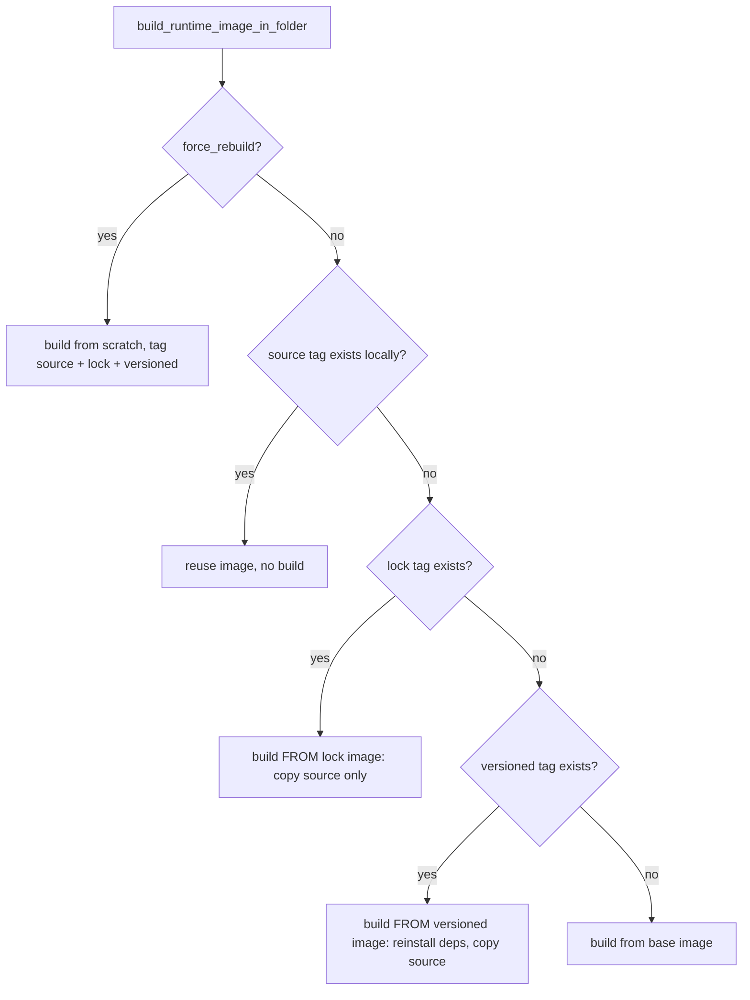

## Overview

Every sandbox runs from a runtime image: a base image of your choice with OpenHands' own code, its Python environment, a browser, a VS Code server and the bundled microagents added on top, so the [[Action Execution Server]] can start inside it. You either name a prebuilt image in `sandbox.runtime_container_image`, or leave it unset and OpenHands builds one from `sandbox.base_container_image` (by default `nikolaik/python-nodejs:python3.12-nodejs22`) before starting the sandbox.

Sources: [openhands/core/config/sandbox_config.py:55-58](repo://openhands/core/config/sandbox_config.py#L55-L58), [containers/runtime/README.md:1-12](repo://containers/runtime/README.md#L1-L12)

`build_runtime_image` in `openhands/runtime/utils/runtime_build.py` does the build. Its job is to build as little as possible: the image tags encode what went into the image, so an existing image is reused whenever the inputs match, and a partial match lets the build start from an image that already has most dependencies. The [[Runtime Implementations]] that build images (Docker and remote) call it with their own builder.

Sources: [openhands/runtime/utils/runtime_build.py:108-165](repo://openhands/runtime/utils/runtime_build.py#L108-L165), [openhands/runtime/impl/docker/docker_runtime.py:233-250](repo://openhands/runtime/impl/docker/docker_runtime.py#L233-L250)

## Inputs and settings

`DockerRuntime.maybe_build_runtime_container_image` passes the build its inputs from the config: the target `platform`, `runtime_extra_deps` (a shell command run in the image as the `openhands` user), `force_rebuild_runtime`, `runtime_extra_build_args` for the builder, and `enable_browser`, which controls whether Playwright's Chromium is installed.

Sources: [openhands/runtime/impl/docker/docker_runtime.py:233-250](repo://openhands/runtime/impl/docker/docker_runtime.py#L233-L250), [openhands/runtime/utils/runtime_templates/Dockerfile.j2:359-362](repo://openhands/runtime/utils/runtime_templates/Dockerfile.j2#L359-L362)

Images go to the repository `ghcr.io/all-hands-ai/runtime` unless `OH_RUNTIME_RUNTIME_IMAGE_REPO` names another.

Sources: [openhands/runtime/utils/runtime_build.py:27-28](repo://openhands/runtime/utils/runtime_build.py#L27-L28)

## Image tags

Three tags are computed for a build, from most to least specific:

Sources: [openhands/runtime/utils/runtime_build.py:168-187](repo://openhands/runtime/utils/runtime_build.py#L168-L187)

| Tag | Format | Changes when |
| --- | --- | --- |
| Source | `oh_v<version>_<lock hash>_<source hash>` | Any OpenHands source file changes |
| Lock | `oh_v<version>_<lock hash>` | The base image, `pyproject.toml`, `poetry.lock` or the browser setting changes |
| Versioned | `oh_v<version>_<base image name>` | The base image or the OpenHands version changes |

Sources: [openhands/runtime/utils/runtime_build.py:179-187](repo://openhands/runtime/utils/runtime_build.py#L179-L187)

The lock hash is an MD5 of the base image name, the browser flag (only when the browser is off) and the two dependency files, converted to base 36 and cut to 16 characters. The source hash is a directory hash of the `openhands` package, ignoring hidden directories and compiled files. The versioned tag is the base image name with `/` written as `_s_` and `:` as `_t_`, lower-cased and cut to its last 96 characters.

Sources: [openhands/runtime/utils/runtime_build.py:307-358](repo://openhands/runtime/utils/runtime_build.py#L307-L358)

`get_runtime_image_repo_and_tag` returns the repository for the build. If the base image is already in the runtime repository it is reused as-is; otherwise its name is folded into a tag of the form `oh_v<version>_image_<repo>_tag_<tag>`, hashing long names so the tag stays within Docker's 128-character limit.

Sources: [openhands/runtime/utils/runtime_build.py:65-105](repo://openhands/runtime/utils/runtime_build.py#L65-L105)

## Choosing how to build



Sources: [openhands/runtime/utils/runtime_build.py:168-255](repo://openhands/runtime/utils/runtime_build.py#L168-L255)

The three build modes are named in `BuildFromImageType`, whose comments rank them: `SCRATCH` is slowest and reuses nothing; `VERSIONED` reuses the latest image for the same base and OpenHands version, which already has most dependencies; `LOCK` is fastest and reuses an image with exactly the same dependency lock files. The source-tag check looks only at local images; the lock and versioned checks may pull from the registry.

Sources: [openhands/runtime/utils/runtime_build.py:21-24](repo://openhands/runtime/utils/runtime_build.py#L21-L24), [openhands/runtime/utils/runtime_build.py:214-237](repo://openhands/runtime/utils/runtime_build.py#L214-L237)

`_build_sandbox_image` applies the source and lock tags, plus the versioned tag for a scratch build, skipping any tag that already exists, and raises `AgentRuntimeBuildError` when the builder returns nothing. The function returns the source-tagged image name, which the runtime then starts.

Sources: [openhands/runtime/utils/runtime_build.py:361-389](repo://openhands/runtime/utils/runtime_build.py#L361-L389)

## The build folder

`prep_build_folder` assembles the Docker context in a temporary directory: the `openhands` package (without hidden directories, caches, compiled files and Markdown files), the top-level `microagents` folder, `pyproject.toml` and `poetry.lock`, and a `Dockerfile` rendered from `runtime_templates/Dockerfile.j2` with the base image, the build mode, the extra dependencies and the browser flag.

Sources: [openhands/runtime/utils/runtime_build.py:258-304](repo://openhands/runtime/utils/runtime_build.py#L258-L304), [openhands/runtime/utils/runtime_build.py:31-62](repo://openhands/runtime/utils/runtime_build.py#L31-L62)

The template starts `FROM` the chosen image and, for a scratch build, sets up the base system (with branches for Ubuntu-based images and SWE-bench images), installs micromamba, creates an `openhands` environment with Python and Poetry, installs the main and runtime dependency groups, and as root installs Playwright's Chromium into a shared `/opt/playwright-browsers` directory. Every mode then ensures the `openhands` user and directories exist, installs the openvscode-server release, replaces `/openhands/code/openhands` and `/openhands/code/microagents` with the fresh copies, reinstalls dependencies for a versioned build, and runs the extra dependencies command.

Sources: [openhands/runtime/utils/runtime_templates/Dockerfile.j2:1-64](repo://openhands/runtime/utils/runtime_templates/Dockerfile.j2#L1-L64), [openhands/runtime/utils/runtime_templates/Dockerfile.j2:149-266](repo://openhands/runtime/utils/runtime_templates/Dockerfile.j2#L149-L266), [openhands/runtime/utils/runtime_templates/Dockerfile.j2:268-372](repo://openhands/runtime/utils/runtime_templates/Dockerfile.j2#L268-L372)

This layering is why a lock-tag rebuild is fast: the dependency layers come from the reused image and only the source copy changes.

Sources: [openhands/runtime/utils/runtime_templates/Dockerfile.j2:336-356](repo://openhands/runtime/utils/runtime_templates/Dockerfile.j2#L336-L356)

## Builders

A `RuntimeBuilder` has two methods: `build(path, tags, platform, extra_build_args)`, returning the name of the built image (which may differ from the tags, for example with a registry prefix), and `image_exists(image_name, pull_from_repo)`.

Sources: [openhands/runtime/builder/base.py:1-42](repo://openhands/runtime/builder/base.py#L1-L42)

`DockerRuntimeBuilder` builds with `docker buildx build --load` (or `podman`), requiring Docker 18.09 or Podman 4.9 for BuildKit. When the `buildx` binary is missing, as inside the `openhands-app` container, it installs Docker's CLI packages first. It can use a local layer cache in `/tmp/.buildx-cache`, and streams the last lines of build output to the log. Its `image_exists` checks local images and, when allowed, tries to pull.

Sources: [openhands/runtime/builder/docker.py:17-125](repo://openhands/runtime/builder/docker.py#L17-L125), [openhands/runtime/builder/docker.py:129-160](repo://openhands/runtime/builder/docker.py#L129-L160), [openhands/runtime/builder/docker.py:251-300](repo://openhands/runtime/builder/docker.py#L251-L300)

`RemoteRuntimeBuilder` sends the build folder to the runtime API instead: it tars and base64-encodes the context, posts it to `/build` with the first tag as the target image (waiting and retrying on 429), then polls `/build_status` for up to 30 minutes until it reports success and returns the built image name, or raises on failure. `image_exists` asks `/image_exists`.

Sources: [openhands/runtime/builder/remote.py:22-100](repo://openhands/runtime/builder/remote.py#L22-L100), [openhands/runtime/builder/remote.py:101-149](repo://openhands/runtime/builder/remote.py#L101-L149)

## Building by hand

`runtime_build.py` can also be run as a script, which either builds the image directly or only prepares a build folder:

Sources: [openhands/runtime/utils/runtime_build.py:392-404](repo://openhands/runtime/utils/runtime_build.py#L392-L404)

```bash
poetry run python3 openhands/runtime/utils/runtime_build.py \
    --base_image nikolaik/python-nodejs:python3.12-nodejs22 \
    --build_folder containers/runtime
```

Sources: [containers/runtime/README.md:6-12](repo://containers/runtime/README.md#L6-L12)

With a build folder given, the script does not build: it prepares the Dockerfile and source in a temporary folder, copies them into the build folder, and appends `DOCKER_IMAGE_TAG` and `DOCKER_IMAGE_SOURCE_TAG` to its `config.sh`, which the comments say `containers/build.sh` then uses to build the image. Without one it builds the image in a temporary folder. Setting `SANDBOX_RUNTIME_CONTAINER_IMAGE` to a published image skips building entirely, as [[Quickstart]] shows.

Sources: [openhands/runtime/utils/runtime_build.py:392-476](repo://openhands/runtime/utils/runtime_build.py#L392-L476), [Development.md:157-162](repo://Development.md#L157-L162)
