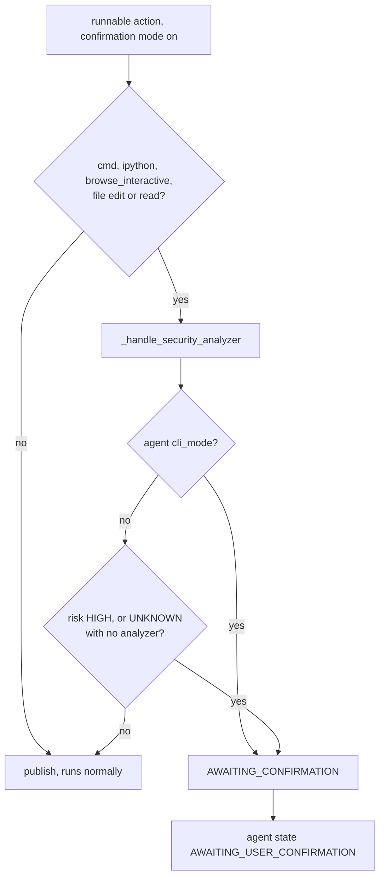

## Overview

An agent that runs shell commands can do damage, so OpenHands can stop and ask before a risky action runs. Two settings in the `[security]` section control this: `confirmation_mode`, which turns on asking, and `security_analyzer`, which names a component that rates each action's risk. With confirmation mode on, the [[Agent Controller]] rates each command, code cell, file read, file edit and interactive browser action before publishing it, and holds it for the user's approval when the rating calls for it.

Sources: [openhands/core/config/security_config.py:1-35](repo://openhands/core/config/security_config.py#L1-L35), [openhands/controller/agent_controller.py:919-973](repo://openhands/controller/agent_controller.py#L919-L973)

The security README explains the intent: given what coding agents can do, the analyzer framework monitors and analyzes actions for risks before they execute. Both settings can also be chosen per user in the web app's settings, which override the config file for that conversation.

Sources: [openhands/security/README.md:1-22](repo://openhands/security/README.md#L1-L22), [openhands/server/session/session.py:142-152](repo://openhands/server/session/session.py#L142-L152)

## Risk levels

Every runnable action carries a `security_risk` of type `ActionSecurityRisk`: `UNKNOWN` (-1), `LOW` (0), `MEDIUM` (1) or `HIGH` (2), `UNKNOWN` by default. Actions that can be held also carry a `confirmation_state`: `confirmed` (the default), `awaiting_confirmation` or `rejected`.

Sources: [openhands/events/action/action.py:8-18](repo://openhands/events/action/action.py#L8-L18), [openhands/events/action/commands.py:25-28](repo://openhands/events/action/commands.py#L25-L28)

The model rates its own actions. CodeAct's command, IPython, editor and browser tools take a required `security_risk` parameter with values `LOW`, `MEDIUM` or `HIGH`, and the system prompt includes a risk policy that defines them: in the sandbox, `LOW` is read-only, `MEDIUM` is edits and installs inside the container, and `HIGH` is data exfiltration or privilege breaks; with `cli_mode`, where the agent works on the user's machine, the bar is stricter (`MEDIUM` for project files and scripts, `HIGH` for system settings, global installs, `sudo` or deleting critical files). Sending sensitive data out of the environment is always `HIGH`. `function_calling.py` copies the model's rating onto the action.

Sources: [openhands/agenthub/codeact_agent/tools/security_utils.py:1-10](repo://openhands/agenthub/codeact_agent/tools/security_utils.py#L1-L10), [openhands/agenthub/codeact_agent/tools/bash.py:73-79](repo://openhands/agenthub/codeact_agent/tools/bash.py#L73-L79), [openhands/agenthub/codeact_agent/prompts/security_risk_assessment.j2:1-23](repo://openhands/agenthub/codeact_agent/prompts/security_risk_assessment.j2#L1-L23), [openhands/agenthub/codeact_agent/prompts/system_prompt.j2:69-71](repo://openhands/agenthub/codeact_agent/prompts/system_prompt.j2#L69-L71), [openhands/agenthub/codeact_agent/function_calling.py:59-70](repo://openhands/agenthub/codeact_agent/function_calling.py#L59-L70)

## The decision

Sources: [openhands/controller/agent_controller.py:919-973](repo://openhands/controller/agent_controller.py#L919-L973)

`_handle_security_analyzer` replaces the action's risk with the analyzer's rating when an analyzer is configured, falling back to `UNKNOWN` if the analyzer raises; with no analyzer the risk is set to `UNKNOWN`. In the web app, an action is then held when it is rated `HIGH`, or when it is `UNKNOWN` and there is no analyzer, so without an analyzer confirmation mode asks about every such action. In CLI mode every one of these actions is held, because the terminal app decides itself what to ask about; the code marks this as a special case to refactor.

Sources: [openhands/controller/agent_controller.py:204-242](repo://openhands/controller/agent_controller.py#L204-L242), [openhands/controller/agent_controller.py:930-960](repo://openhands/controller/agent_controller.py#L930-L960)

## Confirming or rejecting

A held action is published with `confirmation_state = awaiting_confirmation` and the agent moves to `AWAITING_USER_CONFIRMATION`. The runtime sees it but returns a null observation without running it, so the action stays pending in the controller and no step happens.

Sources: [openhands/controller/agent_controller.py:960-973](repo://openhands/controller/agent_controller.py#L960-L973), [openhands/runtime/base.py:951-956](repo://openhands/runtime/base.py#L951-L956)

The user answers by setting the agent state to `USER_CONFIRMED` or `USER_REJECTED` (a `ChangeAgentStateAction` from the UI). `set_agent_state_to` then clears the action's thought, sets its `confirmation_state` to `confirmed` or `rejected`, clears its id and publishes it again. A confirmed action now runs; a rejected one gets a `UserRejectObservation` ("Action has been rejected by the user! Waiting for further user input."). When that observation arrives, the controller moves to `RUNNING` after a confirmation or `AWAITING_USER_INPUT` after a rejection.

Sources: [openhands/controller/agent_controller.py:658-669](repo://openhands/controller/agent_controller.py#L658-L669), [openhands/controller/agent_controller.py:537-547](repo://openhands/controller/agent_controller.py#L537-L547), [openhands/runtime/base.py:964-970](repo://openhands/runtime/base.py#L964-L970)

## The SecurityAnalyzer interface

`SecurityAnalyzer` has three methods: `security_risk(action)`, which returns an `ActionSecurityRisk`; `handle_api_request(request)`, for analyzer-specific HTTP endpoints; and `close()`. The runtime creates the configured analyzer when it is constructed, looking the name up in `openhands.security.options.SecurityAnalyzers`, and the controller receives it from the runtime.

Sources: [openhands/security/analyzer.py:1-29](repo://openhands/security/analyzer.py#L1-L29), [openhands/security/options.py:1-8](repo://openhands/security/options.py#L1-L8), [openhands/runtime/base.py:196-204](repo://openhands/runtime/base.py#L196-L204), [openhands/core/setup.py:229-241](repo://openhands/core/setup.py#L229-L241)

The analyzer's API is reachable under `/api/conversations/{id}/security/...`: the route forwards any method to `handle_api_request`, or answers 404 when the conversation has no analyzer. The README suggests using it for an analyzer's own settings, and warns that these endpoints must not grant more than the core logic allows.

Sources: [openhands/server/routes/security.py:14-42](repo://openhands/server/routes/security.py#L14-L42), [openhands/security/README.md:43-52](repo://openhands/security/README.md#L43-L52)

| Name | Class | How it rates |
| --- | --- | --- |
| `llm` | `LLMRiskAnalyzer` | Trusts the model's own `security_risk`; anything unrecognised is `UNKNOWN` |
| `invariant` | `InvariantAnalyzer` | Checks the action trace against Invariant policies |

Sources: [openhands/security/options.py:1-8](repo://openhands/security/options.py#L1-L8)

## LLM risk analyzer

`LLMRiskAnalyzer`, the README's default, returns the action's `security_risk` when it is `LOW`, `MEDIUM` or `HIGH` and `UNKNOWN` otherwise, logging unrecognised values. It needs no service, and its API endpoint just answers `ok`. Combined with the decision above, it means only actions the model itself rates `HIGH` need confirmation.

Sources: [openhands/security/llm/analyzer.py:1-42](repo://openhands/security/llm/analyzer.py#L1-L42), [openhands/security/README.md:54-68](repo://openhands/security/README.md#L54-L68)

## Invariant analyzer

`InvariantAnalyzer` uses the Invariant analyzer service, which it runs as a Docker container named `openhands-invariant-server` from `ghcr.io/invariantlabs-ai/server:openhands`, starting or reusing it and waiting for it to come up. Docker must be running; otherwise construction fails with a message to start Docker or disable the analyzer. It loads a policy (the server's template by default) into an Invariant monitor.

Sources: [openhands/security/invariant/analyzer.py:15-90](repo://openhands/security/invariant/analyzer.py#L15-L90)

For each action it converts the action into Invariant trace elements, appends them to the conversation's trace, and asks the monitor to check the new elements against the policy. Each policy violation names a risk in its message as `[risk=high|medium|low]`; the analyzer returns the highest one found, `LOW` when nothing matched, or `UNKNOWN` if the check failed.

Sources: [openhands/security/invariant/analyzer.py:92-125](repo://openhands/security/invariant/analyzer.py#L92-L125), [openhands/security/invariant/parser.py:1-102](repo://openhands/security/invariant/parser.py#L1-L102)

The bundled default policy flags secrets in bash commands and Semgrep findings in Python cells or bash commands, all at medium risk. The README lists what Invariant can detect more broadly: secret leaks, security issues in Python code, malicious bash commands, and dangerous tasks and harmful content for the browsing agent.

Sources: [openhands/security/invariant/policies.py:1-19](repo://openhands/security/invariant/policies.py#L1-L19), [openhands/security/README.md:70-86](repo://openhands/security/README.md#L70-L86)

## Writing an analyzer

The README's recipe: create a submodule of `openhands/security` with a class inheriting `SecurityAnalyzer`, optionally define endpoints under the security route, add it to `SecurityAnalyzers` in `options.py` so the frontend lists it, and optionally add a settings modal in the frontend.

Sources: [openhands/security/README.md:46-52](repo://openhands/security/README.md#L46-L52)
