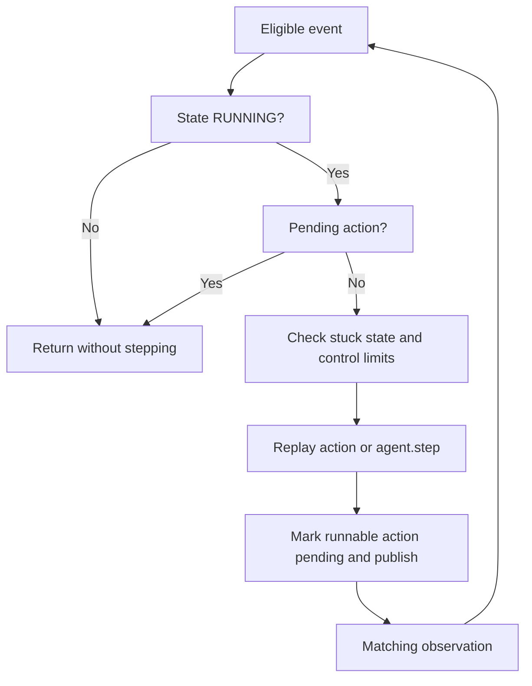

## Overview

`AgentController` turns events into progress on a task. It owns the current execution state, pending action, control limits and optional delegate. `CodeActAgent` supplies the next action by converting conversation context into a model call. Execution itself belongs to [[Runtime and Workspace]], and event identity and delivery belong to [[Events and Persistence]]. The controller joins those systems by deciding when an action may be requested and when its result permits another step.

Sources: [openhands/controller/agent_controller.py:467-517](repo://openhands/controller/agent_controller.py#L467-L517), [openhands/controller/agent_controller.py:821-870](repo://openhands/controller/agent_controller.py#L821-L870), [openhands/controller/agent_controller.py:919-973](repo://openhands/controller/agent_controller.py#L919-L973), [openhands/agenthub/codeact_agent/codeact_agent.py:191-224](repo://openhands/agenthub/codeact_agent/codeact_agent.py#L191-L224)

## Events that advance the task

The controller ignores hidden events, records other events through its state tracker and dispatches them to action or observation handling. It then applies `should_step`. User messages, eligible agent messages, delegation and condensation actions can trigger a step. Most observations can also trigger one, while state-change observations and most null observations cannot. An active delegate suppresses the parent's normal stepping policy.

Sources: [openhands/controller/agent_controller.py:392-431](repo://openhands/controller/agent_controller.py#L392-L431), [openhands/controller/agent_controller.py:467-485](repo://openhands/controller/agent_controller.py#L467-L485)

A user message first creates a pending recall action. The first user message requests workspace context; later messages request knowledge matching the message content. This means the apparent user-message trigger still waits for memory feedback before model execution. [[Memory and Microagents]] explains the recall response and context construction. An agent message with `wait_for_response` changes the state to `AWAITING_USER_INPUT`.

Sources: [openhands/controller/agent_controller.py:549-588](repo://openhands/controller/agent_controller.py#L549-L588)

## Step gates and pending actions

`_step` returns immediately unless the state is `RUNNING` and no action is pending. Before calling the agent, it synchronizes spending, checks whether the agent is stuck and runs the state tracker's control flags. A limit exception is passed to controller error handling. In replay mode it takes the next replay action instead of asking the agent for a model-generated one.

Sources: [openhands/controller/agent_controller.py:821-870](repo://openhands/controller/agent_controller.py#L821-L870)

Runnable actions become pending before publication. When an observation's cause matches that pending action, the controller clears it unless user confirmation is still outstanding. Confirmed actions return the controller to `RUNNING`; rejected actions lead to `AWAITING_USER_INPUT`. Pending actions record their start time. A pending action older than 60 seconds produces a log message, but the getter deliberately does not clear it or synthesize a timeout result.

Sources: [openhands/controller/agent_controller.py:536-546](repo://openhands/controller/agent_controller.py#L536-L546), [openhands/controller/agent_controller.py:960-973](repo://openhands/controller/agent_controller.py#L960-L973), [openhands/controller/agent_controller.py:979-1031](repo://openhands/controller/agent_controller.py#L979-L1031)

Sources: [openhands/controller/agent_controller.py:536-546](repo://openhands/controller/agent_controller.py#L536-L546), [openhands/controller/agent_controller.py:821-887](repo://openhands/controller/agent_controller.py#L821-L887), [openhands/controller/agent_controller.py:960-973](repo://openhands/controller/agent_controller.py#L960-L973)

## CodeAct action generation

CodeAct drains its existing pending-action queue before making another completion. A last user message equal to `/exit` yields a finish action. Otherwise it asks its condenser for a history view; if the condenser returns a condensation action, that action is returned immediately so the next step can use the changed view. Model-message construction and history handling are owned by [[Memory and Microagents]].

Sources: [openhands/agenthub/codeact_agent/codeact_agent.py:182-208](repo://openhands/agenthub/codeact_agent/codeact_agent.py#L182-L208)

The completion includes messages, checked tool definitions and task metadata. CodeAct converts the response to actions, appends them to its deque and returns one action. Its tool list follows agent capability settings: commands, thinking, finishing, condensation requests, browsing, Jupyter, task tracking and one selected editor. The LLM editor takes precedence over the standard editor. [[Model Calls and Routing]] covers the completion service behind this call.

Sources: [openhands/agenthub/codeact_agent/codeact_agent.py:125-152](repo://openhands/agenthub/codeact_agent/codeact_agent.py#L125-L152), [openhands/agenthub/codeact_agent/codeact_agent.py:207-224](repo://openhands/agenthub/codeact_agent/codeact_agent.py#L207-L224)

## Confirmation and state transitions

With confirmation mode enabled, selected runnable action classes enter security analysis. High-risk actions require confirmation in the non-CLI branch; unknown risk also prompts when no analyzer exists. CLI mode marks these actions for its own confirmation handling. The controller publishes `AWAITING_USER_CONFIRMATION` before the action, and the runtime's confirmation gate prevents execution while the action is awaiting approval.

Sources: [openhands/controller/agent_controller.py:919-973](repo://openhands/controller/agent_controller.py#L919-L973), [openhands/runtime/base.py:951-970](repo://openhands/runtime/base.py#L951-L970)

Confirmation or rejection updates the pending action, clears its ID and republishes it with the new confirmation status. State transitions emit `AgentStateChangedObservation` and save state so crashes do not discard the transition. Finish and reject actions copy their outputs into state and select their terminal state. [[Configuration]] describes the agent and security settings feeding these branches.

Sources: [openhands/controller/agent_controller.py:512-517](repo://openhands/controller/agent_controller.py#L512-L517), [openhands/controller/agent_controller.py:631-683](repo://openhands/controller/agent_controller.py#L631-L683)

## Failure and delegation

Malformed or missing model actions and tool-validation errors become `ErrorObservation` events. Recognized context-window errors emit `CondensationRequestAction` when history truncation is enabled; otherwise they raise a context-limit error. The outer step wrapper reports other failures through `_react_to_exception`, which stores the reason, selects an appropriate runtime status and generally changes the agent to `ERROR`. Its rate-limit branch can use `RATE_LIMITED` while retries remain.

Sources: [openhands/controller/agent_controller.py:302-356](repo://openhands/controller/agent_controller.py#L302-L356), [openhands/controller/agent_controller.py:361-390](repo://openhands/controller/agent_controller.py#L361-L390), [openhands/controller/agent_controller.py:869-917](repo://openhands/controller/agent_controller.py#L869-L917)

Delegation creates another agent and controller on the same event stream. Parent and child share iteration and budget flags and metrics; the child begins history after the current stream position. A delegate does not subscribe directly: the parent forwards events while it is active. When the delegate finishes or errors, the parent ends it and resumes its own handling. This is an application execution feature, with resource accounting shared across the task.

Sources: [openhands/controller/agent_controller.py:433-465](repo://openhands/controller/agent_controller.py#L433-L465), [openhands/controller/agent_controller.py:709-752](repo://openhands/controller/agent_controller.py#L709-L752), [openhands/controller/agent_controller.py:754-780](repo://openhands/controller/agent_controller.py#L754-L780)
