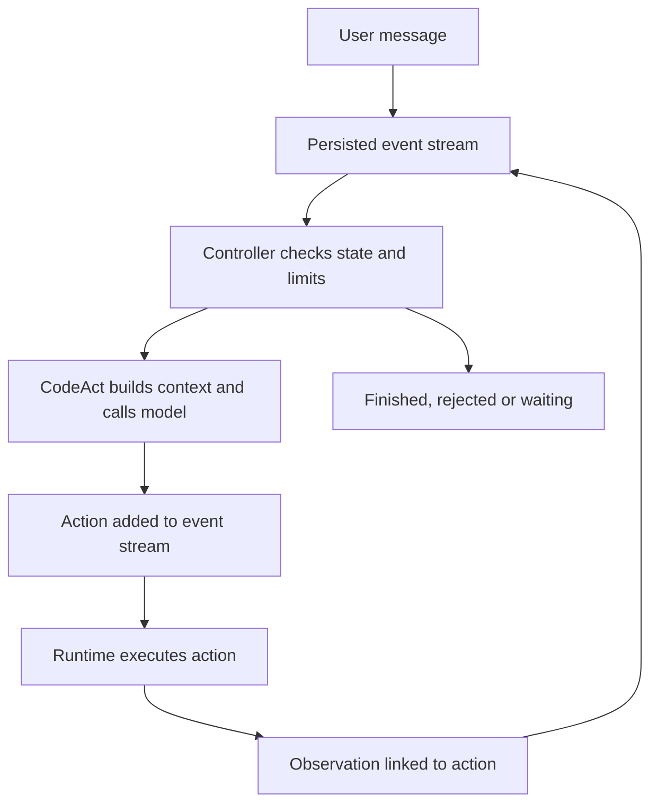

## Overview

OpenHands runs software development tasks with an agent that can converse, execute commands, edit files and interact with tools. Its central execution path separates the agent's next-action decision from the runtime that carries out that action. The headless entry point assembles an agent, runtime, memory and controller, then adds the user's task to their shared event stream. This makes a conversation a sequence of recorded actions and observations rather than a single model request.

Sources: [openhands/core/main.py:97-167](repo://openhands/core/main.py#L97-L167), [openhands/core/main.py:177-216](repo://openhands/core/main.py#L177-L216), [openhands/agenthub/codeact_agent/codeact_agent.py:160-180](repo://openhands/agenthub/codeact_agent/codeact_agent.py#L160-L180)

## System map

| Area | What it does | Documentation |
| --- | --- | --- |
| Local launch | Builds dependencies and starts the application | [[Quickstart]] |
| Settings | Supplies model and application values for startup | [[Configuration]] |
| Event stream | Assigns event IDs, persists events and delivers callbacks | [[Events and Persistence]] |
| Browser sessions | Replays conversation events and joins a live agent session | [[Conversations and Web Interface]] |
| Controller and CodeAct | Advances the task, chooses actions and waits for execution feedback | [[Agent Control Loop]] |
| Model registry | Creates model services and selects the agent's router | [[Model Calls and Routing]] |
| Runtime | Connects an execution backend and prepares the repository | [[Runtime and Workspace]] |
| Memory | Supplies workspace knowledge and reduced conversation history | [[Memory and Microagents]] |
| MCP | Adds external tools to the agent before execution | [[MCP Tools and Integrations]] |
| Resolver | Selects issue or pull request handlers for repository providers | [[Issue Resolution]] |
| Benchmarks | Runs agent inference against benchmark tasks | [[Evaluation]] |
| Contributor workflow | Installs dependencies and runs project checks | [[Development and Testing]] |

Sources: [Makefile:24-45](repo://Makefile#L24-L45), [Development.md:60-76](repo://Development.md#L60-L76), [openhands/events/stream.py:163-203](repo://openhands/events/stream.py#L163-L203), [openhands/server/listen_socket.py:78-129](repo://openhands/server/listen_socket.py#L78-L129), [openhands/controller/agent_controller.py:821-887](repo://openhands/controller/agent_controller.py#L821-L887), [openhands/llm/llm_registry.py:45-127](repo://openhands/llm/llm_registry.py#L45-L127), [openhands/core/main.py:107-155](repo://openhands/core/main.py#L107-L155), [openhands/agenthub/codeact_agent/codeact_agent.py:191-218](repo://openhands/agenthub/codeact_agent/codeact_agent.py#L191-L218), [openhands/resolver/issue_handler_factory.py:36-104](repo://openhands/resolver/issue_handler_factory.py#L36-L104), [evaluation/README.md:5-23](repo://evaluation/README.md#L5-L23), [Makefile:185-197](repo://Makefile#L185-L197)

## A task through the system

Sources: [openhands/core/main.py:177-216](repo://openhands/core/main.py#L177-L216), [openhands/controller/agent_controller.py:467-517](repo://openhands/controller/agent_controller.py#L467-L517), [openhands/controller/agent_controller.py:821-887](repo://openhands/controller/agent_controller.py#L821-L887), [openhands/controller/agent_controller.py:960-973](repo://openhands/controller/agent_controller.py#L960-L973), [openhands/agenthub/codeact_agent/codeact_agent.py:191-224](repo://openhands/agenthub/codeact_agent/codeact_agent.py#L191-L224), [openhands/runtime/base.py:361-399](repo://openhands/runtime/base.py#L361-L399)

The first step is application assembly: [[Quickstart]] reaches the entry points, while [[Configuration]] explains the values used to create the agent and runtime. In headless mode, an existing runtime or memory object may be supplied; otherwise `run_controller` creates them and connects the runtime before constructing the controller. Repository initialization happens before memory is loaded, so repository context can be available when the task starts.

Sources: [openhands/core/main.py:51-61](repo://openhands/core/main.py#L51-L61), [openhands/core/main.py:97-167](repo://openhands/core/main.py#L97-L167)

The second step is event delivery. [[Events and Persistence]] follows the stream from serialization and secret replacement through storage to queued callbacks. For a browser, [[Conversations and Web Interface]] adds replay from the last known event ID and connects the client to a conversation. Both paths ultimately deliver user actions into the task machinery.

Sources: [openhands/events/stream.py:163-203](repo://openhands/events/stream.py#L163-L203), [openhands/server/listen_socket.py:78-145](repo://openhands/server/listen_socket.py#L78-L145), [openhands/server/session/session.py:353-369](repo://openhands/server/session/session.py#L353-L369)

The third step is deciding what to do. [[Agent Control Loop]] covers state and pending-action checks; [[Memory and Microagents]] explains the history view CodeAct consumes. CodeAct converts that view to model messages and calls its LLM, whose selection belongs to [[Model Calls and Routing]]. A completion can yield multiple actions, which CodeAct queues and returns one at a time.

Sources: [openhands/controller/agent_controller.py:821-870](repo://openhands/controller/agent_controller.py#L821-L870), [openhands/agenthub/codeact_agent/codeact_agent.py:182-224](repo://openhands/agenthub/codeact_agent/codeact_agent.py#L182-L224), [openhands/agenthub/codeact_agent/codeact_agent.py:89-96](repo://openhands/agenthub/codeact_agent/codeact_agent.py#L89-L96)

The fourth step is execution. [[Runtime and Workspace]] follows the action into the selected backend, and [[MCP Tools and Integrations]] follows the special MCP branch. The runtime puts the originating action ID into the observation's `cause`; the controller uses that relationship to release a pending action. Execution feedback therefore determines when the next model step can proceed.

Sources: [openhands/runtime/base.py:361-399](repo://openhands/runtime/base.py#L361-L399), [openhands/controller/agent_controller.py:536-546](repo://openhands/controller/agent_controller.py#L536-L546)

## Design decisions across systems

Persistence precedes callback delivery: `add_event` writes the serialized event before enqueuing it. Cached event pages exist because reading individual events becomes slow as history grows, as the cache method's comment explains. Each callback gets a single-worker executor, and the dispatcher submits events to it in order; separate subscribers can still progress independently. These details matter when reasoning about replay, observation timing and concurrent listeners.

Sources: [openhands/events/stream.py:130-148](repo://openhands/events/stream.py#L130-L148), [openhands/events/stream.py:186-213](repo://openhands/events/stream.py#L186-L213), [openhands/events/stream.py:254-275](repo://openhands/events/stream.py#L254-L275)

Execution backends share a `Runtime` interface so setup can select an implementation by configuration and supply the same event stream, session ID and agent plugin requirements. The built-in registry includes Docker, remote, local, Kubernetes and CLI backends; optional third-party runtimes are discovered separately. [[Runtime and Workspace]] owns the backend catalogue and connection behavior.

Sources: [openhands/core/setup.py:61-89](repo://openhands/core/setup.py#L61-L89), [openhands/runtime/__init__.py:14-87](repo://openhands/runtime/__init__.py#L14-L87)

Agent execution is bounded at the controller, where each step synchronizes spending, checks stuck behavior and applies control flags before calling the agent. Runnable actions become pending until feedback arrives. Model context limits have their own recovery path: when configured, a recognized context-window failure emits a condensation request instead of immediately ending the conversation.

Sources: [openhands/controller/agent_controller.py:821-860](repo://openhands/controller/agent_controller.py#L821-L860), [openhands/controller/agent_controller.py:888-960](repo://openhands/controller/agent_controller.py#L888-L960)

Automation reuses these task concepts through separate entry points. [[Issue Resolution]] handles provider-specific issue and review inputs, while [[Evaluation]] runs benchmark inference. Contributor build and validation commands are described in [[Development and Testing]], keeping application mechanics separate from the workflow used to change them.

Sources: [openhands/resolver/issue_handler_factory.py:36-104](repo://openhands/resolver/issue_handler_factory.py#L36-L104), [evaluation/README.md:5-23](repo://evaluation/README.md#L5-L23), [Makefile:24-45](repo://Makefile#L24-L45), [Makefile:185-197](repo://Makefile#L185-L197)
