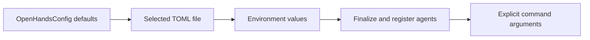

## Overview

OpenHands configuration connects launch-time choices to agents, model services, execution backends and storage. `OpenHandsConfig` holds named LLM and agent configurations alongside sandbox, security, MCP and application settings. The default runtime is Docker and the default file store is local storage under `~/.openhands`. [[Quickstart]] covers creating a configuration and starting a task; this page explains how the values are selected and transformed.

Sources: [openhands/core/config/openhands_config.py:65-80](repo://openhands/core/config/openhands_config.py#L65-L80), [openhands/core/config/openhands_config.py:109-118](repo://openhands/core/config/openhands_config.py#L109-L118)

## Load order and command overrides

`load_openhands_config` constructs defaults, loads the selected TOML file, applies the process environment, finalizes derived values and registers custom agents. Consequently, an environment setting can replace the corresponding TOML setting. The module also calls `load_dotenv` at import. Its file loader silently returns for a missing configuration file, while malformed TOML logs a warning and leaves TOML values unapplied.

Sources: [openhands/core/config/utils.py:36-37](repo://openhands/core/config/utils.py#L36-L37), [openhands/core/config/utils.py:138-158](repo://openhands/core/config/utils.py#L138-L158), [openhands/core/config/utils.py:819-836](repo://openhands/core/config/utils.py#L819-L836)

The CLI and headless wrapper then apply explicit command arguments. A named `--llm-config` becomes the default LLM group; if absent from the loaded configuration, it is looked up in the selected file and then the user's `~/.openhands/config.toml`. A missing requested group raises `ValueError`. Agent class, iteration limit, task budget and selected repository arguments override their corresponding loaded values when provided.

Sources: [openhands/core/config/utils.py:849-904](repo://openhands/core/config/utils.py#L849-L904)

Sources: [openhands/core/config/utils.py:828-836](repo://openhands/core/config/utils.py#L828-L836), [openhands/core/config/utils.py:849-904](repo://openhands/core/config/utils.py#L849-L904)

## Sections and named groups

The `[core]` section sets attributes on `OpenHandsConfig`; unknown core keys produce warnings. Agent and LLM sections are parsed into mappings and installed with `set_agent_config` and `set_llm_config`. The default group names are `agent` and `llm`. Looking up an unknown nondefault LLM name through `get_llm_config` warns and returns the default group, which is different from explicitly selecting a missing group through the command wrapper.

Sources: [openhands/core/config/utils.py:160-211](repo://openhands/core/config/utils.py#L160-L211), [openhands/core/config/openhands_config.py:131-155](repo://openhands/core/config/openhands_config.py#L131-L155), [openhands/core/config/utils.py:879-885](repo://openhands/core/config/utils.py#L879-L885)

An agent can name its LLM group through `llm_config`; without that value the application uses `llm`. Agent subsection parsing treats non-dictionary values as base settings and dictionary-valued entries as custom configurations overriding that base. This lets shared agent defaults coexist with named variants. [[Model Calls and Routing]] follows these choices into live model instances and routing.

Sources: [openhands/core/config/openhands_config.py:157-169](repo://openhands/core/config/openhands_config.py#L157-L169), [openhands/core/config/agent_config.py:79-118](repo://openhands/core/config/agent_config.py#L79-L118)

Sandbox, security and MCP sections are parsed through their configuration types. Model routing is attached to the default agent and populated with LLM groups whose `for_routing` field is true. Parsing errors are handled per section; sandbox and MCP `ValueError` branches raise section-specific errors. Keep protocol connection details with [[MCP Tools and Integrations]] and execution behavior with [[Runtime and Workspace]].

Sources: [openhands/core/config/utils.py:214-286](repo://openhands/core/config/utils.py#L214-L286)

## Environment value conversion

Environment names are uppercase field names, with prefixes for nested models. The loader explicitly applies `LLM_` and `AGENT_` values to default LLM and agent groups. Examples implemented by this mechanism include `LLM_BASE_URL` and `SANDBOX_TIMEOUT`. Empty values are skipped, so an empty string does not clear a value already loaded from TOML.

Sources: [openhands/core/config/utils.py:65-86](repo://openhands/core/config/utils.py#L65-L86), [openhands/core/config/utils.py:127-135](repo://openhands/core/config/utils.py#L127-L135)

Boolean conversion accepts case-insensitive `true` and `1` as true. Lists and dictionaries are parsed with `literal_eval`, including lists of configuration models; ordinary scalar fields use their annotated type. A conversion failure logs an error rather than applying that field. This is why a dictionary-valued environment option must use a valid literal representation instead of an arbitrary comma-separated string.

Sources: [openhands/core/config/utils.py:88-125](repo://openhands/core/config/utils.py#L88-L125)

## Workspace mounts and finalization

`sandbox.volumes` accepts comma-separated `host_path:container_path[:mode]` mounts. Finalization detects an explicit `/workspace` target, resolves its host path to an absolute path and updates the legacy workspace fields. When the volumes option contains no `/workspace` target, it clears the host workspace fields so unrelated mounts do not accidentally become the workspace. Mounts with fewer than two or more than three colon-separated parts raise an error.

Sources: [openhands/core/config/sandbox_config.py:91-94](repo://openhands/core/config/sandbox_config.py#L91-L94), [openhands/core/config/utils.py:377-424](repo://openhands/core/config/utils.py#L377-L424)

The older `workspace_base` and `workspace_mount_path` options remain supported but emit a deprecation warning directing users to `SANDBOX_VOLUMES`. Finalization also normalizes completion-log paths, creates the cache directory and obtains a persisted JWT secret if none was supplied. For the CLI runtime it disables Jupyter and browsing on configured agents because those capabilities are unsupported there.

Sources: [openhands/core/config/utils.py:379-384](repo://openhands/core/config/utils.py#L379-L384), [openhands/core/config/utils.py:426-470](repo://openhands/core/config/utils.py#L426-L470)

## Agent capabilities and browser settings

Agent settings independently enable the editor, command execution, Jupyter, thinking, finishing and MCP tools. History truncation is enabled by default. The agent's default conversation-window condenser exists so a context-limit condensation request has a handler; [[Memory and Microagents]] explains that recovery mechanism. Plan mode also changes the default system prompt to the long-horizon prompt unless a custom prompt filename is selected.

Sources: [openhands/core/config/agent_config.py:27-77](repo://openhands/core/config/agent_config.py#L27-L77)

Browser settings use `/api/settings` and a settings store. The read response reports whether keys exist, then clears the returned LLM, search and sandbox key values. When updating settings, omitted LLM API key, model, base URL and search key values are preserved from the existing settings. This storage path is relevant when changing a browser conversation's model; [[Conversations and Web Interface]] follows settings into session initialization.

Sources: [openhands/server/routes/settings.py:65-76](repo://openhands/server/routes/settings.py#L65-L76), [openhands/server/routes/settings.py:108-126](repo://openhands/server/routes/settings.py#L108-L126), [openhands/server/routes/settings.py:133-151](repo://openhands/server/routes/settings.py#L133-L151)
