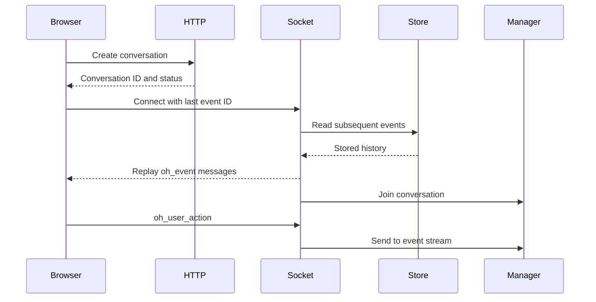

## Overview

The web application uses HTTP to create and manage conversations and Socket.IO to exchange live actions and observations. A conversation ID ties the browser connection to an agent session and its stored history. The ASGI entry point combines the FastAPI application with Socket.IO, optionally mounts the built frontend and adds CORS, cache-control and rate-limit middleware. [[Quickstart]] explains launching these interfaces from the source checkout.

Sources: [openhands/server/listen.py:5-27](repo://openhands/server/listen.py#L5-L27), [openhands/server/routes/manage_conversations.py:189-201](repo://openhands/server/routes/manage_conversations.py#L189-L201), [openhands/server/listen_socket.py:143-158](repo://openhands/server/listen_socket.py#L143-L158)

## Create a conversation

`POST /api/conversations` accepts an `InitSessionRequest` with repository, provider, branch, initial message, images, replay input, conversation instructions and MCP configuration. Extra fields are forbidden. Normally the server generates the conversation ID; supplying one is exposed only when `ALLOW_SET_CONVERSATION_ID` enables that request field. The creation handler returns the ID and conversation status for the client to use when connecting.

Sources: [openhands/server/routes/manage_conversations.py:78-78](repo://openhands/server/routes/manage_conversations.py#L78-L78), [openhands/server/routes/manage_conversations.py:160-175](repo://openhands/server/routes/manage_conversations.py#L160-L175), [openhands/server/routes/manage_conversations.py:248-269](repo://openhands/server/routes/manage_conversations.py#L248-L269)

Creation selects a trigger for a normal GUI task, suggested task, microagent-management request or bearer-authenticated request. A bearer request without an initial message receives HTTP 400. When a repository is supplied, a provider handler verifies it before `create_new_conversation` receives the repository, branch, secrets, initial message and instructions. Missing settings and LLM authentication failures also return structured HTTP 400 responses.

Sources: [openhands/server/routes/manage_conversations.py:213-288](repo://openhands/server/routes/manage_conversations.py#L213-L288)

## Connect and replay history

The frontend's `WsClientProvider` creates its socket query from the conversation ID, provider selection, session API key and last received event ID, defaulting the latter to `-1`. It can derive a socket endpoint from a conversation-specific URL or use the configured backend base URL and current host. Changing the conversation ID resets the event collections and connection status so the next conversation starts with its own replay position.

Sources: [frontend/src/context/ws-client-provider.tsx:286-333](repo://frontend/src/context/ws-client-provider.tsx#L286-L333)

On connect, the server parses the last event ID, rejects a missing conversation ID or invalid session key and invokes the conversation validator with cookies and the authorization header. It opens the conversation's event store, replays from `latest_event_id + 1` and filters null events and recall actions. State-change observations are held back so the latest state is emitted after other replayed events. [[Events and Persistence]] owns the stored-event format and reading behavior.

Sources: [openhands/server/listen_socket.py:35-114](repo://openhands/server/listen_socket.py#L35-L114)

Sources: [openhands/server/routes/manage_conversations.py:248-269](repo://openhands/server/routes/manage_conversations.py#L248-L269), [openhands/server/listen_socket.py:78-145](repo://openhands/server/listen_socket.py#L78-L145)

## Join the live session

After replay, the socket handler obtains conversation settings and asks the conversation manager to join. In the standalone manager, joining puts the connection into the conversation's Socket.IO room, records the connection-to-session mapping and starts the agent loop if needed. This separates a browser connection from the agent session it observes: the mapping supplies the destination when that connection later sends a user action.

Sources: [openhands/server/listen_socket.py:120-132](repo://openhands/server/listen_socket.py#L120-L132), [openhands/server/conversation_manager/standalone_conversation_manager.py:151-165](repo://openhands/server/conversation_manager/standalone_conversation_manager.py#L151-L165), [openhands/server/conversation_manager/standalone_conversation_manager.py:369-380](repo://openhands/server/conversation_manager/standalone_conversation_manager.py#L369-L380)

`AgentSession.start` refuses a second start when a controller or runtime already exists. It creates the runtime, registers provider and custom secrets with the event stream and creates memory. MCP tools must be added before controller construction so the system-message event includes them. The controller is then created or initialized for trajectory replay. [[Configuration]], [[Memory and Microagents]] and [[MCP Tools and Integrations]] explain those inputs at their owning boundaries.

Sources: [openhands/server/session/agent_session.py:117-168](repo://openhands/server/session/agent_session.py#L117-L168), [openhands/server/session/agent_session.py:170-189](repo://openhands/server/session/agent_session.py#L170-L189)

With an initial message, startup publishes that message and a change to `RUNNING`; without one it publishes a change to `AWAITING_USER_INPUT`. Startup records success, duration and whether state was restored. [[Agent Control Loop]] explains how these state changes affect stepping, including waiting for a user reply or confirmation.

Sources: [openhands/server/session/agent_session.py:191-222](repo://openhands/server/session/agent_session.py#L191-L222)

## Send actions and receive observations

The frontend emits `oh_user_action`; the server forwards it through the manager to session dispatch. Dispatch deserializes the payload and checks image-bearing messages against the active model's vision settings before adding the event as a user event. A disabled or unsupported vision configuration sends an error and returns before publishing the message. The older `oh_action` event remains as a compatibility alias.

Sources: [frontend/src/context/ws-client-provider.tsx:151-157](repo://frontend/src/context/ws-client-provider.tsx#L151-L157), [openhands/server/listen_socket.py:143-152](repo://openhands/server/listen_socket.py#L143-L152), [openhands/server/conversation_manager/standalone_conversation_manager.py:369-380](repo://openhands/server/conversation_manager/standalone_conversation_manager.py#L369-L380), [openhands/server/session/session.py:353-369](repo://openhands/server/session/session.py#L353-L369)

Outbound session delivery filters null events, sends agent and user events and adapts selected environment observations to the UI's agent source. Messages enter a publish queue and are emitted as `oh_event` to the conversation room. A brief initialization wait allows the socket room to exist before the first publication; a runtime send error marks the session as no longer alive.

Sources: [openhands/server/session/session.py:314-351](repo://openhands/server/session/session.py#L314-L351), [openhands/server/session/session.py:371-416](repo://openhands/server/session/session.py#L371-L416)

## Disconnect and close

The frontend records the last numeric event ID and updates its reconnect query on disconnect. The standalone manager removes that connection's mapping on disconnect; explicit session close is a separate operation. `AgentSession.close` marks the session closed, closes the stream, saves and closes the controller and schedules runtime cleanup. This lifecycle is distinct from replaying stored events to a newly connected browser.

Sources: [frontend/src/context/ws-client-provider.tsx:252-268](repo://frontend/src/context/ws-client-provider.tsx#L252-L268), [openhands/server/conversation_manager/standalone_conversation_manager.py:397-413](repo://openhands/server/conversation_manager/standalone_conversation_manager.py#L397-L413), [openhands/server/session/agent_session.py:224-245](repo://openhands/server/session/agent_session.py#L224-L245)
