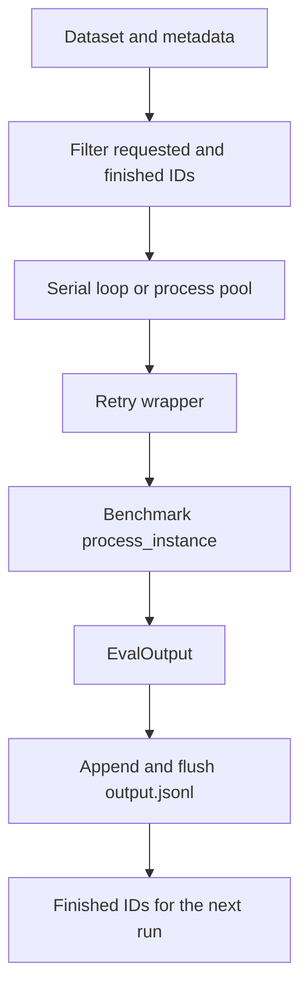

## Overview

Evaluation runs agent tasks against datasets and records reproducible per-instance results. Benchmark entry points provide task instructions, environment setup and result extraction; shared utilities provide metadata, dataset selection, retries, worker scheduling and output. SWE-Bench illustrates the complete path: generate an edit patch during inference, then evaluate it separately. [[Quickstart]] covers interactive execution, while [[Development and Testing]] covers repository validation rather than benchmark rollouts.

Sources: [evaluation/README.md:5-23](repo://evaluation/README.md#L5-L23), [evaluation/utils/shared.py:164-216](repo://evaluation/utils/shared.py#L164-L216), [evaluation/utils/shared.py:486-549](repo://evaluation/utils/shared.py#L486-L549), [evaluation/benchmarks/swe_bench/README.md:19-23](repo://evaluation/benchmarks/swe_bench/README.md#L19-L23)

## Choose a benchmark configuration

The evaluation guide directs users to benchmark-specific `run_infer.py` entry points after setting up the development environment and LLM. It notes that benchmark code constructs its own application configuration rather than applying all ordinary `config.toml` core settings. In SWE-Bench, `get_config` chooses an instance-specific image, enables automatic linting, disables host networking, selects `linux/amd64` and uses the `RUNTIME` environment value or Docker.

Sources: [evaluation/README.md:9-23](repo://evaluation/README.md#L9-L23), [evaluation/benchmarks/swe_bench/run_infer.py:206-239](repo://evaluation/benchmarks/swe_bench/run_infer.py#L206-L239)

SWE-Bench loads the selected LLM group, enables completion logging and disables LiteLLM parameter modification for reproducibility. `EVAL_CONDENSER` selects a named condenser configuration; without it, the runner uses `NoOpCondenserConfig`. Its constructed agent configuration disables Jupyter, MCP and prompt extensions, and configures browsing, the editor and model routing explicitly. [[Configuration]] explains named groups, and [[Memory and Microagents]] describes the condenser strategies.

Sources: [evaluation/benchmarks/swe_bench/run_infer.py:241-263](repo://evaluation/benchmarks/swe_bench/run_infer.py#L241-L263), [evaluation/benchmarks/swe_bench/run_infer.py:799-826](repo://evaluation/benchmarks/swe_bench/run_infer.py#L799-L826)

The benchmark README provides this inference example; its first argument must name an LLM configuration available in the checkout:

Sources: [evaluation/benchmarks/swe_bench/README.md:57-69](repo://evaluation/benchmarks/swe_bench/README.md#L57-L69)

```bash
./evaluation/benchmarks/swe_bench/scripts/run_infer.sh llm.eval_gpt4_1106_preview HEAD CodeActAgent 500 100 1 princeton-nlp/SWE-bench_Verified test
```

Sources: [evaluation/benchmarks/swe_bench/README.md:60-62](repo://evaluation/benchmarks/swe_bench/README.md#L60-L62)

The shell wrapper accepts model configuration, Git version, agent, evaluation limit, maximum iterations, worker count, dataset, split, run count and mode. It invokes its version-control helper before inference. Its defaults include one worker, CodeActAgent, 100 iterations, SWE-bench Lite and the test split. These defaults belong to the benchmark wrapper and can differ from ordinary application startup.

Sources: [evaluation/benchmarks/swe_bench/scripts/run_infer.sh:4-59](repo://evaluation/benchmarks/swe_bench/scripts/run_infer.sh#L4-L59)

## Record metadata and resume a dataset

`make_metadata` creates an output path grouped by dataset, agent, model, iteration limit and optional note. It records the start time, repository commit, model and agent configuration, dataset details, condenser and instruction-template selection, then writes `metadata.json`. Each `EvalOutput` can carry that metadata along with instance ID, test result, instruction, history, metrics, error and original instance data.

Sources: [evaluation/utils/shared.py:44-78](repo://evaluation/utils/shared.py#L44-L78), [evaluation/utils/shared.py:180-216](repo://evaluation/utils/shared.py#L180-L216)

`prepare_dataset` requires an `instance_id` column and reads already-finished IDs from the existing result JSONL file. It can filter explicit IDs, skip an initial portion or sample a positive limit without replacement using seed 42. It then removes finished IDs and converts values such as arrays and timestamps to serializable representations. Existing output is therefore the resume boundary, and completed instances are identified by ID rather than row position.

Sources: [evaluation/utils/shared.py:219-289](repo://evaluation/utils/shared.py#L219-L289)

## Schedule and persist instance results

`run_evaluation` uses multiprocessing when `num_workers > 1`; workers return through `imap_unordered`, so output follows completion order. With one worker it iterates directly through the dataframe. Both paths call `update_progress`, which appends one serialized result line and flushes immediately. Keyboard interruption invokes cleanup. The runner also checks whether any instances exhausted their retries after evaluation ends.

Sources: [evaluation/utils/shared.py:292-305](repo://evaluation/utils/shared.py#L292-L305), [evaluation/utils/shared.py:486-549](repo://evaluation/utils/shared.py#L486-L549)



Sources: [evaluation/utils/shared.py:219-289](repo://evaluation/utils/shared.py#L219-L289), [evaluation/utils/shared.py:387-410](repo://evaluation/utils/shared.py#L387-L410), [evaluation/utils/shared.py:486-538](repo://evaluation/utils/shared.py#L486-L538), [evaluation/utils/shared.py:292-305](repo://evaluation/utils/shared.py#L292-L305)

## Follow one SWE-Bench instance

The instance function builds its application configuration, creates and connects a runtime, initializes the benchmark workspace and renders a message action. It calls `run_controller` with the supplied runtime and benchmark-specific automatic user-response function. Fatal execution errors are promoted to `EvalException` to trigger retry. It then extracts the patch and closes the runtime in a `finally` block. [[Agent Control Loop]] and [[Runtime and Workspace]] explain the reused execution machinery.

Sources: [evaluation/benchmarks/swe_bench/run_infer.py:606-675](repo://evaluation/benchmarks/swe_bench/run_infer.py#L606-L675)

Inference stores the patch under `test_result.git_patch`, serializes agent history and gathers metrics. It deliberately leaves correctness evaluation to `eval_infer.sh`, because the agent may have altered its environment or test cases. A completed inference result therefore records the produced edit and execution data; its existence alone does not mean the benchmark's tests passed.

Sources: [evaluation/benchmarks/swe_bench/run_infer.py:678-710](repo://evaluation/benchmarks/swe_bench/run_infer.py#L678-L710)

## Retry, timeout and iterative modes

The shared wrapper makes an initial attempt plus up to five retries by default. It counts fatal runtime failures and supplies that count to benchmark functions that accept it. SWE-Bench uses the count to increase remote runtime resources up to a factor of eight. A wrapper timeout returns an error result; exhausted errors normally raise, while `EVAL_SKIP_MAXIMUM_RETRIES_EXCEEDED=true` records and skips the failed instance.

Sources: [evaluation/utils/shared.py:387-478](repo://evaluation/utils/shared.py#L387-L478), [evaluation/benchmarks/swe_bench/run_infer.py:621-635](repo://evaluation/benchmarks/swe_bench/run_infer.py#L621-L635)

The SWE-Bench entry point requests an eight-hour per-instance timeout, but the shared runner forwards `timeout_seconds` only in the multiprocessing branch. The serial wrapper call omits that argument. Iterative evaluation is another mechanism: `ITERATIVE_EVAL_MODE` enables attempts judged by the agent-finished critic, with a default maximum of three attempts. It is separate from infrastructure-error retries around an individual instance call.

Sources: [evaluation/utils/shared.py:512-538](repo://evaluation/utils/shared.py#L512-L538), [evaluation/benchmarks/swe_bench/run_infer.py:849-879](repo://evaluation/benchmarks/swe_bench/run_infer.py#L849-L879)
