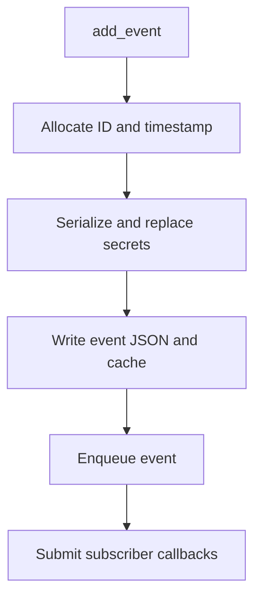

## Overview

The event stream is the shared record connecting the agent controller, runtime, memory and interfaces. `EventStore` reads a conversation's stored events; `EventStream` extends it with writes and subscriptions. This division lets a reconnecting reader inspect history without creating a live execution loop. [[Architecture]] places these objects in the task flow, while [[Conversations and Web Interface]] explains how stored events reach a browser.

Sources: [openhands/events/event_store.py:43-83](repo://openhands/events/event_store.py#L43-L83), [openhands/events/stream.py:43-69](repo://openhands/events/stream.py#L43-L69), [openhands/server/listen_socket.py:78-108](repo://openhands/server/listen_socket.py#L78-L108)

## Event identity and representation

An event exposes an ID, timestamp, source and optional cause. Sources distinguish user, agent and environment events. A newly constructed event has `INVALID_ID`, which is `-1`; the stream assigns its persisted identity. The cause is a separate event reference: the runtime sets an observation's cause to the action ID and carries over tool-call metadata, allowing execution feedback to remain associated with the request that produced it.

Sources: [openhands/events/event.py:9-12](repo://openhands/events/event.py#L9-L12), [openhands/events/event.py:35-77](repo://openhands/events/event.py#L35-L77), [openhands/runtime/base.py:391-399](repo://openhands/runtime/base.py#L391-L399)

`event_from_dict` chooses action or observation deserialization from the corresponding dictionary key and rejects an unknown event shape. It restores metadata such as timestamps, sources, tool calls and LLM metrics. The inverse conversion lifts shared metadata into top-level fields, converts source enums to their values and omits an invalid ID. Action-specific payloads and observation-specific payloads retain their own serialization paths.

Sources: [openhands/events/serialization/event.py:52-91](repo://openhands/events/serialization/event.py#L52-L91), [openhands/events/serialization/event.py:100-155](repo://openhands/events/serialization/event.py#L100-L155)

## Append and persist

`add_event` refuses an event that already has an ID; its error explains that re-adding an event from a handler can create a loop. It stamps source and time, allocates the next ID under a lock, serializes the event and replaces configured secrets. It then reconstructs the event from the sanitized dictionary before adding it to delivery. Subscribers therefore receive the reconstructed representation rather than the exact object instance passed by the caller.

Sources: [openhands/events/stream.py:163-180](repo://openhands/events/stream.py#L163-L180)

The stream writes one JSON event file, updates a full cache page when appropriate, then places the event on the callback queue. A cache page groups events because individual-file reads become slow for large histories. The allocation lock covers ID and cache-list changes; the filesystem write and queue insertion occur after leaving that lock. The code establishes persistence before delivery for each append without presenting the operation as a transaction across concurrent producers.

Sources: [openhands/events/stream.py:170-213](repo://openhands/events/stream.py#L170-L213)

Sources: [openhands/events/stream.py:163-213](repo://openhands/events/stream.py#L163-L213), [openhands/events/stream.py:254-275](repo://openhands/events/stream.py#L254-L275)

## Subscriber ordering and lifecycle

Subscriptions use a subscriber category plus a callback ID. Registering the same callback ID within a category raises an error. Each callback receives a single-worker thread pool whose initializer creates a thread-local asyncio loop. The queue dispatcher iterates subscriber categories in sorted order and submits each callback's work; it does not wait for every callback to finish before submitting to another subscriber.

Sources: [openhands/events/stream.py:71-76](repo://openhands/events/stream.py#L71-L76), [openhands/events/stream.py:130-148](repo://openhands/events/stream.py#L130-L148), [openhands/events/stream.py:254-275](repo://openhands/events/stream.py#L254-L275)

Unsubscribe removes the callback and cleans up its executor and event loop. Closing the stream stops and joins the queue thread, cleans up every subscriber and drains remaining queued events. Callback futures have an error handler that retrieves the result, logs exceptions and re-raises them. [[Agent Control Loop]] describes how a controller callback decides whether a particular event should cause another agent step.

Sources: [openhands/events/stream.py:78-128](repo://openhands/events/stream.py#L78-L128), [openhands/events/stream.py:150-161](repo://openhands/events/stream.py#L150-L161), [openhands/events/stream.py:277-291](repo://openhands/events/stream.py#L277-L291)

## Reading and recovery

The store lazily calculates its next ID by listing existing event files and taking the highest parsed ID plus one; an empty conversation starts at zero. Searches accept start and end IDs, reverse order, an event filter and a result limit. An explicitly supplied end ID is inclusive. Searches try cache pages first and fall back to individual events; missing event files are skipped.

Sources: [openhands/events/event_store.py:53-83](repo://openhands/events/event_store.py#L53-L83), [openhands/events/event_store.py:85-136](repo://openhands/events/event_store.py#L85-L136), [openhands/events/event_store.py:161-175](repo://openhands/events/event_store.py#L161-L175)

Controller state is stored separately as a base64-encoded pickle. Its serialization deliberately excludes history and cached history views because history is restored from the event stream. Saving temporarily removes the conversation-statistics reference, which manages its own persistence. Restoration records a resumable previous state and puts the restored controller into `LOADING`; it also supports finding an older state location when a user-specific location is absent.

Sources: [openhands/controller/state/state.py:122-189](repo://openhands/controller/state/state.py#L122-L189), [openhands/controller/state/state.py:191-209](repo://openhands/controller/state/state.py#L191-L209)

## Storage backends and secret replacement

| File-store selection | Factory behavior |
| --- | --- |
| `local` | Creates a local store and requires a path |
| `s3` | Creates an S3 store using the configured path |
| `google_cloud` | Creates a Google Cloud store using the configured path |
| Other values | Creates an in-memory store |
| Webhook option | Wraps the selected store with regular or batched webhook delivery |

Sources: [openhands/storage/__init__.py:14-57](repo://openhands/storage/__init__.py#L14-L57)

Secret replacement walks dictionary values recursively and replaces matching string contents with `<secret_hidden>`. Top-level metadata fields such as ID, cause, source and action are protected from replacement. This implementation traverses nested dictionaries and strings; it does not recursively walk list elements. [[Configuration]] explains selecting the file-store implementation and path that persist these sanitized event records.

Sources: [openhands/events/stream.py:215-244](repo://openhands/events/stream.py#L215-L244), [openhands/core/config/openhands_config.py:71-76](repo://openhands/core/config/openhands_config.py#L71-L76)
