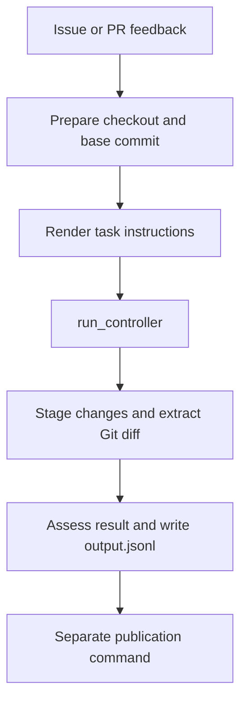

## Overview

The resolver adapts repository issues and pull request feedback into OpenHands tasks. Its inference stage prepares a checkout, runs the agent, extracts a patch and records an assessment. A separate publication module consumes that record to commit changes and push a branch or pull request. The task execution within inference uses the same controller described in [[Agent Control Loop]], with workspace behavior supplied by [[Runtime and Workspace]].

Sources: [openhands/resolver/issue_resolver.py:411-476](repo://openhands/resolver/issue_resolver.py#L411-L476), [openhands/resolver/issue_resolver.py:503-517](repo://openhands/resolver/issue_resolver.py#L503-L517), [openhands/resolver/send_pull_request.py:522-584](repo://openhands/resolver/send_pull_request.py#L522-L584)

## Inputs and provider selection

The resolver command requires `--selected-repo` and `--issue-number`. It supports `--issue-type issue` or `--issue-type pr`, optional comment selection, output directory, runtime choice, image choices, prompt and repository-instruction files. The parser's iteration limit defaults to 50 and output directory to `output`. The main function constructs `IssueResolver` and runs its asynchronous resolution method.

Sources: [openhands/resolver/resolve_issue.py:17-78](repo://openhands/resolver/resolve_issue.py#L17-L78), [openhands/resolver/resolve_issue.py:97-131](repo://openhands/resolver/resolve_issue.py#L97-L131)

Construction splits the repository at its final slash and requires both username and token. Token precedence is explicit token, `GITHUB_TOKEN`, `GITLAB_TOKEN`, then `BITBUCKET_TOKEN`; username falls back to `GIT_USERNAME`. It identifies the provider from the token and optional base domain. The handler factory creates issue or PR contexts for GitHub, GitLab or Bitbucket and rejects unsupported selections.

Sources: [openhands/resolver/issue_resolver.py:74-97](repo://openhands/resolver/issue_resolver.py#L74-L97), [openhands/resolver/issue_handler_factory.py:36-110](repo://openhands/resolver/issue_handler_factory.py#L36-L110)

The checked-in resolver guide gives a source-environment invocation for an example issue:

Sources: [openhands/resolver/README.md:142-154](repo://openhands/resolver/README.md#L142-L154)

```bash
poetry run python openhands/resolver/resolve_issue.py --selected-repo all-hands-ai/openhands --issue-number 100
```

Sources: [openhands/resolver/README.md:150-154](repo://openhands/resolver/README.md#L150-L154)

## Prepare the repository and instructions

The resolver selects an issue prompt with tests or a PR-followup prompt unless a custom prompt is provided. It also loads a companion conversation-instructions template obtained by replacing the prompt's `.jinja` suffix. An explicit repository-instruction file is read during construction. Resolution can fall back to `.openhands_instructions` from the checkout when no explicit instructions were supplied.

Sources: [openhands/resolver/issue_resolver.py:99-123](repo://openhands/resolver/issue_resolver.py#L99-L123), [openhands/resolver/issue_resolver.py:593-600](repo://openhands/resolver/issue_resolver.py#L593-L600)

Resolution extracts the issue and checks that an explicitly requested comment matched the appropriate thread or review data. It creates output and log directories, clones the repository if needed and records the current commit. For a PR it fetches and checks out the head branch and records that branch's commit. Existing `output.jsonl` entries are inspected by issue number; an already processed issue is skipped.

Sources: [openhands/resolver/issue_resolver.py:544-591](repo://openhands/resolver/issue_resolver.py#L544-L591), [openhands/resolver/issue_resolver.py:602-652](repo://openhands/resolver/issue_resolver.py#L602-L652)

## Run the agent and collect a patch

`process_issue` replaces its task workspace with a copy of the prepared checkout, creates and connects a runtime and initializes it. The provider context builds the task text, conversation instructions and image URLs. The resolver wraps these in a message and invokes `run_controller` with its prepared runtime and automatic user-response function. [[Configuration]] describes the model and runtime settings used by this shared application machinery.

Sources: [openhands/resolver/issue_resolver.py:411-446](repo://openhands/resolver/issue_resolver.py#L411-L446)



Sources: [openhands/resolver/issue_resolver.py:571-591](repo://openhands/resolver/issue_resolver.py#L571-L591), [openhands/resolver/issue_resolver.py:427-476](repo://openhands/resolver/issue_resolver.py#L427-L476), [openhands/resolver/issue_resolver.py:350-386](repo://openhands/resolver/issue_resolver.py#L350-L386), [openhands/resolver/issue_resolver.py:654-661](repo://openhands/resolver/issue_resolver.py#L654-L661), [openhands/resolver/send_pull_request.py:522-584](repo://openhands/resolver/send_pull_request.py#L522-L584)

After execution, `complete_runtime` switches to `/workspace`, sets Git behavior, stages all changes and asks for a cached diff against the base commit. It retries diff extraction up to five times with increasing hard timeouts. Command setup or staging failures raise errors, while unsuccessful diff attempts are logged and retried. The returned patch is the captured diff rather than a textual claim from the agent.

Sources: [openhands/resolver/issue_resolver.py:325-386](repo://openhands/resolver/issue_resolver.py#L325-L386)

## Understand the output and assessment

`ResolverOutput` records issue data, issue type, generated instruction, base commit, Git patch, serialized history, metrics, success, per-comment success, explanation and error. With a valid agent state, the provider context's `guess_success` uses issue data, history and patch. This success field is an assessment step, separate from patch extraction. A missing or failed agent state records failure defaults and an empty history.

Sources: [openhands/resolver/issue_resolver.py:462-517](repo://openhands/resolver/issue_resolver.py#L462-L517)

The result is appended as one JSON line and flushed before closing the output file. Value and runtime errors around controller execution are converted into failure state handling, but patch collection still follows afterward. Benchmark result scheduling and metrics across datasets belong to [[Evaluation]]; resolver output focuses on the selected repository issue or review task.

Sources: [openhands/resolver/issue_resolver.py:440-457](repo://openhands/resolver/issue_resolver.py#L440-L457), [openhands/resolver/issue_resolver.py:654-665](repo://openhands/resolver/issue_resolver.py#L654-L665)

## Apply and publish a recorded result

Publication skips unsuccessful records unless `send_on_failure` is enabled. It initializes a patch checkout from the issue's base commit or PR head branch, applies the recorded patch and makes a commit. Patch application handles deletions, renames and textual diffs, preserving detected line endings when rewriting files. Existing PR tasks call the update path; new issue tasks call the pull request creation path.

Sources: [openhands/resolver/send_pull_request.py:28-121](repo://openhands/resolver/send_pull_request.py#L28-L121), [openhands/resolver/send_pull_request.py:522-584](repo://openhands/resolver/send_pull_request.py#L522-L584)

Publication accepts `branch`, `draft` or `ready`. It chooses a unique issue branch, uses an explicit target branch when supplied and pushes to the original owner or requested fork. Branch mode returns a compare URL; PR modes create the provider request with draft status derived from the selected mode and optionally request reviewers. Push failures raise errors before PR creation.

Sources: [openhands/resolver/send_pull_request.py:265-310](repo://openhands/resolver/send_pull_request.py#L265-L310), [openhands/resolver/send_pull_request.py:329-390](repo://openhands/resolver/send_pull_request.py#L329-L390)
