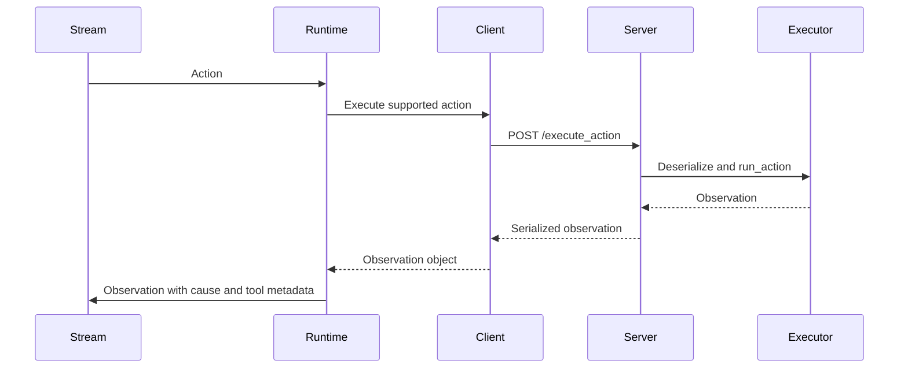

## Overview

A runtime executes agent actions and returns observations on the conversation's event stream. The shared `Runtime` constructor subscribes to that stream, copies configuration and plugin requirements, prepares environment variables and creates a provider handler. Application setup chooses a runtime class from the configured name. [[Agent Control Loop]] owns action scheduling and confirmation; this page follows what happens when an action crosses into execution.

Sources: [openhands/runtime/base.py:128-178](repo://openhands/runtime/base.py#L128-L178), [openhands/core/setup.py:61-89](repo://openhands/core/setup.py#L61-L89)

## Select an execution backend

| Runtime name | Execution model |
| --- | --- |
| `docker`, `eventstream` | Docker runtime using an action execution server inside its container |
| `remote` | Connects to a remote runtime client; requires a sandbox API key |
| `local` | Runs an action execution server locally |
| `kubernetes` | Creates and manages pods in a Kubernetes cluster |
| `cli` | Runs local commands and file operations directly; browsing is unsupported |

Sources: [openhands/runtime/__init__.py:14-21](repo://openhands/runtime/__init__.py#L14-L21), [openhands/runtime/impl/docker/docker_runtime.py:74-79](repo://openhands/runtime/impl/docker/docker_runtime.py#L74-L79), [openhands/runtime/impl/remote/remote_runtime.py:39-82](repo://openhands/runtime/impl/remote/remote_runtime.py#L39-L82), [openhands/runtime/impl/local/local_runtime.py:123-145](repo://openhands/runtime/impl/local/local_runtime.py#L123-L145), [openhands/runtime/impl/kubernetes/kubernetes_runtime.py:61-76](repo://openhands/runtime/impl/kubernetes/kubernetes_runtime.py#L61-L76), [openhands/runtime/impl/cli/cli_runtime.py:90-105](repo://openhands/runtime/impl/cli/cli_runtime.py#L90-L105)

The runtime registry also discovers optional implementations under `third_party.runtime.impl`, tries supported class-name patterns and adds successful imports. Missing optional dependencies are skipped. Names outside the registry are resolved as runtime implementations through `get_impl`; an invalid selection raises a `ValueError` listing known names. [[Configuration]] explains the runtime and sandbox values that feed this selection.

Sources: [openhands/runtime/__init__.py:23-103](repo://openhands/runtime/__init__.py#L23-L103)

## Connect Docker and prepare the environment

Docker connection first attempts to attach to the session's container. If it is missing and the caller requested attachment only, connection raises a runtime-disconnected error. Otherwise it builds or selects the runtime image and creates the container. It waits for the execution server to become alive, initializes environment variables for a new runtime, marks the runtime ready and attaches configured additional Docker networks.

Sources: [openhands/runtime/impl/docker/docker_runtime.py:170-220](repo://openhands/runtime/impl/docker/docker_runtime.py#L170-L220)

Agent plugin requirements are copied into the runtime; non-headless sessions also receive the VS Code plugin. Initial environment variables combine sandbox defaults, supplied values and provider values. `setup_initial_env` skips an attachment to an existing runtime; for a new one it installs the initial environment followed by `runtime_startup_env_vars`. Plugin initialization order matters for CodeAct: agent skills precede Jupyter so those functions are available to the interpreter.

Sources: [openhands/runtime/base.py:152-178](repo://openhands/runtime/base.py#L152-L178), [openhands/runtime/base.py:210-216](repo://openhands/runtime/base.py#L210-L216), [openhands/agenthub/codeact_agent/codeact_agent.py:70-76](repo://openhands/agenthub/codeact_agent/codeact_agent.py#L70-L76)

## Execute an action

The runtime event callback handles actions and supplies a default sandbox timeout when the action has none. It refreshes relevant provider credentials, sends MCP actions through their asynchronous tool path and runs other actions through the synchronous dispatch path. [[MCP Tools and Integrations]] describes the external-tool branch. Standard action execution associates the returned observation with the original action before publication.

Sources: [openhands/runtime/base.py:320-324](repo://openhands/runtime/base.py#L320-L324), [openhands/runtime/base.py:361-399](repo://openhands/runtime/base.py#L361-L399)

Docker and other execution-server backends share `ActionExecutionClient`. Its action semaphore protects dispatch, confirmation-awaiting actions return null observations, unsupported methods return errors and rejected actions return a user-rejection observation. For execution it serializes the action into a request to `/execute_action`, waits for the action timeout plus five seconds and converts the response back to an observation. A transport timeout raises `AgentRuntimeTimeoutError`.

Sources: [openhands/runtime/impl/action_execution/action_execution_client.py:283-338](repo://openhands/runtime/impl/action_execution/action_execution_client.py#L283-L338)

Sources: [openhands/runtime/base.py:361-399](repo://openhands/runtime/base.py#L361-L399), [openhands/runtime/impl/action_execution/action_execution_client.py:315-338](repo://openhands/runtime/impl/action_execution/action_execution_client.py#L315-L338), [openhands/runtime/action_execution_server.py:814-831](repo://openhands/runtime/action_execution_server.py#L814-L831)

The server rejects non-action input, dispatches under the executor's asynchronous lock and serializes the observation. Command execution uses the persistent bash session unless the action is static, in which case it creates a session for the action's working directory. Jupyter execution synchronizes its current directory with bash and fails when the required plugin is absent. File reads reject binary files and can use the ACI editor view operation.

Sources: [openhands/runtime/action_execution_server.py:379-461](repo://openhands/runtime/action_execution_server.py#L379-L461), [openhands/runtime/action_execution_server.py:814-831](repo://openhands/runtime/action_execution_server.py#L814-L831)

## Repository setup and hooks

With a selected repository, the runtime obtains an authenticated Git URL, clones into the repository's final path component and checks out either the selected branch or a randomly named `openhands-workspace-` branch. Without a selected repository, it initializes Git only if `init_git_in_empty_workspace` is enabled. Otherwise it leaves a mounted workspace's Git setup alone. A missing authenticated repository URL raises an error.

Sources: [openhands/runtime/base.py:401-461](repo://openhands/runtime/base.py#L401-L461)

Setup then checks `.openhands/setup.sh` and sources it as a hidden environment action with a ten-minute hard timeout. Hook setup checks `.openhands/pre-commit.sh`, creates the Git hooks directory, makes the script executable and checks existing hooks before replacement. These repository lifecycle hooks run during workspace initialization; [[Memory and Microagents]] covers repository instructions loaded for the model after that workspace exists.

Sources: [openhands/core/setup.py:141-152](repo://openhands/core/setup.py#L141-L152), [openhands/runtime/base.py:463-488](repo://openhands/runtime/base.py#L463-L488), [openhands/runtime/base.py:495-532](repo://openhands/runtime/base.py#L495-L532)

## Failure and cleanup

Permission errors become error observations that the agent can process. Network and runtime-disconnected exceptions set a disconnected runtime status and return without an observation; other execution exceptions set the general runtime error status. A successful non-null observation receives cause and tool-call metadata before it enters [[Events and Persistence]]. These branches explain why a runtime status failure differs from an ordinary failed command result.

Sources: [openhands/runtime/base.py:372-399](repo://openhands/runtime/base.py#L372-L399)

Docker health checking distinguishes an exited container from a missing one before checking the server. Closing shuts down shared client resources and log streaming. It preserves the container when `keep_runtime_alive` is enabled or the instance attached to an existing runtime; otherwise it stops the session's container, or all matching containers when configured, and releases port locks.

Sources: [openhands/runtime/impl/docker/docker_runtime.py:579-612](repo://openhands/runtime/impl/docker/docker_runtime.py#L579-L612)
