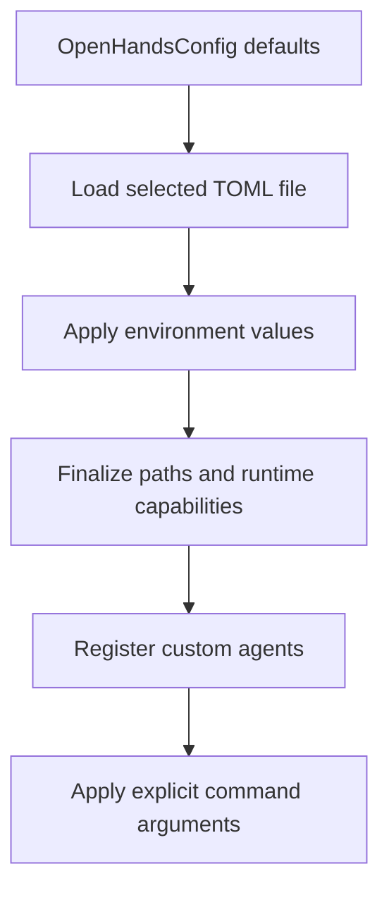

## Overview

`OpenHandsConfig` groups application settings with model, agent, sandbox, security, MCP, Kubernetes, and CLI configuration. It supplies the values used when constructing a task's agent and execution environment. The loader creates defaults, reads TOML, applies environment values, finalizes derived settings, and registers custom agents. This page follows those transformations; [[Quickstart]] covers the build and launch commands that enter this path.

Sources: [openhands/core/config/openhands_config.py:65-125](repo://openhands/core/config/openhands_config.py#L65-L125), [openhands/core/config/utils.py:819-836](repo://openhands/core/config/utils.py#L819-L836)

## Loading order

`load_openhands_config` starts with a new `OpenHandsConfig`, calls `load_from_toml`, then `load_from_env`, followed by `finalize_config`. Environment values therefore override values already loaded from TOML for the fields the environment loader handles. `setup_config_from_args` applies explicit named-model selection, agent class, iteration limit, budget, and selected repository afterward. Named-model selection can replace the default configuration object rather than merge individual fields into it, which matters when interpreting precedence for a command using `--llm-config`.

Sources: [openhands/core/config/utils.py:819-904](repo://openhands/core/config/utils.py#L819-L904)

Sources: [openhands/core/config/utils.py:819-904](repo://openhands/core/config/utils.py#L819-L904)

The common parser defaults `--config-file` to `config.toml` in the current directory. If `--llm-config` names a group already loaded, that object becomes the default. Otherwise the argument setup first tries the selected file and then the user's `~/.openhands/config.toml`, when present. Failure to find the requested group raises `ValueError`. This is a specific fallback for named LLM configuration, not a blanket merge of every user-directory setting into every application launch.

Sources: [openhands/core/config/arg_utils.py:15-22](repo://openhands/core/config/arg_utils.py#L15-L22), [openhands/core/config/utils.py:849-885](repo://openhands/core/config/utils.py#L849-L885)

## TOML sections and named groups

`[core]` is copied onto recognized root attributes, while unknown core keys produce warnings. A missing TOML file simply leaves defaults in place. Invalid TOML produces a warning and applies no TOML values. The example template lists configurable fields, but executable defaults live in the configuration models: for example, the root model defaults to the Docker runtime and a local file store at `~/.openhands`.

Sources: [openhands/core/config/utils.py:138-190](repo://openhands/core/config/utils.py#L138-L190), [config.template.toml:1-12](repo://config.template.toml#L1-L12), [openhands/core/config/openhands_config.py:65-80](repo://openhands/core/config/openhands_config.py#L65-L80)

Within `[llm]`, scalar values form the base model configuration and nested tables form named variants. Each variant merges its overrides over the validated base. An invalid base falls back to model defaults; an invalid custom group is skipped with a warning. `get_llm_config` lazily constructs the default when necessary and falls back to it if a requested group is missing. [[Language Models]] explains what the selected model object does once a client is constructed.

Sources: [openhands/core/config/llm_config.py:100-160](repo://openhands/core/config/llm_config.py#L100-L160), [openhands/core/config/openhands_config.py:131-144](repo://openhands/core/config/openhands_config.py#L131-L144)

Agent groups use the same base-plus-overrides pattern. `AgentConfig.llm_config` names the model group for an agent; when absent, `get_llm_config_from_agent_config` uses `llm`. Agent fields control available tools, MCP, prompt extensions, history truncation, and plan mode. Plan mode changes the resolved default system prompt to the long-horizon prompt unless a custom prompt filename was explicitly selected. [[Agents and Tools]] follows how these flags affect tool construction and stepping.

Sources: [openhands/core/config/agent_config.py:15-85](repo://openhands/core/config/agent_config.py#L15-L85), [openhands/core/config/agent_config.py:99-138](repo://openhands/core/config/agent_config.py#L99-L138), [openhands/core/config/openhands_config.py:161-169](repo://openhands/core/config/openhands_config.py#L161-L169)

## Environment conversion

The environment loader derives uppercase names from fields and prefixes. It explicitly loads the default model with `LLM_` and the default agent with `AGENT_`; nested models use a field-name prefix, such as `SANDBOX_`. Empty values are skipped. Boolean conversion recognizes `true` and `1` as true. Dictionaries and lists pass through `literal_eval`, with list elements converted to Pydantic models where required; they are not treated as arbitrary shell expressions.

Sources: [openhands/core/config/utils.py:65-135](repo://openhands/core/config/utils.py#L65-L135)

Use names such as `LLM_BASE_URL`, `SANDBOX_TIMEOUT`, and `SANDBOX_RUNTIME_STARTUP_ENV_VARS` for these supported fields. Conversion failures log a type error and leave the failed assignment unapplied. This error behavior differs from a fatal mount-format error during finalization, so investigate the stage that emitted the message before assuming the whole configuration failed to load.

Sources: [openhands/core/config/utils.py:40-47](repo://openhands/core/config/utils.py#L40-L47), [openhands/core/config/utils.py:80-125](repo://openhands/core/config/utils.py#L80-L125), [openhands/core/config/utils.py:417-424](repo://openhands/core/config/utils.py#L417-L424)

## Sandbox settings and derived paths

The sandbox model holds provisioning and execution settings, including image selection, timeouts, startup environment variables, GPU configuration, selected repository, and volume mounts. Its default action timeout is 120 seconds. Volume syntax is `host_path:container_path[:mode]`, with comma-separated mounts. [[Sandbox Runtimes]] uses these settings when connecting an execution backend; model credentials and tool definitions belong to their own configuration groups.

Sources: [openhands/core/config/sandbox_config.py:49-97](repo://openhands/core/config/sandbox_config.py#L49-L97)

Finalization recognizes a volume targeting `/workspace` and resolves its host path to an absolute path, setting the workspace mount and base accordingly. If volumes exist but none target `/workspace`, it clears those inferred host workspace fields. Mounts must contain two or three colon-separated parts. Legacy workspace settings still work through a separate branch, but the finalizer emits a deprecation warning recommending `SANDBOX_VOLUMES`.

Sources: [openhands/core/config/utils.py:377-436](repo://openhands/core/config/utils.py#L377-L436)

## Secrets and capability adjustments

Sensitive root settings such as the JWT secret and search API key use `SecretStr`. TOML core loading converts those secret fields before assignment. If no JWT secret is configured, finalization reads one from the selected file store or creates and stores a UUID value. This allows later application construction to reuse the stored secret rather than creating a different value on every load.

Sources: [openhands/core/config/openhands_config.py:81-84](repo://openhands/core/config/openhands_config.py#L81-L84), [openhands/core/config/openhands_config.py:102-104](repo://openhands/core/config/openhands_config.py#L102-L104), [openhands/core/config/utils.py:169-186](repo://openhands/core/config/utils.py#L169-L186), [openhands/core/config/utils.py:367-374](repo://openhands/core/config/utils.py#L367-L374), [openhands/core/config/utils.py:452-457](repo://openhands/core/config/utils.py#L452-L457)

Finalization also makes completion-log folders absolute, creates the cache directory, and disables Jupyter and browsing for every configured agent when the runtime is `cli`, because that runtime does not support those operations. Web conversations add another configuration boundary: their service loads persisted user settings into `ConversationInitData`. [[Conversations and Sessions]] follows that assembly and its missing-settings and authentication failures.

Sources: [openhands/core/config/utils.py:438-470](repo://openhands/core/config/utils.py#L438-L470), [openhands/server/services/conversation_service.py:98-135](repo://openhands/server/services/conversation_service.py#L98-L135)
