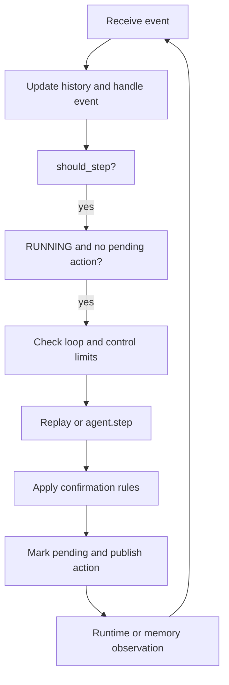

## Overview

`AgentController` advances a conversation by consuming events and asking an agent for its next action when the state permits. `EventStream` persists events and dispatches them to subscribers; `EventStore` supplies history lookup and replay. Session construction and client reconnection are covered in [[Conversations and Sessions]]. This page starts at event insertion and follows scheduling, pending-action correlation, confirmation, failure handling, and termination.

Sources: [openhands/controller/agent_controller.py:392-485](repo://openhands/controller/agent_controller.py#L392-L485), [openhands/events/stream.py:163-203](repo://openhands/events/stream.py#L163-L203), [openhands/events/event_store.py:85-148](repo://openhands/events/event_store.py#L85-L148)

## Persist before dispatch

`add_event` rejects an event that already has an ID, preventing handlers from accidentally reinserting the same event and creating a loop. It assigns a timestamp and source, reserves the next ID under a lock, serializes the event, replaces registered secrets, and reconstructs the dispatched event from that serialized data. It writes individual JSON and completed cache pages before putting the event on its dispatch queue. Event IDs therefore identify stored conversation activity, not model turns alone.

Sources: [openhands/events/stream.py:163-213](repo://openhands/events/stream.py#L163-L213)

Each subscription has a callback ID and a single-worker executor with its own event loop. The queue processor submits each event to callbacks in sorted subscriber-key order. Executors serialize a callback's own work, but the processor does not wait for all callbacks to finish before submitting others. An observation can therefore arrive after another subscriber has already seen its action. Duplicate callback IDs are rejected, and callback exceptions are logged through the future's completion handler.

Sources: [openhands/events/stream.py:130-148](repo://openhands/events/stream.py#L130-L148), [openhands/events/stream.py:254-291](repo://openhands/events/stream.py#L254-L291)

The store calculates its next ID from existing event filenames and uses 25-event cache pages by default. `search_events` supports bounds, reverse traversal, filtering, and a result limit. It tries the appropriate cache page, falls back to individual event files, and tolerates absent files during traversal. This provides the replay surface used by clients and state reconstruction without requiring an active controller.

Sources: [openhands/events/event_store.py:43-142](repo://openhands/events/event_store.py#L43-L142), [openhands/events/event_store.py:158-175](repo://openhands/events/event_store.py#L158-L175)

## From input to a model step

The controller ignores hidden events, adds other events through the state tracker's history filter, and handles their action or observation semantics before evaluating `should_step`. User messages trigger stepping, as do condensation actions and most observations. State-change observations normally do not. A user message first creates a `RecallAction`: the first message asks for workspace context, later messages ask for knowledge. That recall becomes pending until its corresponding observation arrives; [[Memory and Microagents]] owns retrieval behavior.

Sources: [openhands/controller/agent_controller.py:392-430](repo://openhands/controller/agent_controller.py#L392-L430), [openhands/controller/agent_controller.py:467-485](repo://openhands/controller/agent_controller.py#L467-L485), [openhands/controller/agent_controller.py:555-583](repo://openhands/controller/agent_controller.py#L555-L583), [openhands/controller/state/state_tracker.py:220-223](repo://openhands/controller/state/state_tracker.py#L220-L223)

`_step` returns unless the agent is `RUNNING` and no action is pending. It synchronizes the budget with accumulated model costs, detects stuck loops, and advances iteration and budget control flags. It then either obtains the next replay action or calls `agent.step`. [[Agents and Tools]] explains how that call constructs a completion and decodes tools. The controller owns the surrounding lifecycle, so adding a model tool does not itself change the state conditions under which a new step is allowed.

Sources: [openhands/controller/agent_controller.py:821-886](repo://openhands/controller/agent_controller.py#L821-L886), [openhands/controller/state/state_tracker.py:254-268](repo://openhands/controller/state/state_tracker.py#L254-L268)

Sources: [openhands/controller/agent_controller.py:467-485](repo://openhands/controller/agent_controller.py#L467-L485), [openhands/controller/agent_controller.py:821-886](repo://openhands/controller/agent_controller.py#L821-L886), [openhands/controller/agent_controller.py:919-973](repo://openhands/controller/agent_controller.py#L919-L973), [openhands/runtime/base.py:361-399](repo://openhands/runtime/base.py#L361-L399), [openhands/controller/agent_controller.py:536-547](repo://openhands/controller/agent_controller.py#L536-L547)

## Pending actions and confirmation

For runnable actions, the controller records a pending action before publishing it. An observation clears that pending action only when `observation.cause` matches its ID, and it does not clear it while awaiting confirmation. The runtime copies the originating action ID into the observation's cause and preserves tool-call metadata. [[Sandbox Runtimes]] explains execution and transport; here the correlation prevents the model from advancing while a prior operation is unresolved. A pending action older than 60 seconds is logged but is not cleared merely by that timer.

Sources: [openhands/controller/agent_controller.py:536-547](repo://openhands/controller/agent_controller.py#L536-L547), [openhands/controller/agent_controller.py:960-973](repo://openhands/controller/agent_controller.py#L960-L973), [openhands/controller/agent_controller.py:979-1002](repo://openhands/controller/agent_controller.py#L979-L1002), [openhands/runtime/base.py:391-399](repo://openhands/runtime/base.py#L391-L399)

When confirmation mode is active, command, IPython, interactive browsing, file-edit, and file-read actions enter security analysis. In non-CLI mode, high-risk actions require confirmation; unknown risk without an analyzer also asks for confirmation. CLI mode marks these actions awaiting confirmation for its own handling. Transitioning to `USER_CONFIRMED` or `USER_REJECTED` changes the pending action's confirmation status, clears its event ID, and republishes it. The matching observation then resumes execution or returns the agent to awaiting user input.

Sources: [openhands/controller/agent_controller.py:919-969](repo://openhands/controller/agent_controller.py#L919-L969), [openhands/controller/agent_controller.py:658-669](repo://openhands/controller/agent_controller.py#L658-L669), [openhands/controller/agent_controller.py:536-547](repo://openhands/controller/agent_controller.py#L536-L547)

## Errors, limits, and completion

Malformed or missing model actions and function-call validation failures are converted into `ErrorObservation` so they can reenter the conversation. Context-window errors request condensation when history truncation is enabled; otherwise they raise a dedicated context-limit error. The outer step wrapper preserves recognized provider exceptions and reports unexpected exceptions through `_react_to_exception`. Iteration and budget flags are checked before model work, with the budget sourced from combined conversation model metrics.

Sources: [openhands/controller/agent_controller.py:361-390](repo://openhands/controller/agent_controller.py#L361-L390), [openhands/controller/agent_controller.py:847-915](repo://openhands/controller/agent_controller.py#L847-L915), [openhands/controller/state/state_tracker.py:254-268](repo://openhands/controller/state/state_tracker.py#L254-L268)

`AgentFinishAction` stores outputs and moves to `FINISHED`; `AgentRejectAction` moves to `REJECTED`. An agent message requesting a reply moves to `AWAITING_USER_INPUT`. State changes emit `AgentStateChangedObservation` and save state, while `STOPPED` and `ERROR` reset the controller's working state. The headless runner waits for finished, rejected, error, paused, or stopped states, saves non-memory sessions, closes the controller, and can export the trajectory as JSON.

Sources: [openhands/controller/agent_controller.py:512-517](repo://openhands/controller/agent_controller.py#L512-L517), [openhands/controller/agent_controller.py:585-588](repo://openhands/controller/agent_controller.py#L585-L588), [openhands/controller/agent_controller.py:631-683](repo://openhands/controller/agent_controller.py#L631-L683), [openhands/core/main.py:207-244](repo://openhands/core/main.py#L207-L244)
