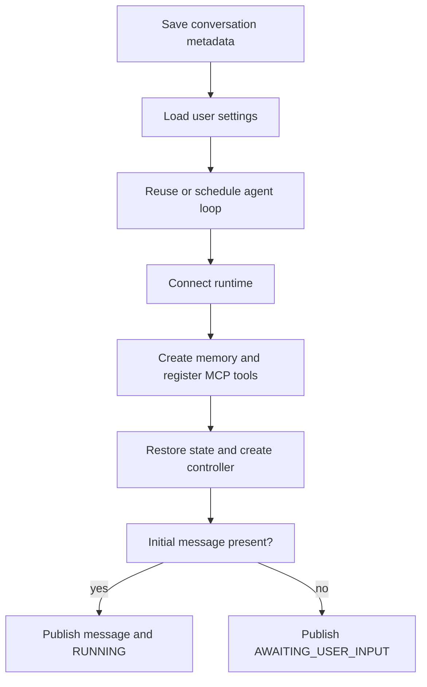

## Overview

A web conversation combines durable metadata, persisted events, an agent session, and one or more client connections. Creating the conversation and joining its Socket.IO room are separate operations. The HTTP service prepares settings and asks the conversation manager to start an agent loop; socket connection replays existing events before joining. [[Configuration]] explains base configuration loading, while this page follows how stored user settings and conversation-specific inputs reach the live session.

Sources: [openhands/server/services/conversation_service.py:98-159](repo://openhands/server/services/conversation_service.py#L98-L159), [openhands/server/listen_socket.py:78-129](repo://openhands/server/listen_socket.py#L78-L129)

## Create a conversation

`POST /api/conversations` accepts `InitSessionRequest`: repository, provider, selected branch, initial message, image URLs, replay JSON, suggested-task or microagent-creation context, conversation instructions, and optional MCP configuration. Extra request fields are forbidden. Explicit conversation IDs are only exposed when `ALLOW_SET_CONVERSATION_ID` is enabled. Bearer-authenticated creation requires an initial user message and otherwise returns HTTP 400 with `CONFIGURATION$MISSING_USER_MESSAGE`.

Sources: [openhands/server/routes/manage_conversations.py:160-200](repo://openhands/server/routes/manage_conversations.py#L160-L200), [openhands/server/routes/manage_conversations.py:226-240](repo://openhands/server/routes/manage_conversations.py#L226-L240)

When a repository is supplied, the route verifies its provider before invoking `create_new_conversation`. That service first calls `initialize_conversation`, which creates a UUID when needed, obtains the user's conversation store, and saves metadata if the ID is new. The metadata records title, trigger, user, repository, branch, and provider. Existing metadata is retrieved instead. Only after metadata is available does the service call `start_conversation`; a metadata record and a functioning agent loop are therefore different lifecycle milestones.

Sources: [openhands/server/routes/manage_conversations.py:242-269](repo://openhands/server/routes/manage_conversations.py#L242-L269), [openhands/server/services/conversation_service.py:34-75](repo://openhands/server/services/conversation_service.py#L34-L75), [openhands/server/services/conversation_service.py:179-202](repo://openhands/server/services/conversation_service.py#L179-L202)

## Assemble session settings

`start_conversation` loads the user's settings store. Missing settings raise `MissingSettingsError`; non-Bedrock models require a nonempty, non-whitespace API key and otherwise raise `LLMAuthenticationError`. The route converts these failures into HTTP 400 responses with distinct message IDs. This check is deliberately local: the code comments explain that a more accurate LiteLLM key check would perform an inference request.

Sources: [openhands/server/services/conversation_service.py:98-124](repo://openhands/server/services/conversation_service.py#L98-L124), [openhands/server/routes/manage_conversations.py:270-288](repo://openhands/server/routes/manage_conversations.py#L270-L288)

Persisted settings form the initial session arguments. The service then adds provider tokens, selected repository and branch, custom secrets, provider, and conversation instructions, and includes request MCP configuration when supplied. It constructs `ConversationInitData`, passes it through the experiment manager, wraps an initial message or images in `MessageAction`, and calls `maybe_start_agent_loop`. The standalone manager reuses a session already associated with that conversation ID; otherwise it creates one and schedules initialization asynchronously.

Sources: [openhands/server/services/conversation_service.py:126-159](repo://openhands/server/services/conversation_service.py#L126-L159), [openhands/server/conversation_manager/standalone_conversation_manager.py:280-294](repo://openhands/server/conversation_manager/standalone_conversation_manager.py#L280-L294), [openhands/server/conversation_manager/standalone_conversation_manager.py:340-366](repo://openhands/server/conversation_manager/standalone_conversation_manager.py#L340-L366)

## Initialize the agent session

`AgentSession.start` refuses to start twice if it already has a controller or runtime and returns early if closed. It creates and connects the runtime, registers provider and custom secrets with the event stream, and creates memory. MCP registration follows memory creation and precedes controller construction because the initial system-message action must contain those tools. Runtime provisioning belongs to [[Sandbox Runtimes]], context loading to [[Memory and Microagents]], and tool discovery to [[MCP Tools]].

Sources: [openhands/server/session/agent_session.py:117-168](repo://openhands/server/session/agent_session.py#L117-L168)

Sources: [openhands/server/services/conversation_service.py:179-202](repo://openhands/server/services/conversation_service.py#L179-L202), [openhands/server/services/conversation_service.py:98-159](repo://openhands/server/services/conversation_service.py#L98-L159), [openhands/server/conversation_manager/standalone_conversation_manager.py:280-294](repo://openhands/server/conversation_manager/standalone_conversation_manager.py#L280-L294), [openhands/server/session/agent_session.py:134-202](repo://openhands/server/session/agent_session.py#L134-L202), [openhands/server/session/agent_session.py:426-446](repo://openhands/server/session/agent_session.py#L426-L446)

Controller creation requires an initialized runtime and attempts `State.restore_from_session` before constructing `AgentController`. Restoration failures are logged at warning level when the stream already has events, otherwise at debug level. The controller receives iteration and budget deltas, confirmation mode, the restored state, and the runtime's security analyzer. If an initial message exists, startup publishes it and a transition to `RUNNING`; otherwise it publishes `AWAITING_USER_INPUT`. [[Controller and Event Stream]] owns subsequent state transitions.

Sources: [openhands/server/session/agent_session.py:409-446](repo://openhands/server/session/agent_session.py#L409-L446), [openhands/server/session/agent_session.py:492-510](repo://openhands/server/session/agent_session.py#L492-L510), [openhands/server/session/agent_session.py:191-202](repo://openhands/server/session/agent_session.py#L191-L202)

## Reconnect and dispatch user actions

Socket connection requires `conversation_id`, interprets `latest_event_id` as an integer with a fallback of `-1`, validates access, and opens an event store. Replay begins at the next event ID. Null events and recall actions are filtered, while the latest agent-state observation is held until other replayed events have been sent. The connection then loads initialization settings and joins the conversation. In the standalone manager, joining enters the conversation's room and records the connection-to-session mapping before ensuring an agent loop exists.

Sources: [openhands/server/listen_socket.py:35-129](repo://openhands/server/listen_socket.py#L35-L129), [openhands/server/conversation_manager/standalone_conversation_manager.py:151-165](repo://openhands/server/conversation_manager/standalone_conversation_manager.py#L151-L165)

Incoming `oh_user_action` messages are forwarded to the manager; `oh_action` remains a compatibility alias. `Session.dispatch` deserializes an event, checks image messages against the model's vision settings, and adds accepted input with `EventSource.USER`. Outgoing session events include agent and user events plus selected environment observations, which are presented to the UI as agent events. [[Web Client]] describes how the browser interprets these messages.

Sources: [openhands/server/listen_socket.py:143-152](repo://openhands/server/listen_socket.py#L143-L152), [openhands/server/session/session.py:314-369](repo://openhands/server/session/session.py#L314-L369)

## Persistence and cleanup

Conversation storage separates `metadata.json`, event JSON files, initialization data, agent-state pickle, registry JSON, and conversation statistics. Paths include the user ID when available. The file-store factory selects local, S3, Google Cloud, or an in-memory fallback and can wrap the store with immediate or batched webhook delivery. These files supply recovery and replay independently of any particular browser connection.

Sources: [openhands/storage/locations.py:1-38](repo://openhands/storage/locations.py#L1-L38), [openhands/storage/__init__.py:14-57](repo://openhands/storage/__init__.py#L14-L57)

Disconnecting a socket removes its local connection mapping. The standalone cleanup loop closes inactive, unconnected sessions after `sandbox.close_delay`, excluding running or still-starting sessions; a falsy delay disables that closing path. Starting above the concurrent-conversation limit closes older conversations and sends a status message. Explicit session close disconnects associated clients, removes the session, closes the event stream, saves controller state, closes the controller, and schedules runtime close.

Sources: [openhands/server/conversation_manager/standalone_conversation_manager.py:179-215](repo://openhands/server/conversation_manager/standalone_conversation_manager.py#L179-L215), [openhands/server/conversation_manager/standalone_conversation_manager.py:306-338](repo://openhands/server/conversation_manager/standalone_conversation_manager.py#L306-L338), [openhands/server/conversation_manager/standalone_conversation_manager.py:397-453](repo://openhands/server/conversation_manager/standalone_conversation_manager.py#L397-L453), [openhands/server/session/agent_session.py:224-245](repo://openhands/server/session/agent_session.py#L224-L245)
