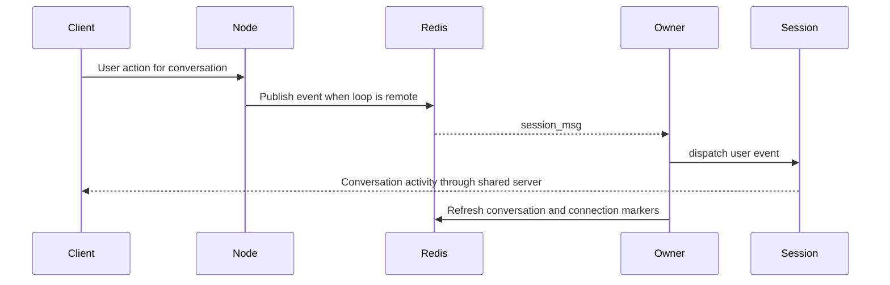

## Overview

The enterprise server extends the shared OpenHands FastAPI application and Socket.IO server with hosted authentication, billing, integration routes, database-backed settings, and distributed conversation management. It uses the common agent platform rather than a separate execution loop. [[Conversations and Sessions]] describes shared session startup and recovery, while [[Web Client]] explains how browser conversation URLs, session keys, and events are consumed.

Sources: [enterprise/saas_server.py:40-98](repo://enterprise/saas_server.py#L40-L98), [enterprise/saas_server.py:130-130](repo://enterprise/saas_server.py#L130-L130), [enterprise/server/config.py:51-71](repo://enterprise/server/config.py#L51-L71), [enterprise/server/clustered_conversation_manager.py:60-76](repo://enterprise/server/clustered_conversation_manager.py#L60-L76)

## Application assembly and deployment boundary

`enterprise/saas_server.py` loads environment values, imports the base application and shared socket server, patches the MCP server, adds `/saas`, mounts internal metrics, and registers hosted routes. It installs configured CORS, cache-control, authentication-cookie middleware, and rate limiting, then mounts the built frontend and wraps everything in `socketio.ASGIApp`. This assembly layers enterprise behavior over shared application behavior, so both entry points matter when tracing middleware or route handling.

Sources: [enterprise/saas_server.py:1-5](repo://enterprise/saas_server.py#L1-L5), [enterprise/saas_server.py:40-66](repo://enterprise/saas_server.py#L40-L66), [enterprise/saas_server.py:100-130](repo://enterprise/saas_server.py#L100-L130)

| Route area | Registration behavior |
| --- | --- |
| Authentication and users | Adds authentication, OAuth callback, user, and API-key routers |
| Billing and email | Registers credit/payment and email-management routes |
| Git providers | Adds GitHub integration when its client ID exists and GitLab integration when its client ID exists |
| Collaboration tools | Always registers Slack routes; conditionally registers Jira, Jira Data Center, and Linear |
| Runtime coordination | Registers nested-runtime event webhooks, feedback, readiness, and internal metrics |

Sources: [enterprise/saas_server.py:57-98](repo://enterprise/saas_server.py#L57-L98)

The Dockerfile builds on an OpenHands image, installs enterprise dependencies, copies the enterprise tree into `/app`, switches to the `openhands` user, and defaults to Uvicorn serving `saas_server:app` on port 3000. Its comment states that deployment templates override the command. The enterprise directory carries a separate PolyForm Free Trial license; its included terms specify a commercial-license requirement beyond 30 days per calendar year. This identifies the repository's packaging and license boundary, rather than treating the enterprise code as part of the root package's MIT declaration.

Sources: [enterprise/Dockerfile:1-26](repo://enterprise/Dockerfile#L1-L26), [enterprise/LICENSE:1-1](repo://enterprise/LICENSE#L1-L1), [enterprise/LICENSE:36-38](repo://enterprise/LICENSE#L36-L38), [pyproject.toml:7-14](repo://pyproject.toml#L7-L14)

## Select enterprise implementations

`load_server_config` resolves `OPENHANDS_CONFIG_CLS`, instantiates the selected server configuration, and verifies it. `SaaSServerConfig` sets SaaS mode and selects enterprise settings, secrets, conversation store, monitoring listener, and authentication classes. Its default conversation manager is clustered, with `CONVERSATION_MANAGER_CLASS` allowing another implementation. This dynamic configuration boundary is separate from the application and model fields explained in [[Configuration]].

Sources: [openhands/server/config/server_config.py:52-60](repo://openhands/server/config/server_config.py#L52-L60), [enterprise/server/config.py:51-71](repo://enterprise/server/config.py#L51-L71)

Verification requires a configuration-class path and analytics client key and checks the GitHub client setting when applicable. The frontend configuration includes mode, feature flags, configured identity providers, optional maintenance timing, and optional authentication URL. GitHub application metadata can be fetched during configuration construction when the client ID and private key exist; absent credentials skip that lookup, while failed application metadata retrieval raises. Startup configuration can therefore include provider I/O before any conversation is created.

Sources: [enterprise/server/config.py:82-127](repo://enterprise/server/config.py#L82-L127), [enterprise/server/config.py:129-179](repo://enterprise/server/config.py#L129-L179)

## Authenticate requests and provider access

`SaasUserAuth.get_instance` first tries bearer/API-key authentication, then cookie authentication if no instance was returned, and raises `NoCredentialsError` when neither succeeds. It applies a user rate limit once per request using a request-state marker. API-key extraction accepts `Authorization: Bearer` and falls back to `X-Session-API-Key` for the documented MCP/nested-runtime compatibility case. A validated key identifies a user and loads an offline token; cookie authentication reads `keycloak_auth` and validates the signed wrapper before constructing user authentication state.

Sources: [enterprise/server/auth/saas_user_auth.py:205-299](repo://enterprise/server/auth/saas_user_auth.py#L205-L299)

Access-token retrieval refreshes missing or expired tokens. Provider-token retrieval queries linked identity providers, asks the token manager for each provider token, preserves custom-host metadata from secrets, and returns an immutable provider mapping. Failures are converted to authentication errors, and a failed linked-token refresh removes the associated stored token record. [[Git Provider Integrations]] describes the shared handler that consumes these tokens for repository operations.

Sources: [enterprise/server/auth/saas_user_auth.py:130-194](repo://enterprise/server/auth/saas_user_auth.py#L130-L194)

## Distributed conversation ownership

`ClusteredConversationManager` extends the standalone manager with Redis ownership markers and pub/sub. Startup begins background update and subscription tasks; shutdown cancels them before shared cleanup. Conversation markers expire after 15 seconds and are refreshed on a five-second update interval. Creation uses Redis `SET` with `nx=True` and an expiry to claim a conversation before starting its local loop. The constructor adjusts the concurrent limit because the Redis claim happens before counting active conversations, with comments identifying simultaneous starts as the reason.

Sources: [enterprise/server/clustered_conversation_manager.py:43-47](repo://enterprise/server/clustered_conversation_manager.py#L43-L47), [enterprise/server/clustered_conversation_manager.py:83-105](repo://enterprise/server/clustered_conversation_manager.py#L83-L105), [enterprise/server/clustered_conversation_manager.py:389-419](repo://enterprise/server/clustered_conversation_manager.py#L389-L419)

A user event dispatches directly when the agent loop is local. Otherwise it is published to `session_msg`, and the node owning that session dispatches it. Close requests are also published across the cluster. State refresh pipelines renew local conversation and connection keys; stale cleanup checks stopped remote conversations and disconnected work. Redis coordinates ownership and transport, while the shared event store remains the history surface used for remotely owned conversations.

Sources: [enterprise/server/clustered_conversation_manager.py:150-160](repo://enterprise/server/clustered_conversation_manager.py#L150-L160), [enterprise/server/clustered_conversation_manager.py:224-235](repo://enterprise/server/clustered_conversation_manager.py#L224-L235), [enterprise/server/clustered_conversation_manager.py:366-387](repo://enterprise/server/clustered_conversation_manager.py#L366-L387), [enterprise/server/clustered_conversation_manager.py:435-483](repo://enterprise/server/clustered_conversation_manager.py#L435-L483), [enterprise/server/clustered_conversation_manager.py:581-608](repo://enterprise/server/clustered_conversation_manager.py#L581-L608)

Sources: [enterprise/server/clustered_conversation_manager.py:107-123](repo://enterprise/server/clustered_conversation_manager.py#L107-L123), [enterprise/server/clustered_conversation_manager.py:150-155](repo://enterprise/server/clustered_conversation_manager.py#L150-L155), [enterprise/server/clustered_conversation_manager.py:316-319](repo://enterprise/server/clustered_conversation_manager.py#L316-L319), [enterprise/server/clustered_conversation_manager.py:366-378](repo://enterprise/server/clustered_conversation_manager.py#L366-L378), [enterprise/server/clustered_conversation_manager.py:458-483](repo://enterprise/server/clustered_conversation_manager.py#L458-L483), [openhands/server/session/session.py:314-338](repo://openhands/server/session/session.py#L314-L338)

## SQL-backed settings and migrations

Database construction supports host/port PostgreSQL settings or a Google Cloud SQL connector, with configurable synchronous pool size and overflow. The asynchronous engine uses `NullPool` to avoid event-loop pooling issues and exposes a separate asynchronous session maker. Alembic migrations use the enterprise SQLAlchemy metadata and the same database-environment family. Database schema evolution and conversation event storage are separate persistence paths.

Sources: [enterprise/storage/database.py:11-51](repo://enterprise/storage/database.py#L11-L51), [enterprise/storage/database.py:82-111](repo://enterprise/storage/database.py#L82-L111), [enterprise/migrations/env.py:4-57](repo://enterprise/migrations/env.py#L4-L57), [openhands/storage/locations.py:11-18](repo://openhands/storage/locations.py#L11-L18)

`SaasSettingsStore` loads by Keycloak user ID, decrypts supported fields, and constructs the shared `Settings` model. Missing or outdated settings enter default-setting creation. Stores expose secret values for serialization, encrypt selected fields, filter to database columns, and update or insert the user-versioned record. These settings feed the shared conversation initialization flow rather than a separate enterprise-only agent configuration object.

Sources: [enterprise/storage/saas_settings_store.py:37-99](repo://enterprise/storage/saas_settings_store.py#L37-L99), [openhands/server/services/conversation_service.py:98-135](repo://openhands/server/services/conversation_service.py#L98-L135)

## Nested-runtime events and callbacks

The event webhook accepts individual writes and batches. A batch returns HTTP 202 immediately and processes operations in a background task. It ignores settings and secrets paths, checks the conversation's session key when the conversation changes, and routes state, statistics, metadata, and event paths to their handlers. Unsupported operations or paths are logged. Receipt of HTTP 202 therefore acknowledges queued batch processing, rather than completion of every operation.

Sources: [enterprise/server/routes/event_webhook.py:53-143](repo://enterprise/server/routes/event_webhook.py#L53-L143), [enterprise/server/routes/event_webhook.py:146-175](repo://enterprise/server/routes/event_webhook.py#L146-L175)

`process_event` writes the event through the configured file store, deserializes it, and invokes active callbacks for agent-state-change observations. Callback records store a processor classpath and JSON state; reconstruction dynamically resolves and validates that processor. Invocation errors mark the callback `ERROR` and commit the result. New processors implement the shared callback interface and register a stored processor instance, which lets integrations react to conversation state without changing the agent loop itself.

Sources: [enterprise/server/utils/conversation_callback_utils.py:54-69](repo://enterprise/server/utils/conversation_callback_utils.py#L54-L69), [enterprise/server/utils/conversation_callback_utils.py:82-118](repo://enterprise/server/utils/conversation_callback_utils.py#L82-L118), [enterprise/server/utils/conversation_callback_utils.py:159-179](repo://enterprise/server/utils/conversation_callback_utils.py#L159-L179), [enterprise/storage/conversation_callback.py:17-46](repo://enterprise/storage/conversation_callback.py#L17-L46), [enterprise/storage/conversation_callback.py:87-111](repo://enterprise/storage/conversation_callback.py#L87-L111)
