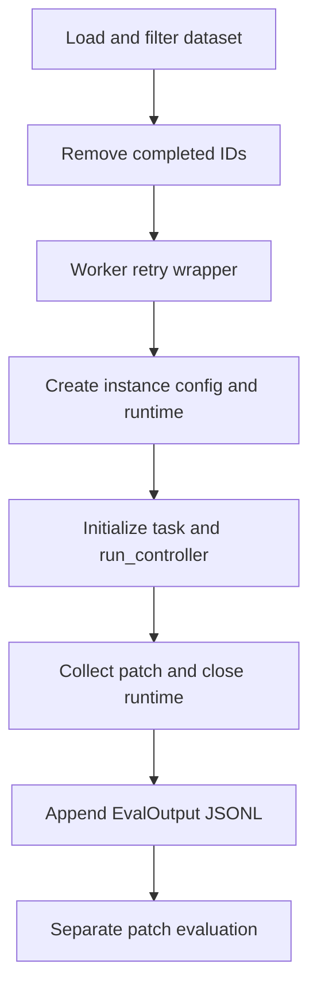

## Overview

The evaluation harness runs dataset instances through an agent and records benchmark-specific results alongside instructions, history, metadata, and metrics. Shared utilities handle output directories, dataset selection, retries, worker processes, and JSONL writing. Benchmark adapters define environment preparation and result extraction. SWE-bench is the concrete flow traced here: inference generates patches, and a separate evaluation script scores them. [[Issue Resolver]] covers repository issue automation with its different result and publication flow.

Sources: [evaluation/utils/shared.py:44-78](repo://evaluation/utils/shared.py#L44-L78), [evaluation/utils/shared.py:486-549](repo://evaluation/utils/shared.py#L486-L549), [evaluation/benchmarks/swe_bench/run_infer.py:637-710](repo://evaluation/benchmarks/swe_bench/run_infer.py#L637-L710), [evaluation/benchmarks/swe_bench/README.md:19-23](repo://evaluation/benchmarks/swe_bench/README.md#L19-L23)

## Choose a benchmark run

The evaluation catalogue includes software-engineering, browsing, assistance, and real-world benchmark adapters. Each has its own inference entry point and setup requirements. For SWE-bench, the shell wrapper accepts a model group, Git revision, agent, evaluation limit, iteration limit, worker count, dataset, split, run count, and mode. It defaults to CodeAct, 100 iterations, one worker, SWE-bench Lite, test split, and `swe` mode. The script invokes version-control helpers before inference, so the revision argument participates in checkout handling.

Sources: [evaluation/README.md:95-131](repo://evaluation/README.md#L95-L131), [evaluation/benchmarks/swe_bench/scripts/run_infer.sh:4-53](repo://evaluation/benchmarks/swe_bench/scripts/run_infer.sh#L4-L53)

The repository documents this wrapper invocation; its model group must exist in the local configuration. [[Quickstart]] covers preparing the source environment, and [[Configuration]] explains named LLM groups. Benchmark code constructs its own application and sandbox settings, so use the adapter's configuration path when comparing an evaluation with an interactive task.

Sources: [evaluation/benchmarks/swe_bench/README.md:57-69](repo://evaluation/benchmarks/swe_bench/README.md#L57-L69), [evaluation/benchmarks/swe_bench/run_infer.py:206-265](repo://evaluation/benchmarks/swe_bench/run_infer.py#L206-L265), [evaluation/benchmarks/swe_bench/run_infer.py:799-807](repo://evaluation/benchmarks/swe_bench/run_infer.py#L799-L807)

```bash
./evaluation/benchmarks/swe_bench/scripts/run_infer.sh llm.eval_gpt4_1106_preview HEAD CodeActAgent 500 100 1 princeton-nlp/SWE-bench_Verified test
```

Sources: [evaluation/benchmarks/swe_bench/README.md:57-62](repo://evaluation/benchmarks/swe_bench/README.md#L57-L62)

## Record configuration and provenance

`make_metadata` creates a path grouped by dataset, agent, model, maximum iterations, and optional note. It writes `metadata.json` with configuration, start time, current Git commit, dataset, split, details, condenser, and instruction-template selection. `EvalOutput` is the per-instance schema: instance ID and `test_result` are required, while instruction, metadata, history, metrics, error, and original instance data are available for inspection. Metadata and outputs therefore carry both execution provenance and benchmark-specific artifacts.

Sources: [evaluation/utils/shared.py:44-78](repo://evaluation/utils/shared.py#L44-L78), [evaluation/utils/shared.py:164-216](repo://evaluation/utils/shared.py#L164-L216)

SWE-bench requires an explicitly resolved model group, enables completion logging, and disables LiteLLM parameter modification for reproducibility. `EVAL_CONDENSER` selects a named condenser; without it, the adapter uses no-op. This differs from the ordinary agent configuration's conversation-window default. [[Memory and Microagents]] describes the strategy behaviors, while [[Language Models]] explains completion logging and provider transformations.

Sources: [evaluation/benchmarks/swe_bench/run_infer.py:799-822](repo://evaluation/benchmarks/swe_bench/run_infer.py#L799-L822), [openhands/core/config/agent_config.py:54-60](repo://openhands/core/config/agent_config.py#L54-L60)

## Select and resume instances

`prepare_dataset` requires an `instance_id` column and loads completed IDs from an existing output file. It can filter explicit IDs, skip an initial portion, or sample a requested count without replacement using seed 42. Explicit IDs take precedence over sampling. Finished IDs are removed after selection, and NumPy arrays and timestamps are normalized for serialization. A resumed run therefore depends on both the output file and the same selection settings; a limit is a deterministic random sample rather than simply the first rows.

Sources: [evaluation/utils/shared.py:219-289](repo://evaluation/utils/shared.py#L219-L289)

The SWE-bench entry point loads its dataset and split through `datasets.load_dataset`, detects a dataset family, and applies adapter filtering before preparing the remaining work. It supports `swe`, `swt`, and `swt-ci` modes. The selected dataset family also changes image naming and workspace conventions, so dataset identity is an execution input as well as a label in output metadata.

Sources: [evaluation/benchmarks/swe_bench/run_infer.py:78-106](repo://evaluation/benchmarks/swe_bench/run_infer.py#L78-L106), [evaluation/benchmarks/swe_bench/run_infer.py:178-216](repo://evaluation/benchmarks/swe_bench/run_infer.py#L178-L216), [evaluation/benchmarks/swe_bench/run_infer.py:747-797](repo://evaluation/benchmarks/swe_bench/run_infer.py#L747-L797)

## Execute a SWE-bench instance

Per-instance configuration selects a benchmark image, enables automatic linting, disables host networking, uses `linux/amd64`, and calculates remote runtime resource allocation. The agent disables Jupyter, MCP, and prompt extensions, with browsing and the LLM editor controlled by evaluation flags. The shared sandbox defaults use a 300-second action timeout, long startup/API timeouts, and no keep-alive. [[Sandbox Runtimes]] explains the underlying execution contract; these values are evaluation-specific overrides.

Sources: [evaluation/benchmarks/swe_bench/run_infer.py:223-263](repo://evaluation/benchmarks/swe_bench/run_infer.py#L223-L263), [evaluation/utils/shared.py:692-705](repo://evaluation/utils/shared.py#L692-L705)

`process_instance` connects a runtime, initializes benchmark state, renders a task message, and calls `run_controller` with the selected automatic user-response function. Fatal evaluation errors trigger `EvalException` for retry. Completion collects the patch and closes the runtime in `finally`. Remote runtime failures can increase the resource factor on later attempts, capped at eight. [[Controller and Event Stream]] covers the shared agent loop rather than duplicating its stepping rules here.

Sources: [evaluation/benchmarks/swe_bench/run_infer.py:606-675](repo://evaluation/benchmarks/swe_bench/run_infer.py#L606-L675)



Sources: [evaluation/benchmarks/swe_bench/run_infer.py:769-778](repo://evaluation/benchmarks/swe_bench/run_infer.py#L769-L778), [evaluation/utils/shared.py:219-289](repo://evaluation/utils/shared.py#L219-L289), [evaluation/utils/shared.py:387-410](repo://evaluation/utils/shared.py#L387-L410), [evaluation/benchmarks/swe_bench/run_infer.py:637-710](repo://evaluation/benchmarks/swe_bench/run_infer.py#L637-L710), [evaluation/utils/shared.py:292-305](repo://evaluation/utils/shared.py#L292-L305), [evaluation/benchmarks/swe_bench/scripts/eval_infer.sh:61-78](repo://evaluation/benchmarks/swe_bench/scripts/eval_infer.sh#L61-L78)

## Retries, workers, and output ordering

`run_evaluation` uses a process pool for more than one worker and sequential execution otherwise. Pool results use `imap_unordered`, so output order reflects completion rather than dataset order. The parent writes and flushes each result through `update_progress`. The retry wrapper defaults to five retries after the initial attempt, waits five seconds between failures, tracks fatal runtime failures, and passes the failure count to adapters that accept it.

Sources: [evaluation/utils/shared.py:292-305](repo://evaluation/utils/shared.py#L292-L305), [evaluation/utils/shared.py:387-410](repo://evaluation/utils/shared.py#L387-L410), [evaluation/utils/shared.py:459-478](repo://evaluation/utils/shared.py#L459-L478), [evaluation/utils/shared.py:486-538](repo://evaluation/utils/shared.py#L486-L538)

A wrapper timeout returns an error result with empty `test_result`; exhausted ordinary retries raise and stop evaluation unless `EVAL_SKIP_MAXIMUM_RETRIES_EXCEEDED=true` enables logged skipping. Although the SWE-bench caller supplies a per-instance timeout, the shared sequential branch does not forward `timeout_seconds` into its wrapper call; the multiprocessing path does. This implementation detail matters when diagnosing an apparently unenforced timeout with one worker.

Sources: [evaluation/utils/shared.py:405-458](repo://evaluation/utils/shared.py#L405-L458), [evaluation/utils/shared.py:513-537](repo://evaluation/utils/shared.py#L513-L537), [evaluation/benchmarks/swe_bench/run_infer.py:867-876](repo://evaluation/benchmarks/swe_bench/run_infer.py#L867-L876)

Optional iterative mode uses `AgentFinishedCritic`, separate attempt files, and a default maximum of three attempts. Later attempts process IDs that failed the previous critic result; zero temperature changes to `0.1` after the first attempt. This retry criterion is separate from infrastructure exception retries and from final patch scoring.

Sources: [evaluation/benchmarks/swe_bench/run_infer.py:849-855](repo://evaluation/benchmarks/swe_bench/run_infer.py#L849-L855), [evaluation/benchmarks/swe_bench/run_infer.py:878-949](repo://evaluation/benchmarks/swe_bench/run_infer.py#L878-L949)

## Extract and score patches

Patch completion stages files, removes staged binary files, writes the cached diff against the instance base commit to `patch.diff`, and reads it with a command fallback for decoding failures. It requires a non-null patch and removes binary diffs before returning. The inference result stores this patch under `test_result.git_patch`; it intentionally leaves scoring to a separate environment because the agent may have altered the environment or tests.

Sources: [evaluation/benchmarks/swe_bench/run_infer.py:529-603](repo://evaluation/benchmarks/swe_bench/run_infer.py#L529-L603), [evaluation/benchmarks/swe_bench/run_infer.py:678-709](repo://evaluation/benchmarks/swe_bench/run_infer.py#L678-L709)

`eval_infer.sh` accepts an output file plus optional instance, dataset, split, and execution-environment selection. It detects SWE-bench prediction format or converts OpenHands output first, then enters the scoring path. Preserve the generated JSONL, metadata, inference logs, and completion logs when investigating a result: successful inference establishes that an artifact was produced, while the separate evaluator determines benchmark correctness.

Sources: [evaluation/benchmarks/swe_bench/scripts/eval_infer.sh:3-78](repo://evaluation/benchmarks/swe_bench/scripts/eval_infer.sh#L3-L78), [evaluation/benchmarks/swe_bench/scripts/eval_infer.sh:82-139](repo://evaluation/benchmarks/swe_bench/scripts/eval_infer.sh#L82-L139), [evaluation/utils/shared.py:187-214](repo://evaluation/utils/shared.py#L187-L214), [evaluation/benchmarks/swe_bench/run_infer.py:241-244](repo://evaluation/benchmarks/swe_bench/run_infer.py#L241-L244), [evaluation/benchmarks/swe_bench/run_infer.py:614-617](repo://evaluation/benchmarks/swe_bench/run_infer.py#L614-L617)
