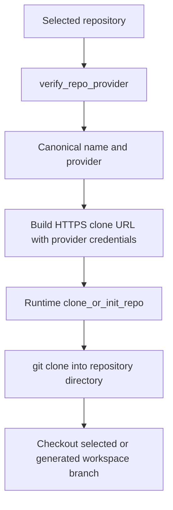

## Overview

`ProviderHandler` routes repository operations to GitHub, GitLab, and Bitbucket services. It converts provider credentials into service instances, repository details, runtime environment variables, and authenticated clone URLs. HTTP routes expose repository discovery and related operations, while runtimes execute the actual Git commands. [[Conversations and Sessions]] follows how repository selection enters a task; [[Sandbox Runtimes]] owns cloning and workspace preparation after provider authentication succeeds.

Sources: [openhands/integrations/provider.py:105-160](repo://openhands/integrations/provider.py#L105-L160), [openhands/integrations/provider.py:385-423](repo://openhands/integrations/provider.py#L385-L423), [openhands/integrations/provider.py:613-661](repo://openhands/integrations/provider.py#L613-L661), [openhands/server/routes/git.py:35-91](repo://openhands/server/routes/git.py#L35-L91), [openhands/runtime/base.py:422-460](repo://openhands/runtime/base.py#L422-L460)

## Credential and service boundaries

`ProviderToken` contains a secret token plus optional user ID and host. Tokens are frozen Pydantic models, and the handler requires a `MappingProxyType` mapping rather than a mutable dictionary. `_get_service` forwards token, host, user identity, external authentication, and token-manager settings to the chosen implementation. The provider enum also contains `enterprise_sso`, but the default service-class map defines Git services for GitHub, GitLab, and Bitbucket only.

Sources: [openhands/integrations/provider.py:41-67](repo://openhands/integrations/provider.py#L41-L67), [openhands/integrations/provider.py:93-94](repo://openhands/integrations/provider.py#L93-L94), [openhands/integrations/provider.py:113-160](repo://openhands/integrations/provider.py#L113-L160), [openhands/integrations/service_types.py:20-24](repo://openhands/integrations/service_types.py#L20-L24)

| Provider | Service behavior and extension setting |
| --- | --- |
| GitHub | Combines repository, branch, PR, feature, and resolver mixins; custom hosts use enterprise API paths; selected by `OPENHANDS_GITHUB_SERVICE_CLS` |
| GitLab | Combines repository, branch, PR, feature, and resolver mixins; custom domains set REST and GraphQL addresses; selected by `OPENHANDS_GITLAB_SERVICE_CLS` |
| Bitbucket | Combines repository, branch, PR, and feature mixins with workspace installation support; selected by `OPENHANDS_BITBUCKET_SERVICE_CLS` |

Sources: [openhands/integrations/github/github_service.py:21-78](repo://openhands/integrations/github/github_service.py#L21-L78), [openhands/integrations/gitlab/gitlab_service.py:20-82](repo://openhands/integrations/gitlab/gitlab_service.py#L20-L82), [openhands/integrations/bitbucket/bitbucket_service.py:19-67](repo://openhands/integrations/bitbucket/bitbucket_service.py#L19-L67)

Headless setup reads `GITHUB_TOKEN`, `GITLAB_TOKEN`, and `BITBUCKET_TOKEN` from the environment and wraps available values in `UserSecrets` before returning its provider mapping. Web routes obtain provider tokens and external identity through authentication dependencies instead. These are credential acquisition paths into the same handler, so provider implementation code does not need to know whether the task started from the browser or the headless runner.

Sources: [openhands/core/setup.py:92-116](repo://openhands/core/setup.py#L92-L116), [openhands/server/routes/git.py:65-81](repo://openhands/server/routes/git.py#L65-L81)

## Discover and verify repositories

Repository listing uses a selected provider's paginated API when one is specified, requiring page and per-page values. Without a selected provider, it gathers repositories from available services and logs individual provider failures while continuing. `verify_repo_provider` tries a specified provider first and then the available mapping, returning the first successful repository-details lookup. If all attempts fail, it logs the collected errors and raises `AuthenticationError`.

Sources: [openhands/integrations/provider.py:213-245](repo://openhands/integrations/provider.py#L213-L245), [openhands/integrations/provider.py:447-470](repo://openhands/integrations/provider.py#L447-L470)

Branch retrieval similarly tries the specified provider and then available services. Its fallback is an empty paginated response, rather than repository verification's exception. Repository and branch results use shared models carrying provider identity, visibility or protection, commit information, and pagination fields. Callers should preserve those distinctions when presenting an unavailable provider, an inaccessible repository, or a repository with no matching branches.

Sources: [openhands/integrations/provider.py:472-513](repo://openhands/integrations/provider.py#L472-L513), [openhands/integrations/service_types.py:125-151](repo://openhands/integrations/service_types.py#L125-L151)

## Authenticate workspace cloning

`get_authenticated_git_url` first verifies the repository and uses the returned canonical full name and provider. The host comes from the token's custom host when present, otherwise the provider's default domain. GitLab credentials use an `oauth2` username; Bitbucket accepts a username-and-app-password token or uses `x-token-auth`; GitHub embeds the token directly in the HTTPS authority. If the selected token has no value, the method returns a regular HTTPS clone URL, but repository verification still occurred first.

Sources: [openhands/integrations/provider.py:613-661](repo://openhands/integrations/provider.py#L613-L661)

Sources: [openhands/integrations/provider.py:622-661](repo://openhands/integrations/provider.py#L622-L661), [openhands/runtime/base.py:422-460](repo://openhands/runtime/base.py#L422-L460)

The runtime requests this URL before constructing its clone action and raises an error if it cannot obtain one. It executes clone and checkout through runtime action methods. Repository setup and hooks remain runtime concerns; automated issue work adds a separate provider-specific issue abstraction and patch publication path, described in [[Issue Resolver]].

Sources: [openhands/runtime/base.py:422-488](repo://openhands/runtime/base.py#L422-L488), [openhands/resolver/issue_resolver.py:30-44](repo://openhands/resolver/issue_resolver.py#L30-L44)

## Runtime exports and refresh

`get_env_vars` returns typed secret values unless asked to expose strings. Runtime environment keys are lowercase names such as `github_token`, derived from the provider enum. Refresh occurs only when `get_latest` is requested and both a refresh URL and session ID exist. The refresh endpoint is based on `WEB_HOST` and receives the provider, session ID, and session API-key header. A failed refresh logs a warning and returns no refreshed token.

Sources: [openhands/integrations/provider.py:139-142](repo://openhands/integrations/provider.py#L139-L142), [openhands/integrations/provider.py:172-193](repo://openhands/integrations/provider.py#L172-L193), [openhands/integrations/provider.py:385-445](repo://openhands/integrations/provider.py#L385-L445)

Before action execution, the runtime scans command actions for provider-token names case-insensitively. When it finds references, it fetches the latest values, updates event-stream secret registration, and exports the values into the execution environment. `set_event_stream_secrets` supplies exposed provider values to the stream's masking implementation, which replaces registered strings in eligible string fields and nested dictionaries while preserving protected top-level event metadata. This is value-based masking with specific traversal rules.

Sources: [openhands/integrations/provider.py:338-367](repo://openhands/integrations/provider.py#L338-L367), [openhands/integrations/provider.py:426-445](repo://openhands/integrations/provider.py#L426-L445), [openhands/runtime/base.py:324-358](repo://openhands/runtime/base.py#L324-L358), [openhands/events/stream.py:215-244](repo://openhands/events/stream.py#L215-L244)

## HTTP operations and repository knowledge

The OSS Git router uses `/api/user` and exposes installation/workspace lookup, repository listing, user information, repository and branch search, suggested tasks, and paginated branches. Installation lookup supports GitHub and Bitbucket explicitly and rejects unsupported providers. Missing tokens raise authentication errors or produce route-specific 401 responses; selected provider service failures are translated by the route. The shared application includes this router only in OSS mode; hosted routes are extended through [[Enterprise Services]].

Sources: [openhands/server/routes/git.py:35-62](repo://openhands/server/routes/git.py#L35-L62), [openhands/server/routes/git.py:65-102](repo://openhands/server/routes/git.py#L65-L102), [openhands/server/routes/git.py:132-207](repo://openhands/server/routes/git.py#L132-L207), [openhands/server/routes/git.py:210-240](repo://openhands/server/routes/git.py#L210-L240), [openhands/server/app.py:83-85](repo://openhands/server/app.py#L83-L85)

Suggested tasks render provider-specific templates for merge conflicts, failing checks, unresolved comments, and open issues. Repository microagent retrieval tries providers until a nonempty result is found, reports accumulated provider errors when all fail, and returns an empty list when all successful responses are empty. [[Memory and Microagents]] describes how retrieved instructions later enter model context; repository discovery and knowledge activation remain separate steps.

Sources: [openhands/integrations/service_types.py:48-107](repo://openhands/integrations/service_types.py#L48-L107), [openhands/integrations/provider.py:527-554](repo://openhands/integrations/provider.py#L527-L554)
