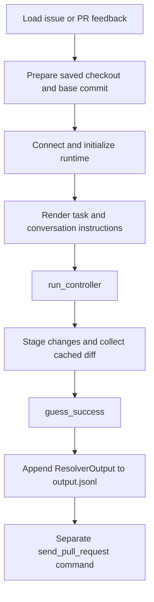

## Overview

The resolver runs CodeAct against a repository issue or pull-request feedback, records the resulting patch and trajectory, and assesses whether the work appears successful. A separate publishing module applies a saved patch, commits it, and pushes a branch or creates or updates a pull request. [[Git Provider Integrations]] covers shared repository credentials and services; the resolver adds provider-specific issue and review-context handlers around the headless agent flow.

Sources: [openhands/resolver/issue_resolver.py:397-475](repo://openhands/resolver/issue_resolver.py#L397-L475), [openhands/resolver/issue_resolver.py:504-517](repo://openhands/resolver/issue_resolver.py#L504-L517), [openhands/resolver/send_pull_request.py:522-584](repo://openhands/resolver/send_pull_request.py#L522-L584), [openhands/resolver/issue_handler_factory.py:36-110](repo://openhands/resolver/issue_handler_factory.py#L36-L110)

## Inputs and credentials

The `openhands.resolver.resolve_issue` module requires `--selected-repo` and `--issue-number`. Optional arguments select a comment, issue or PR mode, runtime, container image, output directory, model settings, prompt template, repository instructions, and base domain. The default maximum iteration count is 50, output directory is `output`, and issue type is `issue`. Its `main` constructs `IssueResolver` and runs `resolve_issue` through asyncio.

Sources: [openhands/resolver/resolve_issue.py:17-95](repo://openhands/resolver/resolve_issue.py#L17-L95), [openhands/resolver/resolve_issue.py:97-135](repo://openhands/resolver/resolve_issue.py#L97-L135)

Construction splits repository owner and name at the final slash and rejects an invalid format. Token selection prefers the argument, then GitHub, GitLab, and Bitbucket token environment variables. Username comes from the argument or `GIT_USERNAME`; both username and token are required. The resolver identifies the platform from the token and domain, reads prompt templates, and constructs an issue-handler factory. Default templates differ between an issue and PR feedback, with a companion conversation-instructions template loaded alongside the user prompt.

Sources: [openhands/resolver/issue_resolver.py:74-123](repo://openhands/resolver/issue_resolver.py#L74-L123), [openhands/resolver/issue_resolver.py:125-176](repo://openhands/resolver/issue_resolver.py#L125-L176)

`IssueHandlerFactory` selects an issue or PR strategy for GitHub, GitLab, or Bitbucket and wraps it in `ServiceContextIssue` or `ServiceContextPR`. Unsupported platforms and issue types fail immediately. Issue extraction asks that context for converted issues and rejects an empty result; when a specific comment was requested, the resolver also verifies that matching feedback exists before starting execution.

Sources: [openhands/resolver/issue_handler_factory.py:36-110](repo://openhands/resolver/issue_handler_factory.py#L36-L110), [openhands/resolver/issue_resolver.py:519-560](repo://openhands/resolver/issue_resolver.py#L519-L560)

## Prepare configuration and checkout

The resolver loads application configuration and then forces `CodeActAgent`, a budget of 4, and the requested iteration count. It selects the provided runtime or the loaded/default Docker runtime and installs an agent configuration disabling the `github` microagent. Image configuration rejects simultaneous base and runtime images. Without either image and outside experimental mode, it chooses the versioned runtime image. [[Configuration]] explains the settings loaded before these resolver-specific overrides.

Sources: [openhands/resolver/issue_resolver.py:145-153](repo://openhands/resolver/issue_resolver.py#L145-L153), [openhands/resolver/issue_resolver.py:178-226](repo://openhands/resolver/issue_resolver.py#L178-L226)

`resolve_issue` creates output and inference-log directories, clones into `<output>/repo` if absent, and records the checkout's `HEAD`. It can load legacy repository instructions when no instruction file was supplied. Existing `output.jsonl` records are checked by issue number, and an already processed issue is skipped. PR mode fetches and checks out the PR head branch and updates the base commit before processing. Reusing an output directory therefore affects both checkout reuse and duplicate detection.

Sources: [openhands/resolver/issue_resolver.py:562-615](repo://openhands/resolver/issue_resolver.py#L562-L615), [openhands/resolver/issue_resolver.py:623-652](repo://openhands/resolver/issue_resolver.py#L623-L652)

## Execute the task

`process_issue` replaces its working directory with a copy of the saved repository, creates a registry and runtime, connects it, and subscribes an event logger. Runtime initialization changes to `/workspace`, configures Git paging, and checks repository setup and pre-commit scripts. The service context renders instructions and image URLs; the resolver wraps them in `MessageAction` and invokes `run_controller` with the existing runtime and an automatic user-response callback. [[Sandbox Runtimes]] describes execution, while [[Controller and Event Stream]] owns stepping and limits.

Sources: [openhands/resolver/issue_resolver.py:411-446](repo://openhands/resolver/issue_resolver.py#L411-L446), [openhands/resolver/issue_resolver.py:281-307](repo://openhands/resolver/issue_resolver.py#L281-L307)

Sources: [openhands/resolver/issue_resolver.py:544-587](repo://openhands/resolver/issue_resolver.py#L544-L587), [openhands/resolver/issue_resolver.py:411-475](repo://openhands/resolver/issue_resolver.py#L411-L475), [openhands/resolver/issue_resolver.py:350-386](repo://openhands/resolver/issue_resolver.py#L350-L386), [openhands/resolver/issue_resolver.py:654-661](repo://openhands/resolver/issue_resolver.py#L654-L661), [openhands/resolver/send_pull_request.py:522-584](repo://openhands/resolver/send_pull_request.py#L522-L584)

## Patch collection and result meaning

Completion stages all changes and requests `git diff --no-color --cached <base_commit>`. It retries up to five times, increasing the hard timeout and waiting after failed command or error observations. Agent execution failures caught as `ValueError` or `RuntimeError` leave no final state, but the resolver still attempts patch collection. A missing state yields empty history, no metrics, false success, and an agent-failed explanation.

Sources: [openhands/resolver/issue_resolver.py:350-386](repo://openhands/resolver/issue_resolver.py#L350-L386), [openhands/resolver/issue_resolver.py:440-469](repo://openhands/resolver/issue_resolver.py#L440-L469)

For a final state, the service context's `guess_success` inspects issue context, agent history, and patch. The issue implementation asks its LLM to evaluate the result; PR assessment returns overall and per-feedback results. This success flag is an assessment, not an independent benchmark test pass. `ResolverOutput` stores issue, type, instruction, base commit, patch, serialized history, metrics, success, per-comment results, explanation, and error. The resolver appends one JSON record and flushes it before closing the output file.

Sources: [openhands/resolver/issue_resolver.py:470-475](repo://openhands/resolver/issue_resolver.py#L470-L475), [openhands/resolver/interfaces/issue_definitions.py:370-410](repo://openhands/resolver/interfaces/issue_definitions.py#L370-L410), [openhands/resolver/interfaces/issue_definitions.py:101-108](repo://openhands/resolver/interfaces/issue_definitions.py#L101-L108), [openhands/resolver/resolver_output.py:8-20](repo://openhands/resolver/resolver_output.py#L8-L20), [openhands/resolver/issue_resolver.py:654-665](repo://openhands/resolver/issue_resolver.py#L654-L665)

## Publish saved results

`send_pull_request` provides `branch`, `draft`, and `ready` modes, defaulting to draft in its parser. `process_single_issue` skips unsuccessful results unless `send_on_failure` is enabled. It copies the saved checkout to a patch directory, checks out the recorded base or PR head, applies the patch, and commits. Patch application handles file deletion and rename as well as text changes; committing rejects a result with no changes. These operations act on a saved resolver result rather than continuing the agent conversation.

Sources: [openhands/resolver/send_pull_request.py:28-119](repo://openhands/resolver/send_pull_request.py#L28-L119), [openhands/resolver/send_pull_request.py:124-159](repo://openhands/resolver/send_pull_request.py#L124-L159), [openhands/resolver/send_pull_request.py:197-230](repo://openhands/resolver/send_pull_request.py#L197-L230), [openhands/resolver/send_pull_request.py:522-555](repo://openhands/resolver/send_pull_request.py#L522-L555), [openhands/resolver/send_pull_request.py:615-626](repo://openhands/resolver/send_pull_request.py#L615-L626)

Issue mode pushes a branch and either returns a compare URL or creates a PR with the chosen draft state, target branch, and optional reviewer. PR mode updates the existing branch and can post a change summary and replies to review threads. The repository also supplies a reusable GitHub workflow with label/comment/review triggers and write permissions. [[Evaluation Harness]] covers dataset execution and benchmark artifacts, which use a different orchestration and result schema from issue automation.

Sources: [openhands/resolver/send_pull_request.py:329-384](repo://openhands/resolver/send_pull_request.py#L329-L384), [openhands/resolver/send_pull_request.py:438-497](repo://openhands/resolver/send_pull_request.py#L438-L497), [openhands/resolver/send_pull_request.py:557-584](repo://openhands/resolver/send_pull_request.py#L557-L584), [.github/workflows/openhands-resolver.yml:3-67](repo://.github/workflows/openhands-resolver.yml#L3-L67), [evaluation/utils/shared.py:44-78](repo://evaluation/utils/shared.py#L44-L78)
