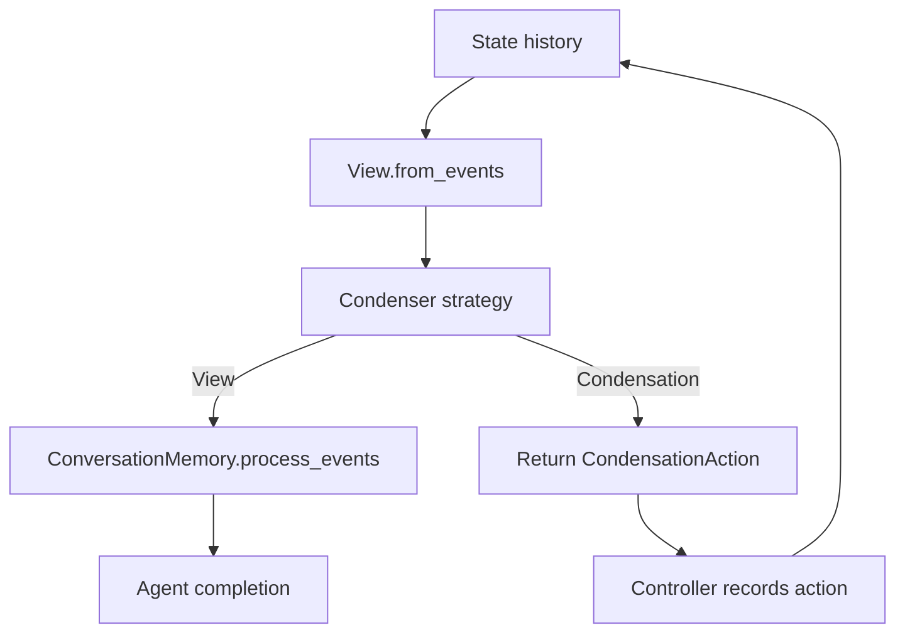

## Overview

OpenHands builds model context in two stages: `Memory` retrieves workspace knowledge as events, while `ConversationMemory` turns selected history into model messages. A condenser determines which events are visible for that conversion. These mechanisms add relevant instructions and reduce conversation size without replacing the event-stream coordination described in [[Controller and Event Stream]]. [[Agents and Tools]] explains where CodeAct consumes the resulting context.

Sources: [openhands/memory/memory.py:41-84](repo://openhands/memory/memory.py#L41-L84), [openhands/memory/conversation_memory.py:74-96](repo://openhands/memory/conversation_memory.py#L74-L96), [openhands/memory/condenser/condenser.py:44-52](repo://openhands/memory/condenser/condenser.py#L44-L52), [openhands/agenthub/codeact_agent/codeact_agent.py:191-208](repo://openhands/agenthub/codeact_agent/codeact_agent.py#L191-L208)

## Recall workspace and keyword knowledge

`Memory` subscribes under `EventStreamSubscriber.MEMORY`. Workspace-context recall is accepted from a user-sourced `RecallAction`; keyword knowledge recall accepts user or agent sources. Both branches publish an observation whose cause matches the recall event ID. If retrieval finds no content, memory publishes `NullObservation` with the same cause so the controller can stop waiting. Retrieval exceptions set `ERROR_MEMORY` status instead of returning a successful recall.

Sources: [openhands/memory/memory.py:64-68](repo://openhands/memory/memory.py#L64-L68), [openhands/memory/memory.py:90-137](repo://openhands/memory/memory.py#L90-L137)

Workspace recall concatenates all repository microagent content and combines it with repository identity, branch and directory, runtime hosts, additional instructions, date, working directory, custom-secret descriptions, conversation instructions, and keyword matches. Knowledge recall contains matching microagents only. Trigger matching is case-insensitive substring matching and returns the first matching trigger for each microagent. It does not perform an embedding search: the query is checked directly against configured trigger strings.

Sources: [openhands/memory/memory.py:153-223](repo://openhands/memory/memory.py#L153-L223), [openhands/memory/memory.py:225-252](repo://openhands/memory/memory.py#L225-L252), [openhands/microagent/microagent.py:189-203](repo://openhands/microagent/microagent.py#L189-L203)

## Load and classify microagents

Memory first loads global microagents, then user microagents from `~/.openhands/microagents/`, and later accepts workspace microagents. Dictionaries are keyed by name, so later assignment replaces an earlier entry with the same name within its category. User-directory loading creates the directory and logs failures without aborting construction. Runtime repository loading gathers organization or user-level microagents before repository-specific files and also checks the legacy `.openhands_instructions` file.

Sources: [openhands/memory/memory.py:79-84](repo://openhands/memory/memory.py#L79-L84), [openhands/memory/memory.py:254-300](repo://openhands/memory/memory.py#L254-L300), [openhands/runtime/base.py:838-888](repo://openhands/runtime/base.py#L838-L888)

`BaseMicroagent.load` reads Markdown front matter, normalizes numeric versions to strings, validates metadata, and derives a name from the file's relative path when a microagent directory is supplied. It recognizes `.cursorrules`, `agents.md`, and `agent.md` as repository instructions, case-insensitively. Inputs imply a task microagent and add a slash-name trigger; otherwise triggers imply keyword knowledge, and no triggers imply always-active repository knowledge. Task microagents append a prompt requesting missing input variables.

Sources: [openhands/microagent/microagent.py:26-49](repo://openhands/microagent/microagent.py#L26-L49), [openhands/microagent/microagent.py:62-105](repo://openhands/microagent/microagent.py#L62-L105), [openhands/microagent/microagent.py:129-171](repo://openhands/microagent/microagent.py#L129-L171), [openhands/microagent/microagent.py:226-250](repo://openhands/microagent/microagent.py#L226-L250)

Repository microagents can carry MCP configuration. Loading warns about SSE servers and requires stdio servers when MCP configuration is present. `get_microagent_mcp_tools` collects configurations from repository microagents, which are always active; keyword matching does not govern that collection. [[MCP Tools]] follows how these configurations become discoverable tool schemas.

Sources: [openhands/microagent/microagent.py:104-118](repo://openhands/microagent/microagent.py#L104-L118), [openhands/memory/memory.py:302-318](repo://openhands/memory/memory.py#L302-L318)

## Convert events into valid model messages

`ConversationMemory.process_events` ensures a system message and the initial user message exist, then processes actions and observations. It groups tool-call results by tool-call ID and waits until all calls belonging to a pending model-response message have results before appending that assistant message and its tool responses. A final filter removes unmatched calls and responses, followed by user-message formatting. Observation conversion receives the character limit and vision flags, so event storage and model-visible content need not be identical.

Sources: [openhands/memory/conversation_memory.py:74-164](repo://openhands/memory/conversation_memory.py#L74-L164)

## Condensation protocol

A condenser returns either `View` or `Condensation`. A view is ready for message construction; a condensation contains an action that the agent returns immediately. The next step reconstructs the view after that action enters history. `View.from_events` excludes forgotten IDs and condensation control events, inserts the latest available summary at its specified offset, and detects whether a condensation request remains unhandled. This changes the model's working view rather than deleting original event files.

Sources: [openhands/memory/condenser/condenser.py:38-52](repo://openhands/memory/condenser/condenser.py#L38-L52), [openhands/agenthub/codeact_agent/codeact_agent.py:191-201](repo://openhands/agenthub/codeact_agent/codeact_agent.py#L191-L201), [openhands/memory/view.py:47-93](repo://openhands/memory/view.py#L47-L93)

Sources: [openhands/memory/view.py:47-93](repo://openhands/memory/view.py#L47-L93), [openhands/memory/condenser/condenser.py:104-115](repo://openhands/memory/condenser/condenser.py#L104-L115), [openhands/agenthub/codeact_agent/codeact_agent.py:191-224](repo://openhands/agenthub/codeact_agent/codeact_agent.py#L191-L224), [openhands/controller/agent_controller.py:471-485](repo://openhands/controller/agent_controller.py#L471-L485)

## Available condenser strategies

| Strategy | Transformation |
| --- | --- |
| No-op | Return the incoming view unchanged |
| Recent events | Combine a configured initial prefix with a recent tail |
| Observation masking | Replace older observations outside the attention window with placeholders |
| Browser-output masking | Keep recent browser observations and replace earlier browser content with URL placeholders |
| Amortized forgetting | When oversized, retain an initial prefix and recent tail totaling roughly half the configured maximum |
| LLM summarizing | Summarize forgotten events and return a condensation action containing that summary |
| LLM attention | Ask a model to rank event IDs for retention |
| Structured summary | Request a validated state-summary tool call and store its formatted summary |
| Pipeline | Apply condensers in order, stopping at the first condensation action |
| Conversation window | Respond to an unhandled condensation request by preserving essential initial events and recent history |

Sources: [openhands/memory/condenser/impl/no_op_condenser.py:11-13](repo://openhands/memory/condenser/impl/no_op_condenser.py#L11-L13), [openhands/memory/condenser/impl/recent_events_condenser.py:17-22](repo://openhands/memory/condenser/impl/recent_events_condenser.py#L17-L22), [openhands/memory/condenser/impl/observation_masking_condenser.py:19-28](repo://openhands/memory/condenser/impl/observation_masking_condenser.py#L19-L28), [openhands/memory/condenser/impl/browser_output_condenser.py:21-40](repo://openhands/memory/condenser/impl/browser_output_condenser.py#L21-L40), [openhands/memory/condenser/impl/amortized_forgetting_condenser.py:40-58](repo://openhands/memory/condenser/impl/amortized_forgetting_condenser.py#L40-L58), [openhands/memory/condenser/impl/llm_summarizing_condenser.py:132-161](repo://openhands/memory/condenser/impl/llm_summarizing_condenser.py#L132-L161), [openhands/memory/condenser/impl/llm_attention_condenser.py:56-89](repo://openhands/memory/condenser/impl/llm_attention_condenser.py#L56-L89), [openhands/memory/condenser/impl/structured_summary_condenser.py:255-308](repo://openhands/memory/condenser/impl/structured_summary_condenser.py#L255-L308), [openhands/memory/condenser/impl/pipeline.py:34-47](repo://openhands/memory/condenser/impl/pipeline.py#L34-L47), [openhands/memory/condenser/impl/conversation_window_condenser.py:20-27](repo://openhands/memory/condenser/impl/conversation_window_condenser.py#L20-L27), [openhands/memory/condenser/impl/conversation_window_condenser.py:141-177](repo://openhands/memory/condenser/impl/conversation_window_condenser.py#L141-L177)

The default `AgentConfig` uses the conversation-window condenser because a no-op strategy would never handle the condensation requests generated when the model context limit is hit. That window strategy preserves the system message, first user message, associated recall, and recent action-observation context. Model-based strategies instead require model configuration and incur their own completion work. [[Language Models]] explains registry services and metrics for those calls; choose configuration based on the actual strategy rather than assuming every condenser summarizes.

Sources: [openhands/core/config/agent_config.py:48-60](repo://openhands/core/config/agent_config.py#L48-L60), [openhands/memory/condenser/impl/conversation_window_condenser.py:20-100](repo://openhands/memory/condenser/impl/conversation_window_condenser.py#L20-L100), [openhands/core/config/condenser_config.py:61-85](repo://openhands/core/config/condenser_config.py#L61-L85), [openhands/memory/condenser/impl/llm_summarizing_condenser.py:142-149](repo://openhands/memory/condenser/impl/llm_summarizing_condenser.py#L142-L149)

## Extend and diagnose context handling

Condenser classes register against configuration types; duplicate registration and unknown configuration types raise `ValueError`. `condensed_history` attaches model metadata and runs within a metadata-batching context that writes diagnostics into `state.extra_data`. Retrieval errors, invalid microagent metadata, missing tool pairs, and failed condensation are separate boundaries. Inspect recall observations for knowledge delivery and the condenser's view and metadata for retention decisions before changing agent prompts.

Sources: [openhands/memory/condenser/condenser.py:70-115](repo://openhands/memory/condenser/condenser.py#L70-L115), [openhands/memory/condenser/condenser.py:129-166](repo://openhands/memory/condenser/condenser.py#L129-L166), [openhands/memory/memory.py:133-136](repo://openhands/memory/memory.py#L133-L136), [openhands/microagent/microagent.py:120-127](repo://openhands/microagent/microagent.py#L120-L127), [openhands/memory/conversation_memory.py:129-159](repo://openhands/memory/conversation_memory.py#L129-L159)
