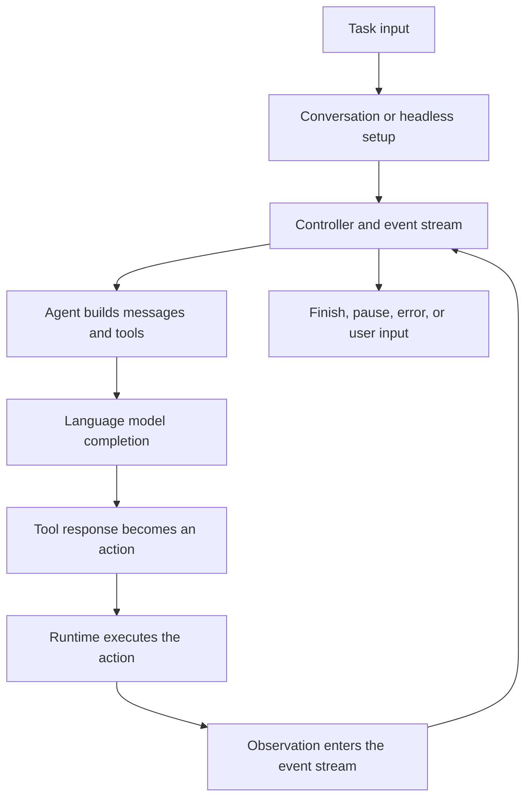

## Overview

OpenHands runs software development agents that accept a task, ask a language model for actions, execute those actions against a workspace, and feed the results back into the conversation. This checkout contains the Python agent platform and server, a browser application, unattended issue resolution, benchmark runners, and enterprise extensions. The Python package identifies itself as `openhands-ai` version `0.56.0`; these pages describe the checked-out implementation. Start with [[Quickstart]] to run it, then use the system pages to follow the part you are changing.

Sources: [pyproject.toml:7-25](repo://pyproject.toml#L7-L25), [openhands/core/main.py:97-167](repo://openhands/core/main.py#L97-L167), [openhands/resolver/issue_resolver.py:14-49](repo://openhands/resolver/issue_resolver.py#L14-L49), [evaluation/benchmarks/swe_bench/run_infer.py:26-65](repo://evaluation/benchmarks/swe_bench/run_infer.py#L26-L65), [enterprise/saas_server.py:40-98](repo://enterprise/saas_server.py#L40-L98)

## System map

| Area | What it does | Page |
| --- | --- | --- |
| Launch | Build this checkout and choose web, terminal, or headless execution | [[Quickstart]] |
| Settings | Load application, model, agent, and sandbox configuration | [[Configuration]] |
| Conversations | Create metadata and start or restore a web agent session | [[Conversations and Sessions]] |
| Coordination | Persist events, advance the controller, and gate execution | [[Controller and Event Stream]] |
| Agent behavior | Build tool definitions and decode model responses into actions | [[Agents and Tools]] |
| Model access | Construct model clients and pass completion requests | [[Language Models]] |
| Execution | Select a runtime and execute commands, file operations, and browser actions | [[Sandbox Runtimes]] |
| Context | Add workspace knowledge and construct bounded conversation history | [[Memory and Microagents]] |
| External tools | Discover and register MCP tools before the controller starts | [[MCP Tools]] |
| Browser application | Present the conversation and its streamed events | [[Web Client]] |
| Repository access | Authenticate provider operations and prepare repository URLs | [[Git Provider Integrations]] |
| Issue automation | Run an agent against an issue or pull request | [[Issue Resolver]] |
| Benchmarks | Execute dataset instances through the shared agent platform | [[Evaluation Harness]] |
| Hosted extensions | Extend the shared server with authentication, billing, and integrations | [[Enterprise Services]] |

Sources: [openhands/cli/entry.py:12-48](repo://openhands/cli/entry.py#L12-L48), [openhands/core/main.py:97-167](repo://openhands/core/main.py#L97-L167), [openhands/server/app.py:17-35](repo://openhands/server/app.py#L17-L35), [openhands/agenthub/codeact_agent/codeact_agent.py:182-224](repo://openhands/agenthub/codeact_agent/codeact_agent.py#L182-L224), [openhands/runtime/base.py:324-399](repo://openhands/runtime/base.py#L324-L399), [frontend/package.json:9-61](repo://frontend/package.json#L9-L61), [openhands/resolver/issue_resolver.py:14-49](repo://openhands/resolver/issue_resolver.py#L14-L49), [evaluation/benchmarks/swe_bench/run_infer.py:26-65](repo://evaluation/benchmarks/swe_bench/run_infer.py#L26-L65), [enterprise/saas_server.py:40-98](repo://enterprise/saas_server.py#L40-L98)

## A task through the platform

Sources: [openhands/core/main.py:97-167](repo://openhands/core/main.py#L97-L167), [openhands/core/main.py:177-228](repo://openhands/core/main.py#L177-L228), [openhands/agenthub/codeact_agent/codeact_agent.py:182-224](repo://openhands/agenthub/codeact_agent/codeact_agent.py#L182-L224), [openhands/controller/agent_controller.py:919-973](repo://openhands/controller/agent_controller.py#L919-L973), [openhands/runtime/base.py:361-399](repo://openhands/runtime/base.py#L361-L399)

The first step selects the entry path. The installed `openhands` command dispatches terminal work to the CLI and `serve` to the GUI launcher. Headless work enters `run_controller`, which creates a registry and agent, connects a runtime, and creates memory. Web work instead starts from stored conversation settings. [[Quickstart]] covers launch commands; [[Configuration]] explains the values consumed during construction, while [[Conversations and Sessions]] follows the web lifecycle from metadata to a live session.

Sources: [openhands/cli/entry.py:12-48](repo://openhands/cli/entry.py#L12-L48), [openhands/core/main.py:97-143](repo://openhands/core/main.py#L97-L143), [openhands/server/services/conversation_service.py:98-159](repo://openhands/server/services/conversation_service.py#L98-L159)

Next, [[Controller and Event Stream]] coordinates the exchange. The agent obtains a condensed history, constructs messages, and calls its model with tool definitions. [[Agents and Tools]] owns that translation between model output and action objects; [[Language Models]] follows the completion boundary. A single response can enqueue multiple actions, which CodeAct returns one at a time on later steps. [[Memory and Microagents]] explains the history and workspace context that enter those messages.

Sources: [openhands/agenthub/codeact_agent/codeact_agent.py:182-224](repo://openhands/agenthub/codeact_agent/codeact_agent.py#L182-L224), [openhands/agenthub/codeact_agent/codeact_agent.py:279-299](repo://openhands/agenthub/codeact_agent/codeact_agent.py#L279-L299)

Execution then moves to [[Sandbox Runtimes]]. The runtime handles an action, attaches its originating event ID to the resulting observation, preserves tool-call metadata, and adds the observation to the event stream. Repository operations can refresh provider credentials before execution, as described in [[Git Provider Integrations]]. MCP actions take a separate asynchronous tool-call branch within the same runtime handler; [[MCP Tools]] explains discovery and invocation. The controller can then consume the result and continue the task.

Sources: [openhands/runtime/base.py:324-399](repo://openhands/runtime/base.py#L324-L399)

## Design decisions across systems

Events provide the common boundary between independently subscribed components. `EventStream.add_event` serializes an event, replaces registered secrets, writes the event and any completed cache page, then queues subscriber delivery. Cache pages exist because reading many individual events is slow. Subscriber callbacks run through their own executors, so queued delivery is distinct from completion of a callback. This separation is central when following a command from submission to its observation or investigating a client that has received an action before its result.

Sources: [openhands/events/stream.py:175-213](repo://openhands/events/stream.py#L175-L213), [openhands/events/stream.py:254-275](repo://openhands/events/stream.py#L254-L275)

Tool registration precedes controller creation in web sessions because the tools must be present in the `SystemMessageAction`. Runtime connection and memory construction therefore happen before `add_mcp_tools_to_agent`, which in turn happens before `_create_controller`. This ordering explains why changing tool setup in an already running session is different from changing the next session's configuration. The startup path also registers provider and custom secrets with the event stream before the controller begins emitting task activity.

Sources: [openhands/server/session/agent_session.py:134-189](repo://openhands/server/session/agent_session.py#L134-L189)

Runtime selection is an explicit extension boundary. Built-in names resolve to runtime classes; optional third-party packages are discovered dynamically, with missing dependencies tolerated. An unrecognized name is also tried as a custom implementation before the selector reports unsupported runtimes. This lets the controller and agent communicate through the runtime contract while provisioning differs between Docker, local, remote, and Kubernetes implementations.

Sources: [openhands/runtime/__init__.py:14-103](repo://openhands/runtime/__init__.py#L14-L103)

## Other execution surfaces

The browser is one consumer of this platform. The server wraps FastAPI with Socket.IO and can serve the built frontend; [[Web Client]] explains how the browser consumes the conversation. [[Issue Resolver]] and [[Evaluation Harness]] import the shared headless execution path for automated tasks. [[Enterprise Services]] extends the shared FastAPI application and Socket.IO server with hosted-service routes, so shared conversation behavior still matters when investigating an enterprise-specific integration.

Sources: [openhands/server/listen.py:15-27](repo://openhands/server/listen.py#L15-L27), [openhands/resolver/issue_resolver.py:14-45](repo://openhands/resolver/issue_resolver.py#L14-L45), [evaluation/benchmarks/swe_bench/run_infer.py:43-65](repo://evaluation/benchmarks/swe_bench/run_infer.py#L43-L65), [enterprise/saas_server.py:40-98](repo://enterprise/saas_server.py#L40-L98), [enterprise/saas_server.py:130-130](repo://enterprise/saas_server.py#L130-L130)
