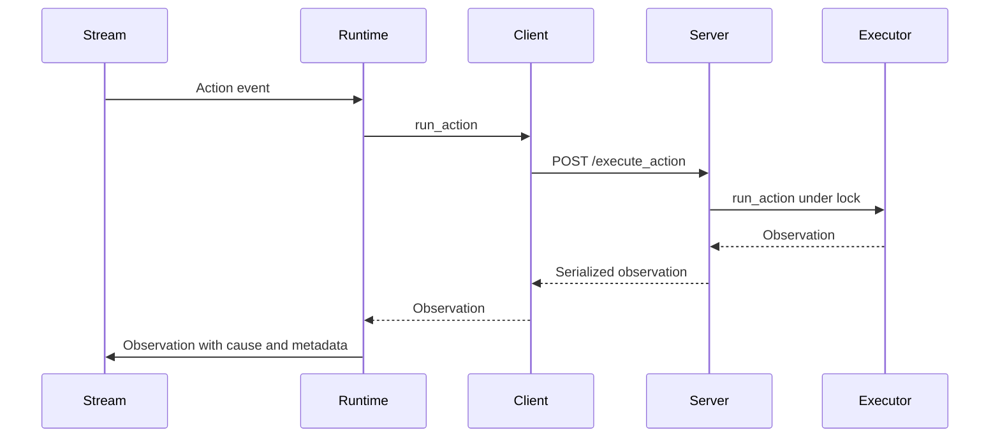

## Overview

A runtime executes an agent's actions and returns observations through the conversation's event stream. The base `Runtime` subscribes to actions, holds configuration and provider credentials, and initializes editing and security support. Docker, remote, Kubernetes, and local implementations share an HTTP action-execution client; the CLI runtime executes locally through subprocesses. [[Controller and Event Stream]] explains when an action is dispatched and how its observation releases the next agent step.

Sources: [openhands/runtime/base.py:142-204](repo://openhands/runtime/base.py#L142-L204), [openhands/runtime/impl/docker/docker_runtime.py:75-75](repo://openhands/runtime/impl/docker/docker_runtime.py#L75-L75), [openhands/runtime/impl/remote/remote_runtime.py:39-39](repo://openhands/runtime/impl/remote/remote_runtime.py#L39-L39), [openhands/runtime/impl/kubernetes/kubernetes_runtime.py:61-61](repo://openhands/runtime/impl/kubernetes/kubernetes_runtime.py#L61-L61), [openhands/runtime/impl/local/local_runtime.py:123-133](repo://openhands/runtime/impl/local/local_runtime.py#L123-L133), [openhands/runtime/impl/cli/cli_runtime.py:90-92](repo://openhands/runtime/impl/cli/cli_runtime.py#L90-L92)

## Select an execution backend

| Runtime name | Execution path |
| --- | --- |
| `docker`, legacy `eventstream` | Attach to a Docker container or build and start one, then wait for the execution server |
| `remote` | Find an existing runtime or start one through the remote runtime path |
| `kubernetes` | Attach to a pod or initialize Kubernetes resources and wait for readiness |
| `local` | Run the action-execution server directly on the host; no sandbox is used |
| `cli` | Run commands with local subprocesses and file operations with Python; browser functionality is absent |

Sources: [openhands/runtime/__init__.py:14-21](repo://openhands/runtime/__init__.py#L14-L21), [openhands/runtime/impl/docker/docker_runtime.py:170-214](repo://openhands/runtime/impl/docker/docker_runtime.py#L170-L214), [openhands/runtime/impl/remote/remote_runtime.py:125-171](repo://openhands/runtime/impl/remote/remote_runtime.py#L125-L171), [openhands/runtime/impl/kubernetes/kubernetes_runtime.py:219-276](repo://openhands/runtime/impl/kubernetes/kubernetes_runtime.py#L219-L276), [openhands/runtime/impl/local/local_runtime.py:123-165](repo://openhands/runtime/impl/local/local_runtime.py#L123-L165), [openhands/runtime/impl/cli/cli_runtime.py:90-92](repo://openhands/runtime/impl/cli/cli_runtime.py#L90-L92)

`get_runtime_cls` combines built-in classes with discovered third-party runtime packages. Discovery tolerates unavailable optional libraries and logs other import failures. Unrecognized names are resolved as custom `Runtime` implementations before raising an unsupported-runtime error. The package declares optional E2B, Modal, Runloop, and Daytona dependencies through `third_party_runtimes`. [[Configuration]] covers the runtime setting, volumes, and capability adjustments applied before selection.

Sources: [openhands/runtime/__init__.py:23-103](repo://openhands/runtime/__init__.py#L23-L103), [pyproject.toml:98-106](repo://pyproject.toml#L98-L106)

## Connect and prepare the workspace

Docker connection first tries to attach to the named container. If attachment fails and `attach_to_existing` is true, it raises a disconnected-runtime error. Otherwise it builds an image when `runtime_container_image` is absent, starts the container, waits for liveness, sets up the initial environment, and marks the runtime ready. Image building takes the base image, platform, extra dependencies, rebuild flag, extra build arguments, and browser setting. Supplying a runtime image bypasses that build branch.

Sources: [openhands/runtime/impl/docker/docker_runtime.py:170-214](repo://openhands/runtime/impl/docker/docker_runtime.py#L170-L214), [openhands/runtime/impl/docker/docker_runtime.py:233-248](repo://openhands/runtime/impl/docker/docker_runtime.py#L233-L248)

Base construction copies agent plugin requirements and adds VSCode for non-headless sessions. Repository setup asks the provider handler for an authenticated URL, clones into the repository's last path component, and checks out the selected branch or a randomly named workspace branch. With no selected repository, it only initializes Git when `init_git_in_empty_workspace` is enabled. [[Git Provider Integrations]] owns token selection and authenticated URL generation.

Sources: [openhands/runtime/base.py:152-178](repo://openhands/runtime/base.py#L152-L178), [openhands/runtime/base.py:401-461](repo://openhands/runtime/base.py#L401-L461)

If `.openhands/setup.sh` can be read, the runtime makes it executable and sources it as a hidden, blocking command with a 600-second hard timeout. It records that action as environment activity and executes it. The runtime also has a setup path for `.openhands/pre-commit.sh`. These repository hooks are workspace preparation mechanisms; their execution occurs through runtime commands rather than by adding text to a model prompt.

Sources: [openhands/runtime/base.py:463-508](repo://openhands/runtime/base.py#L463-L508)

## Action transport

The base event handler sets a default nonblocking timeout when absent, refreshes provider credentials when needed, and routes MCP actions to asynchronous tool invocation. Other actions call `run_action`. Permission errors become `ErrorObservation`; network and disconnected-runtime errors publish a disconnected status, while other unexpected errors publish a generic runtime error. Normal observations receive the action ID as their cause and retain tool-call metadata before insertion into the stream. [[MCP Tools]] explains the external-tool branch.

Sources: [openhands/runtime/base.py:361-399](repo://openhands/runtime/base.py#L361-L399)

Sources: [openhands/runtime/base.py:361-399](repo://openhands/runtime/base.py#L361-L399), [openhands/runtime/impl/action_execution/action_execution_client.py:315-338](repo://openhands/runtime/impl/action_execution/action_execution_client.py#L315-L338), [openhands/runtime/action_execution_server.py:379-383](repo://openhands/runtime/action_execution_server.py#L379-L383), [openhands/runtime/action_execution_server.py:814-831](repo://openhands/runtime/action_execution_server.py#L814-L831)

The HTTP client serializes action requests with a single-action semaphore. It skips actions awaiting confirmation, rejects unsupported types, and returns `UserRejectObservation` for rejected actions. Blocking commands must have an explicit timeout. Requests to `/execute_action` wait five seconds beyond the action timeout so a server-side timeout can return; an HTTP timeout becomes `AgentRuntimeTimeoutError`. The server authenticates requests using `X-Session-API-Key`, except `/alive` and `/server_info`, then deserializes the action and executes it under an asynchronous lock.

Sources: [openhands/runtime/impl/action_execution/action_execution_client.py:82-84](repo://openhands/runtime/impl/action_execution/action_execution_client.py#L82-L84), [openhands/runtime/impl/action_execution/action_execution_client.py:272-338](repo://openhands/runtime/impl/action_execution/action_execution_client.py#L272-L338), [openhands/runtime/action_execution_server.py:788-831](repo://openhands/runtime/action_execution_server.py#L788-L831), [openhands/runtime/action_execution_server.py:379-383](repo://openhands/runtime/action_execution_server.py#L379-L383)

## Execution behavior

Commands execute in the persistent Bash session unless the action is static, in which case the executor creates a session for the requested working directory. Command exceptions become error observations. IPython requires the Jupyter plugin and synchronizes its working directory with Bash before running the cell. A missing Jupyter requirement raises an error rather than silently running Python elsewhere.

Sources: [openhands/runtime/action_execution_server.py:385-434](repo://openhands/runtime/action_execution_server.py#L385-L434)

File reads reject binary content and route ACI views through the file editor. ACI edits return a file-edit observation including a calculated diff. Browser actions return an error when browsing is disabled or unsupported and ensure browser readiness before invoking browser work. In the interactive path, a failed browser action can instead return a file-download observation when a new download is detected and copied into `/workspace`.

Sources: [openhands/runtime/action_execution_server.py:442-461](repo://openhands/runtime/action_execution_server.py#L442-L461), [openhands/runtime/action_execution_server.py:565-643](repo://openhands/runtime/action_execution_server.py#L565-L643)

## Shutdown and diagnostics

Docker close first closes shared client resources and log streaming. It leaves containers running when `keep_runtime_alive` or attachment mode is active; otherwise it stops containers matching the current name, or the broader sandbox prefix when configured, and releases port locks. For startup failures, distinguish image construction, container or pod readiness, and action execution statuses. [[Conversations and Sessions]] describes when inactivity or explicit session shutdown calls this runtime lifecycle.

Sources: [openhands/runtime/impl/docker/docker_runtime.py:593-633](repo://openhands/runtime/impl/docker/docker_runtime.py#L593-L633), [openhands/runtime/impl/docker/docker_runtime.py:170-214](repo://openhands/runtime/impl/docker/docker_runtime.py#L170-L214), [openhands/runtime/impl/kubernetes/kubernetes_runtime.py:237-263](repo://openhands/runtime/impl/kubernetes/kubernetes_runtime.py#L237-L263), [openhands/server/session/agent_session.py:239-245](repo://openhands/server/session/agent_session.py#L239-L245)
