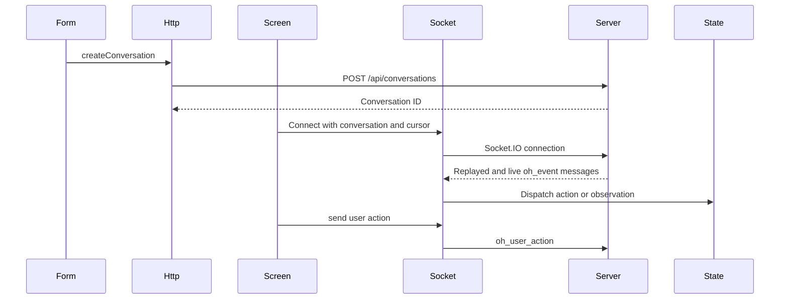

## Overview

The browser application creates conversations through HTTP and receives task activity through Socket.IO. React Router selects screens, TanStack Query manages fetched data, Redux holds application state, and the websocket provider keeps raw and parsed event collections. [[Conversations and Sessions]] follows the server side of creation and replay; this page follows the browser from task submission to synchronized conversation panels.

Sources: [frontend/src/routes.ts:8-25](repo://frontend/src/routes.ts#L8-L25), [frontend/src/hooks/mutation/use-create-conversation.ts:20-54](repo://frontend/src/hooks/mutation/use-create-conversation.ts#L20-L54), [frontend/src/store.ts:16-34](repo://frontend/src/store.ts#L16-L34), [frontend/src/context/ws-client-provider.tsx:130-156](repo://frontend/src/context/ws-client-provider.tsx#L130-L156)

## Routes and conversation creation

The route tree includes the home screen, terms acceptance, settings, `conversations/:conversationId`, and microagent management. Settings have separate model, MCP, user, integration, application, billing, secrets, and API-key routes. The conversation route loads metadata and authentication state, redirects an authenticated user when a conversation is unavailable, and starts a stopped conversation before refetching it. Changing conversation IDs clears terminal, Jupyter, and conversation state and sets the agent to loading.

Sources: [frontend/src/routes.ts:8-25](repo://frontend/src/routes.ts#L8-L25), [frontend/src/routes/conversation.tsx:32-74](repo://frontend/src/routes/conversation.tsx#L32-L74)

`useCreateConversation` accepts a query, repository/provider/branch selection, optional suggested task, conversation instructions, and microagent-creation context. It forwards these to `OpenHands.createConversation`, which posts the corresponding snake-case fields to `/api/conversations`. Successful mutation records task-submission analytics and invalidates the user's conversation list. Creation returns conversation data; ongoing event delivery is established by the conversation screen's providers.

Sources: [frontend/src/hooks/mutation/use-create-conversation.ts:8-54](repo://frontend/src/hooks/mutation/use-create-conversation.ts#L8-L54), [frontend/src/api/open-hands.ts:257-282](repo://frontend/src/api/open-hands.ts#L257-L282), [frontend/src/routes/conversation.tsx:76-95](repo://frontend/src/routes/conversation.tsx#L76-L95)

## HTTP addressing

The Axios client builds its base address from the browser protocol and `VITE_BACKEND_BASE_URL`, falling back to the current host. `OpenHands` separately stores the current conversation: matching conversation IDs can use the conversation's custom URL, while other requests fall back to `/api/conversations/<id>`. Conversation-specific headers include `X-Session-API-Key` when supplied. Workspace downloads, web-host lookup, and VSCode URL requests use this address and header abstraction, allowing those operations to target the conversation's execution endpoint.

Sources: [frontend/src/api/open-hands-axios.ts:1-5](repo://frontend/src/api/open-hands-axios.ts#L1-L5), [frontend/src/api/open-hands.ts:24-64](repo://frontend/src/api/open-hands.ts#L24-L64), [frontend/src/api/open-hands.ts:165-211](repo://frontend/src/api/open-hands.ts#L165-L211)

## Connect and resume the event stream

`WsClientProvider` resets events and the last-event reference when the conversation changes. Its connection effect waits until conversation metadata indicates a running conversation or provides runtime status. The query includes conversation ID, selected providers, session API key, and the latest numeric event ID, initially `-1`. An absolute conversation URL determines the socket host and any path prefix; otherwise it uses the configured backend host or current host with `/socket.io`.

Sources: [frontend/src/context/ws-client-provider.tsx:286-333](repo://frontend/src/context/ws-client-provider.tsx#L286-L333)

The connection uses websocket transport and registers connect, event, connection-error, and disconnect handlers. Connect marks the client connected and clears the displayed websocket error. Disconnect marks it disconnected and updates the reconnect query with the last processed event ID. That cursor matches the server's replay-from-next-ID behavior. Cleanup removes listeners and disconnects on unmount, so switching screens does not intentionally retain the active conversation socket.

Sources: [frontend/src/context/ws-client-provider.tsx:159-162](repo://frontend/src/context/ws-client-provider.tsx#L159-L162), [frontend/src/context/ws-client-provider.tsx:258-268](repo://frontend/src/context/ws-client-provider.tsx#L258-L268), [frontend/src/context/ws-client-provider.tsx:335-372](repo://frontend/src/context/ws-client-provider.tsx#L335-L372), [openhands/server/listen_socket.py:93-114](repo://openhands/server/listen_socket.py#L93-L114)

Sources: [frontend/src/hooks/mutation/use-create-conversation.ts:23-42](repo://frontend/src/hooks/mutation/use-create-conversation.ts#L23-L42), [frontend/src/api/open-hands.ts:257-282](repo://frontend/src/api/open-hands.ts#L257-L282), [frontend/src/context/ws-client-provider.tsx:151-165](repo://frontend/src/context/ws-client-provider.tsx#L151-L165), [frontend/src/context/ws-client-provider.tsx:312-345](repo://frontend/src/context/ws-client-provider.tsx#L312-L345), [frontend/src/services/actions.ts:69-76](repo://frontend/src/services/actions.ts#L69-L76), [openhands/server/listen_socket.py:93-145](repo://openhands/server/listen_socket.py#L93-L145)

## Dispatch and render activity

Incoming messages first pass through `handleAssistantMessage`, which dispatches by `action`, `observation`, or `status_update`. Action handling ignores hidden actions, updates available model metrics, appends shell or Python input, and records security-risk actions. Observation handling appends terminal output, Jupyter output and images, browser URLs and screenshots, or agent-state changes. Terminal output above 5,000 characters is displayed as head and tail with a truncation marker; this presentation limit does not modify stored server events.

Sources: [frontend/src/services/actions.ts:17-43](repo://frontend/src/services/actions.ts#L17-L43), [frontend/src/services/actions.ts:69-76](repo://frontend/src/services/actions.ts#L69-L76), [frontend/src/services/observations.ts:9-56](repo://frontend/src/services/observations.ts#L9-L56)

The provider separately appends typed actions and observations to `parsedEvents` and normal messages to `events`. User-message echoes remove optimistic user messages. File edits, writes, and commands invalidate the conversation's file-change query; edits and writes also invalidate the individual diff after removing workspace and repository path prefixes. The latest numeric event ID becomes the reconnect cursor. This cache invalidation connects task activity to file panels without implementing Git diff parsing inside the websocket transport.

Sources: [frontend/src/context/ws-client-provider.tsx:190-255](repo://frontend/src/context/ws-client-provider.tsx#L190-L255)

## Errors and state boundaries

Status errors and agent-state error observations are tracked and set the displayed error, with an early return in the provider's event handler. Other error observations are tracked, while non-error observations clear the displayed error. The `EventHandler` wrapper installs websocket and runtime-active hooks; its websocket hook displays server errors and sends a paused state when an error message starts with `Agent reached maximum`. [[Controller and Event Stream]] describes the underlying execution limits and server state transitions.

Sources: [frontend/src/context/ws-client-provider.tsx:164-202](repo://frontend/src/context/ws-client-provider.tsx#L164-L202), [frontend/src/wrapper/event-handler.tsx:1-10](repo://frontend/src/wrapper/event-handler.tsx#L1-L10), [frontend/src/hooks/use-handle-ws-events.ts:15-45](repo://frontend/src/hooks/use-handle-ws-events.ts#L15-L45)

Redux separates agent, browser, code, file, command, Jupyter, security, status, metrics, conversation, event-message, and microagent-management state. A separate `ConversationSubscriptionsProvider` exposes subscriptions and collected events for additional conversation IDs, alongside the active conversation provider. These are distinct from Query's fetched conversation and file caches, so changes to one surface should identify which state owner supplies the UI being changed.

Sources: [frontend/src/store.ts:16-34](repo://frontend/src/store.ts#L16-L34), [frontend/src/context/conversation-subscriptions-provider.tsx:23-42](repo://frontend/src/context/conversation-subscriptions-provider.tsx#L23-L42), [frontend/src/routes/conversation.tsx:76-95](repo://frontend/src/routes/conversation.tsx#L76-L95), [frontend/src/context/ws-client-provider.tsx:212-247](repo://frontend/src/context/ws-client-provider.tsx#L212-L247)

## Frontend development surfaces

The frontend scripts provide real and mock development servers, a React Router build, Vitest, Playwright, linting, and type generation. [[Quickstart]] covers the source-development commands. The repository also contains the separately packaged `@openhands/ui` component library, exporting controls such as buttons, inputs, selects, tabs, and typography, with its own distributed JavaScript, types, and styles. Its package boundary is separate from the conversation transport and application-state code discussed here.

Sources: [frontend/package.json:63-81](repo://frontend/package.json#L63-L81), [openhands-ui/package.json:17-40](repo://openhands-ui/package.json#L17-L40), [openhands-ui/index.ts:1-18](repo://openhands-ui/index.ts#L1-L18)
