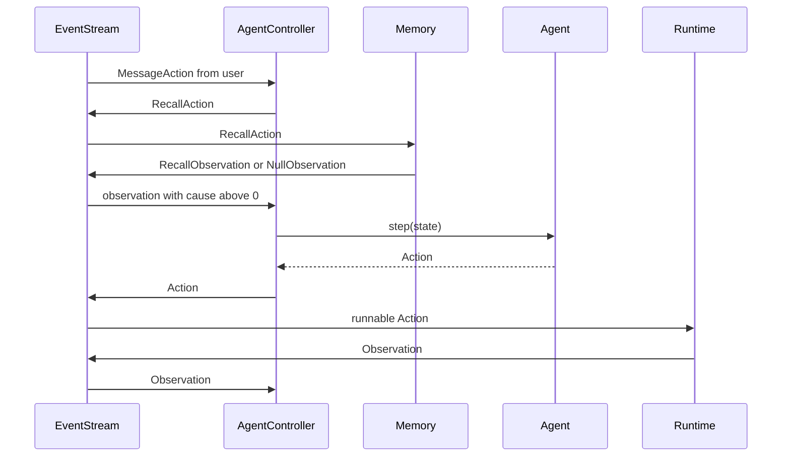

## Overview

`AgentController` is the object that keeps one conversation moving. It listens to the event stream, decides which events should make the agent think, enforces iteration and budget limits, turns errors into an `ERROR` state, and starts sub-agents on request. It never executes anything itself: the agent proposes actions and the [[Runtime and Action Execution]] layer runs them.

Sources: [openhands/controller/agent_controller.py:100-134](repo://openhands/controller/agent_controller.py#L100-L134), [openhands/controller/agent_controller.py:433-476](repo://openhands/controller/agent_controller.py#L433-L476)

A root controller subscribes to the stream under `EventStreamSubscriber.AGENT_CONTROLLER`. A delegate controller is created with `is_delegate=True` and does not subscribe: its parent forwards events to it. At construction the controller restores or creates a `State`, loads history from the stream, builds a `StuckDetector` and adds the agent's `SystemMessageAction` if the stream does not already hold one.

Sources: [openhands/controller/agent_controller.py:165-202](repo://openhands/controller/agent_controller.py#L165-L202), [openhands/controller/agent_controller.py:244-268](repo://openhands/controller/agent_controller.py#L244-L268)

## One message, end to end

Sources: [openhands/controller/agent_controller.py:549-583](repo://openhands/controller/agent_controller.py#L549-L583), [openhands/controller/agent_controller.py:418-431](repo://openhands/controller/agent_controller.py#L418-L431), [openhands/controller/agent_controller.py:869-873](repo://openhands/controller/agent_controller.py#L869-L873), [openhands/memory/memory.py:90-132](repo://openhands/memory/memory.py#L90-L132)

`_on_event` first drops events marked `hidden`, appends the event to history through the `StateTracker`, handles it by type, and then asks `should_step`. A user `MessageAction` does not step the agent directly. `_handle_message_action` emits a `RecallAction` whose type is `WORKSPACE_CONTEXT` for the first user message and `KNOWLEDGE` afterwards, stores it as the pending action, and moves the state to `RUNNING`. The agent steps when the recall's observation arrives, because `should_step` accepts a `NullObservation` whose `cause` is above zero.

Sources: [openhands/controller/agent_controller.py:467-492](repo://openhands/controller/agent_controller.py#L467-L492), [openhands/controller/agent_controller.py:555-583](repo://openhands/controller/agent_controller.py#L555-L583), [openhands/controller/agent_controller.py:418-431](repo://openhands/controller/agent_controller.py#L418-L431)

## When the agent steps

`should_step` returns false while a delegate is active. For actions it accepts user messages, agent messages while the state is not `AWAITING_USER_INPUT`, `AgentDelegateAction`, `CondensationAction` and `CondensationRequestAction`. For observations it accepts everything except `AgentStateChangedObservation` and `NullObservation`, with the recall exception above.

Sources: [openhands/controller/agent_controller.py:392-431](repo://openhands/controller/agent_controller.py#L392-L431)

`_step` then applies a series of gates before calling the agent.

Sources: [openhands/controller/agent_controller.py:821-861](repo://openhands/controller/agent_controller.py#L821-L861)

1. The state must be `RUNNING` and there must be no pending action. A runnable action stays pending until its observation arrives, so the agent never has two actions in flight.
2. The budget flag is synchronised with the accumulated cost, then `StuckDetector.is_stuck` is checked. A loop raises `AgentStuckInLoopError`.
3. `run_control_flags` advances the iteration flag and checks the budget flag. Either limit raises a `RuntimeError`.
4. In replay mode the action comes from the recorded trajectory, otherwise from `agent.step(state)`. A `None` result raises `LLMNoActionError`.

Sources: [openhands/controller/agent_controller.py:821-872](repo://openhands/controller/agent_controller.py#L821-L872)

Malformed model output (`LLMMalformedActionError`, `LLMNoActionError`, `LLMResponseError`, `FunctionCallValidationError`, `FunctionCallNotExistsError`) becomes an `ErrorObservation` in the stream, so the model sees its own mistake and tries again. A context-window error is recognised by exception type or by matching provider message strings. With `enable_history_truncation` it emits a `CondensationRequestAction`, otherwise it raises `LLMContextWindowExceedError`. See [[Conversation Memory and Condensers]].

Sources: [openhands/controller/agent_controller.py:874-917](repo://openhands/controller/agent_controller.py#L874-L917)

## Agent states

`AgentState` has twelve values: `LOADING`, `RUNNING`, `AWAITING_USER_INPUT`, `PAUSED`, `STOPPED`, `FINISHED`, `REJECTED`, `ERROR`, `AWAITING_USER_CONFIRMATION`, `USER_CONFIRMED`, `USER_REJECTED` and `RATE_LIMITED`. `set_agent_state_to` is the only place that changes it. It records the change, resets the pending action on `STOPPED` or `ERROR`, widens the limits when the user resumes from `ERROR`, and emits an `AgentStateChangedObservation` that UIs and the headless loop watch. It then saves the `State`.

Sources: [openhands/core/schema/agent.py:4-51](repo://openhands/core/schema/agent.py#L4-L51), [openhands/controller/agent_controller.py:631-683](repo://openhands/controller/agent_controller.py#L631-L683)

On a reset, a pending action that already has a tool call would leave the history with a tool call and no result, which providers reject. `_reset` therefore emits an `ErrorObservation` carrying the same `tool_call_metadata`, with one message for a user stop and another for a runtime error.

Sources: [openhands/controller/agent_controller.py:590-629](repo://openhands/controller/agent_controller.py#L590-L629)

Agent finish and reject actions store `outputs` on the state and move to `FINISHED` or `REJECTED`. An agent message with `wait_for_response` moves to `AWAITING_USER_INPUT`.

Sources: [openhands/controller/agent_controller.py:494-517](repo://openhands/controller/agent_controller.py#L494-L517), [openhands/controller/agent_controller.py:585-588](repo://openhands/controller/agent_controller.py#L585-L588)

## Errors and limits

### Mapping exceptions to states

`_react_to_exception` stores `state.last_error`, maps litellm exceptions to a `RuntimeStatus` (authentication, service unavailable, internal server error, out of credits, content policy) and calls the status callback. A rate-limit error keeps the controller in `RATE_LIMITED` while retries remain, and moves to `ERROR` on the last attempt.

Sources: [openhands/controller/agent_controller.py:302-356](repo://openhands/controller/agent_controller.py#L302-L356)

### Iteration and budget flags

The two limits are dataclass flags. `IterationControlFlag.step` raises when `current_value` reaches `max_value` and otherwise increments. `BudgetControlFlag.step` raises when the synchronised cost reaches the maximum. When the user resumes after an error, an interactive controller adds `limit_increase_amount` to the iteration maximum, and the budget maximum becomes the current cost plus the increase. In headless mode the iteration limit stays fixed.

Sources: [openhands/controller/state/control_flags.py:44-91](repo://openhands/controller/state/control_flags.py#L44-L91), [openhands/controller/state/state_tracker.py:231-268](repo://openhands/controller/state/state_tracker.py#L231-L268)

### Stuck detection

`StuckDetector` reads the history after filtering user messages and null events; in interactive mode it only looks past the last user message. It flags five patterns: the same action and observation four times, the same action with three errors (including repeated IPython syntax errors), an agent repeating the same message three times with no observation between, an alternating action and observation pattern over six steps, and a loop of context-window errors over ten events.

Sources: [openhands/controller/stuck.py:28-118](repo://openhands/controller/stuck.py#L28-L118), [openhands/controller/stuck.py:135-184](repo://openhands/controller/stuck.py#L135-L184), [openhands/controller/stuck.py:258-290](repo://openhands/controller/stuck.py#L258-L290)

## Confirmation of actions

When `confirmation_mode` is on, runnable command, IPython, browser, file edit and file read actions go through `_handle_security_analyzer`. In CLI mode the action is always marked `AWAITING_CONFIRMATION`, and the CLI asks the user. Otherwise it is marked only if the risk is `HIGH`, or `UNKNOWN` with no analyzer. The controller then enters `AWAITING_USER_CONFIRMATION`. When the user's choice arrives as `USER_CONFIRMED` or `USER_REJECTED`, the same action is re-added to the stream with its confirmation status set, and the runtime either runs it or returns a `UserRejectObservation`. See [[Security Analyzers and Confirmation Mode]].

Sources: [openhands/controller/agent_controller.py:919-968](repo://openhands/controller/agent_controller.py#L919-L968), [openhands/controller/agent_controller.py:654-669](repo://openhands/controller/agent_controller.py#L654-L669), [openhands/runtime/base.py:951-970](repo://openhands/runtime/base.py#L951-L970)

## Delegation

An `AgentDelegateAction` makes the parent call `start_delegate`. That looks up the agent class in the registry, creates a `State` that shares the parent's metrics and flags at `delegate_level + 1`, starts at the next event id, and creates a child controller with `is_delegate=True`. The parent then posts the task as a user message and sets the child `RUNNING`.

Sources: [openhands/controller/agent_controller.py:500-510](repo://openhands/controller/agent_controller.py#L500-L510), [openhands/controller/agent_controller.py:693-752](repo://openhands/controller/agent_controller.py#L693-L752)

While a delegate runs, `on_event` forwards every event to it and the parent ignores them. When the delegate is `FINISHED`, `ERROR` or `REJECTED`, `end_delegate` copies the iteration count back, closes the child, and adds an `AgentDelegateObservation` linked to the original tool call. The history that `StateTracker` rebuilds keeps the delegate action and observation but drops the events between them.

Sources: [openhands/controller/agent_controller.py:439-462](repo://openhands/controller/agent_controller.py#L439-L462), [openhands/controller/agent_controller.py:754-819](repo://openhands/controller/agent_controller.py#L754-L819), [openhands/controller/state/state_tracker.py:145-192](repo://openhands/controller/state/state_tracker.py#L145-L192)

## State persistence

`State` holds the session id, the two control flags, the history, `inputs` and `outputs`, the agent state, the delegate level, the event id range, metrics and `last_error`. `save_to_session` pickles it, base64-encodes it and writes it to the conversation's `agent_state.pkl`; the `ConversationStats` object is detached first because it saves itself. `StateTracker` keeps history in step with the stream, excluding null events, state changes and hidden events. See [[Storage and Persistence]].

Sources: [openhands/controller/state/state.py:50-103](repo://openhands/controller/state/state.py#L50-L103), [openhands/controller/state/state_tracker.py:38-48](repo://openhands/controller/state/state_tracker.py#L38-L48), [openhands/controller/state/state_tracker.py:246-252](repo://openhands/controller/state/state_tracker.py#L246-L252)
