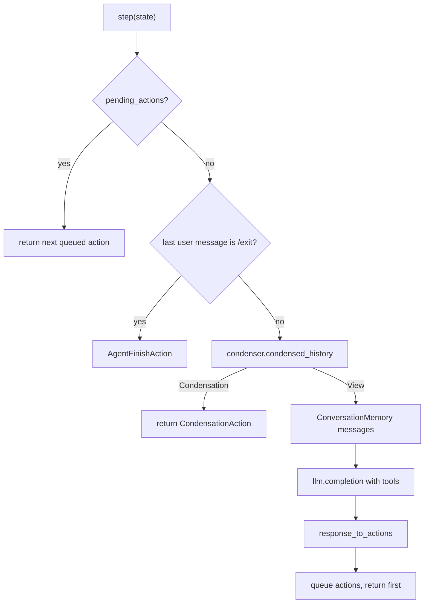

## Overview

An agent is the part of OpenHands that looks at the conversation so far and chooses the next action. The `Agent` base class defines that contract, `openhands.agenthub` registers the built-in agents by name, and `CodeActAgent` is the default one: it gives an LLM a set of tools (shell, editor, browser, Python, finish), and converts each tool call the model makes into an `Action` for the controller to publish. The controller that calls it is described in [[Agent Controller and Agent States]].

Sources: [openhands/controller/agent.py:25-52](repo://openhands/controller/agent.py#L25-L52), [openhands/agenthub/__init__.py:1-24](repo://openhands/agenthub/__init__.py#L1-L24), [openhands/agenthub/codeact_agent/codeact_agent.py:49-96](repo://openhands/agenthub/codeact_agent/codeact_agent.py#L49-L96)

## The Agent contract and registry

An `Agent` holds its `AgentConfig`, an LLM obtained from the registry under the service id `'agent'`, an MCP tool dictionary and a `tools` list. Subclasses must implement `step(state) -> Action`. `get_system_message` builds a `SystemMessageAction` from the prompt manager and the tool list; the controller adds it to the stream as the first event of a conversation.

Sources: [openhands/controller/agent.py:40-114](repo://openhands/controller/agent.py#L40-L114)

Agents are found by name. `Agent.register(name, cls)` stores the class in a class-level dictionary and raises `AgentAlreadyRegisteredError` for a duplicate, and `Agent.get_cls(name)` raises `AgentNotRegisteredError` for an unknown name. Each agent package registers itself in its `__init__.py`, and `openhands.agenthub` imports them all, which is why entry points start with `import openhands.agenthub`. Agent classes may also declare `sandbox_plugins`, the plugin requirements the runtime must start; see [[Runtime and Action Execution]].

Sources: [openhands/controller/agent.py:34-37](repo://openhands/controller/agent.py#L34-L37), [openhands/controller/agent.py:120-161](repo://openhands/controller/agent.py#L120-L161), [openhands/agenthub/codeact_agent/__init__.py:1-4](repo://openhands/agenthub/codeact_agent/__init__.py#L1-L4), [openhands/core/setup.py:65-82](repo://openhands/core/setup.py#L65-L82)

`set_mcp_tools` appends tools discovered from MCP servers to `self.tools` and to `mcp_tools`, skipping names that already exist. See [[MCP Integration]].

Sources: [openhands/controller/agent.py:163-183](repo://openhands/controller/agent.py#L163-L183)

## One step of CodeActAgent

Sources: [openhands/agenthub/codeact_agent/codeact_agent.py:160-224](repo://openhands/agenthub/codeact_agent/codeact_agent.py#L160-L224)

The model can return several tool calls in one response. `step` therefore keeps a `pending_actions` deque: if it is not empty, the next queued action is returned without calling the LLM. Otherwise a last user message of `/exit` ends the run with `AgentFinishAction`.

Sources: [openhands/agenthub/codeact_agent/codeact_agent.py:182-189](repo://openhands/agenthub/codeact_agent/codeact_agent.py#L182-L189)

The condenser runs next. If it returns a `View`, the agent uses those events. If it returns a `Condensation`, `step` returns the contained `CondensationAction` instead of an action of its own, and the controller steps again with the shortened history. See [[Conversation Memory and Condensers]].

Sources: [openhands/agenthub/codeact_agent/codeact_agent.py:191-201](repo://openhands/agenthub/codeact_agent/codeact_agent.py#L191-L201)

`_get_messages` finds the first user message, hands the events to `ConversationMemory.process_events`, and applies prompt-cache markers when `llm.is_caching_prompt_active()` is true. `step` then calls `self.llm.completion` with the messages, the tools checked by `check_tools` and request metadata, converts the response with `response_to_actions`, queues every action and returns the first. The call and its retries are covered in [[LLM Layer]].

Sources: [openhands/agenthub/codeact_agent/codeact_agent.py:207-224](repo://openhands/agenthub/codeact_agent/codeact_agent.py#L207-L224), [openhands/agenthub/codeact_agent/codeact_agent.py:279-293](repo://openhands/agenthub/codeact_agent/codeact_agent.py#L279-L293)

## Tool selection

`_get_tools` builds the tool list from `AgentConfig` flags. For models whose name contains `gpt-4`, `o3`, `o1` or `o4` it asks for short tool descriptions.

Sources: [openhands/agenthub/codeact_agent/codeact_agent.py:108-124](repo://openhands/agenthub/codeact_agent/codeact_agent.py#L108-L124)

| Flag | Default | Tool added |
| --- | --- | --- |
| `enable_cmd` | true | bash command tool |
| `enable_think` | true | `ThinkTool` |
| `enable_finish` | true | `FinishTool` |
| `enable_condensation_request` | false | `CondensationRequestTool` |
| `enable_browsing` | true | `BrowserTool`, skipped on Windows |
| `enable_jupyter` | true | `IPythonTool` |
| `enable_plan_mode` | true | task tracker tool |
| `enable_llm_editor` | false | `LLMBasedFileEditTool`; otherwise `enable_editor` (true) adds the `str_replace_editor` tool |

Sources: [openhands/agenthub/codeact_agent/codeact_agent.py:108-152](repo://openhands/agenthub/codeact_agent/codeact_agent.py#L108-L152), [openhands/core/config/agent_config.py:24-53](repo://openhands/core/config/agent_config.py#L24-L53)

`enable_plan_mode` also changes the prompt: `resolved_system_prompt_filename` returns `system_prompt_long_horizon.j2` unless a custom prompt filename was set. The `condenser` field defaults to `ConversationWindowCondenserConfig` because a no-op condenser would let a condensation request go unanswered.

Sources: [openhands/core/config/agent_config.py:54-77](repo://openhands/core/config/agent_config.py#L54-L77)

## From tool calls to actions

`response_to_actions` accepts exactly one choice. Without tool calls the content becomes a `MessageAction` with `wait_for_response=True`, which makes the controller ask the user. With tool calls, the assistant text becomes the `thought` of the first action, and each call is parsed from JSON and mapped by function name.

Sources: [openhands/agenthub/codeact_agent/function_calling.py:73-99](repo://openhands/agenthub/codeact_agent/function_calling.py#L73-L99), [openhands/agenthub/codeact_agent/function_calling.py:311-338](repo://openhands/agenthub/codeact_agent/function_calling.py#L311-L338)

| Tool call | Action |
| --- | --- |
| bash | `CmdRunAction` with `is_input`, and an optional hard timeout |
| IPython | `IPythonRunCellAction` |
| `delegate_to_browsing_agent` | `AgentDelegateAction` for `BrowsingAgent` |
| finish | `AgentFinishAction` |
| `str_replace_editor` `view` | `FileReadAction` with `view_range` |
| `str_replace_editor` other commands | `FileEditAction` using the OH_ACI implementation |
| LLM-based editor | `FileEditAction` using the LLM-based implementation |
| think | `AgentThinkAction` |
| browser | `BrowseInteractiveAction` |
| task tracker | `TaskTrackingAction` with a normalised task list |
| any MCP tool name | `MCPAction` |

Sources: [openhands/agenthub/codeact_agent/function_calling.py:105-135](repo://openhands/agenthub/codeact_agent/function_calling.py#L105-L135), [openhands/agenthub/codeact_agent/function_calling.py:138-250](repo://openhands/agenthub/codeact_agent/function_calling.py#L138-L250), [openhands/agenthub/codeact_agent/function_calling.py:256-305](repo://openhands/agenthub/codeact_agent/function_calling.py#L256-L305)

Failures are raised as `FunctionCallValidationError` (missing required argument, invalid timeout, an unexpected editor argument, malformed task list) or `FunctionCallNotExistsError` (unknown tool name). The controller turns both into an `ErrorObservation`, so the model sees the message and can correct itself. A `security_risk` argument is copied to the action only if it is `LOW`, `MEDIUM` or `HIGH`; see [[Security Analyzers and Confirmation Mode]]. Every action receives `ToolCallMetadata` with the call id and the full model response, and the response id for token accounting.

Sources: [openhands/agenthub/codeact_agent/function_calling.py:59-70](repo://openhands/agenthub/codeact_agent/function_calling.py#L59-L70), [openhands/agenthub/codeact_agent/function_calling.py:306-335](repo://openhands/agenthub/codeact_agent/function_calling.py#L306-L335), [openhands/controller/agent_controller.py:874-887](repo://openhands/controller/agent_controller.py#L874-L887)

## The other built-in agents

All six are registered by `openhands.agenthub`. `default_agent` in configuration selects which one a run uses; it defaults to `CodeActAgent`.

Sources: [openhands/core/config/openhands_config.py:67](repo://openhands/core/config/openhands_config.py#L67), [openhands/agenthub/__init__.py:1-24](repo://openhands/agenthub/__init__.py#L1-L24)

| Agent | What it is | Choose it when |
| --- | --- | --- |
| `CodeActAgent` | The full tool set above | General coding and shell work |
| `ReadOnlyAgent` | Subclass of CodeActAgent with only `think`, `finish`, `grep`, `glob` and `view`; it ignores MCP tools | You want to explore or research a codebase without changing it |
| `LocAgent` | Subclass of CodeActAgent whose tools are finish, repository search, entity search and tree exploration | Code localisation tasks such as the evaluation harness runs |
| `BrowsingAgent` | Standalone agent that builds BrowserGym high-level actions from the page accessibility tree; target of `delegate_to_browsing_agent` | Web navigation as a delegated subtask |
| `VisualBrowsingAgent` | Browsing variant that also uses page screenshots | Browsing where visual layout matters |
| `DummyAgent` | Replays a fixed list of actions and expected observations without any LLM call | End-to-end tests |

Sources: [openhands/agenthub/readonly_agent/readonly_agent.py:23-83](repo://openhands/agenthub/readonly_agent/readonly_agent.py#L23-L83), [openhands/agenthub/readonly_agent/function_calling.py:241-248](repo://openhands/agenthub/readonly_agent/function_calling.py#L241-L248), [openhands/agenthub/loc_agent/loc_agent.py:14-40](repo://openhands/agenthub/loc_agent/loc_agent.py#L14-L40), [openhands/agenthub/loc_agent/function_calling.py:120-125](repo://openhands/agenthub/loc_agent/function_calling.py#L120-L125), [openhands/agenthub/browsing_agent/browsing_agent.py:94-135](repo://openhands/agenthub/browsing_agent/browsing_agent.py#L94-L135), [openhands/agenthub/visualbrowsing_agent/visualbrowsing_agent.py:121-135](repo://openhands/agenthub/visualbrowsing_agent/visualbrowsing_agent.py#L121-L135), [openhands/agenthub/dummy_agent/agent.py:38-60](repo://openhands/agenthub/dummy_agent/agent.py#L38-L60)

## Adding an agent

A custom agent subclasses `Agent`, implements `step`, and calls `Agent.register`. An `[agent.Name]` section in `config.toml` can also give a `classpath` for an agent outside `openhands.agenthub`; `register_custom_agents` imports it with `get_impl` during config loading. See [[Configuration System]].

Sources: [openhands/controller/agent.py:104-134](repo://openhands/controller/agent.py#L104-L134), [openhands/core/config/agent_config.py:20-21](repo://openhands/core/config/agent_config.py#L20-L21), [openhands/core/config/utils.py:796-817](repo://openhands/core/config/utils.py#L796-L817)
