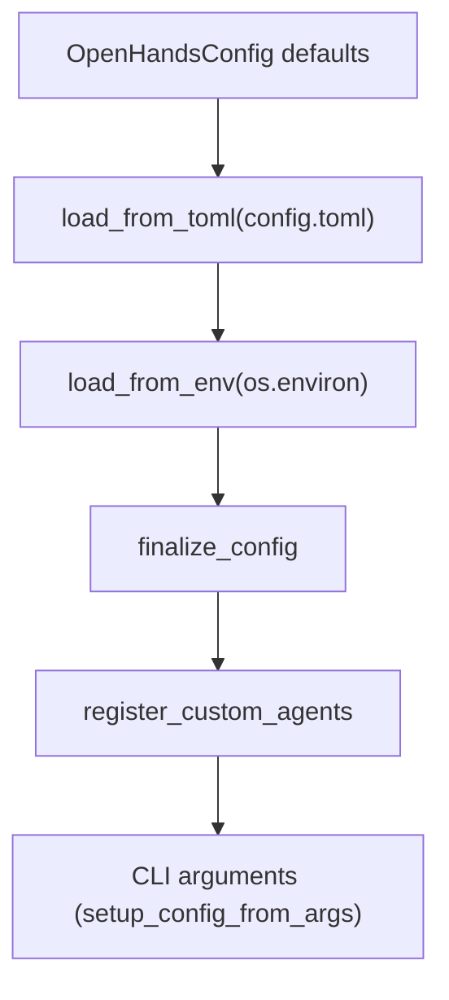

## Overview

Almost every behaviour in OpenHands is a field on a Pydantic model, collected in one root object, `OpenHandsConfig`. `load_openhands_config` fills it from three layers in a fixed order, and a web conversation then overlays per-user `Settings` on a copy. This page explains the model, the loading order, how named LLM and agent groups work, and where to look for a particular option; `config.template.toml` lists every option with its default.

Sources: [openhands/core/config/utils.py:819-836](repo://openhands/core/config/utils.py#L819-L836), [openhands/core/config/openhands_config.py:65-127](repo://openhands/core/config/openhands_config.py#L65-L127), [config.template.toml:1-12](repo://config.template.toml#L1-L12)

## The configuration model

`OpenHandsConfig` holds dictionaries of named `LLMConfig` and `AgentConfig` objects, `default_agent` (`CodeActAgent`), and nested `SandboxConfig`, `SecurityConfig`, `MCPConfig`, `KubernetesConfig` and `CLIConfig` sections. It also carries top-level fields such as `runtime` (default `docker`), `file_store` (`local`) and `file_store_path` (`~/.openhands`), `max_iterations`, `max_budget_per_task`, `save_trajectory_path`, `replay_trajectory_path`, `enable_default_condenser` (true), `max_concurrent_conversations`, `mcp_host` and the git user name and email. The model forbids unknown fields.

Sources: [openhands/core/config/openhands_config.py:65-129](repo://openhands/core/config/openhands_config.py#L65-L129)

| Section | Class | What it controls | Where it is used |
| --- | --- | --- | --- |
| `[core]` | `OpenHandsConfig` | Runtime name, storage, limits, workspace, trajectories | [[Quickstart]], [[Storage and Persistence]] |
| `[llm]` | `LLMConfig` | Model, API key, retries, timeouts, caching, vision | [[LLM Layer]] |
| `[agent]` | `AgentConfig` | Tool switches, prompts, condenser, routing | [[CodeAct Agent and the Agent Hub]] |
| `[sandbox]` | `SandboxConfig` | Images, timeouts, volumes, ports, GPU, remote API | [[Runtime Implementations and Sandbox Image]] |
| `[security]` | `SecurityConfig` | `confirmation_mode`, `security_analyzer` | [[Security Analyzers and Confirmation Mode]] |
| `[condenser]` | `CondenserConfig` variants | History condensation strategy | [[Conversation Memory and Condensers]] |
| `[mcp]` | `MCPConfig` | sse, stdio and shttp servers | [[MCP Integration]] |
| `[kubernetes]` | `KubernetesConfig` | Namespace and pod settings | [[Runtime Implementations and Sandbox Image]] |
| `[model_routing]` | `ModelRoutingConfig` | Router name and routing LLMs | [[LLM Layer]] |

Sources: [openhands/core/config/openhands_config.py:65-127](repo://openhands/core/config/openhands_config.py#L65-L127), [openhands/core/config/utils.py:192-260](repo://openhands/core/config/utils.py#L192-L260), [openhands/core/config/utils.py:258-330](repo://openhands/core/config/utils.py#L258-L330)

## Loading order

### Order of the layers

Sources: [openhands/core/config/utils.py:819-880](repo://openhands/core/config/utils.py#L819-L880)

`load_openhands_config` creates the defaults, applies the TOML file (`config.toml` in the working directory unless `--config-file` says otherwise), then environment variables, then `finalize_config`, then `register_custom_agents`. Command-line arguments are applied last by `setup_config_from_args`, so the precedence from highest to lowest is: CLI parameters, environment, then the TOML file, then the defaults. The docstring of that function also lists `~/.openhands/settings.json` and `config.toml` as the lowest layer.

Sources: [openhands/core/config/utils.py:819-880](repo://openhands/core/config/utils.py#L819-L880)

### TOML

`load_from_toml` returns quietly if the file is missing and logs a warning if it cannot be parsed. Keys under `[core]` are copied onto the root object by name; an unknown key is logged. Strings destined for `SecretStr` fields are wrapped. The other sections each have a `from_toml_section` parser, and a section that fails validation is skipped with a warning, so a bad `[sandbox]` section does not stop the rest. A bad `[security]`, `[sandbox]` or `[mcp]` section raises a `ValueError` instead.

Sources: [openhands/core/config/utils.py:138-227](repo://openhands/core/config/utils.py#L138-L227), [openhands/core/config/utils.py:258-299](repo://openhands/core/config/utils.py#L258-L299)

### Environment variables

`load_from_env` walks every field of the config models and looks for the upper-cased name, with the nested model's name as prefix: `SANDBOX_TIMEOUT`, `LLM_API_KEY`, `AGENT_ENABLE_BROWSING`. The default LLM and agent groups use the prefixes `LLM_` and `AGENT_`. Values are cast to the field's type: booleans accept `true` or `1`, and dictionaries and lists are parsed with `literal_eval`. An empty value is skipped, and a value that cannot be cast is logged and ignored.

Sources: [openhands/core/config/utils.py:40-135](repo://openhands/core/config/utils.py#L40-L135)

### Finalizing

`finalize_config` does the cross-field work. It reads `sandbox.volumes` (comma-separated `host:container[:mode]`) and, when one mount targets `/workspace`, sets `workspace_mount_path`, `workspace_mount_path_in_sandbox` and `workspace_base` from it; a malformed entry raises `ValueError`. It logs a deprecation warning for the older `WORKSPACE_BASE` variables, makes log folders absolute, creates `cache_dir`, and creates a JWT secret in the file store if none exists. When the runtime is `cli` it disables Jupyter and browsing on every agent.

Sources: [openhands/core/config/utils.py:377-470](repo://openhands/core/config/utils.py#L377-L470)

When no `[condenser]` section is present and `enable_default_condenser` is true, the loader sets the default agent's condenser to an LLM summarising condenser that uses the default LLM config. See [[Conversation Memory and Condensers]].

Sources: [openhands/core/config/utils.py:320-336](repo://openhands/core/config/utils.py#L320-L336)

## Named LLM and agent groups

A section such as `[llm.eval_gpt4]` defines a named `LLMConfig` whose values override the plain `[llm]` values, and `[agent.RepoExplorerAgent]` does the same for agents. `from_toml_section` builds the default config from the non-dictionary keys and then a copy for each dictionary-valued key. The default groups are called `llm` and `agent`.

Sources: [openhands/core/config/llm_config.py:100-125](repo://openhands/core/config/llm_config.py#L100-L125), [openhands/core/config/agent_config.py:79-110](repo://openhands/core/config/agent_config.py#L79-L110), [config.template.toml:214-218](repo://config.template.toml#L214-L218), [config.template.toml:278-283](repo://config.template.toml#L278-L283)

`get_llm_config(name)` returns the named group, or falls back to the default with a warning, and creates the default if it is missing. `get_agent_config` works the same way for agents. An agent chooses its model through `AgentConfig.llm_config`, the name of an LLM group: `get_llm_config_from_agent_config` uses `'llm'` when it is unset. `get_agent_to_llm_config_map` builds the map used by the controller when it delegates to another agent. The command line `-l NAME` and `--agent-config NAME` select a group at start.

Sources: [openhands/core/config/openhands_config.py:131-172](repo://openhands/core/config/openhands_config.py#L131-L172), [openhands/core/config/arg_utils.py:50-61](repo://openhands/core/config/arg_utils.py#L50-L61), [openhands/core/config/utils.py:839-880](repo://openhands/core/config/utils.py#L839-L880)

`register_custom_agents` imports any `[agent.Name]` section that gives a `classpath`, so an agent outside `openhands.agenthub` can be selected by name. See [[CodeAct Agent and the Agent Hub]].

Sources: [openhands/core/config/utils.py:796-817](repo://openhands/core/config/utils.py#L796-L817), [openhands/core/config/agent_config.py:20-21](repo://openhands/core/config/agent_config.py#L20-L21)

## Per-conversation settings

The web server stores a `Settings` object per user: language, agent, `max_iterations`, `security_analyzer`, `confirmation_mode`, `llm_model`, `llm_api_key`, `llm_base_url`, `enable_default_condenser`, sandbox images, MCP config, search and sandbox API keys, `max_budget_per_task`, `condenser_max_size` and git identity. API keys are `SecretStr` and serialise as masked values unless the serialisation context asks to expose them.

Sources: [openhands/storage/data_models/settings.py:21-75](repo://openhands/storage/data_models/settings.py#L21-L75)

When a conversation starts, `create_registry_and_conversation_stats` deep-copies the server config and `setup_llm_config` overwrites the default LLM group's model, key and base URL with the settings values, so one user's choice never leaks into the shared config. `WebSession.initialize_agent` then applies the remaining overrides, using `None` in a setting to mean "keep the server value", with `max_budget_per_task` preferring the setting. See [[Conversation Lifecycle]].

Sources: [openhands/utils/utils.py:10-43](repo://openhands/utils/utils.py#L10-L43), [openhands/server/session/session.py:142-182](repo://openhands/server/session/session.py#L142-L182)

## Finding an option

1. Check `config.template.toml`, which lists every section with defaults and comments.
2. Find the Pydantic field in `openhands/core/config/`; its name is the TOML key, and its upper-cased name with the section prefix is the environment variable.
3. For the web app, check whether `Settings` has a counterpart; if it does, the user's value wins.

Sources: [config.template.toml:1-12](repo://config.template.toml#L1-L12), [openhands/core/config/utils.py:66-80](repo://openhands/core/config/utils.py#L66-L80), [openhands/storage/data_models/settings.py:21-52](repo://openhands/storage/data_models/settings.py#L21-L52)
