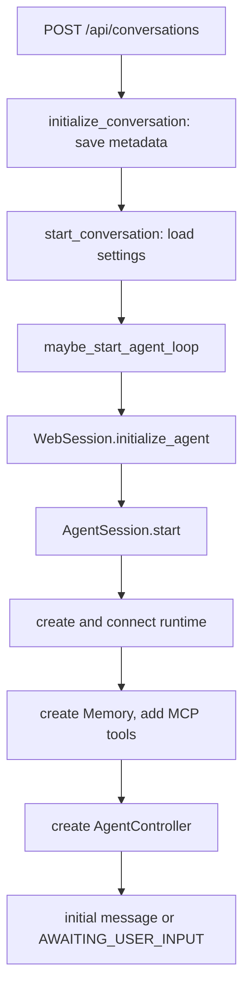

## Overview

On the server, a conversation is a record in a store plus, while it is active, a `WebSession` that owns an `AgentSession` (event stream, runtime, memory, controller). The REST route `POST /api/conversations` creates the record and asks the `ConversationManager` to start an agent loop. The browser then connects over Socket.IO, described in [[Web Server and Socket.IO Protocol]], and joins that loop. This page follows the path from the request to a running agent and then to closing it.

Sources: [openhands/server/routes/manage_conversations.py:189-269](repo://openhands/server/routes/manage_conversations.py#L189-L269), [openhands/server/session/session.py:40-60](repo://openhands/server/session/session.py#L40-L60)

Sources: [openhands/server/services/conversation_service.py:164-202](repo://openhands/server/services/conversation_service.py#L164-L202), [openhands/server/conversation_manager/standalone_conversation_manager.py:296-367](repo://openhands/server/conversation_manager/standalone_conversation_manager.py#L296-L367), [openhands/server/session/agent_session.py:90-203](repo://openhands/server/session/agent_session.py#L90-L203)

## Creating a conversation

`new_conversation` accepts an `InitSessionRequest` (repository, git provider, branch, `initial_user_msg`, `image_urls`, `replay_json`, `suggested_task`, `create_microagent`, `conversation_instructions` and `mcp_config`), and forbids unknown fields. It determines the trigger: a suggested task replaces the first message with the task's prompt, a request authenticated by an API key is `REMOTE_API_KEY` and must have an initial message, and a microagent creation request fills in the repository. A conversation id can only be chosen by the caller when `ALLOW_SET_CONVERSATION_ID` is `1`, which the code reserves for nested runtimes because of the security risk.

Sources: [openhands/server/routes/manage_conversations.py:160-176](repo://openhands/server/routes/manage_conversations.py#L160-L176), [openhands/server/routes/manage_conversations.py:189-240](repo://openhands/server/routes/manage_conversations.py#L189-L240)

If a repository is given, the route verifies it against the user's git provider tokens, then calls `create_new_conversation`. Missing settings produce a 400 with `CONFIGURATION$SETTINGS_NOT_FOUND`, and an LLM authentication problem a 400 with the matching status id.

Sources: [openhands/server/routes/manage_conversations.py:242-288](repo://openhands/server/routes/manage_conversations.py#L242-L288)

`create_new_conversation` calls `initialize_conversation`, which saves `ConversationMetadata` (title, trigger, repository, branch, git provider) in the `ConversationStore` unless the id already exists, and then `start_conversation`. That function loads the user's `Settings` from the settings store. With no settings it raises `MissingSettingsError`; with a blank LLM API key (and the model not a Bedrock one) it raises `LLMAuthenticationError`. It copies the settings into a `ConversationInitData` together with the git tokens, repository, branch, custom secrets, conversation instructions and MCP config, runs the experiment manager's variant hook, turns an initial message or images into a `MessageAction`, and calls `maybe_start_agent_loop`.

Sources: [openhands/server/services/conversation_service.py:34-76](repo://openhands/server/services/conversation_service.py#L34-L76), [openhands/server/services/conversation_service.py:78-161](repo://openhands/server/services/conversation_service.py#L78-L161)

## The conversation manager

`ConversationManager` is an abstract base class and an extension point: a deployment names its own class in `server_config.conversation_manager_class`. Its methods cover joining and disconnecting, starting agent loops, sending events, and querying running loops and connections. `StandaloneConversationManager` is the default for one server process.

Sources: [openhands/server/conversation_manager/conversation_manager.py:20-120](repo://openhands/server/conversation_manager/conversation_manager.py#L20-L120), [openhands/server/config/server_config.py:25-28](repo://openhands/server/config/server_config.py#L25-L28)

`maybe_start_agent_loop` returns the existing loop for a session id, or starts one. `_start_agent_loop` first enforces `max_concurrent_conversations` for the user: it sorts the user's running conversations by last update and, while there are too many, sends the oldest a status update with id `AGENT_ERROR$TOO_MANY_CONVERSATIONS` and closes it. It then creates an LLM registry and `ConversationStats` for the session, builds a `WebSession`, stores it in `_local_agent_loops_by_sid`, and starts `initialize_agent` as a background task. It also subscribes a callback that updates the conversation's metadata (last updated time, cost, and git branch after git-related commands) as events arrive.

Sources: [openhands/server/conversation_manager/standalone_conversation_manager.py:280-367](repo://openhands/server/conversation_manager/standalone_conversation_manager.py#L280-L367), [openhands/server/conversation_manager/standalone_conversation_manager.py:473-565](repo://openhands/server/conversation_manager/standalone_conversation_manager.py#L473-L565), [openhands/utils/utils.py:22-43](repo://openhands/utils/utils.py#L22-L43)

## Applying settings and starting the agent

`WebSession.initialize_agent` first emits an `AgentStateChangedObservation` for `LOADING`. It then lets the session `Settings` override the server config: agent class, confirmation mode, security analyzer, sandbox images, git user name and email, `max_iterations`, `max_budget_per_task`, search API key and sandbox API key. Custom MCP servers from the settings are merged into the config, and the default OpenHands MCP server (and an optional search server) is added. With `enable_default_condenser` it installs the condenser pipeline described in [[Conversation Memory and Condensers]]. It then creates the agent from the registry, sets the retry listener, and calls `AgentSession.start`.

Sources: [openhands/server/session/session.py:132-250](repo://openhands/server/session/session.py#L132-L250), [openhands/server/session/session.py:264-283](repo://openhands/server/session/session.py#L264-L283)

Errors from `start` are reported to the client with `send_error`. A `MicroagentValidationError` or a `ValueError` mentioning a microagent shows the message, and other errors show only the exception class name, to avoid exposing sensitive information.

Sources: [openhands/server/session/session.py:281-304](repo://openhands/server/session/session.py#L281-L304)

`AgentSession.start` does the heavy work, in this order. It creates the runtime with `_create_runtime`, which merges git tokens and custom secrets into environment variables, connects it, clones or initialises the repository and runs the setup scripts; a connection failure reports `ERROR_RUNTIME_DISCONNECTED`. It registers secrets with the event stream so they are redacted from events. It creates `Memory` and loads microagents (see [[Microagents and Knowledge Recall]]). It adds MCP tools to the agent before the controller is created, so the tools appear in the system message (see [[MCP Integration]]). It creates the controller, restoring a saved `State` if one exists, or sets up a replay. Finally it adds the initial message and a `ChangeAgentStateAction(RUNNING)`, or `AWAITING_USER_INPUT` with no message. The runtime classes are described in [[Runtime Implementations and Sandbox Image]].

Sources: [openhands/server/session/agent_session.py:117-203](repo://openhands/server/session/agent_session.py#L117-L203), [openhands/server/session/agent_session.py:296-384](repo://openhands/server/session/agent_session.py#L296-L384), [openhands/server/session/agent_session.py:386-446](repo://openhands/server/session/agent_session.py#L386-L446), [openhands/server/session/agent_session.py:492-510](repo://openhands/server/session/agent_session.py#L492-L510)

A session that is started twice raises `RuntimeError('Session already started...')`, and a session that was closed during startup returns without starting. The `finally` block logs a start signal with `success`, `duration` and whether state was restored, for monitoring.

Sources: [openhands/server/session/agent_session.py:117-125](repo://openhands/server/session/agent_session.py#L117-L125), [openhands/server/session/agent_session.py:204-222](repo://openhands/server/session/agent_session.py#L204-L222)

## Starting and stopping an existing conversation

`POST /conversations/{id}/start` checks that the conversation exists, builds the init data with `setup_init_conversation_settings` (settings, secrets, and a provider token scaffold in SaaS mode), and calls `maybe_start_agent_loop` again, which is a no-op for a running loop. `POST /conversations/{id}/stop` calls `close_session` only if the status is `STARTING` or `RUNNING`.

Sources: [openhands/server/routes/manage_conversations.py:473-531](repo://openhands/server/routes/manage_conversations.py#L473-L531), [openhands/server/routes/manage_conversations.py:534-574](repo://openhands/server/routes/manage_conversations.py#L534-L574), [openhands/server/services/conversation_service.py:217-260](repo://openhands/server/services/conversation_service.py#L217-L260)

## Closing

`close_session` disconnects every Socket.IO connection of the session, removes the `WebSession` from the manager and calls its `close`. `WebSession.close` emits a `STOPPED` state to the room and closes the `AgentSession`. `AgentSession.close` waits for an unfinished start, closes the event stream, saves the controller state and closes the controller, and closes the runtime in an executor thread.

Sources: [openhands/server/conversation_manager/standalone_conversation_manager.py:410-454](repo://openhands/server/conversation_manager/standalone_conversation_manager.py#L410-L454), [openhands/server/session/session.py:119-130](repo://openhands/server/session/session.py#L119-L130), [openhands/server/session/agent_session.py:224-245](repo://openhands/server/session/agent_session.py#L224-L245)

Sessions are also closed automatically. A background `_cleanup_stale` task runs every 15 seconds: it disconnects detached conversations, and, when `sandbox.close_delay` is set, closes any session that has been inactive for longer than that, is not `RUNNING`, and has no connected client. With no `close_delay`, disconnected sandboxes stay open. See [[Agent Controller and Agent States]] for the states involved.

Sources: [openhands/server/conversation_manager/standalone_conversation_manager.py:48-49](repo://openhands/server/conversation_manager/standalone_conversation_manager.py#L48-L49), [openhands/server/conversation_manager/standalone_conversation_manager.py:179-228](repo://openhands/server/conversation_manager/standalone_conversation_manager.py#L179-L228)

## Server-side conversation handles

REST routes that act on a conversation (files, events, microagents) use `ServerConversation`, not the agent loop. It wraps an `EventStream` and a runtime created with `attach_to_existing=True`, so it can read files from a running sandbox without starting one. `attach_to_conversation` reuses a counted active entry, or a recently detached one, or builds a new one; `detach_from_conversation` decrements the count and parks the object until the cleanup task disconnects it.

Sources: [openhands/server/session/conversation.py:12-66](repo://openhands/server/session/conversation.py#L12-L66), [openhands/server/conversation_manager/standalone_conversation_manager.py:91-177](repo://openhands/server/conversation_manager/standalone_conversation_manager.py#L91-L177)
