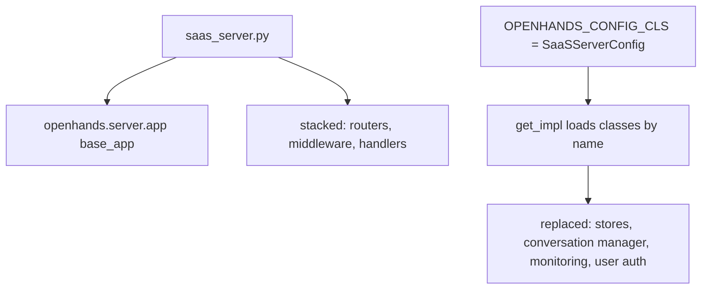

## Overview

The `enterprise/` directory is the server behind OpenHands Cloud. It does not fork the open-source server. It imports it, adds routes and middleware on top, and replaces selected classes by name, using the extension points the OSS server already has. This page lists what it replaces and what it adds; the base server it builds on is in [[Web Server and Socket.IO Protocol]] and [[Conversation Lifecycle]].

Sources: [enterprise/README.md:8-19](repo://enterprise/README.md#L8-L19), [enterprise/saas_server.py:40-45](repo://enterprise/saas_server.py#L40-L45)

> [!WARNING]
> The enterprise code is licensed under the Polyform Free Trial License, which the README says is not an open-source license and limits use to 30 days per calendar year without a commercial license. It is described as a work in progress.

Sources: [enterprise/README.md:1-7](repo://enterprise/README.md#L1-L7)

## Two ways it extends the base

The README names both mechanisms. Enterprise stacks on top of OSS, for example its middleware sits on top of the OSS middleware and both run in SaaS mode. And enterprise overrides OSS, where only one implementation is present at a time, for example `SaaSServerConfig` replacing `ServerConfig` through dynamic import.

Sources: [enterprise/README.md:13-25](repo://enterprise/README.md#L13-L25)

Sources: [enterprise/saas_server.py:40-130](repo://enterprise/saas_server.py#L40-L130), [openhands/server/config/server_config.py:52-60](repo://openhands/server/config/server_config.py#L52-L60)

## Replacing classes

The OSS `ServerConfig` lists the class names the server instantiates with `get_impl`, and `load_server_config` reads the `OPENHANDS_CONFIG_CLS` environment variable to pick a different `ServerConfig` subclass. `SaaSServerConfig` is that subclass. It sets `app_mode` to `AppMode.SAAS` and overrides every pluggable class.

Sources: [openhands/server/config/server_config.py:8-60](repo://openhands/server/config/server_config.py#L8-L60), [enterprise/server/config.py:51-80](repo://enterprise/server/config.py#L51-L80)

| Extension point | OSS default | Enterprise class |
| --- | --- | --- |
| `settings_store_class` | `FileSettingsStore` | `storage.saas_settings_store.SaasSettingsStore` |
| `secret_store_class` | `FileSecretsStore` | `storage.saas_secrets_store.SaasSecretsStore` |
| `conversation_store_class` | `FileConversationStore` | `storage.saas_conversation_store.SaasConversationStore` |
| `conversation_manager_class` | `StandaloneConversationManager` | `server.clustered_conversation_manager.ClusteredConversationManager` |
| `monitoring_listener_class` | `MonitoringListener` (no-op) | `server.saas_monitoring_listener.SaaSMonitoringListener` |
| `user_auth_class` | `DefaultUserAuth` | `server.auth.saas_user_auth.SaasUserAuth` |

Sources: [openhands/server/config/server_config.py:16-32](repo://openhands/server/config/server_config.py#L16-L32), [enterprise/server/config.py:59-71](repo://enterprise/server/config.py#L59-L71), [openhands/server/shared.py:54-77](repo://openhands/server/shared.py#L54-L77)

The same config class supplies the frontend feature flags returned by `get_config` (billing, LLM settings visibility), an `auth_url`, a maintenance window start time, and flags for the Jira, Jira Data Center and Linear integrations. `SaaSServerConfig.__init__` looks up the GitHub App slug through the GitHub API when the app credentials are set.

Sources: [enterprise/server/config.py:51-100](repo://enterprise/server/config.py#L51-L100), [openhands/server/config/server_config.py:38-49](repo://openhands/server/config/server_config.py#L38-L49)

The storage layer follows the base abstractions in [[Storage and Persistence]] with database-backed classes. The `enterprise/storage` package holds models and stores for API keys, auth tokens, billing sessions, stored settings and secrets, conversation metadata, repository data, feedback, and the Slack, Jira, Jira DC and Linear users, workspaces and conversations, with Alembic migrations under `enterprise/migrations`.

Sources: [enterprise/Dockerfile:12-17](repo://enterprise/Dockerfile#L12-L17), [enterprise/alembic.ini:1-10](repo://enterprise/alembic.ini#L1-L10)

## Stacking on top of the app

`saas_server.py` imports the OSS `app` as `base_app` and the OSS `sio`, patches the MCP server with `patch_mcp_server`, and then adds routes, middleware and handlers to `base_app`. The routes are as follows.

Sources: [enterprise/saas_server.py:40-50](repo://enterprise/saas_server.py#L40-L50)

- a `/saas` marker route and Prometheus metrics at `/internal/metrics`;
- routers for readiness, authentication and OAuth callbacks, SaaS user calls, billing (credits and Stripe), API keys, email, feedback, GitHub proxying, Slack, and the event webhook used by nested runtimes;
- GitHub and GitLab integration routers only when `GITHUB_APP_CLIENT_ID` or `GITLAB_APP_CLIENT_ID` is set, and Jira, Jira DC and Linear routers only when their `ENABLE_*` flags are on.

Sources: [enterprise/saas_server.py:52-98](repo://enterprise/saas_server.py#L52-L98)

The middleware and handlers are CORS limited to `PERMITTED_CORS_ORIGINS`, the OSS cache-control middleware, `SetAuthCookieMiddleware`, a rate-limit handler, and exception handlers that turn `NoCredentialsError` and `ExpiredError` into 401 responses. It mounts the frontend build and wraps everything with `socketio.ASGIApp`, as the OSS `listen.py` does.

Sources: [enterprise/saas_server.py:100-130](repo://enterprise/saas_server.py#L100-L130), [openhands/server/listen.py:27](repo://openhands/server/listen.py#L27)

The container image starts the module with `uvicorn saas_server:app` on port 3000.

Sources: [enterprise/Dockerfile:25-26](repo://enterprise/Dockerfile#L25-L26)

## Authentication

The README summarises the difference: the OSS user adds a personal access token in the UI and it is stored in settings, while in enterprise the user signs in with OAuth, receives a short-lived token and a refresh token, and the server keeps them in a token manager and issues a signed cookie. The README also warns that this is a brittle area: OSS code keys everything on the stored token, while enterprise keys everything on the user id from the cookie.

Sources: [enterprise/README.md:27-56](repo://enterprise/README.md#L27-L56)

`SetAuthCookieMiddleware` refreshes the `keycloak_auth` cookie when the authentication state was refreshed during the request, checks that terms of service were accepted before attaching a user, and uses the helpers from the `auth` routes to set the cookie domain and `SameSite` value. `SaaSServerConfig` signs tokens with HS256 JWTs and verifies GitHub webhook payloads by comparing the `x-hub-signature-256` header with an HMAC-SHA256 of the body.

Sources: [enterprise/server/middleware.py:1-40](repo://enterprise/server/middleware.py#L1-L40), [enterprise/server/config.py:27-48](repo://enterprise/server/config.py#L27-L48)

## Clustered conversations

`ClusteredConversationManager` extends the standalone manager so several server processes can share users. It uses Redis for three things: pub/sub on a `session_msg` channel for cross-server messages, keys marking a conversation as active (`ohcnv:{user_id}:{conversation_id}`) and tracking connections (`ohcnct:...`), and cleanup of stale entries after a server fails.

Sources: [enterprise/server/clustered_conversation_manager.py:60-77](repo://enterprise/server/clustered_conversation_manager.py#L60-L77), [enterprise/server/clustered_conversation_manager.py:107-134](repo://enterprise/server/clustered_conversation_manager.py#L107-L134)

`maybe_start_agent_loop` shows the pattern. It tries to create the conversation's Redis key with `SET ... NX` and an expiry. Only the worker that creates the key starts the agent loop; any other worker just returns the loop's information with the conversation's URL and an event store. The constructor raises `max_concurrent_conversations` by one, because the key is created before the running count is checked, to avoid a race between servers.

Sources: [enterprise/server/clustered_conversation_manager.py:389-419](repo://enterprise/server/clustered_conversation_manager.py#L389-L419), [enterprise/server/clustered_conversation_manager.py:83-89](repo://enterprise/server/clustered_conversation_manager.py#L83-L89)

This pairs with the OSS `shared.py`, which creates the Socket.IO server with a Redis client manager when `REDIS_HOST` is set, so events reach clients connected to a different process.

Sources: [openhands/server/shared.py:37-52](repo://openhands/server/shared.py#L37-L52)

## Integrations

The `enterprise/integrations` package connects external tools to the agent. A `Manager` base class defines the contract: `receive_message`, `send_message`, `is_job_requested` and `start_job`. Messages carry a `SourceType` of GitHub, GitLab, Slack, Jira, Jira DC, Linear or OpenHands. There is a manager and a set of views for GitHub and Slack, and a job context with the issue id, key, user message and user identity for the project trackers. The Slack and Jira views start conversations through the same `create_new_conversation` service the web route uses; see [[Conversation Lifecycle]].

Sources: [enterprise/integrations/manager.py:1-30](repo://enterprise/integrations/manager.py#L1-L30), [enterprise/integrations/models.py:1-30](repo://enterprise/integrations/models.py#L1-L30), [enterprise/integrations/slack/slack_view.py:188-204](repo://enterprise/integrations/slack/slack_view.py#L188-L204)
