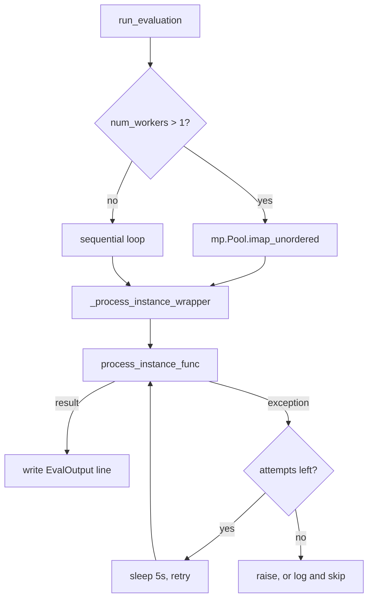

## Overview

The `evaluation/` directory runs OpenHands agents against benchmarks. A benchmark lives in its own folder under `evaluation/benchmarks/` and supplies two things: a `run_infer.py` that makes the agent produce an answer for each benchmark instance, and usually an evaluation script that scores the answers. Everything else (metadata, resuming, retries, parallel workers and the sandbox configuration) comes from the shared `evaluation/utils/shared.py`. The per-instance work is the headless run that [[Quickstart]] describes, repeated over a dataset.

Sources: [evaluation/README.md:1-20](repo://evaluation/README.md#L1-L20), [evaluation/utils/shared.py:44-79](repo://evaluation/utils/shared.py#L44-L79), [evaluation/benchmarks/swe_bench/run_infer.py:606-660](repo://evaluation/benchmarks/swe_bench/run_infer.py#L606-L660)

## The shared model

`EvalMetadata` records one run: agent class, LLM config, optional agent and condenser config, `max_iterations`, output directory, start time, git commit, dataset name and split, and free-form `details`. `EvalOutput` is one line of the result file: the `instance_id`, a benchmark-specific `test_result` dictionary, the instruction, the metadata, the event history, metrics and an error string.

Sources: [evaluation/utils/shared.py:44-79](repo://evaluation/utils/shared.py#L44-L79)

`make_metadata` builds the metadata and creates the output folder `<eval_output_dir>/<dataset>/<agent>/<model>_maxiter_<N>[_N_<note>]` with a `logs` subfolder. It records the current git commit and writes `metadata.json`; a missing condenser config becomes a no-op condenser. Only the LLM section of `config.toml` is used in evaluation, which the README stresses.

Sources: [evaluation/utils/shared.py:164-216](repo://evaluation/utils/shared.py#L164-L216), [evaluation/README.md:23-45](repo://evaluation/README.md#L23-L45)

## Choosing which instances to run

`prepare_dataset` takes a pandas dataframe with an `instance_id` column. If the output file already exists, it reads the ids already finished and removes them, which makes a stopped evaluation resumable. It then restricts the dataset: to specific ids (`eval_ids`), or by skipping the first N, or to a random sample of `eval_n_limit` instances using a fixed seed of 42 so the sample is reproducible. Numpy arrays and timestamps are made JSON-serialisable.

Sources: [evaluation/utils/shared.py:219-289](repo://evaluation/utils/shared.py#L219-L289)

## Running in parallel with retries

Sources: [evaluation/utils/shared.py:486-549](repo://evaluation/utils/shared.py#L486-L549), [evaluation/utils/shared.py:387-478](repo://evaluation/utils/shared.py#L387-L478)

`run_evaluation(dataset, metadata, output_file, num_workers, process_instance_func, max_retries, timeout_seconds)` uses a multiprocessing pool when `num_workers` is above 1, and otherwise a plain loop. Each result is written as one JSON line and flushed at once, so a crash loses at most the instances in flight. On `KeyboardInterrupt` it terminates the child processes.

Sources: [evaluation/utils/shared.py:486-549](repo://evaluation/utils/shared.py#L486-L549), [evaluation/utils/shared.py:292-305](repo://evaluation/utils/shared.py#L292-L305), [evaluation/utils/shared.py:156-161](repo://evaluation/utils/shared.py#L156-L161)

`_process_instance_wrapper` calls the benchmark's function up to `max_retries + 1` times. A timeout (when `timeout_seconds` is set) is recorded as an `EvalOutput` with an error and is not retried. Any other exception is logged and retried after 5 seconds. If the function accepts a `runtime_failure_count` parameter, the wrapper counts failures whose message names a fatal runtime error (timeout, unavailable, disconnected, not found) and passes the count in, so the benchmark can give the next attempt a bigger sandbox. After the last attempt the wrapper raises `RuntimeError` and stops the evaluation, unless `EVAL_SKIP_MAXIMUM_RETRIES_EXCEEDED` is `true`, in which case the instance is logged and skipped.

Sources: [evaluation/utils/shared.py:387-478](repo://evaluation/utils/shared.py#L387-L478), [evaluation/utils/shared.py:626-667](repo://evaluation/utils/shared.py#L626-L667)

## Configuration helpers

`get_default_sandbox_config_for_eval` returns a `SandboxConfig` with a 300 second timeout, `NO_CHANGE_TIMEOUT_SECONDS` of 30, a remote runtime API from `SANDBOX_REMOTE_RUNTIME_API_URL`, a long init timeout and retries enabled. `get_openhands_config_for_eval` builds an `OpenHandsConfig` from the metadata with `run_as_openhands=False`, the runtime from the `RUNTIME` environment variable (default `docker`), 50 iterations if not given, and a local file store in `.eval_sessions`. See [[Configuration System]] and [[Runtime Implementations and Sandbox Image]].

Sources: [evaluation/utils/shared.py:692-705](repo://evaluation/utils/shared.py#L692-L705), [evaluation/utils/shared.py:708-781](repo://evaluation/utils/shared.py#L708-L781)

`codeact_user_response` is the fake user that keeps an unattended agent going. When the agent asks for input it answers with a standard message telling it to continue, use the `finish` tool and never ask for human help; after two user messages it adds that the agent may give up with `finish`. It can also return `/exit` early when a benchmark's `try_parse` function finds an answer in the last action. `get_metrics` combines the conversation statistics with the condenser metadata. The [[Issue Resolver]] uses the same fake user.

Sources: [evaluation/utils/shared.py:106-153](repo://evaluation/utils/shared.py#L106-L153), [evaluation/utils/shared.py:670-689](repo://evaluation/utils/shared.py#L670-L689)

## A benchmark in practice: SWE-bench

The SWE-bench driver is the reference example. For each instance, `process_instance` builds its configuration, runs the agent and captures a patch, in these steps.

Sources: [evaluation/benchmarks/swe_bench/run_infer.py:606-612](repo://evaluation/benchmarks/swe_bench/run_infer.py#L606-L612)

1. `get_config` picks a per-instance Docker image as the base image, enables auto-lint, and builds an `AgentConfig` that turns off Jupyter and MCP and uses the run's condenser config.
2. It increases `remote_runtime_resource_factor` (capped at 8) when earlier attempts failed on the runtime.
3. It creates and connects the runtime, then `initialize_runtime` prepares the checkout.
4. `get_instruction` makes the task message from the instance's problem statement, and `run_controller` runs the agent with `codeact_user_response` as the fake user.
5. A fatal error in `state.last_error` raises `EvalException` so the wrapper retries it.
6. `complete_runtime` extracts `git_patch`, and the runtime is closed in a `finally` block.
7. The `EvalOutput` stores the patch as `test_result`, the history and metrics.

Sources: [evaluation/benchmarks/swe_bench/run_infer.py:206-265](repo://evaluation/benchmarks/swe_bench/run_infer.py#L206-L265), [evaluation/benchmarks/swe_bench/run_infer.py:606-660](repo://evaluation/benchmarks/swe_bench/run_infer.py#L606-L660), [evaluation/benchmarks/swe_bench/run_infer.py:657-711](repo://evaluation/benchmarks/swe_bench/run_infer.py#L657-L711)

The script does not score the patch itself. A comment explains that the agent could alter the environment or test cases, so scoring is a separate step in `eval_infer.py` using the official SWE-bench Docker evaluation. The README lists the three stages: environment setup, inference to produce a patch per issue, and evaluating the patches.

Sources: [evaluation/benchmarks/swe_bench/run_infer.py:678-683](repo://evaluation/benchmarks/swe_bench/run_infer.py#L678-L683), [evaluation/benchmarks/swe_bench/README.md:19-25](repo://evaluation/benchmarks/swe_bench/README.md#L19-L25)

`run_infer.py` can also run in an iterative mode (`ITERATIVE_EVAL_MODE=true`, default 3 attempts). After each attempt an `AgentFinishedCritic` scores every output: 0 if the git patch is empty or the last action was not `AgentFinishAction`, otherwise 1. Only instances that failed are repeated in the next attempt, writing a `.critic_attempt_<n>.jsonl` file each time, and a configured temperature of 0 becomes 0.1 for later attempts.

Sources: [evaluation/benchmarks/swe_bench/run_infer.py:847-925](repo://evaluation/benchmarks/swe_bench/run_infer.py#L847-L925), [openhands/critic/finish_critic.py:6-26](repo://openhands/critic/finish_critic.py#L6-L26)

## Adding a benchmark

A new benchmark gets its own folder with a `run_infer.py` that parses the arguments, loads a dataframe with `instance_id`, calls `make_metadata` and `prepare_dataset`, and passes a `process_instance` function to `run_evaluation`. In that function it creates a runtime, runs `run_controller` with `codeact_user_response` (or its own function), and returns an `EvalOutput`. The directories present are listed below.

Sources: [evaluation/benchmarks/swe_bench/run_infer.py:747-760](repo://evaluation/benchmarks/swe_bench/run_infer.py#L747-L760)

`agent_bench`, `aider_bench`, `algotune`, `biocoder`, `bird`, `browsing_delegation`, `commit0`, `discoverybench`, `EDA`, `gaia`, `gorilla`, `gpqa`, `humanevalfix`, `lca_ci_build_repair`, `logic_reasoning`, `miniwob`, `mint`, `ml_bench`, `multi_swe_bench`, `nocode_bench`, `scienceagentbench`, `swe_bench`, `terminal_bench`, `testgeneval`, `the_agent_company`, `toolqa`, `versicode`, `visual_swe_bench`, `visualwebarena` and `webarena`.

Sources: [evaluation/benchmarks/swe_bench/run_infer.py:747-860](repo://evaluation/benchmarks/swe_bench/run_infer.py#L747-L860), [evaluation/README.md:1-20](repo://evaluation/README.md#L1-L20)
