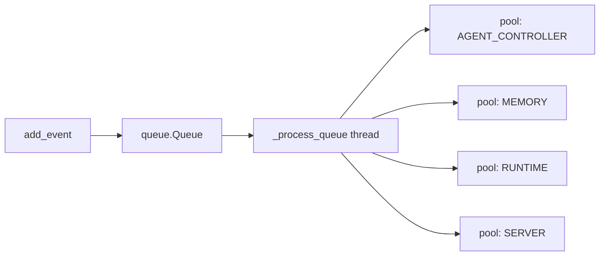

## Overview

An event is a small dataclass that records one thing that happened in a conversation: either an `Action` (something an agent or user wants done) or an `Observation` (something the environment reports back). The `EventStream` is the ordered, persisted log of those events and the bus that delivers each one to every subscriber. The agent, the runtime, memory and the server never call each other, they read and write this stream.

Sources: [openhands/events/event.py:35-131](repo://openhands/events/event.py#L35-L131), [openhands/events/stream.py:43-69](repo://openhands/events/stream.py#L43-L69)

## The event model

### Metadata fields

`Event` carries its metadata as underscore attributes that the stream fills in: `_id`, `_timestamp`, `_source`, `_cause`, plus optional `_timeout`, `_llm_metrics`, `_tool_call_metadata` and `_response_id`. `EventSource` is `AGENT`, `USER` or `ENVIRONMENT`. An event that has not been added to a stream has `id == Event.INVALID_ID` (-1).

Sources: [openhands/events/event.py:9-13](repo://openhands/events/event.py#L9-L13), [openhands/events/event.py:35-131](repo://openhands/events/event.py#L35-L131)

### Actions and observations

`Action` subclasses declare `runnable`, a class variable that tells the runtime whether to execute them. For example `CmdRunAction` is runnable and has fields such as `command`, `blocking`, `confirmation_state` and `security_risk`, while `AgentFinishAction` and `AgentDelegateAction` are not runnable and are handled by the controller. An `Observation` adds a `content` string.

Sources: [openhands/events/action/action.py:1-23](repo://openhands/events/action/action.py#L1-L23), [openhands/events/action/commands.py:12-39](repo://openhands/events/action/commands.py#L12-L39), [openhands/events/action/agent.py:22-43](repo://openhands/events/action/agent.py#L22-L43), [openhands/events/observation/observation.py:6-15](repo://openhands/events/observation/observation.py#L6-L15)

### Linking results with cause

`cause` ties an observation to the action it answers: the runtime sets `observation._cause = event.id` before adding it, and the controller compares `_pending_action.id` with `observation.cause` to know the action finished. `tool_call_metadata` is copied the same way so that the LLM-facing history can pair each tool call with its result.

Sources: [openhands/runtime/base.py:391-399](repo://openhands/runtime/base.py#L391-L399), [openhands/controller/agent_controller.py:536-547](repo://openhands/controller/agent_controller.py#L536-L547)

### Catalogue of types

| Kind | Types | Role |
| --- | --- | --- |
| Messages | `MessageAction`, `SystemMessageAction` | User and agent text, and the system prompt with its tool list |
| Execution | `CmdRunAction`, `IPythonRunCellAction`, `BrowseURLAction`, `BrowseInteractiveAction`, `FileReadAction`, `FileWriteAction`, `FileEditAction`, `MCPAction` | Runnable actions the runtime executes |
| Agent control | `AgentFinishAction`, `AgentRejectAction`, `AgentDelegateAction`, `AgentThinkAction`, `ChangeAgentStateAction`, `TaskTrackingAction` | Handled by the controller or logged only |
| Context | `RecallAction`, `CondensationAction`, `CondensationRequestAction` | Ask memory for knowledge, or drop events from the LLM view |
| Results | `CmdOutputObservation`, `IPythonRunCellObservation`, `BrowserOutputObservation`, `File*Observation`, `MCPObservation`, `ErrorObservation`, `UserRejectObservation` | What the environment returned |
| Notices | `AgentStateChangedObservation`, `RecallObservation`, `AgentCondensationObservation`, `AgentDelegateObservation`, `NullAction`, `NullObservation` | State changes, retrieved knowledge, summaries and placeholders |

Sources: [openhands/events/action/__init__.py:1-48](repo://openhands/events/action/__init__.py#L1-L48), [openhands/events/observation/__init__.py:1-53](repo://openhands/events/observation/__init__.py#L1-L53), [openhands/events/serialization/action.py:25-47](repo://openhands/events/serialization/action.py#L25-L47)

## Serialization

`event_to_dict` flattens an event into top-level keys (`id`, `timestamp`, `source`, `message`, `cause`, `action` or `observation`, `tool_call_metadata`, `llm_metrics`) and puts the rest under `args` for actions or `extras` for observations. `event_from_dict` picks `action_from_dict` or `observation_from_dict` by the presence of the `action` or `observation` key and restores the underscore metadata. `action_from_dict` looks the class up in `ACTION_TYPE_TO_CLASS`, renames deprecated arguments, and raises `LLMMalformedActionError` for an unknown or malformed action.

Sources: [openhands/events/serialization/event.py:16-34](repo://openhands/events/serialization/event.py#L16-L34), [openhands/events/serialization/event.py:52-91](repo://openhands/events/serialization/event.py#L52-L91), [openhands/events/serialization/event.py:100-152](repo://openhands/events/serialization/event.py#L100-L152), [openhands/events/serialization/action.py:98-154](repo://openhands/events/serialization/action.py#L98-L154)

The same dictionary form is the wire format for the Socket.IO channel, the HTTP call into the sandbox and saved trajectories. `event_to_trajectory` strips browser DOM and accessibility trees, and screenshots unless requested. `truncate_content` keeps the head and tail of a long string and inserts a truncation marker in the middle.

Sources: [openhands/events/serialization/event.py:36-49](repo://openhands/events/serialization/event.py#L36-L49), [openhands/events/serialization/event.py:155-178](repo://openhands/events/serialization/event.py#L155-L178)

## Writing to the stream

`add_event(event, source)` is the single write path. It refuses an event that already has an id, which catches a handler re-adding an event it received. Under a lock it assigns the next id from `cur_id` and serialises the event.

Sources: [openhands/events/stream.py:163-173](repo://openhands/events/stream.py#L163-L173)

Secrets are redacted at this point. `_replace_secrets` replaces every configured secret value in string fields with `<secret_hidden>`, except system fields at the top level such as `id`, `source` and `action`. The redacted dictionary is turned back into an event, so subscribers never see the raw secret either. `set_secrets` and `update_secrets` fill `self.secrets`. See [[Security Analyzers and Confirmation Mode]].

Sources: [openhands/events/stream.py:174-181](repo://openhands/events/stream.py#L174-L181), [openhands/events/stream.py:215-244](repo://openhands/events/stream.py#L215-L244)

Each event is written as one JSON file named by its id. Events are also appended to an in-memory page and, when the page reaches `cache_size` (25), the whole page is written as one file named `event_cache/<start>-<end>.json`. The page is stored last, so a reader that finds no page falls back to the single files. Events over about 1 MB are logged with a warning. Finally the event is placed on the in-process queue.

Sources: [openhands/events/stream.py:182-213](repo://openhands/events/stream.py#L182-L213), [openhands/events/event_store.py:155-175](repo://openhands/events/event_store.py#L155-L175)

## Delivering to subscribers

Sources: [openhands/events/stream.py:246-275](repo://openhands/events/stream.py#L246-L275)

A daemon thread started in the constructor runs `_process_queue`. For each event it walks the subscriber ids in sorted order and, for each callback registered under them, submits the call to that callback's own `ThreadPoolExecutor(max_workers=1)`. Each callback therefore sees events in order, and a slow callback delays only itself. The pool's worker thread has its own asyncio loop, which is why callbacks such as the controller's use `run_until_complete`. A callback exception is logged by a done-callback.

Sources: [openhands/events/stream.py:56-69](repo://openhands/events/stream.py#L56-L69), [openhands/events/stream.py:71-76](repo://openhands/events/stream.py#L71-L76), [openhands/events/stream.py:130-148](repo://openhands/events/stream.py#L130-L148), [openhands/events/stream.py:254-291](repo://openhands/events/stream.py#L254-L291)

The subscriber ids are the `EventStreamSubscriber` enum: `AGENT_CONTROLLER`, `RESOLVER`, `SERVER`, `RUNTIME`, `MEMORY`, `MAIN` and `TEST`. Subscribing twice with the same id and callback id raises `ValueError`, which `StandaloneConversationManager` relies on when it adds its update callback to a resumed stream.

Sources: [openhands/events/stream.py:23-30](repo://openhands/events/stream.py#L23-L30), [openhands/events/stream.py:142-146](repo://openhands/events/stream.py#L142-L146), [openhands/server/conversation_manager/standalone_conversation_manager.py:356-366](repo://openhands/server/conversation_manager/standalone_conversation_manager.py#L356-L366)

## Reading events back

`EventStore` is the read side that `EventStream` extends. `cur_id` is computed lazily from the highest event file name in the conversation's `events/` directory, so reopening a stream continues the numbering. `search_events` iterates ids forward or backward, loading a cache page first and falling back to single files, and accepts an `EventFilter` and a limit. This is what the controller uses to rebuild history, and what the server uses to replay a conversation to a reconnecting client.

Sources: [openhands/events/event_store.py:43-83](repo://openhands/events/event_store.py#L43-L83), [openhands/events/event_store.py:85-148](repo://openhands/events/event_store.py#L85-L148), [openhands/server/listen_socket.py:78-114](repo://openhands/server/listen_socket.py#L78-L114)

`session_exists` tests whether a conversation's directory exists in the file store, and file paths come from `get_conversation_dir`, which prefixes `users/<user_id>/conversations/` when a user id is given and `sessions/` otherwise. See [[Storage and Persistence]].

Sources: [openhands/events/stream.py:33-40](repo://openhands/events/stream.py#L33-L40), [openhands/storage/locations.py:1-14](repo://openhands/storage/locations.py#L1-L14)
