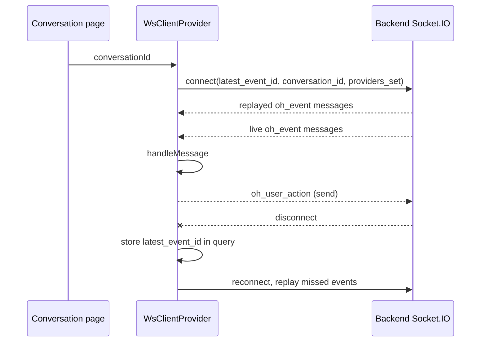

## Overview

The `frontend/` directory is a single-page React app built with React Router, Redux Toolkit and TanStack Query. It talks to the backend in two ways. REST calls (through an Axios client) list, create, start and stop conversations and read files and settings. A Socket.IO connection carries the live event stream for the open conversation. The server side of both is described in [[Web Server and Socket.IO Protocol]] and [[Conversation Lifecycle]]; this page covers how the client consumes them.

Sources: [frontend/package.json:1-40](repo://frontend/package.json#L1-L40), [frontend/src/api/open-hands-axios.ts:3-4](repo://frontend/src/api/open-hands-axios.ts#L3-L4), [frontend/src/context/ws-client-provider.tsx:130-160](repo://frontend/src/context/ws-client-provider.tsx#L130-L160)

## Routes

`routes.ts` declares the pages under one layout: the home page, terms acceptance, a settings area with nested pages (LLM at the index, MCP, user, integrations, app, billing, secrets and API keys), the conversation page `conversations/:conversationId`, and microagent management.

Sources: [frontend/src/routes.ts:1-25](repo://frontend/src/routes.ts#L1-L25)

The conversation route is the main screen. `AppContent` wraps its content in `WsClientProvider`, `ConversationSubscriptionsProvider` and an `EventHandler`. On load it fetches the conversation; if the conversation's status is `STOPPED` it calls `startConversation` and refetches, and if it does not exist or is not accessible it shows an error and returns to the home page. Whenever the conversation id changes, it clears the terminal and Jupyter state and resets the agent state to `LOADING`.

Sources: [frontend/src/routes/conversation.tsx:32-97](repo://frontend/src/routes/conversation.tsx#L32-L97)

`useActiveConversation` polls the conversation record every 3 seconds while its status is `STARTING` and every 30 seconds otherwise, because the title can change after an automatic update. The right-hand panel has tabs for the editor, VS Code, terminal, Jupyter, the served application and the browser, and the selected tab is kept in local storage.

Sources: [frontend/src/hooks/query/use-active-conversation.ts:6-26](repo://frontend/src/hooks/query/use-active-conversation.ts#L6-L26), [frontend/src/components/features/conversation/conversation-tabs/conversation-tabs.tsx:24-68](repo://frontend/src/components/features/conversation/conversation-tabs/conversation-tabs.tsx#L24-L68), [frontend/src/components/features/conversation/conversation-tabs/conversation-tabs.tsx:90-130](repo://frontend/src/components/features/conversation/conversation-tabs/conversation-tabs.tsx#L90-L130)

## The WebSocket connection

`WsClientProvider` owns the Socket.IO client. It does not connect until the conversation is `RUNNING` or has a `runtime_status`. It then connects using the WebSocket transport with these query parameters: `latest_event_id` (the id of the last event received, or -1), `conversation_id`, `providers_set` and `session_api_key` taken from the conversation record, because Socket.IO cannot send custom headers. The URL comes from the conversation's own `url` when it is absolute, which allows a conversation to be served by another host, and otherwise from `VITE_BACKEND_BASE_URL` or the page's host.

Sources: [frontend/src/context/ws-client-provider.tsx:295-340](repo://frontend/src/context/ws-client-provider.tsx#L295-L340)

Sources: [frontend/src/context/ws-client-provider.tsx:151-157](repo://frontend/src/context/ws-client-provider.tsx#L151-L157), [frontend/src/context/ws-client-provider.tsx:258-269](repo://frontend/src/context/ws-client-provider.tsx#L258-L269), [openhands/server/listen_socket.py:78-118](repo://openhands/server/listen_socket.py#L78-L118)

`send` emits `oh_user_action` with an event dictionary. On a disconnect the provider writes the id of the last event it has into the socket's query parameters, so the automatic reconnect asks the server to replay only newer events; the server's replay is described in [[Web Server and Socket.IO Protocol]]. Connection errors and server error messages are turned into toasts and an error banner.

Sources: [frontend/src/context/ws-client-provider.tsx:151-157](repo://frontend/src/context/ws-client-provider.tsx#L151-L157), [frontend/src/context/ws-client-provider.tsx:258-284](repo://frontend/src/context/ws-client-provider.tsx#L258-L284), [frontend/src/context/ws-client-provider.tsx:340-352](repo://frontend/src/context/ws-client-provider.tsx#L340-L352)

## Handling an event

`handleMessage` is the callback for each `oh_event`. It passes the message to `handleAssistantMessage` in `services/actions.ts` and then updates React state.

Sources: [frontend/src/context/ws-client-provider.tsx:164-170](repo://frontend/src/context/ws-client-provider.tsx#L164-L170)

For a recognised event (`id`, `source`, `message` and `timestamp` present) it does the following: an error status update or an agent state change to `error` stores the error message and stops processing; otherwise actions and observations are appended to `parsedEvents`, an error observation is tracked, a user message clears the optimistic message, and message events feed a rate counter used to show a loading indicator while history is replayed. When the event is a file edit, file write or command, it invalidates the TanStack Query keys for git changes and for the affected file's diff, without cancelling a refetch that is already running.

Sources: [frontend/src/context/ws-client-provider.tsx:167-256](repo://frontend/src/context/ws-client-provider.tsx#L167-L256)

`handleAssistantMessage` dispatches by message shape: an `action` field goes to `handleActionMessage`, an `observation` field to `handleObservationMessage`, and a `status_update` field to `handleStatusMessage`.

Sources: [frontend/src/services/actions.ts:67-77](repo://frontend/src/services/actions.ts#L67-L77)

| Message | Effect on the store |
| --- | --- |
| Action with `llm_metrics` | Updates cost, budget limit and token usage in the metrics slice |
| `run` action | Appends the command to the terminal |
| `run_ipython` action | Appends the code to the Jupyter slice |
| Action with `security_risk` | Appends an entry to the security analyzer log |
| `run` observation | Appends output to the terminal, truncating content over 5,000 characters in the middle |
| `run_ipython` observation | Appends output and any images to Jupyter |
| browse observations | Sets the screenshot and URL for the browser tab |
| `agent_state_changed` observation | Sets the current agent state |
| Status update `info` | Sets the status line, or refetches the conversation when it carries a new title |
| Status update `error` | Tracks the error |

Sources: [frontend/src/services/actions.ts:16-65](repo://frontend/src/services/actions.ts#L16-L65), [frontend/src/services/observations.ts:9-58](repo://frontend/src/services/observations.ts#L9-L58)

Actions with `args.hidden` are ignored, and observations with `extras.hidden` skip the terminal. The default message for read, edit, think, recall, MCP and task-tracking observations is left to the chat components.

Sources: [frontend/src/services/actions.ts:16-19](repo://frontend/src/services/actions.ts#L16-L19), [frontend/src/services/observations.ts:9-14](repo://frontend/src/services/observations.ts#L9-L14), [frontend/src/services/observations.ts:44-58](repo://frontend/src/services/observations.ts#L44-L58)

The separate `useHandleWSEvents` hook watches the latest event. For a server error it shows a toast, and for an error message starting with "Agent reached maximum" (an iteration or budget limit; see [[Agent Controller and Agent States]]) it sends an agent state change to `PAUSED`, so that the user's Resume button can raise the limits.

Sources: [frontend/src/hooks/use-handle-ws-events.ts:15-46](repo://frontend/src/hooks/use-handle-ws-events.ts#L15-L46), [frontend/src/wrapper/event-handler.tsx:5-10](repo://frontend/src/wrapper/event-handler.tsx#L5-L10)

## State management

Two stores share the work. Redux holds state that events update continuously: `agent` (the current agent state), `cmd` (terminal), `jupyter`, `browser`, `code`, `fileState`, `status`, `metrics`, `securityAnalyzer`, `conversation` (selected tab), `eventMessage`, `initialQuery` and `microagentManagement`. TanStack Query holds server data fetched over REST, such as conversations, settings, git repositories and diffs, with a global error handler that shows a toast once per distinct message in three seconds and invalidates the authentication query on a 401.

Sources: [frontend/src/store.ts:1-35](repo://frontend/src/store.ts#L1-L35), [frontend/src/query-client-config.ts:9-48](repo://frontend/src/query-client-config.ts#L9-L48), [frontend/src/state/agent-slice.tsx:4-16](repo://frontend/src/state/agent-slice.tsx#L4-L16)

The REST client in `api/open-hands.ts` is a class of static methods, one per backend route: conversation create, start, stop, update and search, event-adjacent calls such as the trajectory, git changes and diffs, microagents, files, upload and web hosts. Its base URL is the page's own origin unless `VITE_BACKEND_BASE_URL` is set. The security risk values in the `securityAnalyzer` slice mirror the backend's `ActionSecurityRisk`; see [[Security Analyzers and Confirmation Mode]].

Sources: [frontend/src/api/open-hands.ts:169-260](repo://frontend/src/api/open-hands.ts#L169-L260), [frontend/src/api/open-hands.ts:257-310](repo://frontend/src/api/open-hands.ts#L257-L310), [frontend/src/api/open-hands.ts:347-440](repo://frontend/src/api/open-hands.ts#L347-L440), [frontend/src/api/open-hands.ts:442-477](repo://frontend/src/api/open-hands.ts#L442-L477), [frontend/src/state/security-analyzer-slice.ts:1-20](repo://frontend/src/state/security-analyzer-slice.ts#L1-L20)

## Building and serving

`npm run dev` generates the translation files with `make-i18n` and starts the React Router dev server, `build` makes the static bundle in `frontend/build`, and the Python server serves that directory at `/` when `SERVE_FRONTEND` is not `false`. `dev:mock` runs against mocked APIs. See [[Quickstart]].

Sources: [frontend/package.json:63-77](repo://frontend/package.json#L63-L77), [openhands/server/listen.py:15-18](repo://openhands/server/listen.py#L15-L18)
