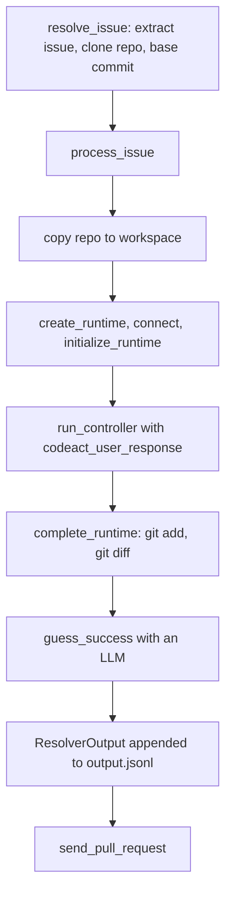

## Overview

The resolver is a headless pipeline that takes a GitHub, GitLab or Bitbucket issue (or a pull request with review feedback), runs an agent in a sandbox on a copy of the repository, captures the resulting git patch, asks an LLM whether the work addressed the request, and optionally pushes a branch or opens a pull request. It reuses `run_controller` from the headless entry point, so the agent loop is the one described in [[Agent Controller and Agent States]], and it is the code behind the repository's GitHub Actions workflow.

Sources: [openhands/resolver/issue_resolver.py:52-55](repo://openhands/resolver/issue_resolver.py#L52-L55), [openhands/resolver/issue_resolver.py:397-460](repo://openhands/resolver/issue_resolver.py#L397-L460), [openhands/resolver/issue_resolver.py:460-517](repo://openhands/resolver/issue_resolver.py#L460-L517), [openhands/resolver/README.md:1-60](repo://openhands/resolver/README.md#L1-L60)

Sources: [openhands/resolver/issue_resolver.py:535-600](repo://openhands/resolver/issue_resolver.py#L535-L600), [openhands/resolver/issue_resolver.py:600-665](repo://openhands/resolver/issue_resolver.py#L600-L665), [openhands/resolver/issue_resolver.py:397-460](repo://openhands/resolver/issue_resolver.py#L397-L460), [openhands/resolver/issue_resolver.py:460-517](repo://openhands/resolver/issue_resolver.py#L460-L517)

## Setting up a run

`IssueResolver.__init__` reads the command-line arguments. `--selected-repo` must be `owner/repo`; the token comes from `--token` or `GITHUB_TOKEN`, `GITLAB_TOKEN` or `BITBUCKET_TOKEN`; a username is required. `identify_token` determines the platform from the token, and the base domain defaults to `github.com`, `gitlab.com` or `bitbucket.org`. The prompt template comes from `--prompt-file`, or `basic-with-tests.jinja` for an issue and `basic-followup.jinja` for a pull request, with a matching `-conversation-instructions.jinja` file beside it.

Sources: [openhands/resolver/issue_resolver.py:55-133](repo://openhands/resolver/issue_resolver.py#L55-L133)

`update_openhands_config` loads the normal configuration and then overrides it for this job: the agent is `CodeActAgent` with the `github` microagent disabled, `max_budget_per_task` is 4, the workspace is a per-issue folder, and the sandbox gets a 300 second timeout, no auto-lint, and no host networking. Either a runtime image or a base image may be given, not both; with neither (and without the experimental flag) it uses the published runtime image for the installed version. GitLab CI gets its own local runtime URL and user id. See [[Configuration System]] and [[Runtime Implementations and Sandbox Image]].

Sources: [openhands/resolver/issue_resolver.py:177-265](repo://openhands/resolver/issue_resolver.py#L177-L265)

An `IssueHandlerFactory` then builds the platform-specific handler. For an issue it returns `ServiceContextIssue` wrapping a GitHub, GitLab or Bitbucket issue handler, and for a pull request `ServiceContextPR` with the matching PR handler; an unknown platform raises `ValueError`. The wrapper adds the LLM-based success check on top of the platform API.

Sources: [openhands/resolver/issue_handler_factory.py:15-100](repo://openhands/resolver/issue_handler_factory.py#L15-L100), [openhands/resolver/interfaces/issue_definitions.py:19-45](repo://openhands/resolver/interfaces/issue_definitions.py#L19-L45)

## Resolving one issue

`resolve_issue` fetches the issue through the handler and fails with a helpful message if it is not found. If a `comment_id` was given, it must match a comment of the issue or PR. It clones the repository into `<output_dir>/repo` if that folder does not exist and records the current `HEAD` as the base commit, which makes the run reproducible. If no repo instruction was given, it reads `.openhands_instructions` from the clone.

Sources: [openhands/resolver/issue_resolver.py:519-601](repo://openhands/resolver/issue_resolver.py#L519-L601)

Results are appended to `output.jsonl`. If an entry for the same issue number already exists the run is skipped, so an interrupted batch can be restarted. For a pull request, the resolver fetches and checks out the PR's head branch and uses its tip as the base commit, so the agent works on top of the existing changes.

Sources: [openhands/resolver/issue_resolver.py:602-665](repo://openhands/resolver/issue_resolver.py#L602-L665)

## Running the agent

`process_issue` copies the cloned repository into the workspace folder, creates the registry and a runtime with `create_runtime`, connects it, and subscribes a logging callback. `initialize_runtime` changes into `/workspace`, disables the git pager, and runs the repository's `.openhands/setup.sh` and `pre-commit.sh` through `maybe_run_setup_script` and `maybe_setup_git_hooks`.

Sources: [openhands/resolver/issue_resolver.py:397-427](repo://openhands/resolver/issue_resolver.py#L397-L427), [openhands/resolver/issue_resolver.py:267-307](repo://openhands/resolver/issue_resolver.py#L267-L307)

The handler's `get_instruction` renders two templates: the user instruction (issue title, body and thread comments) and the conversation instructions (the repository instruction). Image URLs found in the text are passed along with the message. `process_issue` then calls `run_controller` with the existing runtime, the message as the initial action, the conversation instructions, and `codeact_user_response` as the fake user. That function replies to any "awaiting input" state with a fixed message telling the agent to keep going and use the finish tool and never ask for help, which is what lets the loop run without a person. See [[Quickstart]] for how `run_controller` consumes it.

Sources: [openhands/resolver/interfaces/issue_definitions.py:337-369](repo://openhands/resolver/interfaces/issue_definitions.py#L337-L369), [openhands/resolver/issue_resolver.py:429-454](repo://openhands/resolver/issue_resolver.py#L429-L454), [evaluation/utils/shared.py:106-124](repo://evaluation/utils/shared.py#L106-L124)

A `ValueError` or `RuntimeError` from the agent is caught and recorded, so the patch is still collected. `complete_runtime` runs `git add -A` and `git diff --no-color --cached <base_commit>` in the sandbox, retrying up to five times with growing timeouts, and returns the patch text. On GitLab CI the commands run with `sudo`.

Sources: [openhands/resolver/issue_resolver.py:449-457](repo://openhands/resolver/issue_resolver.py#L449-L457), [openhands/resolver/issue_resolver.py:309-386](repo://openhands/resolver/issue_resolver.py#L309-L386)

## Judging success

If the agent produced a state, `guess_success` asks an LLM whether the work resolved the request. For an issue it renders `issue-success-check.jinja` with the issue text and thread comments, the agent's last message and the git patch, and expects a reply of `--- success`, `true` or `false`, then `--- explanation`. An answer that does not match gives failure with a "Failed to decode" explanation.

Sources: [openhands/resolver/interfaces/issue_definitions.py:370-410](repo://openhands/resolver/interfaces/issue_definitions.py#L370-L410), [openhands/resolver/issue_resolver.py:462-476](repo://openhands/resolver/issue_resolver.py#L462-L476)

For a pull request, `ServiceContextPR.guess_success` checks each unit of feedback separately. It uses review threads if there are any, otherwise thread comments, otherwise review comments, and asks the LLM about each with the matching prompt. It returns a list of per-item booleans, and overall success only if all are true; with no feedback it returns failure. `process_issue` prints a checklist of which review requests it believes were resolved.

Sources: [openhands/resolver/interfaces/issue_definitions.py:45-110](repo://openhands/resolver/interfaces/issue_definitions.py#L45-L110), [openhands/resolver/issue_resolver.py:478-500](repo://openhands/resolver/issue_resolver.py#L478-L500)

The outcome is a `ResolverOutput`: the issue, type, instruction, base commit, git patch, the event history as dictionaries, metrics, `success`, per-comment `comment_success`, `result_explanation` and `error`. If the agent failed to run, history and metrics are empty and `success` is false.

Sources: [openhands/resolver/resolver_output.py:8-20](repo://openhands/resolver/resolver_output.py#L8-L20), [openhands/resolver/issue_resolver.py:455-517](repo://openhands/resolver/issue_resolver.py#L455-L517)

## Sending the result

`send_pull_request.py` is a second command that reads `output.jsonl`. `process_single_issue` skips an unsuccessful result unless `--send-on-failure` is set, makes a clean checkout at the base commit (or the PR's head branch), applies the stored patch, and commits it as the configured git identity (default `openhands` and `openhands@all-hands.dev`). For an issue it calls `send_pull_request`, and for a pull request `update_existing_pull_request`.

Sources: [openhands/resolver/send_pull_request.py:502-585](repo://openhands/resolver/send_pull_request.py#L502-L585)

`send_pull_request` accepts `--pr-type` of `branch` (push a branch only), `draft` or `ready`. It chooses the handler by platform, creates a unique branch named `openhands-fix-issue-<number>`, pushes it (to a fork if `--fork-owner` is given), and for `draft` and `ready` opens the pull request against `--target-branch` or the default branch, optionally assigning a reviewer. `update_existing_pull_request` instead pushes to the PR's branch and comments with the explanation, using the LLM to summarise the changes, and replies to each unresolved review thread with its explanation.

Sources: [openhands/resolver/send_pull_request.py:233-300](repo://openhands/resolver/send_pull_request.py#L233-L300), [openhands/resolver/send_pull_request.py:393-440](repo://openhands/resolver/send_pull_request.py#L393-L440)

## Triggering from GitHub

The README describes the GitHub Actions flow built on these commands. Adding the label `fix-me` to an issue, or writing a comment containing `@openhands-agent`, runs the resolver; it creates a draft PR if the agent succeeds and a branch if it does not, comments on the issue and removes the label. The workflow needs `LLM_API_KEY` as a secret and optionally a personal access token. See [[Evaluation Harness]] for how the same `codeact_user_response` helper drives benchmark runs.

Sources: [openhands/resolver/README.md:12-60](repo://openhands/resolver/README.md#L12-L60)
