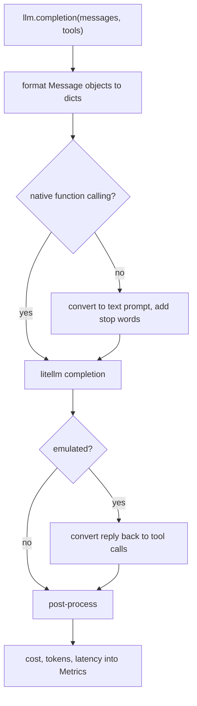

## Overview

All model traffic goes through the `LLM` class in `openhands/llm/llm.py`. It wraps `litellm.completion` and adds the behaviour the rest of OpenHands relies on: per-model request settings, retries with backoff, tool calling for models that do not support it natively, prompt-cache and vision flags, and cost and token accounting. `LLMRegistry` creates and shares `LLM` instances, so the agent, the condenser and the other services each get their own tracked model. What the agent sends is described in [[CodeAct Agent and the Agent Hub]].

Sources: [openhands/llm/llm.py:54-111](repo://openhands/llm/llm.py#L54-L111), [openhands/llm/llm_registry.py:23-56](repo://openhands/llm/llm_registry.py#L23-L56)

## Building the completion function

`LLM.__init__` copies the `LLMConfig`, creates a `Metrics` object, and calls `init_model_info` to fill `max_input_tokens` and `max_output_tokens` from litellm model information (for `litellm_proxy/` models it queries `{base_url}/v1/model/info`). It then builds a `functools.partial` of `litellm.completion` with the model, key, base URL, timeout, `drop_params` and `seed`, plus keyword arguments that depend on the model.

Sources: [openhands/llm/llm.py:76-123](repo://openhands/llm/llm.py#L76-L123), [openhands/llm/llm.py:417-503](repo://openhands/llm/llm.py#L417-L503), [openhands/llm/llm.py:194-207](repo://openhands/llm/llm.py#L194-L207)

Model-specific handling in the constructor includes the following.

Sources: [openhands/llm/llm.py:125-192](repo://openhands/llm/llm.py#L125-L192)

- A model name beginning `openhands/` is rewritten to `litellm_proxy/<name>` with the base URL `https://llm-proxy.app.all-hands.dev/`.
- If the model supports reasoning effort, `reasoning_effort` is passed and `temperature` and `top_p` are removed. For `gemini-2.5-pro` a low or unset effort becomes a small `thinking` budget.
- Azure models use `max_tokens` instead of `max_completion_tokens`.
- Bedrock credentials, Mistral and Gemini safety settings, and an explicit disabled `thinking` setting for `claude-opus-4-1` are added where they apply.

Sources: [openhands/llm/llm.py:125-192](repo://openhands/llm/llm.py#L125-L192)

`LLMConfig` supplies the defaults: temperature 0.0, `num_retries` 5, `retry_multiplier` 8, a 8 to 64 second wait window, `max_message_chars` 30,000, `drop_params` and `modify_params` true, and `caching_prompt` true. See [[Configuration System]].

Sources: [openhands/core/config/llm_config.py:52-98](repo://openhands/core/config/llm_config.py#L52-L98)

## What happens in one call

Sources: [openhands/llm/llm.py:219-300](repo://openhands/llm/llm.py#L219-L300), [openhands/llm/llm.py:300-370](repo://openhands/llm/llm.py#L300-L370)

The wrapper accepts `Message` objects or plain dictionaries, and raises `ValueError` for an empty list. It sets `litellm.modify_params` from the config, drops `extra_body` unless the model is served through `litellm_proxy`, times the call, and records the latency. If a reply has no choices it raises `LLMNoResponseError`, a case the code attributes to Gemini models. With `log_completions` on, each call is written to a JSON file in `log_completions_folder`.

Sources: [openhands/llm/llm.py:243-256](repo://openhands/llm/llm.py#L243-L256), [openhands/llm/llm.py:300-333](repo://openhands/llm/llm.py#L300-L333), [openhands/llm/llm.py:359-405](repo://openhands/llm/llm.py#L359-L405)

## Retries

The wrapper is decorated by `RetryMixin.retry_decorator` using tenacity: stop after `num_retries` attempts, exponential wait between `retry_min_wait` and `retry_max_wait`, and re-raise the last exception. Only these exceptions retry: `APIConnectionError`, `RateLimitError`, `ServiceUnavailableError`, `litellm.Timeout`, `litellm.InternalServerError` and `LLMNoResponseError`. Before each sleep the decorator logs the attempt and calls the retry listener, which the web session uses to show "Retrying LLM request" to the user.

Sources: [openhands/llm/retry_mixin.py:15-69](repo://openhands/llm/retry_mixin.py#L15-L69), [openhands/llm/llm.py:43-51](repo://openhands/llm/llm.py#L43-L51), [openhands/llm/llm.py:211-218](repo://openhands/llm/llm.py#L211-L218), [openhands/server/session/session.py:306-309](repo://openhands/server/session/session.py#L306-L309)

When the error is `LLMNoResponseError` and the temperature is 0, the next attempt uses temperature 1.0, because an identical request tends to give an identical empty answer. `log_retry_attempt` also stamps `retry_attempt` and `max_retries` on the exception; the controller reads them to decide between the `RATE_LIMITED` and `ERROR` states. See [[Agent Controller and Agent States]].

Sources: [openhands/llm/retry_mixin.py:40-54](repo://openhands/llm/retry_mixin.py#L40-L54), [openhands/llm/retry_mixin.py:71-100](repo://openhands/llm/retry_mixin.py#L71-L100), [openhands/controller/agent_controller.py:337-352](repo://openhands/controller/agent_controller.py#L337-L352)

## Model features and emulated tool calling

`model_features.py` holds glob pattern lists matched against the lower-cased model basename (the part after the last `/`, without an Ollama `:tag`): `FUNCTION_CALLING_PATTERNS`, `REASONING_EFFORT_PATTERNS`, `PROMPT_CACHE_PATTERNS` and `SUPPORTS_STOP_WORDS_FALSE_PATTERNS`. `get_features(model)` returns one `ModelFeatures` flag set. A pattern containing `/` is matched against the full provider-qualified name instead.

Sources: [openhands/llm/model_features.py:7-50](repo://openhands/llm/model_features.py#L7-L50), [openhands/llm/model_features.py:61-139](repo://openhands/llm/model_features.py#L61-L139)

Native tool calling is on when `get_features(model).supports_function_calling` is true, unless `native_tool_calling` is set in the config, which wins. When it is off and the caller passed `tools`, the wrapper converts the messages with `convert_fncall_messages_to_non_fncall_messages`, which describes the tools in the prompt and, for most models, adds an in-context example. It removes `tools` and `tool_choice` from the request and, if the model supports stop words and `disable_stop_word` is false, adds the stop word `</function`. After the reply it calls `convert_non_fncall_messages_to_fncall_messages` to turn the text back into a tool call message, so callers always see tool calls.

Sources: [openhands/llm/llm.py:523-528](repo://openhands/llm/llm.py#L523-L528), [openhands/llm/llm.py:258-292](repo://openhands/llm/llm.py#L258-L292), [openhands/llm/llm.py:337-357](repo://openhands/llm/llm.py#L337-L357), [openhands/llm/fn_call_converter.py:56](repo://openhands/llm/fn_call_converter.py#L56)

Two more flags come from the same place. `is_caching_prompt_active` requires `caching_prompt` and a model in the prompt-cache list, which today means Anthropic Claude models. `vision_is_active` requires that vision is not disabled and that litellm or the model info says the model supports it, or that `OPENHANDS_FORCE_VISION` is set. `format_messages_for_llm` copies the three flags onto each `Message` and forces plain string serialisation for a few model families.

Sources: [openhands/llm/llm.py:530-581](repo://openhands/llm/llm.py#L530-L581), [openhands/llm/llm.py:803-819](repo://openhands/llm/llm.py#L803-L819), [openhands/llm/model_features.py:107-118](repo://openhands/llm/model_features.py#L107-L118)

## Cost and token accounting

After each reply `_post_completion` computes the cost and records usage in the `Metrics` object. `_completion_cost` prefers a cost header supplied by a LiteLLM proxy, then litellm's `completion_cost` (using `input_cost_per_token` and `output_cost_per_token` if both are configured), then a retry with the model name stripped of its provider prefix. If every attempt fails it sets `cost_metric_supported` to false and returns 0 from then on. Token usage splits prompt, completion, cache read and cache write tokens, and records the context window size.

Sources: [openhands/llm/llm.py:583-666](repo://openhands/llm/llm.py#L583-L666), [openhands/llm/llm.py:733-791](repo://openhands/llm/llm.py#L733-L791)

`Metrics` keeps accumulated cost, a list of costs, response latencies and token usages, and can be merged or diffed. The budget flag in the controller reads the combined accumulated cost; see [[Agent Controller and Agent States]].

Sources: [openhands/llm/metrics.py:47-130](repo://openhands/llm/metrics.py#L47-L130), [openhands/controller/state/state_tracker.py:260-268](repo://openhands/controller/state/state_tracker.py#L260-L268)

## The registry and routing

`LLMRegistry` is created from an `OpenHandsConfig`. In its constructor it resolves the agent's LLM config and registers `'agent'`. `get_llm(service_id, config)` returns the existing LLM for a service id and raises `ValueError` if the same id is requested with a different config; `get_llm_from_agent_config` does the same from an `AgentConfig`. The condenser uses the id `'condenser'` with prompt caching turned off, and `request_extraneous_completion` creates a listener-free LLM on demand for one-off calls such as conversation titles.

Sources: [openhands/llm/llm_registry.py:23-107](repo://openhands/llm/llm_registry.py#L23-L107), [openhands/memory/condenser/impl/llm_summarizing_condenser.py:163-179](repo://openhands/memory/condenser/impl/llm_summarizing_condenser.py#L163-L179)

Every created LLM triggers `notify`, so a subscriber such as `ConversationStats` can track metrics for each service. `get_router` returns the plain agent LLM when the router name is `noop_router`, and otherwise builds a `RouterLLM`, a subclass of `LLM` that holds a primary LLM plus the `llms_for_routing` and delegates to the one its `_select_llm` picks. `CodeActAgent` calls `get_router` last in its constructor, so routing applies without the agent knowing.

Sources: [openhands/llm/llm_registry.py:45-56](repo://openhands/llm/llm_registry.py#L45-L56), [openhands/llm/llm_registry.py:111-146](repo://openhands/llm/llm_registry.py#L111-L146), [openhands/llm/router/base.py:17-60](repo://openhands/llm/router/base.py#L17-L60), [openhands/agenthub/codeact_agent/codeact_agent.py:95-96](repo://openhands/agenthub/codeact_agent/codeact_agent.py#L95-L96)
