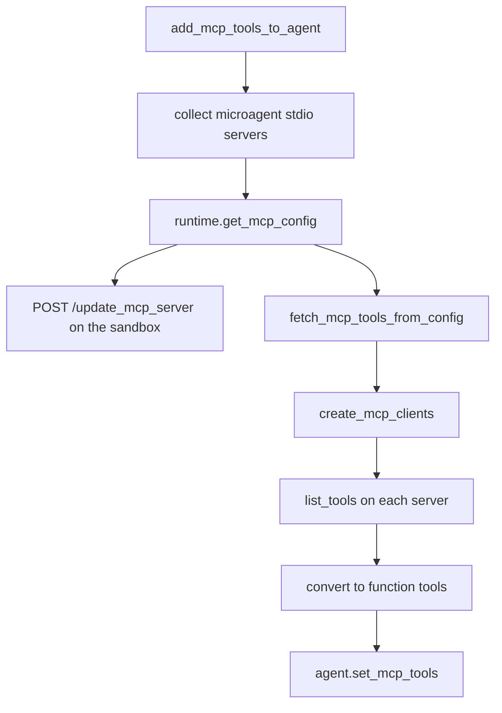

## Overview

Model Context Protocol (MCP) servers add tools beyond the built-in shell, editor and browser. OpenHands is both a client and a server for MCP. As a client it connects to configured servers, lists their tools, and offers them to the agent as ordinary function-calling tools. As a server, `/mcp` on the web server exposes tools such as `create_pr` that agents use to open pull requests. This page follows a tool from configuration to a call, and leaves the parsing of tool calls to [[CodeAct Agent and the Agent Hub]].

Sources: [openhands/mcp/utils.py:267-317](repo://openhands/mcp/utils.py#L267-L317), [openhands/server/routes/mcp.py:26-28](repo://openhands/server/routes/mcp.py#L26-L28), [openhands/server/app.py:37-64](repo://openhands/server/app.py#L37-L64)

## Server configuration

`MCPConfig` has three lists. `sse_servers` and `shttp_servers` each hold a `url` and optional `api_key` (a bare string is accepted and treated as the URL). `stdio_servers` hold a `name`, `command`, `args` and `env`; the field comment says these servers are added to the MCP router running inside the runtime container. URLs are validated, and duplicate SSE URLs are rejected by `validate_servers`. The config lives under `[mcp]` and in the user's `Settings`, and unknown fields are forbidden.

Sources: [openhands/core/config/mcp_config.py:46-77](repo://openhands/core/config/mcp_config.py#L46-L77), [openhands/core/config/mcp_config.py:191-254](repo://openhands/core/config/mcp_config.py#L191-L254), [openhands/storage/data_models/settings.py:42](repo://openhands/storage/data_models/settings.py#L42)

Two servers are added by default. `OpenHandsMCPConfig.create_default_mcp_server_config` returns the OpenHands server itself as a streamable-HTTP server at `http://<mcp_host>/mcp/mcp`, and, when the configured `search_api_key` starts with `tvly-`, a stdio server named `tavily` run with `npx -y tavily-mcp@0.2.1`. The class is resolved through `get_impl` from `OPENHANDS_MCP_CONFIG_CLS`, so a deployment can change the defaults. The web session adds both to the config; the CLI and the headless runner add only the stdio search server.

Sources: [openhands/core/config/mcp_config.py:315-363](repo://openhands/core/config/mcp_config.py#L315-L363), [openhands/server/session/session.py:189-211](repo://openhands/server/session/session.py#L189-L211), [openhands/core/main.py:145-155](repo://openhands/core/main.py#L145-L155), [openhands/cli/main.py:335-350](repo://openhands/cli/main.py#L335-L350)

A repo microagent can also carry `mcp_tools` with stdio servers, which `add_mcp_tools_to_agent` collects through `Memory.get_microagent_mcp_tools`. See [[Microagents and Knowledge Recall]].

Sources: [openhands/mcp/utils.py:267-296](repo://openhands/mcp/utils.py#L267-L296), [openhands/memory/memory.py:302-318](repo://openhands/memory/memory.py#L302-L318)

## From servers to agent tools

### Discovery flow

Sources: [openhands/mcp/utils.py:267-317](repo://openhands/mcp/utils.py#L267-L317), [openhands/mcp/utils.py:151-203](repo://openhands/mcp/utils.py#L151-L203)

`add_mcp_tools_to_agent(agent, runtime, memory)` requires an initialised runtime. It asks the runtime for the complete MCP configuration, fetches the tools, and calls `agent.set_mcp_tools`, which adds them to the agent's tool list; names already present are skipped. It runs before the controller is created so the tools appear in the system message. It does nothing on Windows, where MCP is disabled.

Sources: [openhands/mcp/utils.py:267-317](repo://openhands/mcp/utils.py#L267-L317), [openhands/controller/agent.py:163-183](repo://openhands/controller/agent.py#L163-L183), [openhands/server/session/agent_session.py:165-168](repo://openhands/server/session/agent_session.py#L165-L168)

`Runtime.get_mcp_config` in `ActionExecutionClient` is where stdio servers meet the sandbox. It combines the configured and microagent stdio servers, and if any is new since the last call it posts the sorted list to the action execution server's `/update_mcp_server` route. There an `MCPProxyManager` remounts a proxy that speaks to those stdio servers from inside the sandbox. Whenever at least one stdio server is known, the runtime adds the proxy's `/mcp/sse` URL to the SSE servers, with the session API key. So from the agent's side, stdio servers are reached as one more SSE server.

Sources: [openhands/runtime/impl/action_execution/action_execution_client.py:361-450](repo://openhands/runtime/impl/action_execution/action_execution_client.py#L361-L450), [openhands/runtime/action_execution_server.py:833-884](repo://openhands/runtime/action_execution_server.py#L833-L884), [openhands/runtime/action_execution_server.py:712-735](repo://openhands/runtime/action_execution_server.py#L712-L735)

`fetch_mcp_tools_from_config` creates the clients and converts their tools. Stdio servers are connected directly only when `use_stdio` is true, which `add_mcp_tools_to_agent` sets for `CLIRuntime`, since that runtime has no sandbox proxy. `create_mcp_clients` skips a stdio server whose command is not on `PATH`, and logs and skips any server that fails to connect, so one bad server does not stop the rest. Errors go into `mcp_error_collector`, which the terminal app shows through its `/mcp` command.

Sources: [openhands/mcp/utils.py:63-148](repo://openhands/mcp/utils.py#L63-L148), [openhands/mcp/utils.py:151-203](repo://openhands/mcp/utils.py#L151-L203), [openhands/mcp/utils.py:305-309](repo://openhands/mcp/utils.py#L305-L309), [openhands/cli/main.py:335-353](repo://openhands/cli/main.py#L335-L353)

### The client

`MCPClient` wraps a `fastmcp` client. `connect_http` builds a streamable-HTTP or SSE transport; with an API key it sends `Authorization`, `X-Session-API-Key` and an `s` header, which the sandbox's MCP router and the remote runtime each expect, and a conversation id goes in `X-OpenHands-ServerConversation-ID`. `connect_stdio` builds a stdio transport from the command, arguments and environment. Both then open the client once to list tools, storing each as an `MCPClientTool` with its input schema. Connections use a 30 second timeout.

Sources: [openhands/mcp/client.py:23-56](repo://openhands/mcp/client.py#L23-L56), [openhands/mcp/client.py:57-146](repo://openhands/mcp/client.py#L57-L146)

## Calling a tool

When the model calls a tool whose name is in the agent's MCP tool dictionary, `response_to_actions` creates an `MCPAction` with the name and arguments. It is runnable, so the `Runtime` handles it: `_handle_action` routes an `MCPAction` to `call_tool_mcp` instead of the sandbox. See [[Runtime and Action Execution]].

Sources: [openhands/agenthub/codeact_agent/function_calling.py:298-305](repo://openhands/agenthub/codeact_agent/function_calling.py#L298-L305), [openhands/runtime/base.py:366-371](repo://openhands/runtime/base.py#L366-L371)

`ActionExecutionClient.call_tool_mcp` gets the current MCP config, creates fresh clients for the SSE and streamable-HTTP servers (with the session id as conversation id), and delegates to `openhands.mcp.utils.call_tool_mcp`. That function finds the client that lists the tool name, raising `ValueError` for no match, calls it, and returns an `MCPObservation` whose content is the JSON of the result. An `McpError` is returned as an `MCPObservation` with `isError: true`, so the agent can read the failure. On Windows the result is an `ErrorObservation`.

Sources: [openhands/runtime/impl/action_execution/action_execution_client.py:452-481](repo://openhands/runtime/impl/action_execution/action_execution_client.py#L452-L481), [openhands/mcp/utils.py:206-264](repo://openhands/mcp/utils.py#L206-L264)

## OpenHands as an MCP server

`openhands/server/routes/mcp.py` creates a `FastMCP` server named `mcp` (stateless HTTP, with the session API key dependency and masked error details), which `app.py` mounts at `/mcp`. It registers tools for opening pull requests, merge requests and Bitbucket pull requests: `create_pr`, `create_mr` and `create_bitbucket_pr`. Each reads the caller's provider tokens, user and `X-OpenHands-ServerConversation-ID` header from the HTTP request, calls the matching git service, and raises `ToolError` with the message on failure.

Sources: [openhands/server/routes/mcp.py:26-28](repo://openhands/server/routes/mcp.py#L26-L28), [openhands/server/routes/mcp.py:83-148](repo://openhands/server/routes/mcp.py#L83-L148), [openhands/server/routes/mcp.py:151-152](repo://openhands/server/routes/mcp.py#L151-L152), [openhands/server/routes/mcp.py:226-227](repo://openhands/server/routes/mcp.py#L226-L227)

After a successful `create_pr`, `save_pr_metadata` extracts the number from the returned URL with a `pull/(\d+)` or `merge_requests/(\d+)` pattern and appends it to the conversation's metadata. In SaaS mode `get_conversation_link` appends a link back to the conversation to the PR body.

Sources: [openhands/server/routes/mcp.py:34-80](repo://openhands/server/routes/mcp.py#L34-L80), [openhands/server/routes/mcp.py:141-142](repo://openhands/server/routes/mcp.py#L141-L142)
