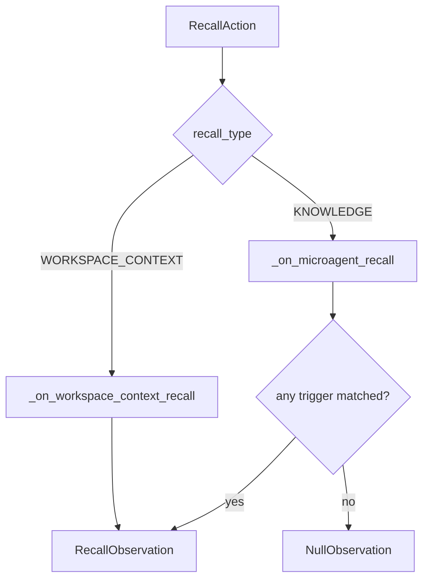

## Overview

A microagent is a markdown file that gives the agent extra instructions without changing the agent's code. Some are always on (a repository's guidelines), some switch on when the user's message contains a keyword, and some are slash-command tasks that ask the user for inputs. The `Memory` component loads them from three places and, when the controller asks, answers with a `RecallObservation` that the agent's prompt then includes.

Sources: [openhands/microagent/types.py:11-33](repo://openhands/microagent/types.py#L11-L33), [openhands/memory/memory.py:41-84](repo://openhands/memory/memory.py#L41-L84)

## Microagent files

A microagent file is markdown with YAML frontmatter. `BaseMicroagent.load` reads the frontmatter into `MicroagentMetadata` (`name`, `type`, `version`, `agent`, `triggers`, `inputs` and optional `mcp_tools`), and the body becomes `content`. For example, the bundled `github.md` has the triggers `github` and `git` and tells the agent how to use `GITHUB_TOKEN`.

Sources: [openhands/microagent/microagent.py:81-122](repo://openhands/microagent/microagent.py#L81-L122), [openhands/microagent/types.py:23-33](repo://openhands/microagent/types.py#L23-L33), [microagents/github.md:1-12](repo://microagents/github.md#L1-L12)

The kind is inferred, not taken from `type`. If the file declares `inputs` it is a `TaskMicroagent`, and `/<name>` is added to its triggers. Otherwise, if it has `triggers` it is a `KnowledgeMicroagent`. With neither it is a `RepoMicroagent`, which is always active.

Sources: [openhands/microagent/microagent.py:134-169](repo://openhands/microagent/microagent.py#L134-L169)

| Kind | Active when | Notes |
| --- | --- | --- |
| `RepoMicroagent` | Always | Content is concatenated into the repository instructions |
| `KnowledgeMicroagent` | A trigger appears in the message, case-insensitively | `match_trigger` returns the first matching trigger |
| `TaskMicroagent` | The user types `/<name>` | Appends a prompt telling the agent to ask for any missing `${variable}` values |

Sources: [openhands/microagent/microagent.py:172-263](repo://openhands/microagent/microagent.py#L172-L263), [openhands/memory/memory.py:157-160](repo://openhands/memory/memory.py#L157-L160)

Some files are recognised by name, not frontmatter. `.openhands_instructions` becomes a repo microagent named `repo_legacy`. `.cursorrules`, `AGENTS.md`, `agents.md`, `AGENT.md` and `agent.md` in the repository root become repo microagents named `cursorrules` or `agents`. A malformed frontmatter or an MCP configuration without stdio servers raises `MicroagentValidationError`, which fails loading of the whole directory.

Sources: [openhands/microagent/microagent.py:30-62](repo://openhands/microagent/microagent.py#L30-L62), [openhands/microagent/microagent.py:94-132](repo://openhands/microagent/microagent.py#L94-L132), [openhands/microagent/microagent.py:266-341](repo://openhands/microagent/microagent.py#L266-L341)

## Where microagents load from

`Memory.__init__` loads two sets immediately: the global directory `microagents/` at the repository root, and `~/.openhands/microagents`, which it creates if missing. After the runtime is connected, `create_memory` adds the third set by calling `Runtime.get_microagents_from_selected_repo` and `Memory.load_user_workspace_microagents`. Later sources overwrite earlier ones with the same name.

Sources: [openhands/memory/memory.py:33-38](repo://openhands/memory/memory.py#L33-L38), [openhands/memory/memory.py:79-84](repo://openhands/memory/memory.py#L79-L84), [openhands/memory/memory.py:254-300](repo://openhands/memory/memory.py#L254-L300), [openhands/core/setup.py:186-197](repo://openhands/core/setup.py#L186-L197)

The workspace set comes from inside the sandbox. `get_microagents_from_selected_repo` looks in `<repo>/.openhands/microagents`, or `<workspace>/.openhands/microagents` with no repository. It also loads organisation or user-level microagents from a sibling repository named `.openhands`, or `openhands-config` on GitLab. It reads a legacy `.openhands_instructions` file, and for a directory it copies the files out of the sandbox as a zip, extracts them to a temporary folder and runs `load_microagents_from_dir`. See [[Runtime and Action Execution]].

Sources: [openhands/runtime/base.py:586-640](repo://openhands/runtime/base.py#L586-L640), [openhands/runtime/base.py:823-888](repo://openhands/runtime/base.py#L823-L888)

## Answering a recall

The controller emits a `RecallAction` for each user message; see [[Agent Controller and Agent States]]. `Memory` subscribes to the stream and handles two cases in `_on_event`, each replying with an observation whose `cause` is the action's id so the controller's pending recall is released.

Sources: [openhands/memory/memory.py:86-137](repo://openhands/memory/memory.py#L86-L137)

Sources: [openhands/memory/memory.py:90-132](repo://openhands/memory/memory.py#L90-L132)

For the first user message (`WORKSPACE_CONTEXT`), `_on_workspace_context_recall` joins the content of all repo microagents, finds knowledge microagents triggered by the message, and builds one `RecallObservation` with the repository name, directory and branch, the runtime's web hosts, additional agent instructions, the date, custom secret descriptions, conversation instructions and the working directory. It returns nothing only if all of these are empty.

Sources: [openhands/memory/memory.py:139-205](repo://openhands/memory/memory.py#L139-L205)

For later messages (`KNOWLEDGE`), `_find_microagent_knowledge` checks every knowledge microagent's triggers against the query and returns the matches as `MicroagentKnowledge` entries. If none match, the reply is a `NullObservation`, which still counts as a result for the controller. Both user and agent messages can trigger knowledge recall.

Sources: [openhands/memory/memory.py:207-252](repo://openhands/memory/memory.py#L207-L252), [openhands/memory/memory.py:114-132](repo://openhands/memory/memory.py#L114-L132)

## How the agent sees it

`Memory.set_runtime_info`, `set_repository_info` and `set_conversation_instructions` store the values that go into the workspace context. When the agent builds messages, `ConversationMemory` turns a workspace `RecallObservation` into a user message rendered from the `additional_info.j2` template (repository info, repository instructions, runtime information, custom secrets), and microagent knowledge through `microagent_info.j2`, which wraps each match in `<EXTRA_INFO>` with the keyword that triggered it and a note that it may not be relevant. Microagents listed in `AgentConfig.disabled_microagents` are dropped, and a knowledge microagent already shown in an earlier recall is not repeated. See [[Conversation Memory and Condensers]].

Sources: [openhands/memory/memory.py:320-365](repo://openhands/memory/memory.py#L320-L365), [openhands/memory/conversation_memory.py:560-640](repo://openhands/memory/conversation_memory.py#L560-L640), [openhands/agenthub/codeact_agent/prompts/microagent_info.j2:1-7](repo://openhands/agenthub/codeact_agent/prompts/microagent_info.j2#L1-L7), [openhands/agenthub/codeact_agent/prompts/additional_info.j2:1-22](repo://openhands/agenthub/codeact_agent/prompts/additional_info.j2#L1-L22)

## Microagents that bring tools

A microagent's `mcp_tools` metadata must contain stdio servers. `Memory.get_microagent_mcp_tools` collects them from all repo microagents, and `add_mcp_tools_to_agent` adds those servers to the runtime's MCP configuration. See [[MCP Integration]].

Sources: [openhands/memory/memory.py:302-318](repo://openhands/memory/memory.py#L302-L318), [openhands/mcp/utils.py:267-317](repo://openhands/mcp/utils.py#L267-L317)
