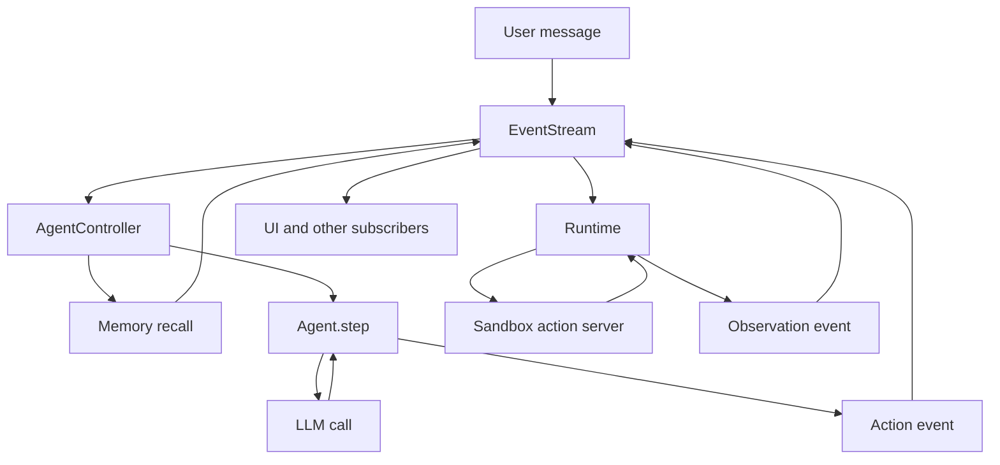

## Overview

OpenHands is a platform for software-development agents: an LLM-driven agent reads a task, runs shell commands, edits files, browses the web and calls tools inside a sandbox, and reports back to a person through a terminal, a web app or a headless script. The repository holds the agent loop, the sandbox runtime, a FastAPI and Socket.IO server, a CLI, a React frontend, an issue resolver, an evaluation harness and an enterprise extension.

Sources: [README.md:30-43](repo://README.md#L30-L43)

Every part talks to the others through one append-only log of events. The headless entry point `run_controller` shows the whole wiring in one place: it builds an LLM registry, an agent, a runtime, a memory and a controller, then puts the user's task into the event stream as a `MessageAction` and waits until the agent reaches a terminal state.

Sources: [openhands/core/main.py:97-143](repo://openhands/core/main.py#L97-L143), [openhands/core/main.py:165-191](repo://openhands/core/main.py#L165-L191), [openhands/core/main.py:207-216](repo://openhands/core/main.py#L207-L216)

## The parts

| Area | What it does | Page |
| --- | --- | --- |
| Agent controller | Decides when the agent steps, enforces limits, tracks the agent state, runs delegates | [[Agent Controller and Agent States]] |
| Events | The message format and the bus every component subscribes to | [[Events and the Event Stream]] |
| Agents | Turn history into the next action with an LLM | [[CodeAct Agent and the Agent Hub]] |
| LLM layer | Wraps litellm with retries, cost tracking and emulated tool calling | [[LLM Layer]] |
| Context management | Shrinks history to fit the model's context window | [[Conversation Memory and Condensers]] |
| Microagents | Repository and keyword-triggered instructions | [[Microagents and Knowledge Recall]] |
| Runtime | Executes actions in a sandbox and returns observations | [[Runtime and Action Execution]] |
| Runtime backends | Docker, local, CLI, remote and Kubernetes sandboxes | [[Runtime Implementations and Sandbox Image]] |
| Web server | REST routes and the Socket.IO channel to the browser | [[Web Server and Socket.IO Protocol]] |
| Conversations | Creates, runs and closes agent sessions on the server | [[Conversation Lifecycle]] |
| Configuration | TOML, environment and per-session settings | [[Configuration System]] |
| Storage | File stores and per-conversation persistence | [[Storage and Persistence]] |
| Security | Risk analysis and user confirmation of actions | [[Security Analyzers and Confirmation Mode]] |
| MCP | External tool servers exposed to the agent | [[MCP Integration]] |
| CLI | Terminal front end | [[Command-Line Interface]] |
| Frontend | React single-page app | [[Web Frontend]] |
| Resolver | Fixes GitHub, GitLab and Bitbucket issues headlessly | [[Issue Resolver]] |
| Evaluation | Benchmark drivers for agents | [[Evaluation Harness]] |
| Enterprise | Hosted-service extension of the server | [[Enterprise Edition]] |

Sources: [openhands/core/main.py:97-143](repo://openhands/core/main.py#L97-L143), [openhands/server/app.py:58-86](repo://openhands/server/app.py#L58-L86)

To run it first, see [[Quickstart]].

Sources: [openhands/core/main.py:286-320](repo://openhands/core/main.py#L286-L320)

## Main flow

Sources: [openhands/controller/agent_controller.py:392-431](repo://openhands/controller/agent_controller.py#L392-L431), [openhands/runtime/base.py:361-399](repo://openhands/runtime/base.py#L361-L399)

1. A user message enters the log through `EventStream.add_event`, which assigns an id, hides secrets and persists the event before queueing it for subscribers. See [[Events and the Event Stream]].
2. The `AgentController` is a subscriber. On a user message it first emits a `RecallAction`, and it steps the agent only when `should_step` says an event calls for a decision. See [[Agent Controller and Agent States]].
3. `Memory` answers the recall with repository and keyword knowledge. See [[Microagents and Knowledge Recall]].
4. `Agent.step` condenses the history, converts it to messages and asks the model for tool calls. See [[CodeAct Agent and the Agent Hub]], [[Conversation Memory and Condensers]] and [[LLM Layer]].
5. The resulting action is added to the stream. The `Runtime` is also a subscriber, runs runnable actions and adds the observation, tagged with the action's id as its `cause`. See [[Runtime and Action Execution]].
6. Observations return to step 2, and the loop repeats until the agent finishes, errors, or is stopped. Servers and UIs subscribe to the same stream to show progress. See [[Conversation Lifecycle]].

Sources: [openhands/events/stream.py:163-203](repo://openhands/events/stream.py#L163-L203), [openhands/controller/agent_controller.py:549-583](repo://openhands/controller/agent_controller.py#L549-L583), [openhands/memory/memory.py:90-132](repo://openhands/memory/memory.py#L90-L132), [openhands/controller/agent_controller.py:869-873](repo://openhands/controller/agent_controller.py#L869-L873)

## Design decisions that cut across the parts

**Components communicate only through events.** The controller subscribes with `EventStreamSubscriber.AGENT_CONTROLLER`, the runtime with `RUNTIME`, memory with `MEMORY` and the server with `SERVER`. None of them calls another directly, so a runtime, a UI or a recorder can be swapped without touching the agent.

Sources: [openhands/events/stream.py:23-30](repo://openhands/events/stream.py#L23-L30), [openhands/controller/agent_controller.py:165-169](repo://openhands/controller/agent_controller.py#L165-L169), [openhands/runtime/base.py:148-151](repo://openhands/runtime/base.py#L148-L151), [openhands/memory/memory.py:64-68](repo://openhands/memory/memory.py#L64-L68)

**Each subscriber callback runs on its own single-thread pool.** `subscribe` creates a one-worker `ThreadPoolExecutor` per callback, and the queue loop hands every event to every subscriber in sorted subscriber order, so a slow runtime action cannot block the controller's callback from being queued.

Sources: [openhands/events/stream.py:130-148](repo://openhands/events/stream.py#L130-L148), [openhands/events/stream.py:254-275](repo://openhands/events/stream.py#L254-L275)

**The sandbox is a separate HTTP server.** Runtimes such as Docker do not execute commands in the backend process. `ActionExecutionClient` serialises the action with `event_to_dict` and posts it to `/execute_action` on an `ActionExecutor` server running inside the sandbox, which answers with a serialised observation. See [[Runtime and Action Execution]].

Sources: [openhands/runtime/impl/action_execution/action_execution_client.py:313-331](repo://openhands/runtime/impl/action_execution/action_execution_client.py#L313-L331), [openhands/runtime/action_execution_server.py:814-829](repo://openhands/runtime/action_execution_server.py#L814-L829)

**Replaceable classes are named in configuration and loaded with `get_impl`.** The server picks its conversation manager, settings store, secrets store, conversation store and monitoring listener from `server_config` class names, and `get_impl` checks the imported class is a subclass of the expected base. This is how the [[Enterprise Edition]] overrides open-source behaviour without editing it.

Sources: [openhands/utils/import_utils.py:33-39](repo://openhands/utils/import_utils.py#L33-L39), [openhands/server/shared.py:54-77](repo://openhands/server/shared.py#L54-L77)

**Missing safety information fails closed.** When confirmation mode is on and no security analyzer is configured, the controller marks every runnable action with `ActionSecurityRisk.UNKNOWN`, which makes it ask the user. See [[Security Analyzers and Confirmation Mode]].

Sources: [openhands/controller/agent_controller.py:235-242](repo://openhands/controller/agent_controller.py#L235-L242), [openhands/controller/agent_controller.py:935-953](repo://openhands/controller/agent_controller.py#L935-L953)

**Runs are bounded.** Every step calls the iteration and budget control flags and a stuck detector before the agent is asked for an action, and a breach becomes an `ERROR` state rather than an endless loop.

Sources: [openhands/controller/agent_controller.py:847-860](repo://openhands/controller/agent_controller.py#L847-L860)
