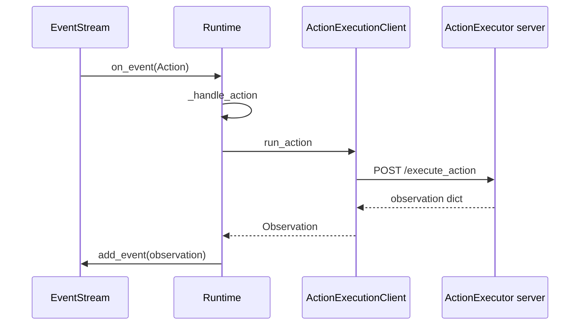

## Overview

The runtime is where actions become real effects. The abstract `Runtime` class subscribes to the event stream, runs each runnable action, and adds the resulting observation back to the stream. For sandboxed backends the work is split in two: `ActionExecutionClient` runs in the OpenHands process and forwards each action over HTTP, and an `ActionExecutor` FastAPI server running inside the sandbox executes it with a persistent bash session, a file editor, a browser and plugins. Choosing and starting a backend is covered in [[Runtime Implementations and Sandbox Image]].

Sources: [openhands/runtime/base.py:90-117](repo://openhands/runtime/base.py#L90-L117), [openhands/runtime/impl/action_execution/action_execution_client.py:61-66](repo://openhands/runtime/impl/action_execution/action_execution_client.py#L61-L66), [openhands/runtime/action_execution_server.py:166-169](repo://openhands/runtime/action_execution_server.py#L166-L169)

## From event to observation

### The event path

Sources: [openhands/runtime/base.py:320-322](repo://openhands/runtime/base.py#L320-L322), [openhands/runtime/base.py:361-399](repo://openhands/runtime/base.py#L361-L399), [openhands/runtime/impl/action_execution/action_execution_client.py:272-338](repo://openhands/runtime/impl/action_execution/action_execution_client.py#L272-L338)

`Runtime.__init__` subscribes `on_event` under `EventStreamSubscriber.RUNTIME`, adds the VS Code plugin when not headless, builds default environment variables and a `ProviderHandler` for git tokens, and creates the configured security analyzer. `on_event` ignores observations and schedules `_handle_action` for each action.

Sources: [openhands/runtime/base.py:128-204](repo://openhands/runtime/base.py#L128-L204), [openhands/runtime/base.py:320-322](repo://openhands/runtime/base.py#L320-L322)

`_handle_action` sets a non-blocking hard timeout of `sandbox.timeout` seconds when the action has none, refreshes git provider tokens if a command references one, and runs the action in a worker thread. An `MCPAction` goes to `call_tool_mcp` instead. The observation then gets `_cause` set to the action's id and the action's `tool_call_metadata`, and is added to the stream with the action's source. A `NullObservation` is not added.

Sources: [openhands/runtime/base.py:361-399](repo://openhands/runtime/base.py#L361-L399), [openhands/runtime/base.py:324-359](repo://openhands/runtime/base.py#L324-L359)

### Dispatch

`run_action` is the dispatcher. It handles actions that are not runnable: an `AgentThinkAction` answers "Your thought has been logged", and a `TaskTrackingAction` writes or reads a `TASKS.md` file in the conversation's directory in the file store. Other non-runnable actions give a `NullObservation`. For runnable actions it checks, in order, that the action is not awaiting confirmation (a `NullObservation`), that the action type is known, that the runtime has a method of that name (otherwise an `ErrorObservation`), and that the user did not reject it (a `UserRejectObservation`). It then calls the method named by the action type: `run`, `run_ipython`, `read`, `write`, `edit`, `browse` or `browse_interactive`.

Sources: [openhands/runtime/base.py:890-972](repo://openhands/runtime/base.py#L890-L972), [openhands/runtime/base.py:1035-1070](repo://openhands/runtime/base.py#L1035-L1070)

### Failures

A `PermissionError` becomes an `ErrorObservation`, so the agent sees the message and continues. A network error or `AgentRuntimeDisconnectedError` sets `RuntimeStatus.ERROR_RUNTIME_DISCONNECTED`, and any other exception sets `RuntimeStatus.ERROR`; both call the status callback with level `error` and add no observation, which the owning session turns into an `ERROR` agent state. The controller then writes an `ErrorObservation` for the orphaned tool call. See [[Agent Controller and Agent States]].

Sources: [openhands/runtime/base.py:372-389](repo://openhands/runtime/base.py#L372-L389), [openhands/runtime/runtime_status.py:5-24](repo://openhands/runtime/runtime_status.py#L5-L24), [openhands/controller/agent_controller.py:590-629](repo://openhands/controller/agent_controller.py#L590-L629)

## Client and server

`ActionExecutionClient.send_action_for_execution` first diverts LLM-based file edits to `llm_based_edit`, then sets a default timeout (and refuses a blocking command with no timeout). Under a one-slot semaphore, so only one action runs at a time, it repeats the same checks as `run_action`, serialises the action with `event_to_dict`, posts it to `/execute_action` with a client timeout five seconds longer than the action's, and rebuilds the observation with `observation_from_dict`. A client timeout becomes `AgentRuntimeTimeoutError`.

Sources: [openhands/runtime/impl/action_execution/action_execution_client.py:272-338](repo://openhands/runtime/impl/action_execution/action_execution_client.py#L272-L338)

HTTP calls use `_send_action_server_request`, which retries up to five times with exponential backoff on `RemoteProtocolError` only. The client also provides `list_files`, `copy_from` (a zip download), `copy_to` (a zip upload for directories), and the VS Code token fetch.

Sources: [openhands/runtime/impl/action_execution/action_execution_client.py:55-60](repo://openhands/runtime/impl/action_execution/action_execution_client.py#L55-L60), [openhands/runtime/impl/action_execution/action_execution_client.py:105-182](repo://openhands/runtime/impl/action_execution/action_execution_client.py#L105-L182)

The server is started with `python -m openhands.runtime.action_execution_server <port>`, with options for the working directory, plugins, username, user id and browser. Its lifespan creates the `ActionExecutor`, calls `ainit`, and mounts an MCP proxy manager (not on Windows). A middleware checks the `X-Session-API-Key` header against the `SESSION_API_KEY` environment variable on every route except `/alive` and `/server_info`. `/execute_action` decodes the action with `event_from_dict`, runs `client.run_action` under an asyncio lock, and returns `event_to_dict(observation)`; other routes handle `/upload_file`, `/download_files`, `/list_files`, `/update_mcp_server` and the VS Code token.

Sources: [openhands/runtime/action_execution_server.py:653-697](repo://openhands/runtime/action_execution_server.py#L653-L697), [openhands/runtime/action_execution_server.py:697-755](repo://openhands/runtime/action_execution_server.py#L697-L755), [openhands/runtime/action_execution_server.py:787-833](repo://openhands/runtime/action_execution_server.py#L787-L833)

## Inside the sandbox

### Startup and action methods

`ActionExecutor.__init__` prepares the user and working directory, creates the file editor (`OHEditor`) rooted at the working directory, and starts a memory monitor. `ainit` creates the bash session first, starts the browser initialisation in the background, initialises every requested plugin within `INIT_PLUGIN_TIMEOUT` (120 s by default), and then runs init bash commands, such as `alias git="git --no-pager"`. `run_action` takes a lock and calls the method named by the action type.

Sources: [openhands/runtime/action_execution_server.py:171-224](repo://openhands/runtime/action_execution_server.py#L171-L224), [openhands/runtime/action_execution_server.py:291-323](repo://openhands/runtime/action_execution_server.py#L291-L323), [openhands/runtime/action_execution_server.py:347-383](repo://openhands/runtime/action_execution_server.py#L347-L383)

| Action | Implementation |
| --- | --- |
| `CmdRunAction` | `BashSession.execute`, or a throwaway session when `is_static` is set |
| `IPythonRunCellAction` | The Jupyter plugin, after syncing its working directory with bash |
| `FileReadAction` | The editor's `view` for OH_ACI reads, otherwise a direct read; binary files give `ERROR_BINARY_FILE` |
| `FileWriteAction` | Writes lines, keeping an existing file's permissions and ownership |
| `FileEditAction` | `OHEditor` commands, returning a diff in the observation |
| `BrowseURLAction`, `BrowseInteractiveAction` | `BrowserEnv`, an error if the browser is disabled; a download is copied into `/workspace` |

Sources: [openhands/runtime/action_execution_server.py:385-433](repo://openhands/runtime/action_execution_server.py#L385-L433), [openhands/runtime/action_execution_server.py:442-461](repo://openhands/runtime/action_execution_server.py#L442-L461), [openhands/runtime/action_execution_server.py:511-563](repo://openhands/runtime/action_execution_server.py#L511-L563), [openhands/runtime/action_execution_server.py:565-643](repo://openhands/runtime/action_execution_server.py#L565-L643)

### The bash session

`BashSession` drives a real shell through tmux (`libtmux`). `initialize` starts a session whose window runs `/bin/bash` (through `su` for `root` or `openhands`), keeps 10,000 lines of history, and sets a custom `PS1` that encodes metadata (exit code, working directory) so the end of a command can be detected.

Sources: [openhands/runtime/utils/bash.py:175-251](repo://openhands/runtime/utils/bash.py#L175-L251)

`execute` refuses a command that `split_bash_commands` finds to be several commands, and asks the model to chain them with `&&` or `;`. It sends the command to the pane and polls every 0.5 s. It ends with one of four states: a new prompt appeared (`COMPLETED`), output did not change for `no_change_timeout_seconds` (`NO_CHANGE_TIMEOUT`, not for blocking commands), the action's hard timeout passed (`HARD_TIMEOUT`), or `CONTINUE`. After a timeout the process keeps running. The next call must be empty (to read more output), or have `is_input=true` (to type into the process, including special keys), or the new command is refused with a message telling the agent so.

Sources: [openhands/runtime/utils/bash.py:164-169](repo://openhands/runtime/utils/bash.py#L164-L169), [openhands/runtime/utils/bash.py:483-570](repo://openhands/runtime/utils/bash.py#L483-L570), [openhands/runtime/utils/bash.py:580-670](repo://openhands/runtime/utils/bash.py#L580-L670)

## Plugins

A plugin is a class with `name`, `initialize(username)` and `run(action)`. `PluginRequirement` is the small dataclass an agent lists in `sandbox_plugins`; the runtime passes the names to the server, which looks them up in `ALL_PLUGINS`. `CodeActAgent` lists agent skills before Jupyter, because the skills are imported into the Jupyter kernel.

Sources: [openhands/runtime/plugins/requirement.py:7-27](repo://openhands/runtime/plugins/requirement.py#L7-L27), [openhands/runtime/plugins/__init__.py:1-25](repo://openhands/runtime/plugins/__init__.py#L1-L25), [openhands/agenthub/codeact_agent/codeact_agent.py:70-76](repo://openhands/agenthub/codeact_agent/codeact_agent.py#L70-L76)

| Plugin | Role |
| --- | --- |
| `jupyter` | Starts a Jupyter kernel gateway on a free port in 40000 to 49999 and runs IPython cells in it |
| `agent_skills` | Python helper functions imported into the Jupyter kernel; it has no `run` |
| `vscode` | Starts a VS Code server; added automatically when the runtime is not headless |

Sources: [openhands/runtime/plugins/jupyter/__init__.py:17-36](repo://openhands/runtime/plugins/jupyter/__init__.py#L17-L36), [openhands/runtime/plugins/agent_skills/__init__.py:9-24](repo://openhands/runtime/plugins/agent_skills/__init__.py#L9-L24), [openhands/runtime/plugins/vscode/__init__.py:19-40](repo://openhands/runtime/plugins/vscode/__init__.py#L19-L40), [openhands/runtime/base.py:155-157](repo://openhands/runtime/base.py#L155-L157)

## Environment and repositories

`setup_initial_env` exports the initial environment variables through the shell (and into the Jupyter kernel when present), appends them to `~/.bashrc`, and configures git. `clone_or_init_repo` runs `git init` in an empty workspace when `init_git_in_empty_workspace` is set, or clones the selected repository with an authenticated URL; `maybe_run_setup_script` and `maybe_setup_git_hooks` then run the repository's `.openhands` scripts. See [[Microagents and Knowledge Recall]] for the microagents loaded from the same workspace.

Sources: [openhands/runtime/base.py:210-219](repo://openhands/runtime/base.py#L210-L219), [openhands/runtime/base.py:245-318](repo://openhands/runtime/base.py#L245-L318), [openhands/runtime/base.py:401-425](repo://openhands/runtime/base.py#L401-L425), [openhands/runtime/base.py:463-495](repo://openhands/runtime/base.py#L463-L495)
