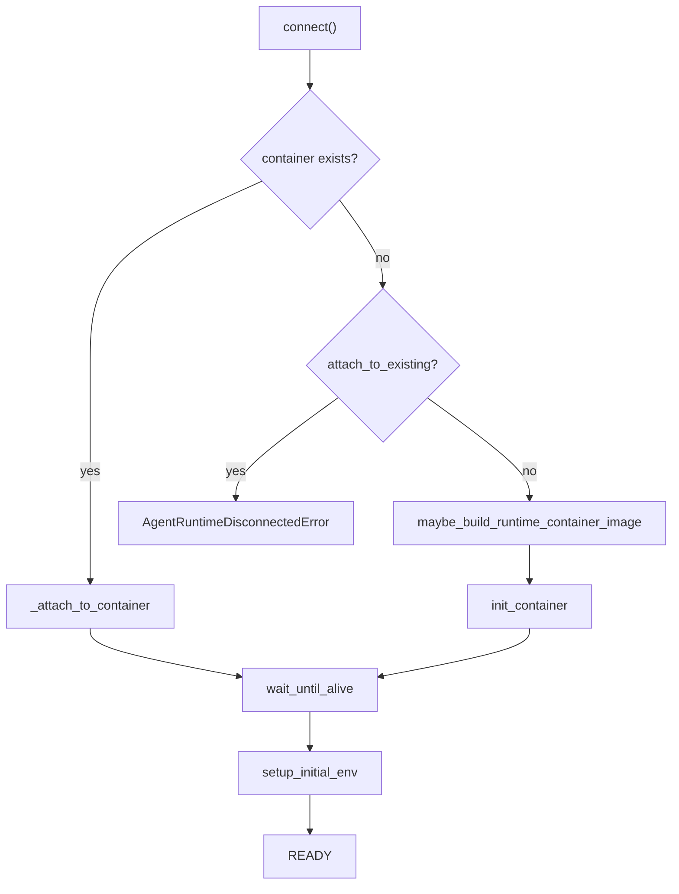

## Overview

`config.runtime` is a string that names the backend that runs an agent's actions. `get_runtime_cls` maps it to a class, and each class is a subclass of `Runtime` that either runs actions itself or starts and talks to the action execution server described in [[Runtime and Action Execution]]. This page lists the backends and then follows the default one, `DockerRuntime`, from image to running container.

Sources: [openhands/runtime/__init__.py:12-21](repo://openhands/runtime/__init__.py#L12-L21), [openhands/runtime/__init__.py:80-95](repo://openhands/runtime/__init__.py#L80-L95)

## Choosing a backend

| Name | Class | What it does |
| --- | --- | --- |
| `docker`, `eventstream` | `DockerRuntime` | Starts a container per conversation and talks to the server inside; the default |
| `local` | `LocalRuntime` | Runs the action execution server as a process on the local machine |
| `cli` | `CLIRuntime` | Runs commands with `subprocess` and files with the standard library, with no sandbox, no browser and no IPython |
| `remote` | `RemoteRuntime` | Asks a remote runtime API to build and start a runtime, then connects to it |
| `kubernetes` | `KubernetesRuntime` | Creates pods in a cluster, designed to work with Kind |

Sources: [openhands/runtime/__init__.py:12-21](repo://openhands/runtime/__init__.py#L12-L21), [openhands/core/config/openhands_config.py:71](repo://openhands/core/config/openhands_config.py#L71)

Any other name is tried as a fully qualified class name through `get_impl`, so `runtime = "app.my.CustomRuntime"` works if the class is a `Runtime` subclass; an unknown name raises `ValueError` listing the known keys. At import time the package also scans `third_party/runtime/impl/*` for a `<name>_runtime` module and registers a class called `<NAME>Runtime` or `<Name>Runtime`, skipping packages whose dependencies are not installed.

Sources: [openhands/runtime/__init__.py:23-95](repo://openhands/runtime/__init__.py#L23-L95)

`LocalRuntime` keeps a module-level dictionary of running servers by session id, so a second `connect` for the same session reuses the process, and fails with `AgentRuntimeDisconnectedError` when `attach_to_existing` is set and none exists. It can also create "warm" servers in advance, controlled by `DESIRED_NUM_WARM_SERVERS`.

Sources: [openhands/runtime/impl/local/local_runtime.py:123-133](repo://openhands/runtime/impl/local/local_runtime.py#L123-L133), [openhands/runtime/impl/local/local_runtime.py:217-246](repo://openhands/runtime/impl/local/local_runtime.py#L217-L246), [openhands/runtime/impl/local/local_runtime.py:754-815](repo://openhands/runtime/impl/local/local_runtime.py#L754-L815)

`CLIRuntime` uses `workspace_base` as the working directory, or a temporary directory when it is not set, and logs a warning that no sandbox is used. It is what the terminal app relies on; the code states that Jupyter and browser actions are not implemented and returns an error for them. See [[Command-Line Interface]].

Sources: [openhands/runtime/impl/cli/cli_runtime.py:90-105](repo://openhands/runtime/impl/cli/cli_runtime.py#L90-L105), [openhands/runtime/impl/cli/cli_runtime.py:135-166](repo://openhands/runtime/impl/cli/cli_runtime.py#L135-L166), [openhands/runtime/impl/cli/cli_runtime.py:478-495](repo://openhands/runtime/impl/cli/cli_runtime.py#L478-L495), [openhands/runtime/impl/cli/cli_runtime.py:588-595](repo://openhands/runtime/impl/cli/cli_runtime.py#L588-L595)

`RemoteRuntime` requires `sandbox.remote_runtime_api_url`. Its `connect` first looks for an existing runtime for the session at `/sessions/<sid>`. Failing that it either builds an image remotely (when no `runtime_container_image` is set) or uses the configured one, starts a runtime with `/start`, and waits until it is alive. `KubernetesRuntime` creates pods through the Kubernetes Python client and is configured with the `[kubernetes]` section.

Sources: [openhands/runtime/impl/remote/remote_runtime.py:39-50](repo://openhands/runtime/impl/remote/remote_runtime.py#L39-L50), [openhands/runtime/impl/remote/remote_runtime.py:92-101](repo://openhands/runtime/impl/remote/remote_runtime.py#L92-L101), [openhands/runtime/impl/remote/remote_runtime.py:125-170](repo://openhands/runtime/impl/remote/remote_runtime.py#L125-L170), [openhands/runtime/impl/kubernetes/kubernetes_runtime.py:61-79](repo://openhands/runtime/impl/kubernetes/kubernetes_runtime.py#L61-L79)

## The Docker runtime

### Connection flow

Sources: [openhands/runtime/impl/docker/docker_runtime.py:170-214](repo://openhands/runtime/impl/docker/docker_runtime.py#L170-L214)

`DockerRuntime` extends `ActionExecutionClient`. The first instance registers a shutdown listener that stops every container whose name starts with `openhands-runtime-`. The container name is that prefix plus the session id, which is how a later `connect` finds a container to reuse.

Sources: [openhands/runtime/impl/docker/docker_runtime.py:43](repo://openhands/runtime/impl/docker/docker_runtime.py#L43), [openhands/runtime/impl/docker/docker_runtime.py:105-108](repo://openhands/runtime/impl/docker/docker_runtime.py#L105-L108), [openhands/runtime/impl/docker/docker_runtime.py:131-140](repo://openhands/runtime/impl/docker/docker_runtime.py#L131-L140)

### Image selection and build

If `sandbox.runtime_container_image` is set, it is used as is. Otherwise `maybe_build_runtime_container_image` requires `base_container_image` (the template default is `nikolaik/python-nodejs:python3.12-nodejs22`) and calls `build_runtime_image`, passing platform, extra dependencies, `force_rebuild_runtime` and `enable_browser`.

Sources: [openhands/runtime/impl/docker/docker_runtime.py:233-248](repo://openhands/runtime/impl/docker/docker_runtime.py#L233-L248), [config.template.toml:299](repo://config.template.toml#L299)

`build_runtime_image_in_folder` names the result by hashes so that rebuilds are cheap. The final tag combines the OpenHands version, a hash of the lock files and a hash of the source files. The decision is as follows.

Sources: [openhands/runtime/utils/runtime_build.py:168-200](repo://openhands/runtime/utils/runtime_build.py#L168-L200)

1. With `force_rebuild`, build from scratch.
2. If the image with the exact source hash exists, reuse it.
3. Else if an image with the same lock-file hash exists, build `FROM` it and copy only the source.
4. Else if a versioned image for the base exists, build from that.
5. Else build from scratch.

Only a from-scratch build also gets the versioned tag, so images do not stack layers repeatedly. The Dockerfile is rendered from `runtime_templates/Dockerfile.j2` with the build mode, extra dependencies and the browser flag.

Sources: [openhands/runtime/utils/runtime_build.py:168-255](repo://openhands/runtime/utils/runtime_build.py#L168-L255), [openhands/runtime/utils/runtime_build.py:31-62](repo://openhands/runtime/utils/runtime_build.py#L31-L62)

### Starting the container

`init_container` allocates four kinds of host port, each from its own range and guarded by a `PortLock` so parallel conversations cannot take the same port: the execution server (30000 to 39999), VS Code (40000 to 49999, unless `vscode_port` is configured), and two application ports (50000 to 54999 and 55000 to 59999). With `use_host_network` the container uses host networking and no port mapping; otherwise each port is mapped on `runtime_binding_address`.

Sources: [openhands/runtime/impl/docker/docker_runtime.py:43-55](repo://openhands/runtime/impl/docker/docker_runtime.py#L43-L55), [openhands/runtime/impl/docker/docker_runtime.py:391-457](repo://openhands/runtime/impl/docker/docker_runtime.py#L391-L457)

The environment passed to the container combines the runtime's initial variables with `port`, `VSCODE_PORT`, `APP_PORT_1`, `APP_PORT_2` and `runtime_startup_env_vars`. Volumes come from `sandbox.volumes`, a comma-separated list of `host:container:mode` entries. A host part starting with `volume:` or not starting with `/` is a named volume. A mode containing `overlay` is excluded from plain mounts and, when the `SANDBOX_VOLUME_OVERLAYS` environment variable names a base directory, becomes an overlay volume with a read-only lower layer and per-container upper and work layers. If `volumes` is unset, the legacy `workspace_mount_path` pair is used.

Sources: [openhands/runtime/impl/docker/docker_runtime.py:459-491](repo://openhands/runtime/impl/docker/docker_runtime.py#L459-L491), [openhands/runtime/impl/docker/docker_runtime.py:261-322](repo://openhands/runtime/impl/docker/docker_runtime.py#L261-L322), [openhands/runtime/impl/docker/docker_runtime.py:324-389](repo://openhands/runtime/impl/docker/docker_runtime.py#L324-L389)

The container runs `/openhands/code/` as its working directory with an empty entrypoint and the command built by `get_action_execution_server_startup_command`: the micromamba-run Poetry prefix, `python -u -m openhands.runtime.action_execution_server <port>`, `--working-dir`, `--plugins`, `--username` and `--user-id` (`openhands` and 1000 when `run_as_openhands`, otherwise `root` and 0), browser arguments, and `--no-enable-browser` when the browser is off. GPU access is requested when `enable_gpu` is set, and extra `docker_runtime_kwargs` are passed through.

Sources: [openhands/runtime/impl/docker/docker_runtime.py:493-541](repo://openhands/runtime/impl/docker/docker_runtime.py#L493-L541), [openhands/runtime/utils/command.py:5-69](repo://openhands/runtime/utils/command.py#L5-L69)

### Attaching, waiting and closing

`_attach_to_container` loads an existing container, restarts it if it has exited, and recovers the ports from its environment and exposed ports. `wait_until_alive` retries for up to 120 seconds, failing fast if the container has exited or vanished, and calls the server's `/alive` route.

Sources: [openhands/runtime/impl/docker/docker_runtime.py:543-591](repo://openhands/runtime/impl/docker/docker_runtime.py#L543-L591)

`close` stops this session's container, or all prefixed containers when `rm_all_containers` is set, and releases the port locks. It does nothing when `keep_runtime_alive` is set or the runtime was attached to an existing container. `pause` and `resume` stop and start the container, and the class method `delete` removes a conversation's container by name.

Sources: [openhands/runtime/impl/docker/docker_runtime.py:593-633](repo://openhands/runtime/impl/docker/docker_runtime.py#L593-L633), [openhands/runtime/impl/docker/docker_runtime.py:716-756](repo://openhands/runtime/impl/docker/docker_runtime.py#L716-L756)
