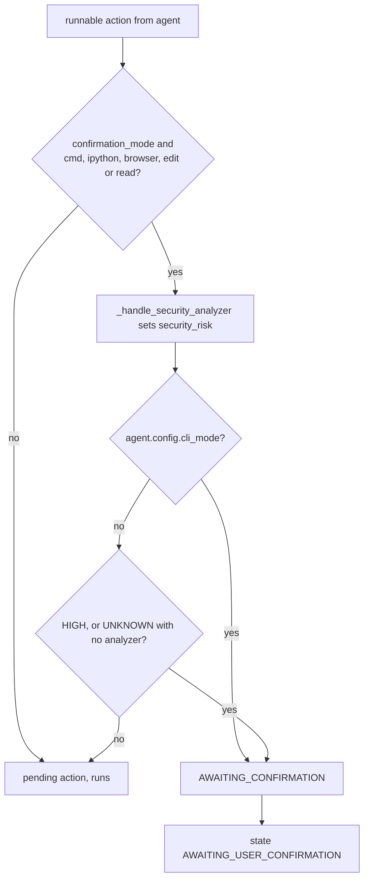

## Overview

OpenHands lets a user require approval before an agent runs a command. Two settings control this: `confirmation_mode` turns the approval step on, and `security_analyzer` names an object that rates each action's risk so that only the risky ones interrupt the user. The risk can come from the model itself (it fills a `security_risk` argument on its tool calls) or from an analyzer such as Invariant. The decision is made in the controller, and the approved or rejected action is carried out by the runtime.

Sources: [openhands/core/config/security_config.py:4-15](repo://openhands/core/config/security_config.py#L4-L15), [openhands/controller/agent_controller.py:919-968](repo://openhands/controller/agent_controller.py#L919-L968)

## Risk levels

`ActionSecurityRisk` is an integer enum: `UNKNOWN` (-1), `LOW` (0), `MEDIUM` (1) and `HIGH` (2). `CmdRunAction` and `IPythonRunCellAction` carry a `security_risk` field defaulting to `UNKNOWN`, and so do the other runnable action classes that can be confirmed. Every action also has a `confirmation_state`: `CONFIRMED` by default, `AWAITING_CONFIRMATION` or `REJECTED`.

Sources: [openhands/events/action/action.py:7-23](repo://openhands/events/action/action.py#L7-L23), [openhands/events/action/commands.py:12-52](repo://openhands/events/action/commands.py#L12-L52)

The model is asked for the level. The bash, editor and other tools include a `security_risk` parameter described by `SECURITY_RISK_DESC`, with the enum `LOW`, `MEDIUM`, `HIGH`, and the bash and editor tools list it as required. The system prompt includes a risk policy template that defines the levels differently inside a sandbox and in CLI mode: in CLI mode, system-level changes, global installs and sudo are high, while in the sandbox it is data leaving the environment and privilege breaks. `set_security_risk` copies the value from the tool arguments onto the action, logging and ignoring any other value.

Sources: [openhands/agenthub/codeact_agent/tools/security_utils.py:1-10](repo://openhands/agenthub/codeact_agent/tools/security_utils.py#L1-L10), [openhands/agenthub/codeact_agent/tools/bash.py:70-80](repo://openhands/agenthub/codeact_agent/tools/bash.py#L70-L80), [openhands/agenthub/codeact_agent/tools/str_replace_editor.py:104-114](repo://openhands/agenthub/codeact_agent/tools/str_replace_editor.py#L104-L114), [openhands/agenthub/codeact_agent/prompts/security_risk_assessment.j2:1-22](repo://openhands/agenthub/codeact_agent/prompts/security_risk_assessment.j2#L1-L22), [openhands/agenthub/codeact_agent/function_calling.py:59-70](repo://openhands/agenthub/codeact_agent/function_calling.py#L59-L70)

## Analyzers

`SecurityAnalyzer` is the base class. A subclass implements `security_risk(action)`, which returns an `ActionSecurityRisk`, and `handle_api_request(request)`, which serves custom API calls; `close()` releases resources. `options.SecurityAnalyzers` maps the names a user can choose to classes.

Sources: [openhands/security/analyzer.py:8-29](repo://openhands/security/analyzer.py#L8-L29), [openhands/security/options.py:1-8](repo://openhands/security/options.py#L1-L8)

| Name | Class | How it decides |
| --- | --- | --- |
| `llm` | `LLMRiskAnalyzer` | Returns the risk the model put on the action, or `UNKNOWN` if it is missing or unrecognised |
| `invariant` | `InvariantAnalyzer` | Starts or reuses a Docker container running the Invariant server, feeds the action trace to a policy monitor, and returns the highest `risk=` level the policy reports, `LOW` if none |

Sources: [openhands/security/llm/analyzer.py:10-42](repo://openhands/security/llm/analyzer.py#L10-L42), [openhands/security/invariant/analyzer.py:15-125](repo://openhands/security/invariant/analyzer.py#L15-L125)

When the policy check itself fails, `InvariantAnalyzer` returns `UNKNOWN` rather than a low rating. It requires Docker and raises at construction if Docker is unavailable.

Sources: [openhands/security/invariant/analyzer.py:37-44](repo://openhands/security/invariant/analyzer.py#L37-L44), [openhands/security/invariant/analyzer.py:110-125](repo://openhands/security/invariant/analyzer.py#L110-L125)

The analyzer is created by the runtime: `Runtime.__init__` looks up `config.security.security_analyzer` in `SecurityAnalyzers`, falling back to the base class for an unknown name, and stores an instance as `runtime.security_analyzer`. The session passes it to the `AgentController`. The base class's `security_risk` raises `NotImplementedError`, and the controller catches any analyzer exception and marks the action `UNKNOWN`.

Sources: [openhands/runtime/base.py:195-204](repo://openhands/runtime/base.py#L195-L204), [openhands/server/session/agent_session.py:427-444](repo://openhands/server/session/agent_session.py#L427-L444), [openhands/controller/agent_controller.py:204-242](repo://openhands/controller/agent_controller.py#L204-L242)

## When the controller asks

Sources: [openhands/controller/agent_controller.py:919-968](repo://openhands/controller/agent_controller.py#L919-L968)

`_step` applies the gate only when `state.confirmation_mode` is on and the action is exactly a `CmdRunAction`, `IPythonRunCellAction`, `BrowseInteractiveAction`, `FileEditAction` or `FileReadAction`. `_handle_security_analyzer` first sets the risk. With an analyzer it overwrites the model's value with `analyzer.security_risk(action)`. With none it sets `UNKNOWN`, a deliberate fail-safe so that confirmation is required when nothing can rate the action.

Sources: [openhands/controller/agent_controller.py:204-242](repo://openhands/controller/agent_controller.py#L204-L242), [openhands/controller/agent_controller.py:919-934](repo://openhands/controller/agent_controller.py#L919-L934)

The rule that follows differs by front end. In the CLI (`agent.config.cli_mode`) every such action is marked `AWAITING_CONFIRMATION`, because the terminal app decides itself from the risk, as the code comment explains. Everywhere else the action is marked only if its risk is `HIGH`, or `UNKNOWN` with no analyzer configured. The controller then moves to `AWAITING_USER_CONFIRMATION` and publishes the action with the awaiting status. A confirmation that is not needed leaves the action `CONFIRMED`, and it runs at once.

Sources: [openhands/controller/agent_controller.py:935-968](repo://openhands/controller/agent_controller.py#L935-L968)

## Approving or rejecting

The user's answer arrives as a `ChangeAgentStateAction` with `USER_CONFIRMED` or `USER_REJECTED`. The controller sets the pending action's `confirmation_state` to `CONFIRMED` or `REJECTED`, clears its thought, resets its id, and re-adds the same action to the stream, so it becomes a new event with the decision recorded. The `Runtime` sees it as an action again: `run_action` returns a `NullObservation` while the status is `AWAITING_CONFIRMATION`, a `UserRejectObservation` when it is `REJECTED`, and otherwise executes it. After a confirmation the controller goes back to `RUNNING`; after a rejection it waits in `AWAITING_USER_INPUT`. See [[Agent Controller and Agent States]] and [[Runtime and Action Execution]].

Sources: [openhands/controller/agent_controller.py:658-669](repo://openhands/controller/agent_controller.py#L658-L669), [openhands/runtime/base.py:951-970](repo://openhands/runtime/base.py#L951-L970), [openhands/controller/agent_controller.py:536-547](repo://openhands/controller/agent_controller.py#L536-L547)

The terminal app adds two shortcuts on top: an "always" choice that confirms everything, and an "auto high-risk" choice that confirms anything not `HIGH`. See [[Command-Line Interface]].

Sources: [openhands/cli/main.py:245-299](repo://openhands/cli/main.py#L245-L299)

## Analyzer API and the web UI

Each analyzer can define its own HTTP endpoints. The route `/api/conversations/{conversation_id}/security/{path}` accepts GET, POST, PUT and DELETE and hands the request to the conversation's analyzer through `handle_api_request`, answering 404 if the conversation has none. The frontend keeps the analyzer's events in its own store slice; see [[Web Frontend]]. The list of analyzers is served by `/api/options/security-analyzers`.

Sources: [openhands/server/routes/security.py:14-42](repo://openhands/server/routes/security.py#L14-L42), [openhands/server/routes/public.py:47-59](repo://openhands/server/routes/public.py#L47-L59), [frontend/src/services/actions.ts:34-36](repo://frontend/src/services/actions.ts#L34-L36)

## Adding an analyzer

Create a subclass of `SecurityAnalyzer` and add it to `SecurityAnalyzers`; its key becomes a valid `security_analyzer` value, in `config.toml` or in the user's settings. The web session copies `confirmation_mode` and `security_analyzer` from the user's `Settings` over the server configuration when it starts. See [[Configuration System]].

Sources: [openhands/security/options.py:1-8](repo://openhands/security/options.py#L1-L8), [openhands/server/session/session.py:142-152](repo://openhands/server/session/session.py#L142-L152)
