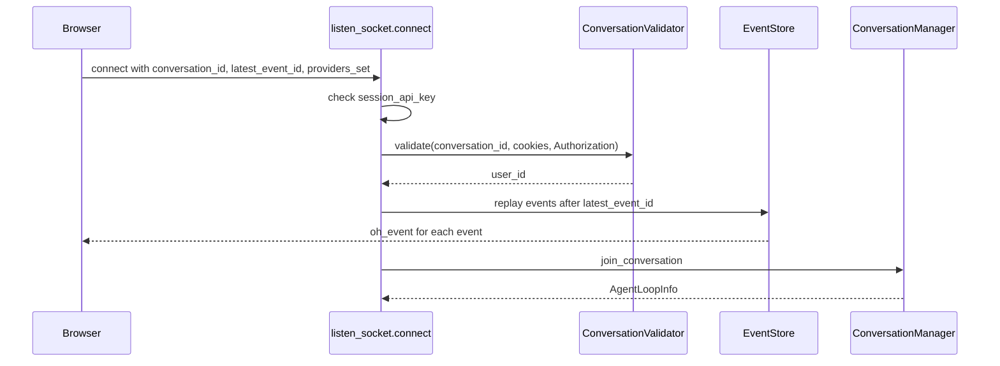

## Overview

The GUI backend is one ASGI application with two halves: a FastAPI app that serves REST routes, the MCP endpoint and the built frontend, and a Socket.IO server that streams events to the browser. REST is used to create and manage conversations; the Socket.IO connection carries the live event stream. Starting an agent loop behind these calls is the subject of [[Conversation Lifecycle]], and the browser side is in [[Web Frontend]].

Sources: [openhands/server/listen.py:1-27](repo://openhands/server/listen.py#L1-L27), [openhands/server/app.py:58-86](repo://openhands/server/app.py#L58-L86)

## Assembling the application

`openhands.server.listen` imports the FastAPI app as `base_app`, mounts the compiled frontend at `/` with `SPAStaticFiles` unless `SERVE_FRONTEND` is `false`, adds three middlewares, and wraps everything with `socketio.ASGIApp(sio, other_asgi_app=base_app)`. `SPAStaticFiles` falls back to `index.html` for any path it cannot serve, which supports client-side routing.

Sources: [openhands/server/listen.py:15-27](repo://openhands/server/listen.py#L15-L27), [openhands/server/static.py:1-12](repo://openhands/server/static.py#L1-L12)

| Middleware | Behaviour |
| --- | --- |
| `LocalhostCORSMiddleware` | Allows any `localhost` or `127.0.0.1` origin when `PERMITTED_CORS_ORIGINS` is unset; otherwise only the listed origins |
| `CacheControlMiddleware` | Fingerprinted `/assets` are cached for 30 days, everything else gets no-cache headers |
| `RateLimitMiddleware` | An in-memory limiter by client host: 10 requests per second pass, the next 10 are delayed one second, beyond that the answer is 429 |

Sources: [openhands/server/middleware.py:16-48](repo://openhands/server/middleware.py#L16-L48), [openhands/server/middleware.py:51-67](repo://openhands/server/middleware.py#L51-L67), [openhands/server/middleware.py:70-131](repo://openhands/server/middleware.py#L70-L131), [openhands/server/listen.py:20-25](repo://openhands/server/listen.py#L20-L25)

The FastAPI app in `app.py` includes the routers below. Its lifespan enters the conversation manager and the MCP app's lifespan together. An `AuthenticationError` from a git provider becomes a 401 response. The git router is only included in `AppMode.OSS`.

Sources: [openhands/server/app.py:37-64](repo://openhands/server/app.py#L37-L64), [openhands/server/app.py:67-86](repo://openhands/server/app.py#L67-L86)

## Shared singletons

`openhands/server/shared.py` builds the objects every route uses, at import time: the `OpenHandsConfig`, the `ServerConfig`, the `FileStore` (with optional webhook wrapping), the Socket.IO `AsyncServer`, and the monitoring listener. It creates `sio` with a 4 MB buffer for large uploads and, when `REDIS_HOST` is set, a Redis client manager so several server processes can share rooms.

Sources: [openhands/server/shared.py:21-52](repo://openhands/server/shared.py#L21-L52)

The conversation manager, monitoring listener, settings store, secrets store and conversation store are classes named by `ServerConfig` and loaded with `get_impl`. The open-source defaults are `StandaloneConversationManager`, `FileSettingsStore`, `FileSecretsStore` and `FileConversationStore`, and the `OPENHANDS_CONFIG_CLS` environment variable swaps the whole `ServerConfig` class. This is the hook the [[Enterprise Edition]] uses. See [[Storage and Persistence]].

Sources: [openhands/server/shared.py:54-77](repo://openhands/server/shared.py#L54-L77), [openhands/server/config/server_config.py:8-60](repo://openhands/server/config/server_config.py#L8-L60)

## Authentication

When the `SESSION_API_KEY` environment variable is set, every router carries `check_session_api_key` as a dependency and the header `X-Session-API-Key` must equal it, otherwise the answer is 401. `get_dependencies()` returns an empty list when it is not set, so local use needs no key. The Socket.IO handshake performs the same check against a `session_api_key` query parameter, because browsers cannot set custom headers on a WebSocket.

Sources: [openhands/server/dependencies.py:1-24](repo://openhands/server/dependencies.py#L1-L24), [openhands/server/listen_socket.py:161-168](repo://openhands/server/listen_socket.py#L161-L168), [frontend/src/context/ws-client-provider.tsx:313-318](repo://frontend/src/context/ws-client-provider.tsx#L313-L318)

## The Socket.IO connection

Sources: [openhands/server/listen_socket.py:35-141](repo://openhands/server/listen_socket.py#L35-L141)

The `connect` handler reads the query string: `conversation_id` is required, `latest_event_id` defaults to -1 and `providers_set` is a comma-separated list of git providers. It refuses the connection with `ConnectionRefusedError` for a missing conversation id or a wrong session key, then asks the `ConversationValidator` (created by `create_conversation_validator`) to turn the cookies and `Authorization` header into a `user_id`.

Sources: [openhands/server/listen_socket.py:35-76](repo://openhands/server/listen_socket.py#L35-L76)

It then replays history. An `EventStore` for the conversation is wrapped in `AsyncEventStoreWrapper` starting at `latest_event_id + 1`, and each event is emitted as `oh_event` to the new connection only. `NullAction`, `NullObservation` and `RecallAction` are skipped, and an `AgentStateChangedObservation` is held back and sent last, so the UI ends in the right state however many were replayed. This is how a reconnecting browser catches up without duplicates.

Sources: [openhands/server/listen_socket.py:78-118](repo://openhands/server/listen_socket.py#L78-L118)

After the replay it builds the settings for the conversation with `setup_init_conversation_settings` and calls `conversation_manager.join_conversation`, which puts the connection in the room `room:<sid>` and starts the agent loop if none is running. A `None` result refuses the connection. Any refusal disconnects the socket after the error is sent.

Sources: [openhands/server/listen_socket.py:120-140](repo://openhands/server/listen_socket.py#L120-L140), [openhands/server/conversation_manager/standalone_conversation_manager.py:151-165](repo://openhands/server/conversation_manager/standalone_conversation_manager.py#L151-L165), [openhands/server/constants.py:1-3](repo://openhands/server/constants.py#L1-L3)

## Messages

| Direction | Event | Payload |
| --- | --- | --- |
| Client to server | `oh_user_action` | An event dictionary, such as a user `MessageAction` or a `ChangeAgentStateAction`; forwarded to the conversation's event stream |
| Client to server | `oh_action` | The older name for the same message, kept for sessions started before the rename |
| Server to client | `oh_event` | A serialised action or observation, or a status update dictionary |

Sources: [openhands/server/listen_socket.py:143-158](repo://openhands/server/listen_socket.py#L143-L158), [frontend/src/context/ws-client-provider.tsx:151-157](repo://frontend/src/context/ws-client-provider.tsx#L151-L157)

`oh_user_action` calls `conversation_manager.send_to_event_stream(connection_id, data)`, which finds the session for the connection and calls `WebSession.dispatch`. `dispatch` decodes the dictionary with `event_from_dict`, rejects images when the model has no vision, and adds the event to the stream with source `USER`. Outbound, `WebSession._on_event` sends agent and user events, selected environment events, and error observations, relabelling environment events as agent events for the UI. Status updates have `status_update: true`, a `type` and an `id` from `RuntimeStatus`, and a message. A disconnect only removes the connection from the manager's map; the agent loop keeps running.

Sources: [openhands/server/conversation_manager/standalone_conversation_manager.py:369-380](repo://openhands/server/conversation_manager/standalone_conversation_manager.py#L369-L380), [openhands/server/session/session.py:314-369](repo://openhands/server/session/session.py#L314-L369), [openhands/server/session/session.py:422-442](repo://openhands/server/session/session.py#L422-L442), [openhands/server/conversation_manager/standalone_conversation_manager.py:397-408](repo://openhands/server/conversation_manager/standalone_conversation_manager.py#L397-L408)

## Catalogue of REST routers

All paths below are served by the routers included in `app.py`. A router under `/api/conversations/{conversation_id}` gets the conversation through the `get_conversation` dependency, which validates the id format first (length, null bytes, path separators and control characters) and attaches to the conversation through the manager.

Sources: [openhands/server/utils.py:16-57](repo://openhands/server/utils.py#L16-L57), [openhands/server/app.py:75-86](repo://openhands/server/app.py#L75-L86)

| Router | Paths | Purpose |
| --- | --- | --- |
| `public` | `/api/options/models`, `/agents`, `/security-analyzers`, `/config` | Models litellm supports, registered agent names, security analyzer names, frontend feature flags |
| `manage_conversations` | `/api/conversations` (POST, GET), `/{id}` (GET, PATCH, DELETE), `/{id}/start`, `/{id}/stop` | Create, list, rename, start, stop and delete conversations; see [[Conversation Lifecycle]] |
| `conversation` | `/api/conversations/{id}/config`, `/vscode-url`, `/web-hosts`, `/events` (GET, POST), `/microagents` | Runtime information, event search with paging (`limit` 1 to 100), and posting an event |
| `files` | `/list-files`, `/select-file`, `/zip-directory`, `/git/changes`, `/git/diff`, `/upload-files` | Workspace files and git changes of a conversation |
| `settings`, `secrets` | `/api/settings`, `/api/secrets`, `/api/add-git-providers`, `/api/unset-provider-tokens` | User settings, custom secrets and git provider tokens; see [[Storage and Persistence]] |
| `git` | `/api/user/repositories`, `/info`, `/search/repositories`, `/search/branches`, `/suggested-tasks` and more | Repository browsing through the git provider; OSS mode only |
| `trajectory`, `feedback` | `/{id}/trajectory`, `/{id}/submit-feedback` | Export the history, store user feedback |
| `security` | `/api/conversations/{id}/security/{path}` | Forwards to the conversation's security analyzer; see [[Security Analyzers and Confirmation Mode]] |
| health | `/alive`, `/health`, `/server_info` | Liveness and system information, no authentication |
| `mcp` | `/mcp` | The server's own MCP tools; see [[MCP Integration]] |

Sources: [openhands/server/routes/public.py:11-69](repo://openhands/server/routes/public.py#L11-L69), [openhands/server/routes/manage_conversations.py:189-190](repo://openhands/server/routes/manage_conversations.py#L189-L190), [openhands/server/routes/manage_conversations.py:291-292](repo://openhands/server/routes/manage_conversations.py#L291-L292), [openhands/server/routes/manage_conversations.py:330-331](repo://openhands/server/routes/manage_conversations.py#L330-L331), [openhands/server/routes/manage_conversations.py:352-353](repo://openhands/server/routes/manage_conversations.py#L352-L353), [openhands/server/routes/manage_conversations.py:473-474](repo://openhands/server/routes/manage_conversations.py#L473-L474), [openhands/server/routes/manage_conversations.py:534-535](repo://openhands/server/routes/manage_conversations.py#L534-L535), [openhands/server/routes/manage_conversations.py:639-640](repo://openhands/server/routes/manage_conversations.py#L639-L640), [openhands/server/routes/conversation.py:19-21](repo://openhands/server/routes/conversation.py#L19-L21), [openhands/server/routes/conversation.py:24-25](repo://openhands/server/routes/conversation.py#L24-L25), [openhands/server/routes/conversation.py:43-44](repo://openhands/server/routes/conversation.py#L43-L44), [openhands/server/routes/conversation.py:75-76](repo://openhands/server/routes/conversation.py#L75-L76), [openhands/server/routes/conversation.py:105-106](repo://openhands/server/routes/conversation.py#L105-L106), [openhands/server/routes/conversation.py:171-172](repo://openhands/server/routes/conversation.py#L171-L172), [openhands/server/routes/conversation.py:191-192](repo://openhands/server/routes/conversation.py#L191-L192), [openhands/server/routes/files.py:30-36](repo://openhands/server/routes/files.py#L30-L36), [openhands/server/routes/files.py:118-119](repo://openhands/server/routes/files.py#L118-L119), [openhands/server/routes/files.py:185-186](repo://openhands/server/routes/files.py#L185-L186), [openhands/server/routes/files.py:222-223](repo://openhands/server/routes/files.py#L222-L223), [openhands/server/routes/files.py:262-263](repo://openhands/server/routes/files.py#L262-L263), [openhands/server/routes/files.py:287-288](repo://openhands/server/routes/files.py#L287-L288)

Sources: [openhands/server/routes/settings.py:25-35](repo://openhands/server/routes/settings.py#L25-L35), [openhands/server/routes/secrets.py:25-25](repo://openhands/server/routes/secrets.py#L25-L25), [openhands/server/routes/secrets.py:103-103](repo://openhands/server/routes/secrets.py#L103-L103), [openhands/server/routes/secrets.py:156-156](repo://openhands/server/routes/secrets.py#L156-L156), [openhands/server/routes/secrets.py:184-184](repo://openhands/server/routes/secrets.py#L184-L184), [openhands/server/routes/secrets.py:212-212](repo://openhands/server/routes/secrets.py#L212-L212), [openhands/server/routes/secrets.py:260-260](repo://openhands/server/routes/secrets.py#L260-L260), [openhands/server/routes/secrets.py:312-312](repo://openhands/server/routes/secrets.py#L312-L312), [openhands/server/routes/git.py:35-38](repo://openhands/server/routes/git.py#L35-L38), [openhands/server/routes/git.py:65-65](repo://openhands/server/routes/git.py#L65-L65), [openhands/server/routes/git.py:105-105](repo://openhands/server/routes/git.py#L105-L105), [openhands/server/routes/git.py:132-132](repo://openhands/server/routes/git.py#L132-L132), [openhands/server/routes/git.py:167-167](repo://openhands/server/routes/git.py#L167-L167), [openhands/server/routes/git.py:210-210](repo://openhands/server/routes/git.py#L210-L210), [openhands/server/routes/security.py:14-34](repo://openhands/server/routes/security.py#L14-L34), [openhands/server/routes/health.py:6-17](repo://openhands/server/routes/health.py#L6-L17)
