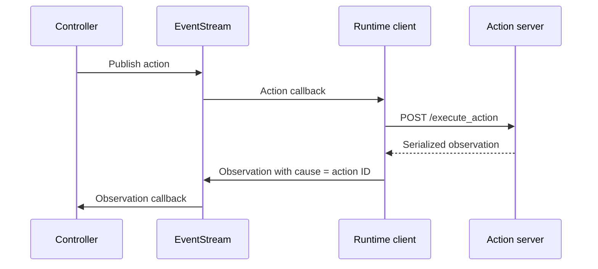

# Runtime execution and sandbox lifecycle

A `Runtime` turns an action into an observation and exposes workspace capabilities such as file transfer, Git inspection, browser access, and editor URLs. The [agent controller](agent-control.md) selects actions; runtime adapters own execution and environment lifecycle.

## Adapter boundary

The runtime registry maps `docker` and the legacy `eventstream` name to `DockerRuntime`, alongside `remote`, `local`, `kubernetes`, and `cli`. Optional third-party runtimes are discovered under `third_party.runtime.impl`; missing optional dependencies can leave an adapter unavailable. A configured class path can resolve a custom `Runtime` implementation.

DockerRuntime extends `ActionExecutionClient`: the application-side client serializes actions over HTTP to an action execution server inside the environment. LocalRuntime also uses that client boundary but starts the server directly on the host. Choosing a runtime therefore changes the execution/isolation boundary, not just a connection address.

## Dispatch, serialization, and failures

The base runtime applies a default nonblocking timeout when needed, refreshes provider-token exports, and dispatches MCP actions asynchronously or ordinary actions through `run_action`. Results inherit the action's cause ID and tool-call metadata. Null observations are omitted from the event stream.

Permission errors become error observations that the agent can act on. Network/disconnection failures instead set an error runtime status and return without publishing a normal result; other unexpected exceptions also set an error status. This distinction matters when diagnosing a controller waiting on a pending action.

The HTTP client serializes execution with a semaphore. It ignores actions awaiting confirmation, returns rejection feedback for rejected actions, validates supported actions, and gives the HTTP request five seconds beyond the action timeout. A client timeout raises `AgentRuntimeTimeoutError`. The server deserializes an action, executes it, and returns a serialized observation.

## Docker startup and cleanup

`connect` first attempts to attach to the session's container. If it is missing and this is an attach-only request, startup raises a disconnection error. Otherwise the runtime selects/builds its runtime image and creates a container. It waits for the execution server, initializes the environment for new sessions, and marks the runtime initialized.

When no ready runtime image is configured, building requires a base image. Build inputs include platform, extra dependencies/build arguments, force-rebuild settings, and browser support. Container construction also owns workspace mounts, execution/editor/application ports, and startup commands. Port locks help coordinate allocation across runtimes.

Closing tears down client resources and log streaming. `keep_runtime_alive` or `attach_to_existing` preserves the container. Otherwise cleanup stops containers matching the selected session prefix (or the broader prefix when configured) and releases port locks. Treat retained runtimes as an explicit lifecycle choice when investigating leftover containers.

## Workspace and plugin initialization

The action server initializes bash first, starts browser initialization in the background, then initializes plugins with an initialization timeout. Jupyter receives its working directory, and AgentSkills imports are installed into Jupyter when both plugins are present. Plugin registrations include Jupyter, AgentSkills, and VS Code.

Repository setup can execute `.openhands/setup.sh`: the runtime reads it, emits a hidden environment command, and runs it with a 600-second hard timeout. Repository hooks and microagent discovery are additional workspace setup paths. Review these alongside mounts and provider credentials when changing startup behavior.

The execution server checks `X-Session-API-Key` only when `SESSION_API_KEY` is configured; `/alive` and `/server_info` bypass that middleware check. This is an environment API contract, not the application's user-authentication system.

## Extension and checks

Implement a runtime by preserving the action/observation contract, startup and cleanup methods, file-transfer behavior, and runtime status callbacks. For a new tool, inspect both runtime dispatch and action-server support; a tool schema alone does not make execution available.

`tests/runtime/` exercises actual shell, file, browser, and Jupyter behavior. It defaults to Docker and supports selecting another adapter through `TEST_RUNTIME`; those checks require the corresponding environment. `tests/runtime/test_port_locking_fix.py` targets allocation behavior. See [testing](../testing/validation.md), [configuration](../operations/configuration.md), and [MCP/provider integrations](../integrations/tools-providers.md).
