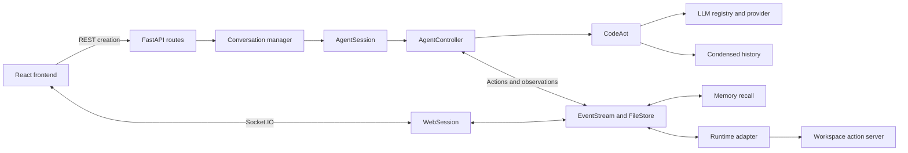

# System architecture and execution flow

OpenHands is an event-driven software-agent application. Its Python backend controls an agent that chooses actions; runtime adapters execute those actions in a workspace; the React frontend presents the conversation and environment. The same controller/runtime concepts support browser sessions, CLI usage, issue resolution, and evaluation, but those entrypoints do not all share the same initialization or interaction policy.

## Ownership map

| Component | Owns | Key boundary |
| --- | --- | --- |
| Agent / CodeAct | Prompt construction and choosing actions | Reads State; produces an Action |
| AgentController | Scheduling, state transitions, limits, pending actions | Publishes actions; reacts to observations |
| EventStream / EventStore | Event publication, persistence, retrieval | Serialized actions and observations |
| Runtime | Workspace execution, tools, environment lifecycle | Converts execution requests to observations |
| LLM / LLMRegistry | Provider calls, model services and metrics | Completion/message/tool formats |
| Memory / condensers | Recall context and the history view shown to the model | Recall/condensation events |
| AgentSession | Runtime, memory, controller startup and close | One running web task |
| ConversationManager / WebSession | Agent-loop routing and client publication | HTTP metadata and Socket.IO events |
| Frontend | Interaction and displayed state | REST requests plus socket event stream |

These boundaries are visible in `openhands/server/session/agent_session.py` and `openhands/core/main.py`. Neither the frontend nor CodeAct directly owns sandbox execution.

## A browser request end to end

Conversation creation resolves settings, credentials, repository selection, and an initial message. Session startup establishes the runtime, then memory, then MCP tools, then the controller. This order lets runtime/workspace information and discovered tools be represented before the controller's system message.

A user event reaches the controller through the stream. CodeAct uses a condensed history view, constructs a completion request, and parses one or more actions. The controller emits one action at a time under its pending-action and limit checks. The runtime executes it and emits an observation linked by `cause`; that result can trigger the next step. WebSession forwards relevant events to the browser.

Read [sessions and APIs](sessions-api.md), [agent control](agent-control.md), and [runtime execution](runtime.md) for each stage's failure and ordering contracts.

## Headless and CLI entrypoints

The package's `openhands` command enters `openhands.cli.entry:main`. It dispatches `serve` to the GUI launcher and `cli` to the interactive CLI, inserting `cli` when no recognized subcommand is supplied.

The reusable `run_controller` coroutine in `openhands/core/main.py` creates an agent/registry, accepts an existing runtime or creates/connects one, creates memory when absent, adds MCP tools, and constructs a controller. A caller supplies an initial Action and may supply a fake-user callback or choose exit-on-message behavior.

It runs until a configured terminal/pause state, persists controller state for non-memory stores, closes the controller, and optionally writes a trajectory. Its returned State supports downstream resolver/evaluation processing. Do not infer from controller closure alone that every externally supplied runtime has been deleted; environment ownership must be checked in the caller.

See [resolver and evaluation](../workflows/resolver-evaluation.md) for these callers and [configuration](../operations/configuration.md) for launch paths.

## State and failure boundaries

There are several independent forms of state:

- The durable event log records conversation actions and observations.
- A controller checkpoint carries execution/control state; history is restored from events.
- The runtime owns workspace files, processes, browser state, and tool sessions.
- Metadata/settings/secret stores supply application-level identity and configuration.
- Frontend state is a projection of server metadata and streamed events.

A reconnect can replay events without restoring a lost workspace. Conversely, a retained sandbox does not guarantee a controller checkpoint or client cursor is current. [Events and durable state](events-storage.md) explains the persistence split.

Failures also belong to different layers. Provider retries belong to the LLM service; malformed actions and context exhaustion involve controller recovery; execution disconnects become runtime status errors; HTTP and socket validation protect separate ingress points. Follow the layer that owns the failing transition instead of adding retries at every boundary.

## Extension strategy

New agents implement the Agent contract and register under an agent name; enabled tools still need serializable actions and runtime support. New runtime implementations preserve execution/status/cleanup contracts. Server deployments may replace configuration, auth, conversation management, and storage implementations; [enterprise extensions](../integrations/enterprise.md) demonstrates these seams.

For changes spanning layers, use [testing and validation](../testing/validation.md) to select a focused check at each changed boundary. The [quickstart](../quickstart.md) routes common contributor tasks to the relevant page.
