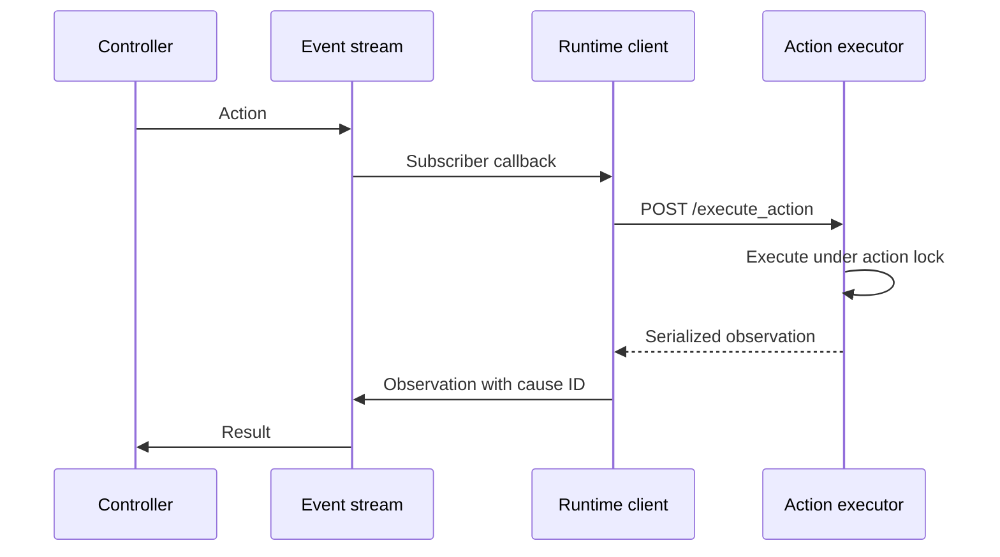

# Runtime execution and sandbox lifecycle

The runtime owns execution against a workspace. The controller decides which action to request; a runtime turns that action into an observation and manages the resources needed to run it. Conversation persistence and sandbox persistence must be considered separately.

## Selection and responsibilities

`get_runtime_cls` maps `docker` and the legacy `eventstream` name to `DockerRuntime`; it also registers remote, local, Kubernetes, and CLI implementations. Optional implementations are discovered under `third_party/runtime/impl` when their dependencies import successfully. A fully qualified custom `Runtime` subclass can be selected through the same loader.

`Runtime` subscribes to actions, supplies timeouts, refreshes relevant provider tokens, and attaches the action's ID and tool-call metadata to observations. Concrete implementations own connection, execution methods, file transfer, workspace access, exposed service URLs, and cleanup. `ActionExecutionClient` shares the HTTP transport used by several runtimes; implementation overrides still matter.

## Action path

The shared action client serializes an action, sends it to `/execute_action`, allows an HTTP margin of five seconds beyond the action timeout, and deserializes the response. Its semaphore and the executor's async lock serialize execution through those paths. The executor owns persistent shell state, optional browser state, file operations, and plugins such as Jupyter.

Base dispatch suppresses actions awaiting confirmation, turns rejected actions into `UserRejectObservation`, and returns errors for unsupported actions. Non-runnable control events usually produce no runtime result, with explicit exceptions such as thought acknowledgements and task tracking. MCP has a separate async dispatch path described in [tools and repositories](../integrations/tools-repositories.md).

## Container and workspace lifecycle

Docker connection first attempts to attach to the named container. If no container exists, an attach-only request fails; otherwise the runtime builds or selects an image and starts a container. It waits for the executor to become ready before environment and workspace setup. An explicit runtime image avoids building from a base image on that path.

Workspace preparation can clone a selected repository, configure Git, load repository microagents, and run `.openhands/setup.sh`. The setup-script helper emits a hidden environment action, sources the script, and gives it a 600-second hard timeout. Repository startup scripts therefore execute code inside the chosen runtime's permission boundary.

Docker cleanup depends on attachment and keep-alive configuration; closing a client is not universally equivalent to deleting its sandbox. For deployment and cleanup work, inspect the selected runtime's `close`, `delete`, and pause/resume behavior together. Local runtime executes on the host and provides no container isolation; CLI is a separate implementation with its own execution choices.

## Errors and authentication

`Runtime._handle_action` converts permission failures into `ErrorObservation`. Network failures and runtime disconnection publish an error status and return without an ordinary action observation. Other unexpected exceptions similarly set runtime error status. A pending action with no observation can therefore reflect a failed sandbox connection.

The executor checks `X-Session-API-Key` when `SESSION_API_KEY` is configured; without that configured key, the verifier does not reject requests for a missing key. Runtime endpoints execute commands and manipulate files, so access and network placement belong to deployment configuration. Confirmation mode controls agent actions; it is not a replacement for runtime isolation or endpoint authentication.

## Extension and validation

Implement the `Runtime` contract for a new execution environment, or extend `ActionExecutionClient` when the environment hosts the existing executor protocol. Preserve observation causality, timeout handling, connection status, and cleanup semantics. Add real runtime coverage for shell state, file transfers, and plugin behavior, not just constructor mocks.

`tests/runtime/` runs real tool interactions, defaults to Docker, and accepts `TEST_RUNTIME` for alternatives. Start with `poetry run pytest tests/runtime/test_bash.py`; runtime-specific unit tests under `tests/unit/runtime/` cover orchestration. See [configuration](../operations/configuration.md) and [system architecture](system.md).
