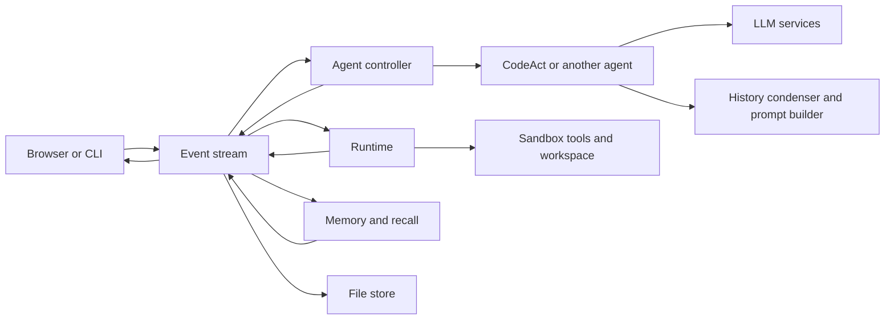

# System architecture and execution flow

OpenHands runs software-development agents against a workspace. Its central boundary is between deciding an action and executing it: an agent produces actions, the controller manages progress, and the runtime performs external effects. An event stream ties these components to memory, storage, and user interfaces.

## Composition roots

| Surface | Composition point | Role |
| --- | --- | --- |
| Browser application | `openhands/server/listen.py` and `server/session/agent_session.py` | REST and Socket.IO around managed conversations |
| Interactive CLI | `openhands/cli/entry.py` | Defaults to the `cli` command; `serve` launches the GUI server workflow |
| Headless and benchmark execution | `openhands/core/main.py:run_controller` | Accepts a task action and configuration, assembles or reuses runtime and memory, and returns final state |
| Sandbox process | `openhands/runtime/action_execution_server.py` | Executes runtime actions with shell, browser, and plugin state |

The web and headless paths share controller, agent, runtime, event, and memory abstractions, but they assemble settings and lifecycles differently. A benchmark may supply a runtime it already initialized; a browser session obtains user settings and provider secrets through configured server services.

## Ownership map

The controller owns agent state, pending-action tracking, iteration and budget enforcement, error transitions, and delegation. The agent owns prompt construction and response interpretation. Runtime implementations own execution resources; memory supplies repository context and triggered knowledge. The file store preserves conversation artifacts, while the runtime owns workspace files.

## One task through the system

1. A composition root creates an event stream and runtime, connects the runtime, and prepares the workspace. It loads memory and discovers MCP tools before creating the controller where that tool list is needed in the initial system message.
2. A user `MessageAction` enters the stream. The controller records events in its state history and determines whether they should trigger another step.
3. While running, the controller checks outstanding work, loop detection, and control flags. A runnable action prevents another normal step until its result is accounted for.
4. CodeAct drains queued actions first. Otherwise it obtains a condensed history, builds messages and tool definitions, calls its LLM, and translates the response into one or more queued actions.
5. The controller applies confirmation handling where configured and appends the next action. The runtime executes it and emits an observation whose `cause` references the action.
6. The controller pairs the observation with pending work, updates state, and can step again. Session subscribers publish relevant events to the browser; the event stream persists them independently of presentation.
7. Finish, rejection, user-input requests, limits, and errors drive state transitions. Headless execution waits for terminal conditions and can use a supplied fake-user callback; web conversations can remain available for later interaction.

## Failure boundaries

A malformed tool response can become an error observation that the agent sees on a later step. Context-window failures can request history condensation when enabled. Runtime disconnection is surfaced as runtime status and can leave no ordinary observation for an action. LLM retries, action execution timeouts, controller budgets, and disconnected-session cleanup belong to different layers; increasing one limit does not fix another layer's failure.

The durable event log provides evidence of requested and completed work. A controller snapshot supports resumption, but neither artifact guarantees that the corresponding sandbox still exists. Diagnose state and execution separately using [persistence](events-persistence.md) and [runtime lifecycle](runtime.md).

## Changing the system

An agent extension implements the registered `Agent` contract and returns existing action types where possible. A new execution backend implements `Runtime`; an external tool can use MCP. Changes to event types cross Python serialization, controller/runtime handling, and frontend dispatch. Server integrations can replace selected services through class-path configuration rather than changing core inference code.

Controller and event unit tests exercise the central loop without a real sandbox; runtime tests exercise actual tools. See [agents and LLMs](../concepts/agents-llms.md), [server conversations](server-conversations.md), and [testing](../testing/validation.md) for the appropriate implementation and validation boundaries.
