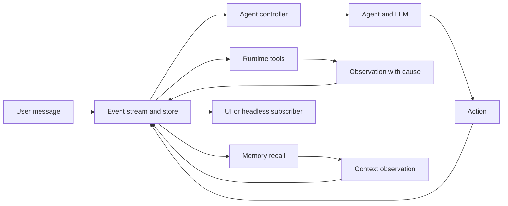

# Execution architecture

OpenHands separates decisions from execution. An agent turns conversation context into actions; a controller manages progress and limits; a runtime executes tools; memory supplies contextual observations. A persisted event stream connects these components. The web server and headless runner construct this graph through different lifecycle owners.

## Entrypoints

| Surface | Entrypoint | Lifecycle owner |
| --- | --- | --- |
| Browser/API server | `openhands.server.listen:app` | Conversation manager → WebSession → AgentSession |
| Headless task | `python -m openhands.core.main` | `run_controller` and setup helpers |
| Interactive CLI | Installed `openhands` command | `openhands.cli.entry:main` and CLI modules |
| Benchmark inference | Benchmark `run_infer.py` | Benchmark setup around core runtime/controller APIs |

The CLI command and core headless module are distinct surfaces. For local installation and invocation, start with [quickstart](../quickstart.md). Benchmark and resolver callers have additional task preparation and output handling described in [evaluation and resolution](../workflows/evaluation-resolver.md).

## Shared execution graph

The controller creates the agent's system-message event, manages state, and requests steps. CodeAct builds model messages and tool definitions and returns an action. Runnable actions become pending until their associated observations arrive. The runtime handles actions and publishes observations carrying the originating action ID as their cause. This causal link is essential when multiple model tool calls become separate actions.

Memory is a separate subscriber. Recall actions ask for workspace context or matching microagent knowledge and produce observations that the agent can include in later model input. Condensers transform the agent's history view; they do not replace the event store.

## Construction and startup order

The headless `run_controller` creates a conversation-specific LLM registry/statistics service and agent. Unless supplied by a caller, it creates a runtime and its event stream, connects the runtime, and initializes a selected repository. It then creates memory, loads MCP tools when enabled, and creates/restores a controller. It adds the initial user message, subscribes for state changes, and waits for configured end states.

`create_runtime` constructs an unconnected backend selected by `config.runtime` and supplies the agent's sandbox plugin requirements. Connecting and preparing a repository are explicit later operations. This distinction matters to evaluation callers that prepare their own runtime before calling the headless runner.

The web `AgentSession.start` similarly creates the runtime, prepares secrets and memory, discovers MCP tools, and only then constructs the controller. MCP discovery occurs before controller creation so the recorded system message includes the available tools. It rejects a second start on an already initialized session. With an initial message it appends that message and requests RUNNING; without one it requests AWAITING_USER_INPUT.

## Progress, failures, and shutdown

Controller stepping requires RUNNING state and no pending action. It synchronizes model spend, checks repetition/stuck behavior, and applies iteration and budget controls before requesting an agent action. Parse/validation errors become error observations. Recognized context-limit failures can request condensation when history truncation is enabled. Confirmation settings may hold runnable actions for approval; see [configuration and action security](../operations/configuration.md).

The headless waiting loop installs runtime, controller, and memory status callbacks. An error status records the last error and requests ERROR state; existing runtime/controller status callbacks are rejected to avoid silently replacing caller behavior. The loop waits for terminal states rather than directly driving model calls.

At the end of a headless run, persistent stores receive the controller checkpoint, the controller closes without forcing a stopped state, and an optional JSON trajectory is written. The function returns the final State. Runtime lifetime remains relevant to callers that supply and reuse one; web session closure explicitly schedules runtime cleanup.

For deeper changes, follow [events and state](../concepts/events-state.md), [agents and LLMs](../concepts/agents-llm.md), [conversation server](conversation-server.md), and [runtime operations](../operations/runtimes.md). Representative controller, session, and runtime tests verify these seams independently.
