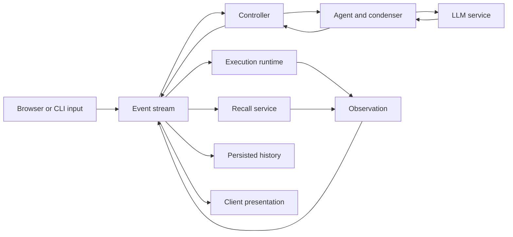

# System architecture

## Main boundaries

OpenHands connects user intent to model-selected actions in a workspace. The Python package contains the agent engine, application server, runtime adapters, storage and integrations. `frontend/` is the React browser application. `evaluation/` drives the engine with benchmark-specific tasks; `enterprise/` packages deployment-specific server and storage extensions separately. `openhands-ui/` is a separate UI component package, not the main application server.

| Component | Owns | Depends on |
| --- | --- | --- |
| Agent, normally CodeAct | Prompt construction and response-to-action conversion | Model services, condensed history and tool schemas |
| Controller | Agent state, action sequencing, limits and delegation | Event stream, state tracker and agent |
| Runtime | Workspace execution and result observations | Backend environment, plugins and provider credentials |
| Memory | Recall of repository/runtime context and microagent knowledge | Loaded microagents and event stream |
| Event/storage layer | History identity, serialization and persistence | Configured file store |
| Server conversation manager | Sessions, connections and conversation lifecycle | Server configuration, settings, auth and engine |
| Browser application | User interaction and event presentation | REST APIs and Socket.IO |

## A task through the system

The event stream is the common exchange boundary. User messages initiate work; the controller supplies state to the agent; the agent calls a model and returns an action. Runnable actions wait for a causally linked observation. Workspace recall is handled by memory, while commands, files, browser and notebook operations belong to the runtime. Finish and rejection actions change controller state rather than executing shell commands.

Persistent events, controller snapshots, client display state and runtime workspace files are distinct representations. A browser reconnect can replay history without rerunning commands. Restoring controller state still requires an available runtime and compatible persisted data.

## Entrypoints and assembly

The installed `openhands` command enters `cli.entry:main`. It handles fast help/version commands and defaults to the `cli` subcommand; `serve` launches the GUI path. Headless engine execution is exposed through `core.main.run_controller`, which assembles model services, agent, runtime, memory and controller, submits the initial user action and runs until terminal states. Evaluation code uses that engine while supplying its own task and runtime setup.

For the web application, Uvicorn loads `openhands.server.listen:app`. `server.app` composes REST routers and the MCP HTTP mount; `server.listen` adds optional frontend static serving and middleware, then wraps the application in Socket.IO. Server shared initialization selects implementation classes and stores. GUI agent startup uses `AgentSession`, so changes to headless setup alone do not automatically change web startup.

Agents register through imports in `agenthub`; configuration can also register custom agents. Runtime selection and server implementation classes are other extension seams. Keep action schemas, serialization, tool conversion and frontend handlers aligned when adding a capability across these boundaries.

## Where to investigate

Start at [core/setup.py](../../openhands/core/setup.py) and [core/main.py](../../openhands/core/main.py) for headless composition, or [server/app.py](../../openhands/server/app.py) and [AgentSession](../../openhands/server/session/agent_session.py) for web composition. Controller and server unit tests exercise different assembly boundaries; runtime integration tests exercise real execution environments.

Continue with [agent loop](../concepts/agent-loop.md), [conversations](conversations.md), [events and storage](events-and-storage.md), [runtimes](runtimes.md) or [quickstart](../quickstart.md).
