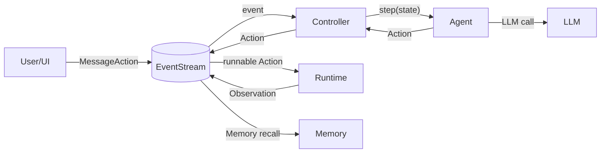

# System Architecture Overview

OpenHands is a platform for AI software-development agents. A user (via web UI, CLI, API, or an automated resolver/evaluation harness) gives an agent a task; the agent repeatedly decides on an action, the action is executed in a sandboxed runtime, and the observation is fed back until the task is done. Everything is connected by one durable, ordered **event stream**.

## Main components

| Component | Code | Role |
|---|---|---|
| EventStream | `openhands/events/` | Ordered, persisted event log + pub/sub bus. [Details](event-stream.md) |
| AgentController | `openhands/controller/` | Subscribes to the stream, calls `agent.step`, enforces limits, tracks `State`. [Details](agent-controller.md) |
| Agent | `openhands/agenthub/` | Pure decision function: `State → Action`. [Details](../agents/codeact-agent.md) |
| LLM / registry | `openhands/llm/` | LiteLLM wrapper, retries, metrics, routers. [Details](../llm/llm-layer.md) |
| Memory & condensers | `openhands/memory/` | History → messages, context shrinking, microagent recall. [Details](../agents/memory-and-condensation.md) |
| Runtime | `openhands/runtime/` | Executes runnable actions in a sandbox and emits observations. [Details](../runtime/runtime-and-sandbox.md) |
| Server | `openhands/server/` | FastAPI + Socket.IO; `Session`, `AgentSession`, `ConversationManager`. [Details](../server/server-and-sessions.md) |
| Storage | `openhands/storage/` | `FileStore` backends for events, state, settings, secrets. [Details](../server/storage-and-persistence.md) |
| Frontend | `frontend/` | React SPA talking to the server over REST and Socket.IO. [Details](../clients/frontend.md) |

## The core loop

In prose: a user `MessageAction` lands on the stream; the controller first issues a `RecallAction` that `Memory` answers with workspace context and [microagent](../agents/microagents.md) knowledge; then, on each observation (or other triggering event) the controller calls `agent.step(state)`, publishes the resulting action, and sets it as the pending action. `Runtime` is itself a stream subscriber (`Runtime._handle_action`): for runnable actions it calls `run_action`, sets `observation._cause = action.id`, and publishes the result. The controller clears its pending action when that observation arrives and steps again. The loop ends when the agent emits `AgentFinishAction`/`AgentRejectAction`, asks the user a question (`AWAITING_USER_INPUT`), hits an iteration/budget limit, errors, or is stopped.

Key design properties:

- **Single source of truth.** History, resumption, replay, UI feeds and trajectories are all derived from the stream. Context shrinking ([condensation](../agents/memory-and-condensation.md)) adds events rather than deleting them.
- **One action in flight.** The controller's pending-action gate serializes the loop.
- **Runtime isolation.** The runtime is behind an HTTP boundary (`ActionExecutionClient` ↔ `action_execution_server`) so sandboxes can be Docker containers, remote services, Kubernetes pods or the local machine.
- **Pluggable everything.** Agents, runtimes, condensers, security analyzers, file stores, conversation managers and user-auth classes are selected by name/config; the enterprise edition overrides several via dynamic imports ([Enterprise](../enterprise/enterprise-saas.md)).

## Two assembly paths

### Server path (web UI / API)

1. The frontend connects over Socket.IO (`listen_socket.connect`) with `conversation_id`, optional `latest_event_id` and providers. The server validates access (`ConversationValidator`), **replays stored events** after `latest_event_id` to the client (skipping `NullAction`/`NullObservation`/`RecallAction`, sending the last `AgentStateChangedObservation` last), then calls `ConversationManager.join_conversation`.
2. The conversation manager starts an agent loop if none is running, creating a `Session`/`AgentSession` pair per conversation.
3. `AgentSession.start(...)` assembles the parts in a fixed order: **runtime** (`_create_runtime`: chosen by name, connected, repo cloned/initialized, setup script and git hooks run) → register provider tokens/custom secrets as event-stream secrets → **memory** (`_create_memory`: runtime info + microagents from the repo) → **MCP tools** added to the agent (must happen before the controller so they enter the system message) → **controller** (`_create_controller`, restoring pickled `State` when the conversation existed; `headless_mode=False`) → finally the initial user message and a `ChangeAgentStateAction(RUNNING)` (or `AWAITING_USER_INPUT` if there is no initial message).
4. `Session` forwards stream events to the client as `oh_event` messages and dispatches client actions (`oh_user_action`) back onto the stream.

### Headless path (CLI, resolver, evaluation)

`openhands/core/main.py::run_controller` does the same assembly without a server: `create_registry_and_conversation_stats` → `create_agent` → `create_runtime` (+ `runtime.connect`, optional repo init) → `create_memory` → optional MCP tools → `create_controller` (tries `State.restore_from_session`) → add the initial user action (or a "get back on track" message if resuming a session with an error) → subscribe a `MAIN` callback that supplies the next user message when the agent awaits input (`/exit`, a fake responder, or interactive input) → `run_agent_until_done` until one of `FINISHED`, `REJECTED`, `ERROR`, `PAUSED`, `STOPPED` → save state and optionally write the trajectory JSON. Session ids come from `generate_sid`, a truncated SHA-256 of a name plus the JWT secret (32 chars max so Kubernetes resource names stay within limits). See [CLI](../clients/cli.md), [Issue resolver](../workflows/issue-resolver.md) and [Testing and evaluation](../operations/testing-and-evaluation.md).

## Cross-cutting concerns

- **Configuration**: one `OpenHandsConfig` tree built from defaults, TOML, environment and CLI flags — [Configuration](../configuration/configuration.md).
- **Security**: confirmation mode and analyzers gate risky actions; secrets are redacted in the stream — [Security](../security/security-and-confirmation.md).
- **Integrations**: git providers and MCP — [Git providers](../integrations/git-providers.md), [MCP](../integrations/mcp.md).
- **Operations**: build, containers and CI — [Build and containers](../operations/build-and-containers.md).

Start with the [Quickstart](../quickstart.md) for a task-oriented map of the wiki.
