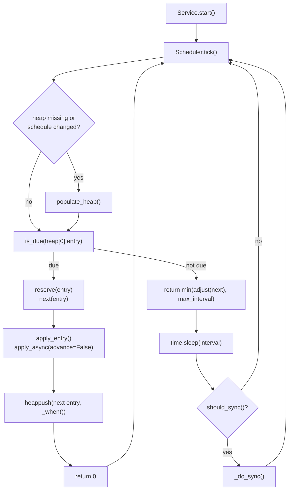
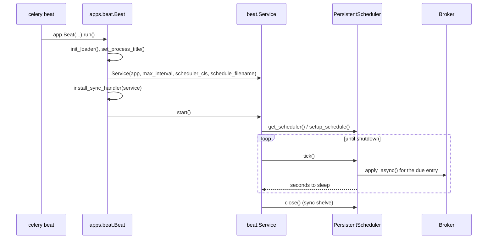

## Overview

Celery beat is the process that sends periodic tasks. It does not execute anything itself: it keeps a table of schedule entries, wakes up when the next one is due, and publishes that task to the broker exactly like `apply_async` would, so ordinary workers run it. The machinery lives in `celery/beat.py` (`ScheduleEntry`, `Scheduler`, `PersistentScheduler`, `Service`, `EmbeddedService`), the program wrapper in `celery/apps/beat.py` (`Beat`), and the `celery beat` command in `celery/bin/beat.py`.

Sources: [celery/beat.py:1-43](repo://celery/beat.py#L1-L43), [celery/apps/beat.py:1-44](repo://celery/apps/beat.py#L1-L44), [celery/bin/beat.py:1-48](repo://celery/bin/beat.py#L1-L48)

Each entry holds a schedule object (`schedule`, `crontab` or `solar`) whose `is_due()` decides when it fires; those types are described in [[Schedule Types]]. Nothing in `Scheduler` coordinates with other processes, so run a single beat per schedule: two instances would each send every due task.

Sources: [celery/beat.py:161-163](repo://celery/beat.py#L161-L163), [celery/schedules.py:703-714](repo://celery/schedules.py#L703-L714)

## Components

| Class | Role |
| --- | --- |
| `ScheduleEntry` | One periodic task: `name`, `task`, `schedule`, `args`, `kwargs`, `options`, `last_run_at`, `total_run_count`. |
| `Scheduler` | Holds the entries in a dict, orders them in a heap and sends due tasks in `tick()`. Base class for custom schedulers. |
| `PersistentScheduler` | `Scheduler` whose entries live in a `shelve` file so `last_run_at` survives restarts. The default `beat_scheduler`. |
| `Service` | Owns one scheduler and runs the sleep/tick loop until stopped. |
| `EmbeddedService` | Factory returning a `_Process` or `_Threaded` wrapper around `Service`, used by `celery worker -B`. |
| `celery.apps.beat.Beat` | The program: loads the app, prints the banner, sets up logging, pidfile and signal handlers, then starts `Service`. |
| `BeatLazyFunc` | Wraps a callable placed in an entry's `args`/`kwargs`; it is called each time the task is sent. |

Sources: [celery/beat.py:50-128](repo://celery/beat.py#L50-L128), [celery/beat.py:219-266](repo://celery/beat.py#L219-L266), [celery/beat.py:505-515](repo://celery/beat.py#L505-L515), [celery/beat.py:612-679](repo://celery/beat.py#L612-L679), [celery/beat.py:682-738](repo://celery/beat.py#L682-L738), [celery/apps/beat.py:40-84](repo://celery/apps/beat.py#L40-L84)

## Schedule entries

### Declaring entries with beat_schedule

Entries come from the `beat_schedule` setting, a dict keyed by entry name. `Scheduler.merge_inplace()` turns every value into `self.Entry(**dict(b[key], name=key, app=self.app))`, so each value accepts the `ScheduleEntry` constructor arguments: `task`, `schedule`, `args`, `kwargs`, `options` and `relative`. `schedule` may be a number of seconds, a `timedelta` or a schedule object; `maybe_schedule()` wraps numbers and timedeltas in `schedule`.

Sources: [celery/beat.py:117-128](repo://celery/beat.py#L117-L128), [celery/beat.py:458-472](repo://celery/beat.py#L458-L472), [celery/schedules.py:703-714](repo://celery/schedules.py#L703-L714)

```python
from celery.schedules import crontab

app.conf.beat_schedule = {
    'add-every-30-seconds': {
        'task': 'tasks.add',
        'schedule': 30.0,
        'args': (16, 16),
    },
    'nightly-report': {
        'task': 'tasks.report',
        'schedule': crontab(hour=3, minute=0),
        'options': {'queue': 'reports'},
    },
}
```

Sources: [celery/beat.py:458-472](repo://celery/beat.py#L458-L472), [celery/app/defaults.py:73-82](repo://celery/app/defaults.py#L73-L82)

`merge_inplace()` first drops every stored key that is not in both the stored schedule and the new dict (the symmetric difference), then updates existing entries with `ScheduleEntry.update()`, which copies only the editable fields `task`, `schedule`, `args`, `kwargs`, `options`. That keeps `last_run_at` and `total_run_count` from the persisted entry while the code-defined fields follow the configuration.

Sources: [celery/beat.py:149-159](repo://celery/beat.py#L149-L159), [celery/beat.py:458-472](repo://celery/beat.py#L458-L472)

### Entry lifecycle

`ScheduleEntry.is_due()` delegates to `self.schedule.is_due(self.last_run_at)`. When an entry fires, `Scheduler.reserve()` replaces it in the schedule with `next(entry)`: `_next_instance()` builds a copy with `last_run_at` set to now and `total_run_count + 1`. Equality (`__eq__`) compares only the editable fields, which is what lets the scheduler detect a changed configuration; ordering (`__lt__`) falls back to `id()` because the heap orders on the time and priority first.

Sources: [celery/beat.py:130-147](repo://celery/beat.py#L130-L147), [celery/beat.py:161-198](repo://celery/beat.py#L161-L198), [celery/beat.py:389-391](repo://celery/beat.py#L389-L391)

Values in `args` and `kwargs` wrapped in `BeatLazyFunc` are evaluated by `_evaluate_entry_args()` and `_evaluate_entry_kwargs()` just before sending, so an argument such as the current time is computed per run, not once at startup.

Sources: [celery/beat.py:50-78](repo://celery/beat.py#L50-L78), [celery/beat.py:201-216](repo://celery/beat.py#L201-L216)

### Default entries

`install_default_entries()` adds `celery.backend_cleanup` at 04:00 every day (`crontab('0', '4', '*')`, message `expires` of 12 hours) when `result_expires` is set and the result backend does not expire results on its own (`supports_autoexpire` is false). An entry with the same name in the configuration is left alone.

Sources: [celery/beat.py:268-277](repo://celery/beat.py#L268-L277)

## The tick loop

### Heap of events

The scheduler keeps a heap of `event_t(time, priority, entry)` tuples. `populate_heap()` asks each entry `is_due()` and pushes it at `_when(entry, 0 if is_due else next_call_delay)`, a UTC timestamp built from the entry's current time plus the delay adjusted by `adjust()` (a 10 ms early drift so the wake-up does not land just after the due time).

Sources: [celery/beat.py:37-37](repo://celery/beat.py#L37-L37), [celery/beat.py:292-323](repo://celery/beat.py#L292-L323)

### One tick

`tick()` runs one iteration and returns how long to sleep. It rebuilds the heap when there is none yet or when `schedules_equal()` finds the schedule changed since the last copy (keys added or removed, or an entry whose editable fields differ). It then looks only at the heap's head: if that entry is due it pops it, reserves the next instance, sends the task with `apply_entry()`, pushes the next instance back at its next due time and returns `0` so the loop ticks again at once. If the head is not due, it returns the adjusted delay, capped at `max_interval`.

Sources: [celery/beat.py:325-379](repo://celery/beat.py#L325-L379)



Sources: [celery/beat.py:326-364](repo://celery/beat.py#L326-L364), [celery/beat.py:633-655](repo://celery/beat.py#L633-L655)

### Sending the task

`apply_entry()` logs `Scheduler: Sending due task` and calls `apply_async(entry, producer=self.producer, advance=False)`; any exception is logged as `Message Error` and swallowed so one broken entry never stops the loop. `apply_async()` looks the task up in `app.tasks`: a registered task is sent with `task.apply_async(args, kwargs, producer=producer, **entry.options)`, an unknown name with `app.send_task()`, so beat can schedule tasks whose code it does not import. Errors there are re-raised as `SchedulingError`. The `finally` block counts the send and calls `_do_sync()` when `should_sync()` says so.

Sources: [celery/beat.py:279-290](repo://celery/beat.py#L279-L290), [celery/beat.py:393-421](repo://celery/beat.py#L393-L421)

The producer is a cached property built on `app.connection_for_write()`. `_ensure_connected()` calls `ensure_connection` with `broker_connection_max_retries` and logs `beat: Connection error ... Trying again` on each retry.

Sources: [celery/beat.py:474-498](repo://celery/beat.py#L474-L498)

## Persistence and sync

### PersistentScheduler

`PersistentScheduler` opens `schedule_filename` with `shelve.open(..., writeback=True)` and stores the entries dict under the `entries` key, so `schedule` reads and writes `self._store['entries']`. `setup_schedule()` does the following:

Sources: [celery/beat.py:505-530](repo://celery/beat.py#L505-L530)

1. Open the shelve and read its keys; any error means a corrupt file, so `_destroy_open_corrupted_schedule()` deletes every file with the suffixes `''`, `.db`, `.dat`, `.bak`, `.dir` and reopens it.
2. `_create_schedule()` creates `entries` if missing, and clears the store when it predates the `__version__`, `tz` or `utc_enabled` keys.
3. If the stored `tz` differs from the `timezone` setting, or the stored `utc_enabled` from `enable_utc`, the store is cleared, because stored `last_run_at` values would be read in the wrong zone.
4. Merge `beat_schedule`, install default entries, write `__version__`, `tz` and `utc_enabled`, and `sync()` to disk.

Sources: [celery/beat.py:505-597](repo://celery/beat.py#L505-L597)

> [!WARNING]
> Changing `timezone` or `enable_utc` resets the whole schedule database: every entry loses its `last_run_at` and is treated as new.

Sources: [celery/beat.py:545-556](repo://celery/beat.py#L545-L556)

### When the schedule is synced

`should_sync()` is true when no sync has happened yet, when more than `sync_every` seconds (180) have passed on the monotonic clock, or when `sync_every_tasks` (the `beat_sync_every` setting) tasks were sent since the last sync. The base `Scheduler.sync()` does nothing; `PersistentScheduler.sync()` calls `self._store.sync()`. `close()` syncs and, for the persistent scheduler, closes the shelve.

Sources: [celery/beat.py:241-248](repo://celery/beat.py#L241-L248), [celery/beat.py:381-387](repo://celery/beat.py#L381-L387), [celery/beat.py:427-439](repo://celery/beat.py#L427-L439), [celery/beat.py:599-605](repo://celery/beat.py#L599-L605)

## Running beat

### Service

`Service` stores `max_interval` (argument or `beat_max_loop_interval`), the scheduler class and `schedule_filename` (argument or `beat_schedule_filename`). `get_scheduler()` resolves the class with `symbol_by_name`, using aliases registered under the `celery.beat_schedulers` entry-point namespace, so packages can expose short scheduler names. `start()` sends the `beat_init` signal (and `beat_embedded_init` when embedded), then loops `tick()` and `time.sleep(interval)` until `_is_shutdown` is set, checking `should_sync()` after each sleep. `KeyboardInterrupt` and `SystemExit` end the loop; the `finally` clause calls `sync()`, which closes the scheduler and sets `_is_stopped` for `stop(wait=True)`.

Sources: [celery/beat.py:612-679](repo://celery/beat.py#L612-L679)

### The celery beat command

`celery beat` is a `CeleryDaemonCommand`. It applies extra `key=value` arguments with `app.config_from_cmdline()`, drops privileges unless detaching, builds `app.Beat` and calls `run()`, inside `detached()` when `--detach` is given.

Sources: [celery/bin/beat.py:9-72](repo://celery/bin/beat.py#L9-L72)

| Option | Effect |
| --- | --- |
| `--detach` | Run in the background as a daemon. |
| `-s`, `--schedule` | Schedule database path; defaults to `beat_schedule_filename`. |
| `-S`, `--scheduler` | Scheduler class; defaults to `beat_scheduler`. |
| `--max-interval` | Maximum seconds to sleep between ticks. |
| `-l`, `--loglevel` | Log level, `WARNING` by default. |

Sources: [celery/bin/beat.py:9-46](repo://celery/bin/beat.py#L9-L46)

`Beat.run()` prints the start line, calls `init_loader()` (`loader.init_worker()` then `app.finalize()`, which imports task modules), sets the process title and calls `start_scheduler()`. That creates the pidlock when a pidfile is given, builds the `Service`, prints the banner (built from a lazy scheduler via `get_scheduler(lazy=True)`), sets up logging and the default socket timeout (30 s), installs a `SIGTERM`/`SIGINT` handler that calls `service.sync()` and raises `SystemExit`, and starts the service. An exception escaping the service is logged as critical and re-raised.

Sources: [celery/apps/beat.py:78-160](repo://celery/apps/beat.py#L78-L160)



Sources: [celery/bin/beat.py:59-72](repo://celery/bin/beat.py#L59-L72), [celery/apps/beat.py:78-118](repo://celery/apps/beat.py#L78-L118), [celery/beat.py:633-679](repo://celery/beat.py#L633-L679)

### Embedded beat with worker -B

`celery worker -B` enables the worker's `Beat` bootstep, which calls `EmbeddedService(w.app, schedule_filename=w.schedule_filename, scheduler_cls=w.scheduler)`. The step refuses gevent and eventlet pools with `ImproperlyConfigured`, and the `-B` option itself is rejected on Windows. See [[Worker Architecture and Bootsteps]] for how steps start.

Sources: [celery/worker/components.py:19-22](repo://celery/worker/components.py#L19-L22), [celery/worker/components.py:181-205](repo://celery/worker/components.py#L181-L205), [celery/bin/worker.py:20-30](repo://celery/bin/worker.py#L20-L30), [celery/bin/worker.py:289-304](repo://celery/bin/worker.py#L289-L304)

`EmbeddedService` returns a `_Process` (a billiard `Process`) unless `thread=True` is passed or multiprocessing is unavailable, in which case it returns a daemon `_Threaded` thread with `max_interval=1` so that `stop()` returns quickly. The process variant resets signals, closes inherited file descriptors except stdio and logger files, makes the app current and starts the service with `embedded_process=True`; `stop()` stops the service and terminates the process.

Sources: [celery/beat.py:682-738](repo://celery/beat.py#L682-L738)

## Configuration

| Setting | Default | Used by |
| --- | --- | --- |
| `beat_schedule` | `{}` | Entries merged by `setup_schedule()`. |
| `beat_scheduler` | `celery.beat:PersistentScheduler` | Scheduler class for `celery beat` (`-S`). |
| `beat_schedule_filename` | `celerybeat-schedule` | Shelve path for `PersistentScheduler` (`-s`). |
| `beat_max_loop_interval` | `0` (falls back to 300 s in `Scheduler`) | Upper bound of each sleep. |
| `beat_sync_every` | `0` | Sync after this many sent tasks; `0` means time-based only. |
| `beat_cron_starting_deadline` | `None` | Skip crontab runs missed by more than this many seconds. |

Sources: [celery/app/defaults.py:73-82](repo://celery/app/defaults.py#L73-L82), [celery/beat.py:252-266](repo://celery/beat.py#L252-L266), [celery/schedules.py:641-688](repo://celery/schedules.py#L641-L688)

The `beat_*` keys are part of the settings namespace described in [[Configuration]]; `timezone` and `enable_utc` also matter because `PersistentScheduler` stores them and resets when they change.

Sources: [celery/app/defaults.py:69-72](repo://celery/app/defaults.py#L69-L72), [celery/beat.py:545-564](repo://celery/beat.py#L545-L564)

## Custom schedulers

Subclass `Scheduler` and point `beat_scheduler` or `-S` at it. The hooks are `setup_schedule()` to load entries, the `schedule` property (`get_schedule`/`set_schedule`) to expose them, `sync()` to persist them, `close()` and `info` for the banner. A scheduler may be built with `lazy=True` for the startup banner, so `__init__` must not have side effects that matter when `setup_schedule()` is skipped. Because `tick()` compares the schedule with its previous copy on every iteration, a scheduler whose `schedule` reflects an external store (a database, for example) has its changes picked up at the next tick, within `max_interval`.

Sources: [celery/beat.py:219-266](repo://celery/beat.py#L219-L266), [celery/beat.py:338-341](repo://celery/beat.py#L338-L341), [celery/beat.py:423-502](repo://celery/beat.py#L423-L502), [celery/apps/beat.py:135-147](repo://celery/apps/beat.py#L135-L147)

The signals `beat_init` and `beat_embedded_init` fire when the service starts; see [[Signals]].

Sources: [celery/signals.py:137-139](repo://celery/signals.py#L137-L139), [celery/beat.py:638-641](repo://celery/beat.py#L638-L641)
