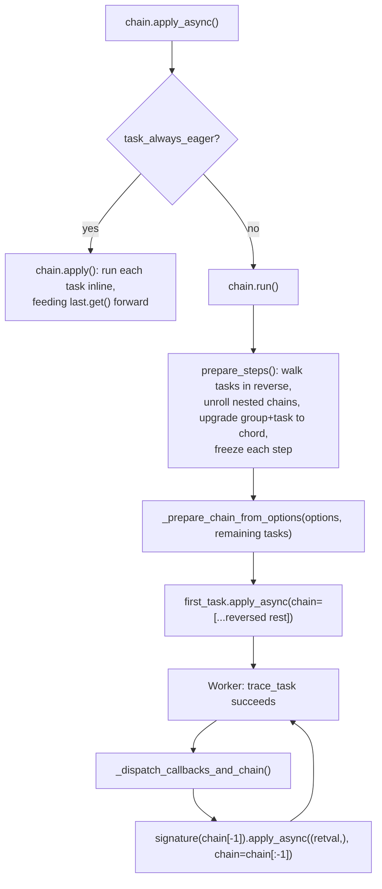
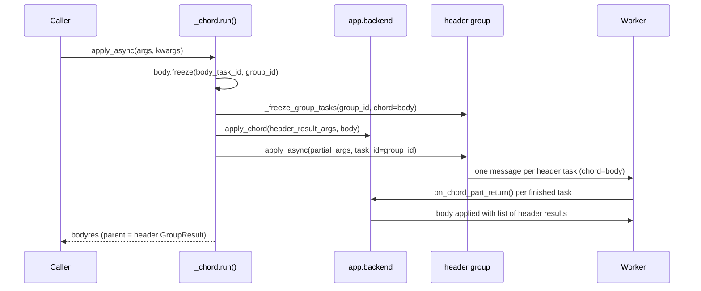

## Overview

The canvas module turns single task calls into data that can be stored, passed around and combined. A `Signature` wraps one task invocation (task name, arguments and execution options) in a plain `dict`, so it survives JSON serialization and can travel inside a message as a callback. The workflow primitives `chain`, `group`, `chord`, `chunks`, `xmap` and `xstarmap` are all `Signature` subclasses, which is why they can be nested inside each other and sent with the same `apply_async` / `delay` calls as a single task.

Sources: [celery/canvas.py:1-40](repo://celery/canvas.py#L1-L40), [celery/canvas.py:232-295](repo://celery/canvas.py#L232-L295)

Canvas code runs in two places. On the producer, a workflow is unrolled and frozen into concrete task messages, each carrying task ids, a `chain` list, `link` callbacks or a `chord` body. On the worker, the tracer reads those fields after a task succeeds and publishes the next step. The results returned by canvas calls are described in [[Task Results]], and the backend hooks that make chords complete are covered in [[Result Backends]].

Sources: [celery/canvas.py:1120-1180](repo://celery/canvas.py#L1120-L1180), [celery/app/trace.py:426-473](repo://celery/app/trace.py#L426-L473)

## Signatures

### Creating a signature

`Task.signature()`, `Task.s()` and `Task.si()` all funnel into `celery.canvas.signature()`. `s()` packs star arguments, and `si()` passes `immutable=True`. `signature()` clones an existing signature, rebuilds a typed signature from a dict via `Signature.from_dict`, or constructs a new `Signature`.

Sources: [celery/app/task.py:962-986](repo://celery/app/task.py#L962-L986), [celery/canvas.py:2395-2412](repo://celery/canvas.py#L2395-L2412)

`Signature.__init__` accepts a task object or a task name. With a task object it stores `task.name` and keeps the object in `_type`; any extra keyword arguments are folded into `options`. The resulting dict has exactly six keys: `task`, `args`, `kwargs`, `options`, `subtask_type` and `immutable`. The attributes `id`, `parent_id`, `root_id`, `args`, `options` and so on are `getitem_property` views into that dict, so `sig.id` reads `sig['options']['task_id']`.

Sources: [celery/canvas.py:323-345](repo://celery/canvas.py#L323-L345), [celery/canvas.py:865-875](repo://celery/canvas.py#L865-L875)

### Typed signatures and deserialization

Every subclass registers itself in `Signature.TYPES` through the `register_type` decorator, keyed by name (`chain`, `group`, `chord`, `xmap`, `xstarmap`, `chunks`). `from_dict` reads `subtask_type` from the dict and dispatches to the subclass's own `from_dict`, so a serialized chord comes back as a `_chord` with its header and body rebuilt. `maybe_signature` is the lenient variant used across the code base: it returns `None` for `None`, converts dicts, optionally clones, and binds the signature to an app.

Sources: [celery/canvas.py:290-321](repo://celery/canvas.py#L290-L321), [celery/canvas.py:2415-2442](repo://celery/canvas.py#L2415-L2442)

`__reduce__` pickles a signature as `signature(dict(self))`, and the `type` property resolves the task lazily from `app.tasks[self['task']]`. If the task is not registered locally, `_apply_async` falls back to `app.send_task` with the task name, so a producer can send signatures for tasks it does not import.

Sources: [celery/canvas.py:823-829](repo://celery/canvas.py#L823-L829), [celery/canvas.py:843-863](repo://celery/canvas.py#L843-L863)

### Partial arguments and immutability

`_merge` is the single rule for combining stored and call-time values. Call-time `args` are prepended to the stored args, `kwargs` are merged on top, and options override stored options except for keys in `_IMMUTABLE_OPTIONS` (`group_id`, `stamped_headers`) and any stamped header names. If the signature is immutable and `force` is false, only the options are merged. This is how a chain passes the parent's return value as the first argument of the next task, and why `si()` callbacks ignore it.

Sources: [celery/canvas.py:403-443](repo://celery/canvas.py#L403-L443)

| Method | Effect |
| --- | --- |
| `__call__(*args, **kwargs)` | Merges and calls the task body in the current process. |
| `delay(*args, **kwargs)` | `apply_async(args, kwargs)`. |
| `apply_async(args, kwargs, **options)` | Drops `None` options, merges, and calls `type.apply_async` (or `app.send_task`). |
| `apply(args, kwargs, **options)` | Runs the task eagerly through `type.apply`. |
| `clone(args, kwargs, **opts)` / `partial` | New signature with merged values and a deep copy of options. |
| `replace(args, kwargs, options)` | Clone with whole sections swapped out. |
| `set(immutable=None, **options)` | Updates options in place and returns `self` for chaining. |
| `~sig` | `apply_async().get()`. |

Sources: [celery/canvas.py:347-401](repo://celery/canvas.py#L347-L401), [celery/canvas.py:445-471](repo://celery/canvas.py#L445-L471), [celery/canvas.py:524-552](repo://celery/canvas.py#L524-L552), [celery/canvas.py:820-821](repo://celery/canvas.py#L820-L821)

## Freezing and task ids

`freeze()` gives a signature its final identity without sending it. It keeps an existing `options['task_id']` or assigns `_id` or a fresh UUID, sets `root_id`, `parent_id`, `group_id`, `chord` and `group_index` when given, defaults `reply_to` to `app.thread_oid`, and returns an `AsyncResult` for that id. Because the id is now fixed, sending the same frozen signature twice publishes two messages with the same task id.

Sources: [celery/canvas.py:473-522](repo://celery/canvas.py#L473-L522)

Freezing is what lets canvas return a result tree before anything runs. Chains freeze every step and wire `prev_res.parent = res`; groups freeze each member with the shared `group_id` and an index; chords freeze the header with `chord=self.body` and then the body. `Task.replace` freezes the replacement with the current request id so existing `AsyncResult` objects keep pointing at the right task.

Sources: [celery/canvas.py:1243-1266](repo://celery/canvas.py#L1243-L1266), [celery/canvas.py:1890-1947](repo://celery/canvas.py#L1890-L1947), [celery/canvas.py:2094-2125](repo://celery/canvas.py#L2094-L2125), [celery/app/task.py:1066-1069](repo://celery/app/task.py#L1066-L1069)

## Composition with the pipe operator

`|` is implemented separately on each class, and the result depends on both operands. Groups with a single member are unrolled first by `maybe_unroll_group`, so a one-task group behaves like that task. `__ior__` is overridden because Python 3.9 made `|=` a dict merge.

Sources: [celery/canvas.py:43-58](repo://celery/canvas.py#L43-L58), [celery/canvas.py:759-786](repo://celery/canvas.py#L759-L786)

| Expression | Result |
| --- | --- |
| `task \| task` | `_chain(task, task)` |
| `task \| chain` | chain with the task prepended to `other.unchain_tasks()` |
| `task \| group` | `_chain(task, group)` |
| `group \| task` | `chord(group, body=task)` |
| `group \| empty group` | the left group unchanged |
| `chain \| chain` | `reduce(operator.or_, ...)` over the right chain's tasks |
| `chain[..., group] \| task` | the trailing group becomes `chord(group, task)`; a preceding chord gets this chord appended to its body |
| `chain[..., chord] \| task` | the task is appended to the chord body |
| `chain[..., chord] \| group` | the group is appended to the chord body |
| `chord \| task` | the task is appended to a cloned chord's body |

Sources: [celery/canvas.py:960-1006](repo://celery/canvas.py#L960-L1006), [celery/canvas.py:1598-1607](repo://celery/canvas.py#L1598-L1607), [celery/canvas.py:2077-2092](repo://celery/canvas.py#L2077-L2092)

`chain(a, b, c)` uses `__new__` to reduce its arguments with `operator.or_` starting from an empty `_chain`, so the constructor and the pipe operator always build the same structure, including the automatic group-to-chord upgrade.

Sources: [celery/canvas.py:1371-1382](repo://celery/canvas.py#L1371-L1382)

## Chains

### How a chain is sent

`_chain.apply_async` delegates to `apply` when `task_always_eager` is set, and otherwise to `run`. `run` merges partial args into the chain's args, calls `prepare_steps`, adds any `link` to the first prepared task, pops the first task to execute, and publishes only that one. The rest of the chain rides along in the message's `chain` option.

Sources: [celery/canvas.py:1036-1092](repo://celery/canvas.py#L1036-L1092)



Sources: [celery/canvas.py:1036-1092](repo://celery/canvas.py#L1036-L1092), [celery/canvas.py:1294-1302](repo://celery/canvas.py#L1294-L1302), [celery/app/trace.py:467-473](repo://celery/app/trace.py#L467-L473)

### prepare_steps

`prepare_steps` pops tasks off the end of a `deque`, so it builds the list in reverse: the worker later calls `chain.pop()` to get the next step. For each task it converts dicts with `from_dict`, unrolls single-member groups and skips empty groups, clones the task (applying the chain's partial args only to the first task), and splices any nested `_chain` back into the deque.

Sources: [celery/canvas.py:1161-1215](repo://celery/canvas.py#L1161-L1215)

When a group is followed by an already processed task, the pair is replaced by `chord(task, body=prev_task, task_id=prev_res.task_id)`; if the previous result is a `GroupResult` (no `task_id`), the chord is built without one. The last task in the chain (the first one processed) is frozen with the caller's `last_task_id`, `group_id`, `chord` body and `group_index`, so when the chain sits inside a group or chord header, synchronization happens on its final step. Other steps are frozen with only `root_id`.

Sources: [celery/canvas.py:1216-1252](repo://celery/canvas.py#L1216-L1252)

Each frozen result gets the next step's result as its `parent`, building the parent chain that `AsyncResult.parent` walks. Under protocol 1 (`use_link`), steps are linked with `task.link(prev_task)` instead of the `chain` field. Every chain-level `link_error` is attached to every step and also to the body of chord steps, so `chord_error_from_stack` finds it. A chord step calls `app.backend.ensure_chords_allowed()` and moves `prev_res` to the root of the chord's result tree.

Sources: [celery/canvas.py:1254-1292](repo://celery/canvas.py#L1254-L1292)

### The chain option

`_prepare_chain_from_options` wraps the options in a `ChainMap` rather than mutating them, because group members share one options dict: extending a shared `chain` list in place made sibling tasks inherit each other's steps (issue #5354). If a `chain` key already exists, it creates a new list `options['chain'] + tasks`.

Sources: [celery/canvas.py:877-931](repo://celery/canvas.py#L877-L931)

On the worker, `_dispatch_callbacks_and_chain` first applies `link` callbacks with the return value (several callbacks become one `group`, and group callbacks are applied individually), then turns `chain[-1]` into a signature and applies it with `chain=chain[:-1]`. The tracer calls it before `mark_as_done`, so `result.children` is populated when the result is stored.

Sources: [celery/app/trace.py:426-473](repo://celery/app/trace.py#L426-L473), [celery/app/trace.py:610-625](repo://celery/app/trace.py#L610-L625)

`unchain_tasks` is used whenever a chain is merged into another: it clones the tasks, moves the chain's `link` callbacks to the last task and copies its `link_error` errbacks to every task, so callbacks set on the outer chain are not lost.

Sources: [celery/canvas.py:1017-1034](repo://celery/canvas.py#L1017-L1034)

## Groups

### Applying a group

`group.__init__` accepts a list, another group, a single signature or a generator; non-`_regen` iterables are wrapped in `regen` so generators are consumed lazily. `apply_async` refuses `link` and `link_error` keyword arguments, short-circuits to `apply` under `task_always_eager`, and returns `freeze()` for an empty group.

Sources: [celery/canvas.py:1580-1596](repo://celery/canvas.py#L1580-L1596), [celery/canvas.py:1616-1630](repo://celery/canvas.py#L1616-L1630)

The group id comes from `_freeze_gid`, which pops `task_id` from the options, so the group's own id becomes `group_id` instead of being copied onto every member. `_prepared` clones each task, recursively flattens nested groups, prepends partial args to mutable members and freezes each with `group_id`, `root_id` and its `group_index`. `_apply_tasks` then publishes all members on one producer and adds each result to a `vine.barrier`, which backs the returned `GroupResult`'s ready state.

Sources: [celery/canvas.py:1631-1650](repo://celery/canvas.py#L1631-L1650), [celery/canvas.py:1714-1761](repo://celery/canvas.py#L1714-L1761), [celery/canvas.py:1827-1837](repo://celery/canvas.py#L1827-L1837)

`_apply_tasks` iterates with `itertools.tee` to look one task ahead. It sums `_chord._descend(sig)` for every member and, when it reaches the last one and the members carry a chord, calls `app.backend.set_chord_size(group_id, chord_size)`. A generator of tasks is therefore never fully materialized just to count it (issue #3021).

Sources: [celery/canvas.py:1763-1825](repo://celery/canvas.py#L1763-L1825)

If the call happens inside a running task, the `GroupResult` is added to that task's trail (`parent_task.add_trail`) so it appears in `children`. A group with a single member whose result is itself a `GroupResult` returns that inner result directly.

Sources: [celery/canvas.py:1636-1650](repo://celery/canvas.py#L1636-L1650)

### Freezing a group

`freeze` returns `app.GroupResult(gid, results)` from `_freeze_group_tasks`. For list-backed groups, `_freeze_unroll` flattens nested groups depth-first, freezes each leaf with an increasing `group_index` and replaces `self.tasks` with the frozen clones. For generator-backed groups it uses `itertools.tee` so freezing yields results lazily and the group keeps an unexhausted copy of its tasks.

Sources: [celery/canvas.py:1839-1897](repo://celery/canvas.py#L1839-L1897), [celery/canvas.py:1913-1947](repo://celery/canvas.py#L1913-L1947)

## Chords

### Building and running a chord

`_chord` stores the header (normalized by `_maybe_group` into a list of signatures) in `kwargs['header']` and the body in `kwargs['body']`; `tasks` and `body` are properties over those keys. `chord(header)(body)` works because `__call__` passes the body through `kwargs`.

Sources: [celery/canvas.py:1475-1488](repo://celery/canvas.py#L1475-L1488), [celery/canvas.py:2064-2075](repo://celery/canvas.py#L2064-L2075), [celery/canvas.py:2386-2392](repo://celery/canvas.py#L2386-L2392)

`apply_async` clones the body with the call options, wraps the header in a `group` and, under `task_always_eager`, runs `apply` (header results gathered with `get()` and passed to `body.apply`). Otherwise it calls `run`, which freezes the body with a fresh or given task id and the header's `group_id`, freezes the header with `chord=body`, and strips `chain`, `chord` and `task_id` from the options passed to the header.

Sources: [celery/canvas.py:2153-2189](repo://celery/canvas.py#L2153-L2189), [celery/canvas.py:2226-2266](repo://celery/canvas.py#L2226-L2266)



Sources: [celery/canvas.py:2226-2286](repo://celery/canvas.py#L2226-L2286), [celery/canvas.py:1806-1815](repo://celery/canvas.py#L1806-L1815)

The base `Backend.apply_chord` falls back to `fallback_chord_unlock`, which schedules the `celery.chord_unlock` task. That task retries every `interval` until the header `GroupResult` is ready, joins it inside `allow_join_result()`, and calls `callback.delay(ret)`; a failure is reported through `chord_error_from_stack`. Backends with native chord support (Redis, for example) override `apply_chord` and `on_chord_part_return`.

Sources: [celery/backends/base.py:832-866](repo://celery/backends/base.py#L832-L866), [celery/app/builtins.py:36-98](repo://celery/app/builtins.py#L36-L98)

> [!NOTE]
> With an empty header, nothing would ever trigger the body, so `run` calls `body.delay([])` directly and returns a `GroupResult` built from the frozen header.

Sources: [celery/canvas.py:2268-2286](repo://celery/canvas.py#L2268-L2286)

### Counting chord completions

`_chord._descend` computes how many task completions fire the body: each plain signature counts 1, a group counts the sum of its members, a chain counts its last non-empty element, and a nested chord counts its body. `__length_hint__` applies it across the header, and `group._apply_tasks` uses it to set the chord size.

Sources: [celery/canvas.py:2190-2224](repo://celery/canvas.py#L2190-L2224)

### Chord freezing and links

`freeze` wraps the header in a `group`, freezes it with `chord=self.body`, takes the header's id as the chord id, then freezes the body and walks the body result's parents to attach the header `GroupResult` at the top, raising `RuntimeError('Recursive result parents')` on a cycle. `link` only attaches to the body. `link_error` always attaches to the body, recurses into nested chords in the header, and attaches `errback.clone(immutable=True)` to each header task only when `task_allow_error_cb_on_chord_header` is true; otherwise it emits a `CPendingDeprecationWarning`.

Sources: [celery/canvas.py:2094-2125](repo://celery/canvas.py#L2094-L2125), [celery/canvas.py:2298-2341](repo://celery/canvas.py#L2298-L2341)

## Map, starmap and chunks

`xmap` and `xstarmap` share `_basemap`: an immutable signature for the built-in `celery.map` / `celery.starmap` task with `kwargs` `task` and `it`. `apply_async` materializes the iterable into a list and routes the message by the inner task's name. On the worker the built-in task resolves the inner task type and calls it in-process for each item, so these run sequentially inside one task, not in parallel.

Sources: [celery/canvas.py:1385-1433](repo://celery/canvas.py#L1385-L1433), [celery/app/builtins.py:101-120](repo://celery/app/builtins.py#L101-L120)

`chunks(task, it, n)` splits the work into `ceil(len(it)/n)` parallel tasks. Its `group()` method builds a group of `xstarmap(task, part)` signatures over `_chunks(iter(it), n)`, and `apply_async` sends that group. `Task.chunks`, `Task.map` and `Task.starmap` are shortcuts that wrap `self.s()`.

Sources: [celery/canvas.py:1436-1472](repo://celery/canvas.py#L1436-L1472), [celery/app/task.py:988-1001](repo://celery/app/task.py#L988-L1001)

## Callbacks and errbacks

`link(callback)` and `link_error(errback)` append to the `link` / `link_error` options through `append_to_list_option`, which normalizes the value to a list and skips duplicates. Both return the argument, not the signature, which suits `functools.reduce`. `on_error` calls `link_error` but returns `self`, so `add.s(2, 2).on_error(errback.s()).delay()` sends `add`. `flatten_links` returns the signature followed by all its linked callbacks recursively.

Sources: [celery/canvas.py:685-757](repo://celery/canvas.py#L685-L757)

| Primitive | `link` | `link_error` |
| --- | --- | --- |
| `Signature` | appended to `options['link']` | appended to `options['link_error']` |
| `chain` | stored on the chain; moved to the last task by `unchain_tasks`, or attached to the first prepared task in `run` | added to every step by `prepare_steps` / `unchain_tasks` |
| `group` | an immutable clone linked to the first member only, so it may fire before siblings finish | a clone linked to every member, so it may fire more than once |
| `chord` | linked to the body | body, nested header chords, and header tasks if `task_allow_error_cb_on_chord_header` |

Sources: [celery/canvas.py:717-733](repo://celery/canvas.py#L717-L733), [celery/canvas.py:1691-1712](repo://celery/canvas.py#L1691-L1712), [celery/canvas.py:2298-2341](repo://celery/canvas.py#L2298-L2341)

## Stamping

### The StampingVisitor API

Stamping attaches custom headers to every signature in a canvas, including callbacks and errbacks, so a whole workflow can be tagged (and later revoked by stamp). A visitor subclasses `StampingVisitor` and must implement `on_signature`; the other hooks have defaults. `on_chord_header_start` wraps the header in a `group` and delegates to `on_group_start`.

Sources: [celery/canvas.py:119-229](repo://celery/canvas.py#L119-L229)

| Hook | Called by | Default |
| --- | --- | --- |
| `on_signature(sig, **headers)` | `Signature.stamp` | abstract |
| `on_chain_start` / `on_chain_end` | `_chain.stamp` | `{}` / no-op |
| `on_group_start` / `on_group_end` | `group.stamp` | `{}` / no-op |
| `on_chord_header_start` / `on_chord_header_end` | `_chord.stamp` | delegates to the group hooks |
| `on_chord_body` | `_chord.stamp` | `{}` |
| `on_callback` / `on_errback` | `Signature.stamp_links` | `{}` |

Sources: [celery/canvas.py:125-229](repo://celery/canvas.py#L125-L229), [celery/canvas.py:614-683](repo://celery/canvas.py#L614-L683)

### How stamps are merged

`Signature.stamp` stamps the links first, then calls `visitor.on_signature`, merges the result with `_stamp_headers` and writes it into the options with `set`. `_stamp_headers` builds a `stamped_headers` list naming every stamp key, merges visitor headers over the passed headers, then merges the signature's existing stamped options. With `append_stamps=True` duplicate keys are aggregated into lists by `_merge_dictionaries`; otherwise the later value wins. `stamp_links` passes `self_headers=False` so a callback does not inherit the stamps of the signature it is attached to.

Sources: [celery/canvas.py:74-116](repo://celery/canvas.py#L74-L116), [celery/canvas.py:554-612](repo://celery/canvas.py#L554-L612), [celery/canvas.py:614-683](repo://celery/canvas.py#L614-L683)

The composite classes walk their children: `_chain.stamp` calls `on_chain_start`, stamps its links and every task, then `on_chain_end`. `group.stamp` maps over generator members with `_stamp_regen_task` so a lazy group is not exhausted. `_chord.stamp` stamps the header tasks between the header hooks, then stamps the body with the headers returned by `on_chord_body`.

Sources: [celery/canvas.py:1107-1118](repo://celery/canvas.py#L1107-L1118), [celery/canvas.py:1668-1689](repo://celery/canvas.py#L1668-L1689), [celery/canvas.py:2127-2151](repo://celery/canvas.py#L2127-L2151)

### Stamps in messages and on the worker

When a task message is built, `AMQP.as_task_v2` copies each name in `stamped_headers` from the options into a `stamps` dict and sends both as message headers. On the worker, `Request.stamped_headers` and `Request.stamps` expose them, and `Context.as_execution_options` copies them back into the options when a request is turned into a signature again by `signature_from_request`. Workers check stamps against `revoked_stamps`, which `app.control.revoke_by_stamped_headers` populates (see [[Remote Control and Inspection]]).

Sources: [celery/app/amqp.py:365-392](repo://celery/app/amqp.py#L365-L392), [celery/worker/request.py:327-334](repo://celery/worker/request.py#L327-L334), [celery/worker/request.py:478-498](repo://celery/worker/request.py#L478-L498), [celery/app/task.py:168-194](repo://celery/app/task.py#L168-L194), [celery/app/task.py:731-736](repo://celery/app/task.py#L731-L736)

The stamping example uses `Task.on_replace` to stamp the replacement signature before it is sent, which is the hook `Task.replace` calls last. The default `on_replace` returns `sig.apply().get()` for eager requests and otherwise calls `sig.delay()` and raises `Ignore`.

Sources: [celery/app/task.py:1095-1095](repo://celery/app/task.py#L1095-L1095), [celery/app/task.py:1211-1226](repo://celery/app/task.py#L1211-L1226)

```python
class StampOnReplace(Task):
    """Custom task for stamping on replace"""

    def on_replace(self, sig: Signature):
        logger.warning(f"StampOnReplace: {sig}.stamp(FullVisitor())")
        sig.stamp(FullVisitor())
        logger.warning(f"StampOnReplace: {sig}.stamp(MyStampingVisitor())")
        sig.stamp(MyStampingVisitor())
        return super().on_replace(sig)
```

Sources: [examples/stamping/tasks.py:39-47](repo://examples/stamping/tasks.py#L39-L47)

A minimal visitor only returns a dict from `on_signature`, as `MonitoringIdStampingVisitor` does to give every signature its own `mtask_id`.

Sources: [examples/stamping/visitors.py:15-19](repo://examples/stamping/visitors.py#L15-L19)

```python
class MonitoringIdStampingVisitor(StampingVisitor):
    def on_signature(self, sig: Signature, **headers) -> dict:
        mtask_id = str(uuid4())
        logger.critical(f"Visitor: Sig '{sig}' is stamped with: {mtask_id}")
        return {"mtask_id": mtask_id}
```

Sources: [examples/stamping/visitors.py:15-19](repo://examples/stamping/visitors.py#L15-L19)

## Configuration

| Setting | Default | Effect on canvas |
| --- | --- | --- |
| `task_always_eager` | `False` | `chain`, `group` and `chord` run through `apply` in the current process. |
| `task_protocol` | `2` | Protocol 1 makes chains use `link` callbacks instead of the `chain` message field. |
| `task_allow_error_cb_on_chord_header` | `False` | When true, chord `link_error` also attaches to each header task. |
| `result_chord_retry_interval` | `1.0` | Retry delay of `celery.chord_unlock` for backends without native chords. |

Sources: [celery/app/defaults.py:275-275](repo://celery/app/defaults.py#L275-L275), [celery/app/defaults.py:295-295](repo://celery/app/defaults.py#L295-L295), [celery/app/defaults.py:323-323](repo://celery/app/defaults.py#L323-L323), [celery/app/defaults.py:224-224](repo://celery/app/defaults.py#L224-L224), [celery/app/builtins.py:47-48](repo://celery/app/builtins.py#L47-L48)

## Errors and edge cases

| Situation | Behaviour |
| --- | --- |
| `group.apply_async(link=...)` | `TypeError('Cannot add link to group: use a chord')` |
| `group.apply_async(link_error=...)` | `TypeError` asking to link on individual tasks |
| Chord with `DisabledBackend` | `ensure_chords_allowed` raises `NotImplementedError` |
| Cycle in chord body parents | `RuntimeError('Recursive result parents')` from `_chord.freeze` |
| `Task.replace` with a signature holding `chord` | `ImproperlyConfigured` |
| `Task.replace` with an empty chain | `ImproperlyConfigured('Cannot replace with an empty chain')` |
| Calling a frozen signature twice | two messages with the same task id |

Sources: [celery/canvas.py:1616-1624](repo://celery/canvas.py#L1616-L1624), [celery/backends/base.py:1263-1272](repo://celery/backends/base.py#L1263-L1272), [celery/canvas.py:2112-2125](repo://celery/canvas.py#L2112-L2125), [celery/app/task.py:1046-1052](repo://celery/app/task.py#L1046-L1052), [celery/canvas.py:473-480](repo://celery/canvas.py#L473-L480)
