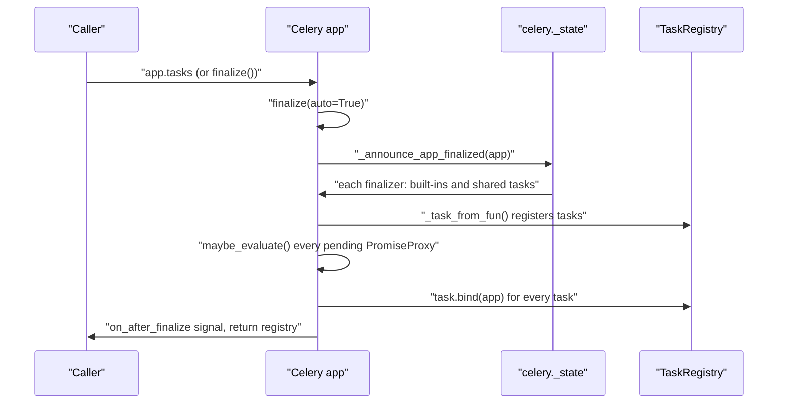

## Overview

The `Celery` class in `celery/app/base.py` is the root object of every Celery program. Clients use it to declare tasks and send messages; workers, beat and the command line use the same object to find tasks, read configuration and open broker connections. Celery keeps no hidden global configuration: everything hangs off an app instance, and several apps can live in one process.

Sources: [celery/app/base.py:252-287](repo://celery/app/base.py#L252-L287)

Almost everything on the app is lazy. The constructor only records arguments; configuration is read on first access, task decorators return proxies until the app is finalized, and helpers such as `amqp`, `backend`, `control` and `loader` are built the first time they are used. How settings are read is covered in [[Configuration]].

Sources: [celery/app/base.py:343-434](repo://celery/app/base.py#L343-L434), [celery/app/base.py:1534-1609](repo://celery/app/base.py#L1534-L1609)

## Creating an app

### Constructor arguments

`Celery(main=None, loader=None, backend=None, amqp=None, events=None, log=None, control=None, set_as_current=True, tasks=None, broker=None, include=None, changes=None, config_source=None, fixups=None, task_cls=None, autofinalize=True, namespace=None, strict_typing=True, **kwargs)`.

Sources: [celery/app/base.py:343-348](repo://celery/app/base.py#L343-L348)

| Argument | Effect |
| --- | --- |
| `main` | Name used instead of `__main__` when generating task names |
| `broker`, `backend`, `include` | Stored as the `broker_url`, `result_backend` and `include` settings |
| `**kwargs` | Any other setting, stored under its own name |
| `changes` | Initial dict of configuration changes (used when unpickling) |
| `config_source` | Object or module name to read configuration from, as `config_from_object` does |
| `namespace` | Prefix for setting names (for example `CELERY`) |
| `loader`, `amqp`, `events`, `log`, `control`, `task_cls` | Classes or `module:Class` strings that replace the defaults |
| `tasks` | A `TaskRegistry` instance or the name of a registry class |
| `fixups` | Fix-up plug-ins; defaults to `BUILTIN_FIXUPS` (the Django fix-up) |
| `set_as_current` | Make the app current for this thread (default `True`) |
| `autofinalize` | When `False`, using the registry before `finalize()` raises `RuntimeError` |
| `strict_typing` | Default for each task's `typing` flag; when true, `apply_async` checks call arguments against the function signature |

Sources: [celery/app/base.py:252-287](repo://celery/app/base.py#L252-L287), [celery/app/base.py:392-416](repo://celery/app/base.py#L392-L416), [celery/app/task.py:425-426](repo://celery/app/task.py#L425-L426), [celery/app/task.py:662-668](repo://celery/app/task.py#L662-L668)

### What the constructor does

`__init__` creates a thread-local, a `LamportClock`, and resolves the component classes, falling back to class attributes such as `amqp_cls = 'celery.app.amqp:AMQP'` and `task_cls = 'celery.app.task:Task'`. It notes whether a custom task class was supplied (`_custom_task_cls_used`), because the Django fix-up only swaps in `DjangoTask` when it was not. The task registry is created from `registry_cls` unless an instance was passed.

Sources: [celery/app/base.py:309-318](repo://celery/app/base.py#L309-L318), [celery/app/base.py:350-385](repo://celery/app/base.py#L350-L385)

Then it places `broker`, `backend`, `include` and extra keywords into `_preconf` and wraps them in a `Settings` over a `PendingConfiguration`, so nothing is loaded yet. It instantiates each fix-up (keeping the instances in `_fixups` so their weak references stay alive), makes the app current if `set_as_current`, creates the `on_configure`, `on_after_configure`, `on_after_finalize` and `on_after_fork` signals, calls the `on_init()` hook and registers the app in the global weak set of apps.

Sources: [celery/app/base.py:392-434](repo://celery/app/base.py#L392-L434)

`app.start(argv)` runs the `celery` Click group with this app preset as the `--app` default, and `worker_main(argv)` does the same but insists that `worker` is in `argv`. `close()` (also called on leaving a `with` block) drops the connection pool and deregisters the app.

Sources: [celery/app/base.py:466-513](repo://celery/app/base.py#L466-L513), [celery/app/base.py:1382-1386](repo://celery/app/base.py#L1382-L1386)

### Lazy components

Each component is a cached property built on first use. Classes that need a back-reference to the app (`Task`, `AsyncResult`, `GroupResult`, `Worker`, `WorkController`, `Beat`) are generated with `subclass_with_self`, which creates a subclass whose `app` attribute is this app and whose `__reduce__` unpickles through the current app.

Sources: [celery/app/base.py:1342-1375](repo://celery/app/base.py#L1342-L1375), [celery/app/base.py:1430-1486](repo://celery/app/base.py#L1430-L1486)

| Attribute | Built from |
| --- | --- |
| `amqp` | `instantiate(amqp_cls, app=self)`: queues, router, message creation, producer pool |
| `backend` | `backends.by_url(result_backend)`; cached app-wide if the backend is `thread_safe`, otherwise per thread |
| `control`, `events`, `log` | `control_cls`, `events_cls`, `log_cls` |
| `loader` | `get_loader_cls(loader_cls)(app=self)` |
| `Task` | `create_task_cls()`: `task_cls` bound to this app as an abstract base |
| `tasks` | The registry; reading it auto-finalizes the app |
| `pool`, `producer_pool` | Broker connection pool and `amqp.producer_pool` |
| `timezone` | From the `timezone` / `enable_utc` settings |

Sources: [celery/app/base.py:1534-1632](repo://celery/app/base.py#L1534-L1632), [celery/app/base.py:1224-1228](repo://celery/app/base.py#L1224-L1228), [celery/app/base.py:1335-1340](repo://celery/app/base.py#L1335-L1340)

## Declaring tasks

### The task decorator

`@app.task` and `@app.task(**options)` both work: one callable argument means the bare form, anything else returns a decorator. The inner `_create_task_cls` does two things:

Sources: [celery/app/base.py:515-585](repo://celery/app/base.py#L515-L585)

1. When `shared=True` (the default) it registers a constructor with `connect_on_app_finalize`, so every app finalized later in this process also gets the task.
2. When `lazy=False` or the app is already finalized it builds the task now with `_task_from_fun`. Otherwise it returns a `PromiseProxy` for `_task_from_fun(fun, **opts)` and appends it to `app._pending`.

Sources: [celery/app/base.py:554-575](repo://celery/app/base.py#L554-L575)

When the process was started by billiard with execv (`FORKED_BY_MULTIPROCESSING` set), the decorator returns a non-lazy `shared_task` instead, so a module-level task always resolves to the instance in the current app.

Sources: [celery/app/base.py:85-85](repo://celery/app/base.py#L85-L85), [celery/app/base.py:545-552](repo://celery/app/base.py#L545-L552)

### Building the task class

`_task_from_fun` raises `RuntimeError('Contract breach: app not finalized')` if the app is unfinalized with `autofinalize=False`. It computes the name with `gen_task_name` (module plus function name, with `app.main` replacing `__main__`) and returns the existing task if the name is already registered. Otherwise it optionally wraps the function with `pydantic_wrapper`, creates a subclass of `base` (default `app.Task`) with `run` set to the function (a staticmethod unless `bind=True`), copies docstring, module, annotations and a generated `__header__` used for argument checking, instantiates it, stores it in `_tasks`, binds it to the app and adds autoretry behaviour.

Sources: [celery/app/base.py:590-633](repo://celery/app/base.py#L590-L633), [celery/utils/imports.py:122-141](repo://celery/utils/imports.py#L122-L141)

With `pydantic=True`, the wrapper validates each argument annotated with a `BaseModel` subclass via `model_validate` (passing `celery_app` and `celery_task_name` in the context) and dumps a returned model with `model_dump(mode='json')` when it matches the return annotation.

Sources: [celery/app/base.py:127-205](repo://celery/app/base.py#L127-L205)

`register_task(task)` covers class-based tasks: it instantiates the class if needed, generates a name when missing, adds autoretry behaviour, stores it in `app.tasks` and binds it. Writing tasks is covered in [[Defining and Calling Tasks]].

Sources: [celery/app/base.py:635-652](repo://celery/app/base.py#L635-L652)

### Finalization

`finalize()` is the point where the registry becomes complete. It runs once under `_finalize_mutex`, and is triggered explicitly or by reading `app.tasks`.

Sources: [celery/app/base.py:657-677](repo://celery/app/base.py#L657-L677), [celery/app/base.py:1601-1609](repo://celery/app/base.py#L1601-L1609)



Sources: [celery/app/base.py:657-677](repo://celery/app/base.py#L657-L677), [celery/_state.py:36-52](repo://celery/_state.py#L36-L52)

1. With `auto=True` and `autofinalize=False` it raises `RuntimeError('Contract breach: app not finalized')`.
2. It sets `finalized = True` and calls `_announce_app_finalized`, which runs every callback in `_on_app_finalizers`: the built-in tasks and every shared task.
3. It drains `_pending`, evaluating each `PromiseProxy` so decorated functions become registered tasks.
4. It calls `task.bind(self)` on every registered task, which fills unset class attributes from configuration through `Task.from_config` (`serializer` from `task_serializer`, `rate_limit` from `task_default_rate_limit`, `acks_late` from `task_acks_late`, and so on).
5. It sends `on_after_finalize`, the earliest moment the registry is stable.

Sources: [celery/app/base.py:663-677](repo://celery/app/base.py#L663-L677), [celery/app/task.py:396-431](repo://celery/app/task.py#L396-L431), [celery/app/base.py:333-338](repo://celery/app/base.py#L333-L338)

### Shared tasks and built-ins

`shared_task` is for libraries that do not know the user's app. It registers a finalizer for all future apps, immediately adds the task to every already-finalized app in `_state._get_active_apps()`, and returns a `Proxy` that looks the task up in the current app's registry on every access.

Sources: [celery/app/__init__.py:24-76](repo://celery/app/__init__.py#L24-L76)

`celery/app/builtins.py` registers its tasks the same way, with `@connect_on_app_finalize` functions that create non-shared, non-lazy tasks on each app. `celery.app.base` imports the module, so every app has them.

Sources: [celery/app/builtins.py:1-33](repo://celery/app/builtins.py#L1-L33), [celery/app/base.py:45-46](repo://celery/app/base.py#L45-L46)

| Task name | Purpose |
| --- | --- |
| `celery.backend_cleanup` | Calls `app.backend.cleanup()` to expire old results |
| `celery.accumulate` | Used by `Task.replace` when replacing a task with a group |
| `celery.chord_unlock` | Polls a chord header for backends without native chord support, retrying every `result_chord_retry_interval` |
| `celery.map`, `celery.starmap`, `celery.chunks` | Run the `xmap`, `xstarmap` and `chunks` canvas primitives in one worker task |
| `celery.group`, `celery.chord` | No longer used; kept so old messages still run |
| `celery.chain` | Placeholder that raises `NotImplementedError` ("chain is not a real task") |

Sources: [celery/app/builtins.py:12-80](repo://celery/app/builtins.py#L12-L80), [celery/app/builtins.py:101-186](repo://celery/app/builtins.py#L101-L186)

### The task registry

`TaskRegistry` is a `dict` keyed by task name. A missing key raises `NotRegistered` through `__missing__`; `register` requires a `name`, instantiates classes and adds autoretry behaviour; `unregister` accepts a name or a task. Tasks pickle by name and unpickle by looking themselves up in the current app's registry (`_unpickle_task_v2` imports the module first).

Sources: [celery/app/registry.py:12-68](repo://celery/app/registry.py#L12-L68), [celery/app/task.py:514-514](repo://celery/app/task.py#L514-L514)

## Sending tasks by name

`send_task(name, args, kwargs, ...)` publishes a task message without needing the task's code, which is how a client calls tasks that live only on workers; `Task.apply_async` also ends here. It accepts the same options as `apply_async`. `task_always_eager` has no effect on it (it warns with `AlwaysEagerIgnored`).

Sources: [celery/app/base.py:846-872](repo://celery/app/base.py#L846-L872)

The steps, in order:

Sources: [celery/app/base.py:863-868](repo://celery/app/base.py#L863-L868)

1. **Default options.** When no `task_type` is given, it looks the name up in the raw `_tasks` dict (not `app.tasks`, so it never forces finalization) and merges the local task's non-`None` execution options under the caller's.
2. **Explicit limits.** `time_limit`, `soft_time_limit` and `expires` are taken from the arguments, or from the merged options when omitted; an explicit `None` clears a task-level default.
3. **Routing.** `router.route(options, route_name or name, args, kwargs, task_type)` fills in queue, exchange and routing key.
4. **Native delayed delivery.** With an ETA or countdown and quorum queues detected, a positive countdown is encoded into the routing key with `calculate_routing_key` and the message is sent to the `celery_delayed_27` topic exchange; for direct exchanges it only logs a warning.
5. **Expiry.** `expires` (datetime, ISO string or seconds) becomes the message `expiration`; a past value is clamped to 0 with a warning.
6. **Lineage.** `root_id` and `parent_id` come from `current_worker_task` when not given, and its priority is inherited if `task_inherit_parent_priority` is set.
7. **Publish.** `amqp.create_task_message(...)` builds the message, a producer is taken from the pool (or built on the given `connection`), `backend.on_task_call` runs unless results are ignored, and `amqp.send_task_message` publishes.
8. **Result.** It returns `(result_cls or self.AsyncResult)(task_id)` with `ignored` set, and adds it to the parent task's trail when `add_to_parent` is true.

Sources: [celery/app/base.py:874-966](repo://celery/app/base.py#L874-L966), [celery/app/base.py:967-1041](repo://celery/app/base.py#L967-L1041)

Message layout, routing and the delayed-delivery exchange are described in [[Task Messages and Routing]].

Sources: [celery/app/base.py:931-966](repo://celery/app/base.py#L931-L966)

## Connections and producer pools

`connection_for_write()` and `connection_for_read()` return a lazy `kombu.Connection` for `broker_write_url` and `broker_read_url`; both fall back to `broker_url`, which lets producers and consumers use different brokers. `_connection` fills credentials, transport, SSL, login method, failover strategy, transport options and connect timeout from the `broker_*` settings. `connection()` and `broker_connection` are older aliases for the write connection.

Sources: [celery/app/base.py:1043-1129](repo://celery/app/base.py#L1043-L1129), [celery/app/utils.py:84-105](repo://celery/app/utils.py#L84-L105)

`app.pool` creates the connection pool on first use: it registers an after-fork handler, sets Kombu's global pool limit to `broker_pool_limit` and takes `pools.connections[...]` for the write connection. `connection_or_acquire(connection)` and `producer_or_acquire(producer)` return a `FallbackContext` that uses the object you pass or acquires one from the pool for the duration of a `with` block, waiting up to `broker_pool_acquire_timeout`.

Sources: [celery/app/base.py:1131-1191](repo://celery/app/base.py#L1131-L1191), [celery/app/base.py:1488-1500](repo://celery/app/base.py#L1488-L1500), [celery/app/base.py:1611-1613](repo://celery/app/base.py#L1611-L1613)

```python
with app.producer_or_acquire() as producer:
    add.apply_async((2, 2), producer=producer)
```

Sources: [celery/app/base.py:1176-1189](repo://celery/app/base.py#L1176-L1189)

When the pool is exhausted, Kombu's `LimitExceeded` is re-raised as `OperationalError` with a message that names both settings to tune. After a fork, `_after_fork` resets the connection pool and the AMQP producer pool so a child never shares sockets with its parent, then sends `on_after_fork`.

Sources: [celery/app/base.py:1131-1146](repo://celery/app/base.py#L1131-L1146), [celery/app/base.py:1162-1174](repo://celery/app/base.py#L1162-L1174), [celery/app/base.py:1282-1288](repo://celery/app/base.py#L1282-L1288), [celery/app/base.py:118-124](repo://celery/app/base.py#L118-L124)

## Current app and state

`celery/_state.py` holds the process-wide state that lets code find "the" app without passing it around.

Sources: [celery/_state.py:1-41](repo://celery/_state.py#L1-L41)

| Name | Meaning |
| --- | --- |
| `_tls.current_app` | Thread-local current app; set by `app.set_current()`, which the constructor calls when `set_as_current` is true |
| `default_app` | Process-wide fallback set by `app.set_default()` |
| `get_current_app()` | Returns the thread's current app, else the default app; if neither exists it creates `Celery('default', fixups=[], set_as_current=False, loader=CELERY_LOADER or 'default')` |
| `current_app` | A `Proxy` around `get_current_app` |
| `current_task` | A `Proxy` to the top of `_task_stack`, the task currently executing in this thread |
| `get_current_worker_task()` | The innermost task on the stack that the worker started, skipping tasks called directly or eagerly |
| `_apps` | Weak set of all live apps, used by `shared_task` |
| `_on_app_finalizers` | Callbacks run for every app at finalization |

Sources: [celery/_state.py:23-142](repo://celery/_state.py#L23-L142), [celery/app/base.py:452-458](repo://celery/app/base.py#L452-L458), [celery/app/base.py:1502-1514](repo://celery/app/base.py#L1502-L1514)

Three environment variables help hunt down code that relies on the implicit app: `C_STRICT_APP` makes `get_current_app` raise, `C_WARN_APP` prints a stack trace on every use, and `CELERY_TRACE_APP` switches `app_or_default` to a version that raises when falling back to the default app in the main process.

Sources: [celery/_state.py:107-118](repo://celery/_state.py#L107-L118), [celery/_state.py:163-197](repo://celery/_state.py#L163-L197)

## Autodiscovering tasks

`autodiscover_tasks(packages=None, related_name='tasks', force=False)` imports `<package>.tasks` for each package. By default it is lazy: it connects a `starpromise` to the `import_modules` signal for this app, which `loader.import_default_modules()` sends when the worker starts. `packages` may be a callable so the list itself is computed late.

Sources: [celery/app/base.py:782-837](repo://celery/app/base.py#L782-L837), [celery/loaders/base.py:97-105](repo://celery/loaders/base.py#L97-L105)

With no packages, the list comes from fix-ups that define `autodiscover_tasks()`; the Django fix-up returns the name of every installed app config. `find_related_module` imports the package, then `package.related_name`, and returns `None` only when that exact module is missing, so an import error inside a tasks module still surfaces. A module-level `_RACE_PROTECTION` flag stops recursive discovery.

Sources: [celery/app/base.py:839-844](repo://celery/app/base.py#L839-L844), [celery/fixups/django.py:121-123](repo://celery/fixups/django.py#L121-L123), [celery/loaders/base.py:218-278](repo://celery/loaders/base.py#L218-L278)

## Fix-ups

A fix-up is a callable `fixup(app)` named by a `module:attr` string; the constructor calls each one in `app.fixups`. The only built-in is `celery.fixups.django:fixup`.

Sources: [celery/app/base.py:82-84](repo://celery/app/base.py#L82-L84), [celery/app/base.py:410-413](repo://celery/app/base.py#L410-L413)

The Django fix-up activates only when `DJANGO_SETTINGS_MODULE` is set and the loader is not a Django loader. It warns with `FixupWarning` if Django is not installed and requires Django 1.11 or later. `DjangoFixup` makes the app the default if none is set, puts the current directory first on `sys.path`, routes the loader's `now()` through `django.utils.timezone.now`, sets `task_cls` to `celery.contrib.django.task:DjangoTask` unless a custom task class was given, and connects to `import_modules` (to run `django.setup()` and system checks before task modules load, unless `CELERY_SKIP_CHECKS` is set) and `worker_init`.

Sources: [celery/fixups/django.py:52-127](repo://celery/fixups/django.py#L52-L127), [celery/fixups/django.py:146-154](repo://celery/fixups/django.py#L146-L154)

On `worker_init`, `DjangoWorkerFixup` connects to `task_prerun`, `task_postrun`, `worker_process_init` and `beat_embedded_init`. It closes database connections around every non-eager task (honouring `CELERY_DB_REUSE_MAX`), closes caches after tasks, and in each new child process drops inherited database file descriptors without network I/O; with prefork and Django's connection pooling it also calls `close_pool()`.

Sources: [celery/fixups/django.py:130-246](repo://celery/fixups/django.py#L130-L246)

## Pickling the app

Apps cross process boundaries by value. `__reduce__` returns `_unpickle_app_v2` with `__reduce_keys__()`: `main`, the configuration changes (or preconf if not yet configured), the component classes, `fixups`, `config_source`, `task_cls` and `namespace`. The receiving side rebuilds the app with `set_as_current=False`. Subclasses that define `__reduce_args__` fall back to the old positional protocol via `AppPickler`.

Sources: [celery/app/base.py:1391-1428](repo://celery/app/base.py#L1391-L1428), [celery/app/utils.py:289-324](repo://celery/app/utils.py#L289-L324), [celery/app/base.py:387-390](repo://celery/app/base.py#L387-L390)

> [!TIP]
> Configuration added with `add_defaults` is not included in the pickled changes. Register it at import time so child processes that re-import your module get it too.

Sources: [celery/app/base.py:679-701](repo://celery/app/base.py#L679-L701)

## Errors

| Error | Cause |
| --- | --- |
| `RuntimeError('Contract breach: app not finalized')` | Registry or task creation used before `finalize()` on an app with `autofinalize=False` |
| `TypeError` | `@app.task` given a non-callable positional argument, or more than one |
| `NotRegistered` | Looking up an unknown task name in `app.tasks` |
| `OperationalError` | No broker connection or producer became free within `broker_pool_acquire_timeout` |
| `ImproperlyConfigured` | `pydantic=True` without pydantic installed, or Django older than 1.11 |
| `ValueError` | `worker_main()` called without `worker` in `argv` |

Sources: [celery/app/base.py:577-585](repo://celery/app/base.py#L577-L585), [celery/app/base.py:602-603](repo://celery/app/base.py#L602-L603), [celery/app/base.py:663-666](repo://celery/app/base.py#L663-L666), [celery/app/registry.py:17-18](repo://celery/app/registry.py#L17-L18), [celery/app/base.py:1131-1174](repo://celery/app/base.py#L1131-L1174), [celery/app/base.py:136-139](repo://celery/app/base.py#L136-L139), [celery/fixups/django.py:47-49](repo://celery/fixups/django.py#L47-L49), [celery/app/base.py:504-511](repo://celery/app/base.py#L504-L511)
