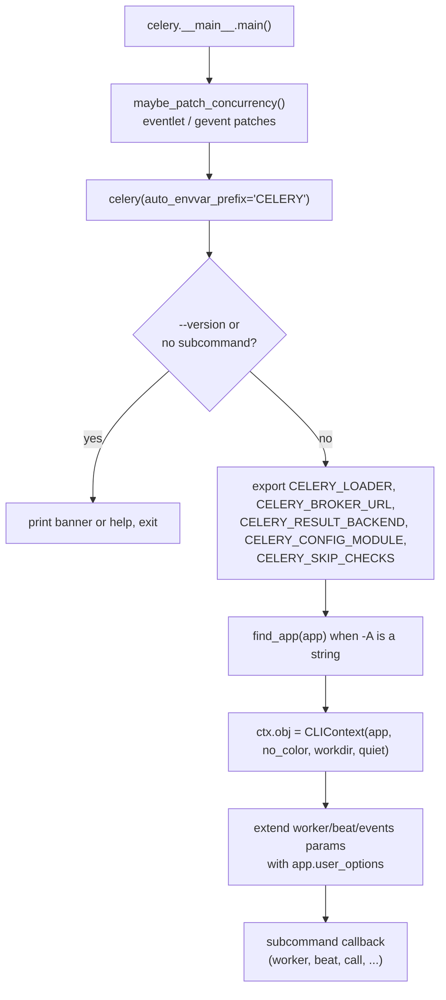
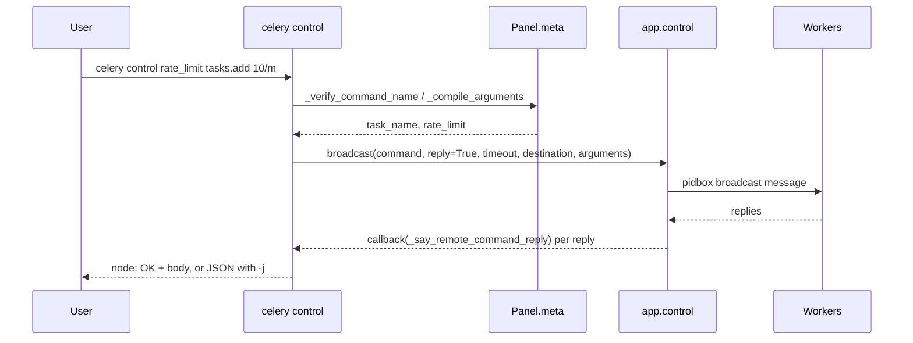

## Overview

Every Celery process an operator starts (a worker, the beat scheduler, the event monitor, a one-off task call) goes through the `celery` umbrella command. It is a [click](https://click.palletsprojects.com/) group defined in `celery/bin/celery.py`: one module per subcommand under `celery/bin/`, a set of shared click customizations in `celery/bin/base.py`, and a context object (`CLIContext`) that carries the loaded application to every subcommand.

Sources: [celery/bin/celery.py:1-30](repo://celery/bin/celery.py#L1-L30), [celery/bin/base.py:37-45](repo://celery/bin/base.py#L37-L45)

The group itself does almost no work: it turns global options into environment variables that the application reads later, imports the app named by `-A`, and hands it to the chosen subcommand. The subcommands are thin wrappers over application APIs, such as `app.Worker`, `app.Beat`, `app.control` and `app.send_task`, so everything they do can also be done from Python. Running several workers and detaching them is covered in [[Running Multiple Workers and Daemonization]]; the remote control commands that `inspect` and `control` send are documented in [[Remote Control and Inspection]].

Sources: [celery/bin/celery.py:113-163](repo://celery/bin/celery.py#L113-L163)

## Startup Sequence

The `celery` console script points at `celery.__main__:main`. Before click parses anything, `main` calls `maybe_patch_concurrency()` unless `multi` is on the command line. That function scans `sys.argv` for `-P`/`--pool` and applies the eventlet or gevent monkey patches at once, because those libraries must patch the standard library before any other module imports sockets or threads.

Sources: [setup.py:155-159](repo://setup.py#L155-L159), [celery/__main__.py:10-15](repo://celery/__main__.py#L10-L15), [celery/__init__.py:88-104](repo://celery/__init__.py#L88-L104), [celery/__init__.py:123-153](repo://celery/__init__.py#L123-L153)

`celery.bin.celery.main` then invokes the group with `auto_envvar_prefix="CELERY"`. With that prefix click also reads any option without an explicit `envvar` from `CELERY_<OPTION>` at the top level and `CELERY_<SUBCOMMAND>_<OPTION>` inside a subcommand, so `CELERY_WORKER_LOGLEVEL=INFO` works like `celery worker -l INFO`.

Sources: [celery/bin/celery.py:220-227](repo://celery/bin/celery.py#L220-L227)



Sources: [celery/__main__.py:10-15](repo://celery/__main__.py#L10-L15), [celery/bin/celery.py:113-163](repo://celery/bin/celery.py#L113-L163)

When `--version` is given the group prints `VERSION_BANNER` and exits; when no subcommand is given (`invoke_without_command=True`) it prints the help text. Otherwise the global options are applied as described below, and the group stores a `CLIContext` in `ctx.obj` for the subcommand to read.

Sources: [celery/bin/celery.py:55-56](repo://celery/bin/celery.py#L55-L56), [celery/bin/celery.py:116-121](repo://celery/bin/celery.py#L116-L121)

## Global Options

### Option table

Global options belong to the group, so they must come before the subcommand name: `celery -A proj worker`, not `celery worker -A proj`.

Sources: [celery/bin/celery.py:57-111](repo://celery/bin/celery.py#L57-L111)

| Option | Environment variable | Effect |
| --- | --- | --- |
| `-A`, `--app` | `APP` (or `CELERY_APP` through the auto prefix) | Import path of the application; passed `click.UNPROCESSED` so a `Celery` object can also be given when the group is invoked from Python. |
| `-b`, `--broker` | `BROKER_URL` | Sets `CELERY_BROKER_URL`. |
| `--result-backend` | `RESULT_BACKEND` | Sets `CELERY_RESULT_BACKEND`. |
| `--loader` | `LOADER` | Sets `CELERY_LOADER`. |
| `--config` | `CONFIG_MODULE` | Sets `CELERY_CONFIG_MODULE`. |
| `--workdir` | none | Eager callback that runs `os.chdir()` before the other options are processed. |
| `-C`, `--no-color` | `NO_COLOR` | Plain output from every `CLIContext` helper. |
| `-q`, `--quiet` | none | Suppresses banners and `<-` chat lines. |
| `--version` | none | Prints `VERSION_BANNER` and exits. |
| `--skip-checks` | `SKIP_CHECKS` | Sets `CELERY_SKIP_CHECKS=true`, which skips Django's `run_checks()` in the Django fixup. |

Sources: [celery/bin/celery.py:57-111](repo://celery/bin/celery.py#L57-L111), [celery/bin/celery.py:123-133](repo://celery/bin/celery.py#L123-L133), [celery/fixups/django.py:150-154](repo://celery/fixups/django.py#L150-L154)

### How options reach the configuration

The broker, backend, loader and config options are not written into `app.conf`. The group exports them as environment variables, and the application reads them when it needs them. `Settings.broker_url` and `Settings.result_backend` check `CELERY_BROKER_URL` and `CELERY_RESULT_BACKEND` before the configured value, so a command-line `--broker` wins over `broker_url` in the config module. `Celery._get_default_loader` checks `CELERY_LOADER` first, and the loaders import the module named by `CELERY_CONFIG_MODULE`.

Sources: [celery/bin/celery.py:123-133](repo://celery/bin/celery.py#L123-L133), [celery/app/utils.py:100-112](repo://celery/app/utils.py#L100-L112), [celery/app/base.py:436-441](repo://celery/app/base.py#L436-L441), [celery/loaders/base.py:208-216](repo://celery/loaders/base.py#L208-L216), [celery/loaders/default.py:25-29](repo://celery/loaders/default.py#L25-L29)

> [!NOTE]
> Because these are process-wide environment variables, they also reach the default app that `CLIContext` falls back to (`get_current_app()`) when no `-A` is given; that fallback app reads `CELERY_LOADER` as well.

Sources: [celery/bin/base.py:40-45](repo://celery/bin/base.py#L40-L45), [celery/_state.py:91-100](repo://celery/_state.py#L91-L100)

### Locating the application

A string passed to `-A` goes to `celery.app.utils.find_app`. It resolves `module:attribute` directly with `symbol_by_name`. For a bare module path it tries the `app` attribute, then `celery`; for a package it retries with `<package>.celery`; as a last resort it returns the first `Celery` instance found among the module's globals.

Sources: [celery/app/utils.py:378-415](repo://celery/app/utils.py#L378-L415)

The group turns lookup failures into click usage errors with three messages: the module itself was not found, the module raised while importing (the full traceback is included), or the module has no application attribute.

Sources: [celery/bin/celery.py:32-43](repo://celery/bin/celery.py#L32-L43), [celery/bin/celery.py:135-152](repo://celery/bin/celery.py#L135-L152)

## CLIContext

`CLIContext` is the `ctx.obj` every subcommand receives. It holds `app`, `no_color`, `quiet` and `workdir`, and centralizes output so `--no-color` is respected in one place: `style`, `secho`, `echo` and `error` drop ANSI styling when `no_color` is set, and `error` always writes to stderr. `OK` and `ERROR` are cached, styled status words.

Sources: [celery/bin/base.py:37-81](repo://celery/bin/base.py#L37-L81)

`pretty(n)` formats remote-control replies: lists become bullet lists, a dict containing `ok` or `error` is unwrapped and labeled `OK` or `ERROR`, and other dicts are dumped as sorted JSON, highlighted with Pygments when it is installed and colour is on. `say_chat` prints `->` lines for requests and replies, and `--quiet` suppresses the `<-` direction.

Sources: [celery/bin/base.py:22-34](repo://celery/bin/base.py#L22-L34), [celery/bin/base.py:83-120](repo://celery/bin/base.py#L83-L120)

## Click Building Blocks

### Options and commands

`CeleryOption` adds two keyword arguments to `click.Option`. `help_group` names the heading the option is listed under in `--help`. `default_value_from_context` takes the default from `ctx.obj` at parse time. `CeleryCommand.format_options` groups the help records by `help_group`, so `celery worker --help` shows "Worker Options", "Pool Options", "Queue Options" and so on, instead of one flat list.

Sources: [celery/bin/base.py:163-194](repo://celery/bin/base.py#L163-L194)

`CeleryDaemonCommand` appends the shared daemonization options `--logfile`/`-f`, `--pidfile`, `--uid`, `--gid`, `--umask` and `--executable` to `worker`, `beat` and `events`. Each is a `DaemonOption` whose callback falls back to the setting named `<command>_<option>`, so `celery worker` without `--pidfile` uses `app.conf.worker_pidfile`.

Sources: [celery/bin/base.py:197-227](repo://celery/bin/base.py#L197-L227)

### Parameter types

| Type (instance) | Converts |
| --- | --- |
| `CommaSeparatedList` (`COMMA_SEPARATED_LIST`) | `"a,b"` to a list through `text.str_to_list`. |
| `JsonArray` (`JSON_ARRAY`) | JSON text that must decode to a list. |
| `JsonObject` (`JSON_OBJECT`) | JSON text that must decode to a dict. |
| `ISO8601DateTime` (`ISO8601`) | An ISO 8601 timestamp, through `maybe_iso8601`. |
| `ISO8601DateTimeOrFloat` (`ISO8601_OR_FLOAT`) | A float of seconds, or else an ISO 8601 timestamp. |
| `LogLevel` (`LOG_LEVEL`) | A case-insensitive level name to its numeric level, through `mlevel`. |
| `WorkersPool` (`WORKERS_POOL`) | A pool name to a pool class; the default `prefork` gives way to `worker_pool` when that setting is configured. |
| `Hostname` (`HOSTNAME`) | A node name, expanded with `default_nodename` and `host_format`. |
| `Autoscale` (`AUTOSCALE`) | `"max,min"` or `"max"` to a `(max, min)` tuple. |
| `CeleryBeat` (`CELERY_BEAT`) | `-B`; fails on Windows. |

Sources: [celery/bin/base.py:230-329](repo://celery/bin/base.py#L230-L329), [celery/bin/worker.py:22-103](repo://celery/bin/worker.py#L22-L103)

## Subcommands

### Command reference

The group registers the built-in commands with `add_command`, and `report` is defined in place. `inspect`, `control`, `status` and `list` delegate to broker or remote-control APIs; `worker`, `beat`, `events` and `multi` start long-running processes.

Sources: [celery/bin/celery.py:166-191](repo://celery/bin/celery.py#L166-L191)

| Command | Module | What it does |
| --- | --- | --- |
| `worker` | `celery/bin/worker.py` | Starts `app.Worker`; can detach. |
| `beat` | `celery/bin/beat.py` | Starts `app.Beat`, the periodic task scheduler. |
| `multi` | `celery/bin/multi.py` | Starts and stops named worker nodes through `MultiTool`. |
| `events` | `celery/bin/events.py` | Curses monitor (`evtop`), `--dump` (`evdump`) or `--camera` (`evcam`). |
| `call` | `celery/bin/call.py` | `app.send_task(name, ...)`, then prints the task id. |
| `result` | `celery/bin/result.py` | Prints `AsyncResult(task_id).get()` or `.traceback`. |
| `purge` | `celery/bin/purge.py` | `queue_purge` on every known queue, minus `-X`, after a confirmation prompt. |
| `inspect` | `celery/bin/control.py` | Sends an inspect command and prints the replies. |
| `control` | `celery/bin/control.py` | Broadcasts a control command with `reply=True`. |
| `status` | `celery/bin/control.py` | `inspect().ping()`; prints the number of nodes online. |
| `list bindings` | `celery/bin/list.py` | Declares the task queues, then prints `conn.manager.get_bindings()`. |
| `shell` | `celery/bin/shell.py` | IPython, bpython or plain Python with the app, canvas primitives and tasks in scope. |
| `migrate` | `celery/bin/migrate.py` | `migrate_tasks(Connection(source), Connection(destination))`. |
| `upgrade settings` | `celery/bin/upgrade.py` | Rewrites Celery 3.x setting names in a file to the new lowercase names. |
| `logtool` | `celery/bin/logtool.py` | `stats`, `traces`, `errors`, `incomplete`, `debug` over worker log files. |
| `graph` | `celery/bin/graph.py` | `bootsteps` or `workers` graphs in dot format. |
| `amqp` | `celery/bin/amqp.py` | AMQP administration REPL (`exchange.declare`, `queue.bind`, `basic.publish`, ...). |
| `report` | `celery/bin/celery.py` | Imports the default modules and prints `app.bugreport()`. |

Sources: [celery/bin/celery.py:166-191](repo://celery/bin/celery.py#L166-L191), [celery/bin/call.py:58-71](repo://celery/bin/call.py#L58-L71), [celery/bin/result.py:21-30](repo://celery/bin/result.py#L21-L30), [celery/bin/purge.py:31-70](repo://celery/bin/purge.py#L31-L70), [celery/bin/list.py:7-38](repo://celery/bin/list.py#L7-L38), [celery/bin/events.py:83-98](repo://celery/bin/events.py#L83-L98), [celery/bin/migrate.py:48-63](repo://celery/bin/migrate.py#L48-L63), [celery/bin/upgrade.py:55-91](repo://celery/bin/upgrade.py#L55-L91), [celery/bin/logtool.py:113-157](repo://celery/bin/logtool.py#L113-L157), [celery/bin/graph.py:11-35](repo://celery/bin/graph.py#L11-L35), [celery/bin/amqp.py:61-71](repo://celery/bin/amqp.py#L61-L71)

### worker

`celery worker` takes its options in help groups: Worker Options (`-n/--hostname`, `-D/--detach`, `-S/--statedb`, `-l/--loglevel`, `-O`, `--prefetch-multiplier`, `--disable-prefetch`), Pool Options (`-c`, `-P`, `-E`, time limits, `--max-tasks-per-child`, `--max-memory-per-child`), Queue Options (`--purge`, `-Q`, `-X`, `-I`), Features (`--without-gossip`, `--without-mingle`, `--without-heartbeat`, `--heartbeat-interval`, `--autoscale`) and Embedded Beat Options (`-B`, `-s`, `--scheduler`). Several callbacks fall back to settings when the option is absent, for example `value or ctx.obj.app.conf.worker_concurrency`.

Sources: [celery/bin/worker.py:136-235](repo://celery/bin/worker.py#L136-L235), [celery/bin/worker.py:236-305](repo://celery/bin/worker.py#L236-L305)

The command body runs these steps in order:

Sources: [celery/bin/worker.py:307-323](repo://celery/bin/worker.py#L307-L323)

1. If `--disable-prefetch` was given, write it to `app.conf.worker_disable_prefetch`.
2. Parse any extra `key=value` arguments (`allow_extra_args`) with `app.config_from_cmdline(ctx.args, namespace='worker')`; a parse error becomes a `click.UsageError`.
3. With `--detach`, rebuild `argv` as `-m celery ...` without `--detach`/`-D`/`--uid`/`--gid` and call `detach()`, which forks through `platforms.detached` and `os.execv`s the interpreter again.
4. Otherwise call `maybe_drop_privileges(uid=uid, gid=gid)`, build `app.Worker(...)` with the node-formatted `pidfile` and `statedb`, call `worker.start()`, and exit with `worker.exitcode`.
5. A `SecurityError` raised along the way (for example by message signing setup) is printed and the command exits with 1.

Sources: [celery/bin/worker.py:105-133](repo://celery/bin/worker.py#L105-L133), [celery/bin/worker.py:307-371](repo://celery/bin/worker.py#L307-L371)

`config_from_cmdline` delegates to the loader's `cmdline_config_parser`. A key that starts with `_` or `.` takes the command's namespace, so `celery worker .prefetch_multiplier=1` sets `worker_prefetch_multiplier`. Any other key is split at its first underscore into namespace and name. Values are cast through the setting's declared type, or explicitly with a `(json)`, `(list)` or `(dict)` prefix.

Sources: [celery/app/base.py:745-748](repo://celery/app/base.py#L745-L748), [celery/loaders/base.py:161-206](repo://celery/loaders/base.py#L161-L206)

### beat and events

`celery beat` follows the same pattern as the worker. It parses extra arguments with `config_from_cmdline`, drops privileges only when it is not detaching (`detached()` does that itself), and runs `app.Beat(...).run()`, inside `platforms.detached` when `--detach` is given. `-s/--schedule` and `-S/--scheduler` default to `beat_schedule_filename` and `beat_scheduler`. [[Celery Beat Scheduler]] describes what runs next.

Sources: [celery/bin/beat.py:10-72](repo://celery/bin/beat.py#L10-L72)

`celery events` picks one of three modes. `--dump` runs `evdump`, `--camera` runs `evcam` with `--frequency` and `--maxrate` (optionally detached), and the default starts the curses `evtop`, which raises a `UsageError` when `_curses` is unavailable. Each mode sets a process title such as `celery events:top`. See [[Events and Monitoring]].

Sources: [celery/bin/events.py:12-49](repo://celery/bin/events.py#L12-L49), [celery/bin/events.py:51-98](repo://celery/bin/events.py#L51-L98)

> [!WARNING]
> In `celery events`, both `--dump` and `--detach` declare the short flag `-d`. Use the long option names to avoid ambiguity.

Sources: [celery/bin/events.py:52-65](repo://celery/bin/events.py#L52-L65)

### inspect, control and status

All three take `-t/--timeout` (default 1.0 seconds), `-d/--destination` (comma-separated node names) and `-j/--json`. `inspect` and `control` take the remote command name as an argument, and `--list` prints the available commands with their signatures. `_get_commands_of_type` builds that list from `Panel.meta`, the registry the worker's `@inspect_command`/`@control_command` decorators fill. Unknown names are rejected by `_verify_command_name` before anything is sent.

Sources: [celery/bin/control.py:56-104](repo://celery/bin/control.py#L56-L104), [celery/worker/control.py:25-75](repo://celery/worker/control.py#L25-L75), [celery/bin/control.py:107-128](repo://celery/bin/control.py#L107-L128), [celery/bin/control.py:153-177](repo://celery/bin/control.py#L153-L177)

Extra positional arguments become the command's arguments. `_compile_arguments` reads the command's `meta.args` (a list of `(name, type)` pairs), converts each positional argument with its type, and passes the rest under the `meta.variadic` name. Too many arguments for a non-variadic command raise a `UsageError` showing the signature.

Sources: [celery/bin/control.py:26-53](repo://celery/bin/control.py#L26-L53), [celery/worker/control.py:255-259](repo://celery/worker/control.py#L255-L259)



Sources: [celery/bin/control.py:16-23](repo://celery/bin/control.py#L16-L23), [celery/bin/control.py:211-262](repo://celery/bin/control.py#L211-L262)

`inspect` calls `app.control.inspect(...)._request(command, **arguments)`; `control` calls `app.control.broadcast(..., reply=True)`; `status` calls `inspect().ping()`. Without `--json`, each reply is printed as it arrives by `_say_remote_command_reply`, and the node count is printed at the end unless `--quiet`. With `--json`, the replies are collected and printed once as JSON.

Sources: [celery/bin/control.py:129-150](repo://celery/bin/control.py#L129-L150), [celery/bin/control.py:178-208](repo://celery/bin/control.py#L178-L208), [celery/bin/control.py:236-262](repo://celery/bin/control.py#L236-L262)

### multi

`celery multi` is a click command that accepts any arguments (`ignore_unknown_options`) and hands them to the older `MultiTool` parser. Because `-A` is now a global option placed before `multi`, the command moves everything after `multi` to the front of the argument list, so that `MultiTool` still sees the app option among the node arguments.

Sources: [celery/bin/multi.py:463-480](repo://celery/bin/multi.py#L463-L480)

## Extending the Command Line

### Custom options

`app.user_options` is a `defaultdict(set)` of click options keyed by command. During the group callback, `user_options['worker']`, `['beat']` and `['events']` are appended to those commands' parameters, and `user_options['preload']` is appended to every registered command. For the worker, the extra values travel through `**kwargs` into `app.Worker` and on to the bootsteps.

Sources: [celery/app/base.py:369-369](repo://celery/app/base.py#L369-L369), [celery/bin/celery.py:157-163](repo://celery/bin/celery.py#L157-L163), [docs/userguide/extending.rst:740-776](repo://docs/userguide/extending.rst#L740-L776)

Preload options are dispatched by `handle_preload_options`, a decorator on each subcommand. It collects the values of the preload options from the parsed kwargs and sends the `user_preload_options` signal with `app` and `options` before running the command body.

Sources: [celery/bin/base.py:143-160](repo://celery/bin/base.py#L143-L160), [celery/signals.py:151-154](repo://celery/signals.py#L151-L154)

```python
    app.user_options['preload'].add(Option(('-Z', '--template'),
                                           default='default',
                                           help='Configuration template to use.'))

    @signals.user_preload_options.connect
    def on_preload_parsed(options, **kwargs):
        use_template(options['template'])
```

Sources: [docs/userguide/extending.rst:796-802](repo://docs/userguide/extending.rst#L796-L802)

### Plugin subcommands

Installed packages can add subcommands through the `celery.commands` entry-point group. The module loads the group with `importlib.metadata.entry_points`, using the API that matches the Python version, and `click_plugins.with_plugins` attaches each entry point's click command to the group. This is how Flower provides `celery flower`.

Sources: [celery/bin/celery.py:46-55](repo://celery/bin/celery.py#L46-L55), [docs/userguide/extending.rst:806-848](repo://docs/userguide/extending.rst#L806-L848)

## Errors and Exit Codes

Commands that talk to the broker wrap their calls in `handle_remote_command_error`. A `click.ClickException` is re-raised unchanged; a kombu `OperationalError` becomes a `CeleryCommandException` that says the broker could not be reached; any other exception becomes "Unable to run the `<command>` command". Both carry `exit_code=EX_UNAVAILABLE`. `inspect`, `control` and `status` raise the same exception when no node replied within the timeout.

Sources: [celery/bin/base.py:123-140](repo://celery/bin/base.py#L123-L140), [celery/exceptions.py:307-312](repo://celery/exceptions.py#L307-L312), [celery/bin/control.py:139-143](repo://celery/bin/control.py#L139-L143)

Celery 5 removed per-subcommand `-A`. To explain the resulting "no such option" error, the module replaces `click.exceptions.NoSuchOption.show`: when the unknown option is `-A` or `--app`, it first prints a red message that shows the correct `celery -A app <command>` order, then calls click's original `show`.

Sources: [celery/bin/celery.py:193-217](repo://celery/bin/celery.py#L193-L217)
