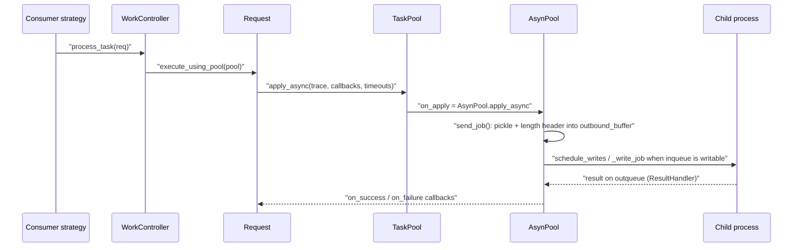
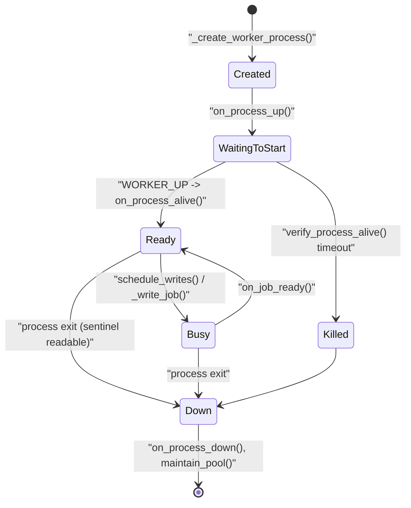
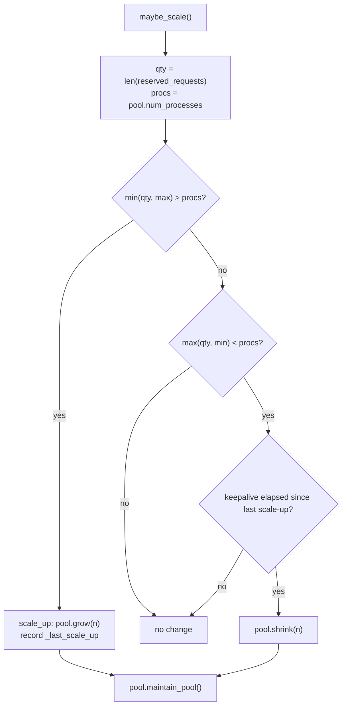

## Overview

A Celery worker receives task messages in one main process and runs the task bodies in an execution pool. The pool decides what a "slot" is: a forked child process (prefork), a thread (threads), a greenlet (eventlet, gevent) or the main process itself (solo). Every implementation subclasses `BasePool`, so the worker, the `Request` object and the remote control commands talk to all of them through the same small interface: `start`, `apply_async`, `terminate_job`, `grow`, `shrink`, `stop` and `info`.

Sources: [celery/concurrency/base.py:47-156](repo://celery/concurrency/base.py#L47-L156)

The pool is created by the `Pool` bootstep of the worker blueprint (see [[Worker Architecture and Bootsteps]]), receives work from `Request.execute_using_pool` (see [[Consumer and Task Requests]]), and runs the tracer described in [[Task Execution and Tracing]] inside each slot.

Sources: [celery/worker/components.py:101-178](repo://celery/worker/components.py#L101-L178), [celery/worker/request.py:341-372](repo://celery/worker/request.py#L341-L372)

## Selecting an implementation

### Aliases and get_implementation

`celery.concurrency.ALIASES` maps short pool names to `module:Class` paths, and `get_implementation` resolves a name with kombu's `symbol_by_name`, so a full dotted path to any `BasePool` subclass also works. `get_available_pool_names` returns the alias keys, which is what the `-P/--pool` option offers as choices.

Sources: [celery/concurrency/__init__.py:11-48](repo://celery/concurrency/__init__.py#L11-L48)

| Alias | Class | Notes |
| --- | --- | --- |
| `prefork` | `celery.concurrency.prefork:TaskPool` | Default (`DEFAULT_POOL = 'prefork'`). |
| `processes` | `celery.concurrency.prefork:TaskPool` | Compatibility alias for `prefork`. |
| `solo` | `celery.concurrency.solo:TaskPool` | Runs tasks inline in the worker process. |
| `threads` | `celery.concurrency.thread:TaskPool` | Added only if `concurrent.futures` imports. |
| `eventlet` | `celery.concurrency.eventlet:TaskPool` | Green threads; needs early monkey patching. |
| `gevent` | `celery.concurrency.gevent:TaskPool` | Green threads; needs early monkey patching. |
| `custom` | value of `CELERY_CUSTOM_WORKER_POOL` | Out-of-tree pool, selected with `--pool custom`. |

Sources: [celery/concurrency/__init__.py:11-38](repo://celery/concurrency/__init__.py#L11-L38), [celery/app/defaults.py:11-11](repo://celery/app/defaults.py#L11-L11)

### How the worker resolves the pool class

`WorkController.setup_defaults` reads `worker_pool` (or the `pool`/`pool_cls` arguments) into `pool_cls`, and `setup_instance` replaces that name with the class returned by `get_implementation` before building the blueprint. On the command line, `WorkersPool.convert` resolves `-P` the same way; when the CLI value is the default `prefork` but `worker_pool` is configured, the configured pool wins.

Sources: [celery/worker/worker.py:376-378](repo://celery/worker/worker.py#L376-L378), [celery/worker/worker.py:129-130](repo://celery/worker/worker.py#L129-L130), [celery/bin/worker.py:35-60](repo://celery/bin/worker.py#L35-L60)

### Early patching for green pools

Eventlet and gevent must monkey-patch the standard library before anything else imports sockets or threads. The `celery` entry point calls `maybe_patch_concurrency` before importing the CLI; it scans `argv` for `-P`/`--pool`, runs `_patch_eventlet` (`eventlet.monkey_patch()`, plus hub blocking detection when `EVENTLET_NOBLOCK` is set) or `_patch_gevent` (`gevent.monkey.patch_all()`), then imports the pool module.

Sources: [celery/__main__.py:10-15](repo://celery/__main__.py#L10-L15), [celery/__init__.py:107-152](repo://celery/__init__.py#L107-L152)

> [!WARNING]
> Selecting `eventlet` or `gevent` through the `worker_pool` setting is too late for patching. The `Pool` bootstep warns with `W_POOL_SETTING` in that case: use `-P eventlet` or `-P gevent` instead. The eventlet module also warns at import when `celery.`, `kombu.` or `billiard.` modules were loaded before patching.

Sources: [celery/worker/components.py:18-30](repo://celery/worker/components.py#L18-L30), [celery/worker/components.py:138-142](repo://celery/worker/components.py#L138-L142), [celery/concurrency/eventlet.py:14-26](repo://celery/concurrency/eventlet.py#L14-L26)

## The BasePool interface

### State and capability flags

`BasePool` keeps a `_state` of `RUN`, `CLOSE` or `TERMINATE`. `start()` calls `on_start()` and sets `RUN`; `close()`, `stop()` and `terminate()` set the state and delegate to `on_close()`, `on_stop()` and `on_terminate()`. Subclasses override the `on_*` hooks rather than the public methods. Class attributes describe what the worker may rely on:

Sources: [celery/concurrency/base.py:47-138](repo://celery/concurrency/base.py#L47-L138)

| Attribute | Default | Meaning |
| --- | --- | --- |
| `signal_safe` | `True` | The pool can be stopped from inside a signal handler. Threads, eventlet and gevent set it to `False`. |
| `is_green` | `False` | Pool runs greenlets (eventlet, gevent). |
| `uses_semaphore` | `False` | Only prefork sets it; the worker then guards `process_task` with a semaphore. |
| `task_join_will_block` | `True` | Whether `result.get()` inside a task blocks; green pools set `False`. |
| `body_can_be_buffer` | `False` | Solo and threads accept a buffer as the message body. |
| `Timer` | `timer2.Timer` | Timer class; green pools supply their own greenlet-based `Timer`. |

Sources: [celery/concurrency/base.py:50-71](repo://celery/concurrency/base.py#L50-L71), [celery/concurrency/thread.py:30-35](repo://celery/concurrency/thread.py#L30-L35), [celery/concurrency/eventlet.py:88-98](repo://celery/concurrency/eventlet.py#L88-L98)

### apply_async and apply_target

`BasePool.apply_async` logs the call at debug level, then forwards to `on_apply` with `waitforslot=self.putlocks` and `callbacks_propagate`. `Request.execute_using_pool` calls it with the tracer function as `target` and its own `on_accepted`, `on_timeout`, `on_success` and `on_failure` as callbacks, plus the soft and hard time limits and `correlation_id=task_id`.

Sources: [celery/concurrency/base.py:140-156](repo://celery/concurrency/base.py#L140-L156), [celery/worker/request.py:356-369](repo://celery/worker/request.py#L356-L369)

In-process pools (solo, threads, eventlet, gevent) run the job through `apply_target`. It calls `accept_callback(pid, monotonic())` first, runs the target, and passes the return value to `callback`. Ordinary exceptions, `WorkerShutdown` and `WorkerTerminate` propagate; any other `BaseException` is re-raised as `WorkerLostError` and handed to `callback` wrapped in an `ExceptionInfo`.

Sources: [celery/concurrency/base.py:22-44](repo://celery/concurrency/base.py#L22-L44)

### Info and process count

`_get_info()` returns a JSON-friendly dict with `implementation` and `max-concurrency`; subclasses add their own keys, and it surfaces through the `info` property in `celery inspect stats`. `num_processes` defaults to `limit` and is what the autoscaler compares against. `terminate_job` and `restart` raise `NotImplementedError` unless a subclass provides them.

Sources: [celery/concurrency/base.py:112-118](repo://celery/concurrency/base.py#L112-L118), [celery/concurrency/base.py:158-180](repo://celery/concurrency/base.py#L158-L180)

## How the worker creates the pool

The `Pool` bootstep requires `Hub` and creates the pool in `create`. It decides between a threaded (blocking) and an event-loop pool: `threaded = not w.use_eventloop or IS_WINDOWS`. With the event loop it creates a `LaxBoundedSemaphore(procs)` and, when `worker_pool_putlocks` is on and the class has `uses_semaphore`, routes `process_task` through `_process_task_sem` so a request only reaches the pool once a slot is free. It then instantiates `pool_cls` with `min_concurrency` slots and the per-child limits, time limits and `sched_strategy=self.optimization` (`-O fair`).

Sources: [celery/worker/components.py:138-172](repo://celery/worker/components.py#L138-L172), [celery/worker/worker.py:220-231](repo://celery/worker/worker.py#L220-L231)

`use_eventloop` is true only when no green environment is detected, the broker transport implements asynchronous I/O, and the platform is not Windows. `register_with_event_loop` on the step forwards the hub to `pool.register_with_event_loop`, which only `AsynPool` acts on.

Sources: [celery/worker/worker.py:239-242](repo://celery/worker/worker.py#L239-L242), [celery/worker/components.py:177-178](repo://celery/worker/components.py#L177-L178)

Sources: [celery/worker/worker.py:220-231](repo://celery/worker/worker.py#L220-L231), [celery/worker/request.py:341-372](repo://celery/worker/request.py#L341-L372), [celery/concurrency/prefork.py:104-126](repo://celery/concurrency/prefork.py#L104-L126), [celery/concurrency/asynpool.py:804-887](repo://celery/concurrency/asynpool.py#L804-L887)

## Prefork pool

### TaskPool and the child initializer

`prefork.TaskPool.on_start` picks billiard's blocking `Pool` when the `threads` option is true and `AsynPool` otherwise, passing `process_initializer` as the child initializer, `process_destructor` as the exit hook and `worker_proc_alive_timeout`. It then binds `on_apply`, `maintain_pool`, `terminate_job`, `grow`, `shrink` and `flush` directly to the underlying pool's methods, so calls skip one level of indirection.

Sources: [celery/concurrency/prefork.py:95-126](repo://celery/concurrency/prefork.py#L95-L126)

`process_initializer` runs in every child. It sets `SIGKILL` as the parent-death signal, resets `SIGTERM`, `SIGHUP`, `SIGTTIN`, `SIGTTOU`, `SIGUSR1` and ignores `SIGINT`, sets the process title, runs the loader's `init_worker`/`init_worker_process`, configures logging from `CELERY_LOG_*` environment variables, rebuilds `task.__trace__` with `build_tracer` for every task, resets worker state, and sends the `worker_process_init` signal. `process_destructor` sends `worker_process_shutdown` with the pid and exit code (see [[Signals]]).

Sources: [celery/concurrency/prefork.py:26-92](repo://celery/concurrency/prefork.py#L26-L92)

`on_stop` closes the pool and joins it. While joining it starts a `prefork-timer-shutdown` daemon thread that keeps calling `hub.fire_timers()` every 0.5 s, so broker heartbeats on asynchronous transports keep firing while tasks drain. `on_terminate` calls `terminate()` immediately. `_get_info` adds the child pids, `max-tasks-per-child`, put-lock status, the soft and hard timeouts and AsynPool write statistics.

Sources: [celery/concurrency/prefork.py:142-216](repo://celery/concurrency/prefork.py#L142-L216)

### AsynPool queues and process lifecycle

`AsynPool` subclasses billiard's `Pool` but avoids the helper threads of the original: everything runs on the worker's kombu hub. Instead of one shared queue it creates a private queue set per process in advance (`create_process_queues`): a non-blocking-write `inq`, a non-blocking-read `outq`, and a `synq` only when `synack` is on. It keeps fd-to-process indexes (`_fileno_to_inq`, `_fileno_to_outq`, `_fileno_to_synq`), the set of writable inqueues, the busy workers, and the `outbound_buffer` of jobs waiting to be written.

Sources: [celery/concurrency/asynpool.py:414-488](repo://celery/concurrency/asynpool.py#L414-L488), [celery/concurrency/asynpool.py:1153-1169](repo://celery/concurrency/asynpool.py#L1153-L1169)

A new child is not given work until it proves it is alive. The custom `Worker.on_loop_start` puts a `WORKER_UP` message on its outqueue; `ResultHandler` maps that state to `on_process_alive`, which registers the child's inqueue fd as writable. `on_process_up` meanwhile schedules `verify_process_alive` after `_proc_alive_timeout` (default `PROC_ALIVE_TIMEOUT = 4.0`), which kills the child with signal 9 if it is still waiting to start.

Sources: [celery/concurrency/asynpool.py:71-75](repo://celery/concurrency/asynpool.py#L71-L75), [celery/concurrency/asynpool.py:243-261](repo://celery/concurrency/asynpool.py#L243-L261), [celery/concurrency/asynpool.py:625-663](repo://celery/concurrency/asynpool.py#L625-L663), [celery/concurrency/asynpool.py:1171-1185](repo://celery/concurrency/asynpool.py#L1171-L1185)

Sources: [celery/concurrency/asynpool.py:490-520](repo://celery/concurrency/asynpool.py#L490-L520), [celery/concurrency/asynpool.py:607-714](repo://celery/concurrency/asynpool.py#L607-L714)

`register_with_event_loop` wires the hub: it registers the result handler, creates time-limit, process and write handlers, watches each child's sentinel fd (duplicated with `os.dup` so it can be unregistered from epoll safely) to call `maintain_pool` on exit, adds a reader for every outqueue, schedules `maintain_pool` every 5 seconds via `timers`, and adds `on_poll_start` to `hub.on_tick` only once, even across consumer restarts. `on_process_down` flushes the dead child's outqueue and removes its fds from every index, checking that a reused fd still belongs to that process before dropping it.

Sources: [celery/concurrency/asynpool.py:522-547](repo://celery/concurrency/asynpool.py#L522-L547), [celery/concurrency/asynpool.py:665-714](repo://celery/concurrency/asynpool.py#L665-L714), [celery/concurrency/asynpool.py:1415-1417](repo://celery/concurrency/asynpool.py#L1415-L1417)

### Writing jobs to children

`send_job` (bound as `_quick_put`) pickles the job tuple, prepends a 4-byte big-endian length header, stores the memoryviews on the job and appends it to `outbound_buffer`. Nothing is written yet. On every loop tick `on_poll_start` registers the inactive inqueue fds for `WRITE | ERR` with `consolidate=True`, so the hub calls `schedule_writes` once with all writable fds. With the fair strategy, fds are only registered while some worker is idle.

Sources: [celery/concurrency/asynpool.py:770-788](repo://celery/concurrency/asynpool.py#L770-L788), [celery/concurrency/asynpool.py:877-887](repo://celery/concurrency/asynpool.py#L877-L887)

`schedule_writes` cycles through the ready fds using `total_write_count % num_ready`, skipping fds already being written and, under the fair strategy, workers marked busy. For each chosen fd it pops a job, records `job._scheduled_for`, creates a `_write_job` generator, marks the fd active and the worker busy, and advances the generator once; if the pipe fills, the generator is registered as a hub writer and resumed when the fd is writable again. When the buffer is empty it removes every idle writer so the always-writable pipes do not spin the loop.

Sources: [celery/concurrency/asynpool.py:804-875](repo://celery/concurrency/asynpool.py#L804-L875)

`_write_job` writes the header then the body with `proc.send_job_offset`, yielding on `EAGAIN`/`EINTR`. After more than 100 consecutive unavailable errors it calls `on_not_recovering`, which terminates the child and puts the job back. Its `finally` block removes the writer, counts the write in `write_stats` and frees the fd. With `synack` on, `send_ack` and `_write_ack` write `ACK`/`NACK` replies on the sync queue; those writes must complete or the child hangs.

Sources: [celery/concurrency/asynpool.py:889-997](repo://celery/concurrency/asynpool.py#L889-L997)

| `-O` value | Strategy constant | Effect in `on_poll_start` / `schedule_writes` |
| --- | --- | --- |
| `default`, `fair`, unset | `SCHED_STRATEGY_FAIR` (4) | Write only to inqueues of workers not in `_busy_workers`. |
| `fast`, `fcfs` | `SCHED_STRATEGY_FCFS` (1) | Write whenever the pipe has room, even if the child is busy. |

Sources: [celery/concurrency/asynpool.py:77-87](repo://celery/concurrency/asynpool.py#L77-L87), [celery/bin/worker.py:169-175](repo://celery/bin/worker.py#L169-L175)

### Time limits, lost processes and flushing

`_create_timelimit_handlers` replaces billiard's timeout thread with hub timers: `on_timeout_set` schedules `_on_soft_timeout` (or `_on_hard_timeout` if only a hard limit exists) with `hub.call_later`, and the soft handler schedules the hard one for the remaining `hard - soft` seconds. Timers are kept in a `WeakValueDictionary` keyed by job and cancelled by `on_timeout_cancel`.

Sources: [celery/concurrency/asynpool.py:549-605](repo://celery/concurrency/asynpool.py#L549-L605)

When a child dies mid-write, the message boundary in that pipe is unknown. `on_job_process_down` calls `on_partial_read` for a job that was being written, which puts an unaccepted job back, marks the process `dead`, and replaces its queue set via `destroy_queues` and a fresh `create_process_queues`. A job that was only scheduled goes back to `outbound_buffer` through `_put_back`, unless it was terminated or revoked. A job whose process exited abnormally is marked lost with `mark_as_worker_lost`.

Sources: [celery/concurrency/asynpool.py:745-757](repo://celery/concurrency/asynpool.py#L745-L757), [celery/concurrency/asynpool.py:1187-1204](repo://celery/concurrency/asynpool.py#L1187-L1204), [celery/concurrency/asynpool.py:1319-1370](repo://celery/concurrency/asynpool.py#L1319-L1370)

`flush` runs when the broker connection is lost. Unaccepted jobs are cancelled (NACK with synack) or discarded, because the broker will redeliver them, and `outbound_buffer` is cleared. Writers that already started must finish to keep message boundaries, so it drives them with `_flush_writer`; afterwards it trims `_busy_workers` to workers still running an accepted job, so the fair scheduler does not double-book a busy child after reconnecting.

Sources: [celery/concurrency/asynpool.py:999-1082](repo://celery/concurrency/asynpool.py#L999-L1082), [celery/concurrency/asynpool.py:1107-1131](repo://celery/concurrency/asynpool.py#L1107-L1131)

## Solo and thread pools

`solo.TaskPool` sets `on_apply = apply_target`, so `apply_async` runs the task synchronously in the worker process; `limit` is forced to 1 and `worker_process_init` is sent from the constructor because there is no child process. While a task runs, the worker cannot consume messages or answer remote control commands.

Sources: [celery/concurrency/solo.py:11-31](repo://celery/concurrency/solo.py#L11-L31)

`thread.TaskPool` wraps a `ThreadPoolExecutor(max_workers=self.limit)`. `on_apply` submits `apply_target` to the executor and returns an `ApplyResult` around the `Future`; `on_stop` shuts the executor down with `cancel_futures=True`. It defines no `grow`, `shrink` or `terminate_job`, so pool resizing, autoscaling and `revoke(terminate=True)` are unavailable with threads.

Sources: [celery/concurrency/thread.py:21-64](repo://celery/concurrency/thread.py#L21-L64)

## Eventlet and gevent pools

Both green pools wrap a greenlet pool (`eventlet.greenpool.GreenPool` or `gevent.pool.Pool`) created with `limit` slots in `on_start`, and spawn `apply_target` per job with a `getpid` that returns `id(getcurrent())`, so the "pid" reported to `accept_callback` identifies the greenlet. Each spawned greenlet is recorded in `_pool_map` and removed by a link when it finishes; `terminate_job(pid)` looks it up there and kills it. The target is wrapped by `_make_killable_target`, which turns `GreenletExit` into a `(False, None, None)` result.

Sources: [celery/concurrency/eventlet.py:100-181](repo://celery/concurrency/eventlet.py#L100-L181), [celery/concurrency/gevent.py:97-166](repo://celery/concurrency/gevent.py#L97-L166)

| Behaviour | eventlet | gevent |
| --- | --- | --- |
| Resize | `GreenPool.resize(limit)` | Adjusts `_semaphore.counter` and `size` |
| Shutdown | `waitall()`, wrapped by `eventlet_pool_preshutdown` / `eventlet_pool_postshutdown` signals | `join()` |
| Signals | `eventlet_pool_started`, `eventlet_pool_apply` | none |
| Hard time limit | not enforced by the pool | `apply_timeout` wraps the call in `gevent.Timeout` when a timeout is given |
| Timer | `spawn_after` greenlets | `Greenlet.spawn_later` |

Sources: [celery/concurrency/eventlet.py:36-86](repo://celery/concurrency/eventlet.py#L36-L86), [celery/concurrency/eventlet.py:88-160](repo://celery/concurrency/eventlet.py#L88-L160), [celery/concurrency/gevent.py:28-145](repo://celery/concurrency/gevent.py#L28-L145)

Both classes set `signal_safe = False`, `is_green = True` and `task_join_will_block = False`. The `Pool` step passes `pool.task_join_will_block` to `_set_task_join_will_block`, which relaxes the check that forbids waiting on a result inside a task.

Sources: [celery/concurrency/gevent.py:85-95](repo://celery/concurrency/gevent.py#L85-L95), [celery/worker/components.py:171-172](repo://celery/worker/components.py#L171-L172)

## Autoscaler

`--autoscale=max,min` enables the `Autoscaler` bootstep (`WorkerComponent`, conditional, requires `Pool`). The CLI parser returns the two numbers sorted descending, so the order typed does not matter, and a single number means `(n, 0)`. The `Pool` step stores them as `max_concurrency` and `min_concurrency` and starts the pool with `min_concurrency` slots.

Sources: [celery/bin/worker.py:75-97](repo://celery/bin/worker.py#L75-L97), [celery/worker/components.py:117-128](repo://celery/worker/components.py#L117-L128), [celery/worker/autoscale.py:31-58](repo://celery/worker/autoscale.py#L31-L58)

With the event loop the scaler is not a thread: `register_with_event_loop` adds `maybe_scale` to `consumer.on_task_message` and calls it every `keepalive` seconds through the hub, using a `DummyLock`. Without the event loop it runs as a `bgThread` whose `body` calls `maybe_scale` under a real lock once per second.

Sources: [celery/worker/autoscale.py:42-81](repo://celery/worker/autoscale.py#L42-L81)

`_maybe_scale` compares demand, `qty = len(state.reserved_requests)`, with `processes = pool.num_processes`. If `min(qty, max_concurrency)` exceeds the current processes it grows the pool and records `_last_scale_up`; if `max(qty, min_concurrency)` is below it, it shrinks, but `scale_down` only acts once `keepalive` seconds (env `AUTOSCALE_KEEPALIVE`, default 30) have passed since the last scale-up. A `ValueError` from `shrink` (all processes busy) is logged at debug level and ignored. After any change `maybe_scale` calls `pool.maintain_pool()`.

Sources: [celery/worker/autoscale.py:28-28](repo://celery/worker/autoscale.py#L28-L28), [celery/worker/autoscale.py:83-154](repo://celery/worker/autoscale.py#L83-L154)

Sources: [celery/worker/autoscale.py:83-131](repo://celery/worker/autoscale.py#L83-L131)

`Autoscaler.update(max, min)` backs the `autoscale` remote control command: lowering `max` below the current size shrinks immediately, and a new `max` also adjusts the consumer prefetch count by the difference. The `pool_grow` and `pool_shrink` commands call `pool.grow`/`pool.shrink` directly and refuse to run while autoscaling is enabled (see [[Remote Control and Inspection]]).

Sources: [celery/worker/autoscale.py:98-138](repo://celery/worker/autoscale.py#L98-L138), [celery/worker/control.py:545-589](repo://celery/worker/control.py#L545-L589)

## Configuration

Where a `celery worker` option exists it overrides the setting; `setup_defaults` reads both through `app.either`. If `worker_concurrency` is unset, `setup_instance` falls back to `cpu_count()`, or 2 when the count is unavailable. See [[Configuration]] for how settings are loaded and [[Command-Line Interface]] for the full option list.

Sources: [celery/worker/worker.py:108-113](repo://celery/worker/worker.py#L108-L113), [celery/worker/worker.py:376-403](repo://celery/worker/worker.py#L376-L403)

| Setting | CLI option | Default | Effect |
| --- | --- | --- | --- |
| `worker_pool` | `-P`, `--pool` | `prefork` | Pool alias or class path. |
| `worker_concurrency` | `-c`, `--concurrency` | `None` (CPU count) | Number of slots: processes, threads or greenlets. |
| `worker_max_tasks_per_child` | `--max-tasks-per-child` | `None` | Prefork replaces a child after this many tasks (`maxtasksperchild`). |
| `worker_max_memory_per_child` | `--max-memory-per-child` | `None` | Resident memory limit in KiB; the child is replaced after the task that exceeded it. |
| `worker_autoscaler` | none | `celery.worker.autoscale:Autoscaler` | Autoscaler class. |
| none | `--autoscale` | off | `max,min` slots for the autoscaler. |
| none | `-O`, `--optimization` | `default` | AsynPool scheduling strategy. |
| `worker_pool_putlocks` | none | `True` | Wait for a free slot before handing a request to the pool. |
| `worker_pool_restarts` | none | `False` | Allow the `pool_restart` control command. |
| `worker_proc_alive_timeout` | none | `4.0` | Seconds a new prefork child has to send `WORKER_UP`. |
| `worker_lost_wait` | none | `10.0` | Passed to the pool as `lost_worker_timeout`. |

Sources: [celery/app/defaults.py:325-355](repo://celery/app/defaults.py#L325-L355), [celery/bin/worker.py:194-248](repo://celery/bin/worker.py#L194-L248), [celery/bin/worker.py:285-288](repo://celery/bin/worker.py#L285-L288), [celery/worker/components.py:154-170](repo://celery/worker/components.py#L154-L170)

## Writing a custom pool

Subclass `BasePool`, implement `on_start` and `on_apply` (calling the `callback` and `accept_callback` the worker passes, as `apply_target` does), and optionally `on_stop`, `terminate_job`, `grow`, `shrink`, `num_processes` and `_get_info`. Point `CELERY_CUSTOM_WORKER_POOL` at the class as `package:Class` and start the worker with `--pool custom`. The `worker_pool` setting also accepts a full class path, since `get_implementation` resolves any `module:Class` name.

Sources: [celery/concurrency/__init__.py:25-43](repo://celery/concurrency/__init__.py#L25-L43), [celery/concurrency/base.py:22-44](repo://celery/concurrency/base.py#L22-L44), [celery/concurrency/base.py:82-156](repo://celery/concurrency/base.py#L82-L156)
